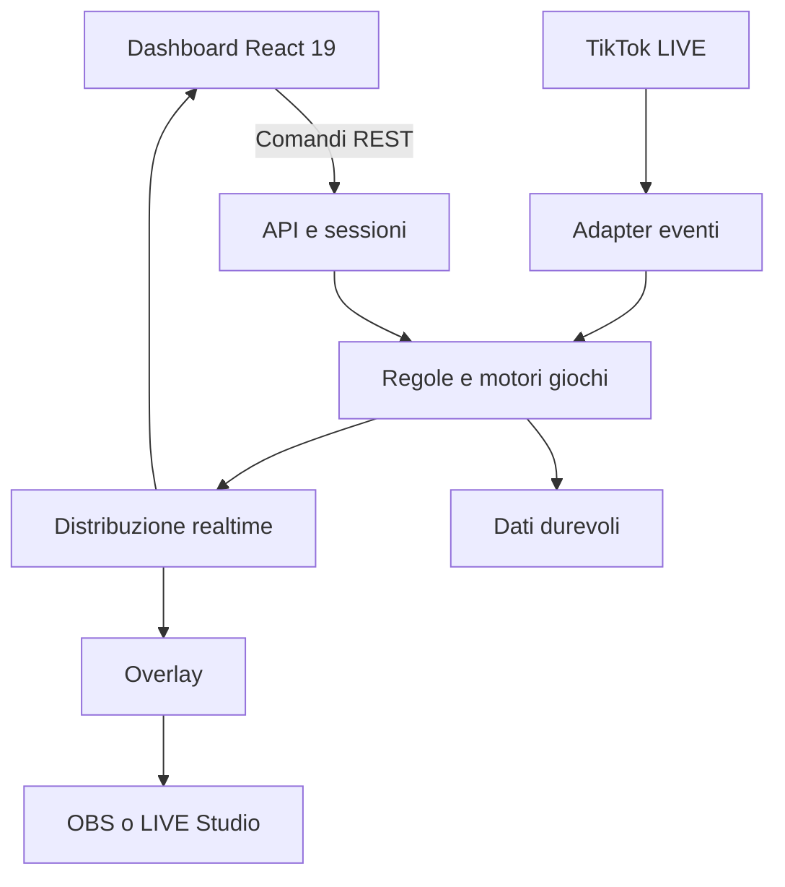

# Zerocade — analisi di Livecade e piano di ricostruzione

> Rilevazione: **23 ottobre 2026**, fuso Europe/Rome. Punto di partenza: <https://app.livecade.io/>. Destinazione progettuale: Zerocade, React 19 stabile. Questo documento contiene l'analisi e il backlog; le caselle non selezionate indicano lavoro di implementazione ancora da svolgere.

## Ingegnerizzazione secondo DIRETTIVE.md — audit del 14 novembre 2026

Aggiornamento infrastrutturale successivo: [rapporto con evidenze e limiti](docs/DIRETTIVE-audit-2026-11-14.md).
Implementati worker di persistenza/report, trasporto browser in worker, limiti/cancellazione, media atomici,
retry ZFB, readiness e correzione EventSub con token utente, follow v2, keepalive e reconnect.
Il backlog storico sotto descrive la situazione precedente; la live Twitch reale, la verifica visuale in OBS,
la separazione dei commit e l'esecuzione CI su GitHub restano gate distinti prima della distribuzione.

Audit del server (`apps/server/src`, circa 6.000 righe) con ricerca di pattern (SQL, `fetch`, timer, `catch`, `JSON.parse`,
chiusura, crescita delle strutture), poi di overlay, dashboard, `scripts/` e strumenti Python dei giochi con le stesse
ricerche. **Non coperti:** `packages/shared` e un'analisi riga per riga di tutto il codice. Baseline iniziale: `typecheck`
pulito, 41 test Node, 13 test Python del database, `npm audit --omit=dev` senza vulnerabilità; dopo i lavori sotto: 50 test Node.

**Fatto** (commit «fix(twitch): EventSub con timeout…»): `twitch-eventsub.ts` con timeout di richiesta e di benvenuto,
controllo dello stato HTTP, segreto fuori dall'URL, sottoscrizioni rifiutate segnalate, WebSocket chiuso in caso di
errore, messaggi malformati ignorati; test in `tests/twitch-eventsub.test.ts`.

**Da fare** (in ordine di priorità; i file indicati avevano modifiche non committate al momento dell'audit):

- [x] **P1 — Spegnimento ordinato** (fatto il 14 novembre 2026): `shutdown.ts` esegue in ordine fonti dal vivo, Socket.IO,
  server e database (checkpoint del WAL), con tempo massimo di 5 s e codice d'uscita 1 se un passo
  fallisce. Collegato a `SIGINT` e `SIGTERM` in `index.ts`; provato con passi finti, con Fastify e Socket.IO veri e con
  la chiusura del database (`tests/shutdown.test.ts`). **Non provato** con un segnale reale sul processo del server:
  su Windows `SIGINT` verso un processo figlio lo termina senza eseguire il gestore, serve Ctrl+C in un terminale.
- [ ] **P1 — EventSub dopo il benvenuto** (`twitch-eventsub.ts`): non gestisce `session_keepalive` scaduto,
  `session_reconnect` né la chiusura del socket a sessione avviata; dopo una caduta follow e raid si fermano senza
  avvisi. Serve un riavvio con attesa crescente e uno stato visibile nella dashboard.
- [ ] **P0 — EventSub non può funzionare con un token d'app** (verificato sulla documentazione di Twitch il
  14 novembre 2026): il trasporto WebSocket accetta **solo un token utente**, un token d'app fa fallire la richiesta, e
  la versione 1 di `channel.follow` è stata rimossa (la 2 chiede lo scope `moderator:read:followers`). Il codice attuale
  usa un token d'app e la versione 1, quindi follow e raid da Twitch non arrivano mai; dopo il fix del 14 novembre se ne
  vede il motivo nella nota di stato. Serve un accesso dell'utente a Twitch (OAuth, per esempio il flusso a codice
  dispositivo) con un'app registrata da Luca, la conservazione sicura del token e il suo rinnovo: **decisione di
  prodotto, non provabile senza un account Twitch vero.** La gestione di `session_keepalive` e `session_reconnect`
  (riga qui sopra) ha senso solo dopo.
- [x] **P2 — Pragma del database** (fatto): aggiunto `busy_timeout = 5000`. `foreign_keys` non serve: nessuna tabella
  dichiara chiavi esterne.
- [x] **P2 — Sessione salvata illeggibile** (fatto): `loadState` registra l'errore e copia la riga originale in
  `sessions_corrupt` prima di ripartire dai valori predefiniti; provato in `tests/shutdown.test.ts`.
- [x] **P2 — Versioning e CI** (fatto): tutti i pacchetti sono alla `0.1.0` (SemVer, definita nel `package.json` radice)
  e `.github/workflows/ci.yml` esegue `npm ci`, `typecheck`, test Node, test Python del database e `npm audit` su
  Windows. **La pipeline non è mai stata eseguita su GitHub**; `npm ci --dry-run` è riuscito. Tag e rilascio restano da fare.
- [x] **P2 — Overlay** (fatto): `content.ts` ritenta il caricamento (3 tentativi, 10 s l'uno) invece di restare vuoto
  per sempre dopo un solo errore; il controllo di aggiornamento ogni 30 s in `main.tsx` ha un timeout.
  Test in `tests/overlay-content.test.ts`. Timer e listener controllati: tutti puliti, tranne quelli a durata dell'app.
- [x] **P2 — Pacchetto Windows** (fatto): `scripts/package-win.mjs` verifica lo SHA-256 di `node.exe` scaricato
  (host non Windows x64) con `SHASUMS256.txt`; la logica è provata sulla release 26.13.1, non il ramo di download.
- [x] **Strumenti Python dei giochi** (controllati): nessun `shell=True`, `eval`, `pickle`, richieste senza timeout né
  `verify=False`. Le query con f-string sono negli strumenti offline di `database/` e interpolano solo nomi di tabella e
  colonna presi dal database stesso, non input esterno.
- [ ] **P2 — `packages/shared` e dashboard in profondità:** non letti riga per riga. Le chiamate `fetch` della dashboard
  non hanno timeout (sono verso il server locale); aggiungerlo se emergono blocchi.

Accesso rapido: [architettura](#3-architettura-funzionale-rilevata) · [rotte](#4-mappa-completa-delle-rotte-applicative-dichiarate) · [frontend](#5-frontend-sistema-visivo-e-composizione) · [roadmap](#23-roadmap-operativa-con-dipendenze) · [API](#25-appendice-a--contratti-rest-del-client) · [eventi](#26-appendice-b--protocollo-socketio-e-iframe) · [tutti i giochi e i campi](#27-appendice-c--catalogo-completo-ricevuto) · [tutti i collegamenti](#28-appendice-d--copertura-dei-collegamenti-e-delle-risorse).

## 1. Risultato, attendibilità e limiti

Livecade è una piattaforma per collegare eventi TikTok LIVE a giochi e strumenti di regia. Il prodotto da ricostruire comprende **pannello del creator, gestione delle sessioni, motore di regole, overlay autonomo, giochi, audio, contenuti personali, statistiche e gestione dell'account**. La somiglianza della sola homepage del pannello non realizza la stessa applicazione.

Legenda delle evidenze:

| Indicazione | Significato |
| --- | --- |
| **UI** | Schermata visualizzata direttamente nel browser durante questa analisi. |
| **HTTP** | Risposta pubblica effettivamente ricevuta e letta. |
| **Client** | Comportamento, contratto o configurazione presente nei JavaScript/CSS pubblicamente distribuiti. Non equivale a un test eseguito sulla funzione. |
| **Doc** | Funzione descritta dalla documentazione ufficiale o dalle sue immagini dimostrative. |
| **Ipotesi** | Deducibile dalle evidenze, ma non verificabile senza codice server o sessione autenticata. |
| **Proposta** | Soluzione da implementare in Zerocade, non affermazione sull'infrastruttura privata di Livecade. |

**Limite concreto:** in questo browser non era presente una sessione Livecade autenticata. Sono stati visualizzati login, registrazione e recupero password; non sono stati creati account, acquistati piani, inviati messaggi, caricati contenuti o connessi account TikTok. `GET /api/user/me` senza cookie ha risposto `401` con richiesta di una sessione valida. Di conseguenza questo è un esame approfondito delle superfici pubbliche, dei contratti del client e della documentazione, **non una verifica end-to-end di ogni stato del pannello autenticato o del backend privato**.

Database, sorgenti del backend, codice dei connettori TikTok, webhook di pagamento, query, job e deployment non sono pubblici. Le rispettive sezioni progettuali sono esplicitamente indicate come proposte. La disponibilità di una rotta nel bundle non prova che il relativo endpoint sia abilitato, che un utente abbia accesso o che un pagamento abbia quel comportamento in produzione.

### Riscontri determinanti

| Riscontro | Evidenza | Implicazione per Zerocade |
| --- | --- | --- |
| Il vendor del dashboard dichiara React **18.3.1**. | Client, [S2] | React 19 è il requisito del nuovo progetto; non va presentato come versione rilevata sul sito originale. |
| Il pannello è una SPA con build Vite, routing client, moduli caricati su richiesta e CSS dedicato. | Client, [S1–S3] | Separare shell, pagine, finestre e moduli; evitare un unico componente monolitico. |
| Il catalogo pubblico restituisce **55 giochi**, con **986 campi** di impostazione. | HTTP, [S4] | Costruire form e controlli sulla base di uno schema. L'appendice censisce ogni campo del catalogo ricevuto. |
| Il sito promozionale pubblicizza **56 giochi**; il loader dell'overlay include anche `marble-race`, assente nel catalogo API ricevuto. | HTTP/Client/Doc, [S4, S7, S9] | Conservare la distinzione tra gioco pubblicizzato, modulo distribuito e gioco disponibile nel catalogo. Non dedurre il motivo dell'assenza. |
| Catalogo: **28 giochi Free e 27 Pro**; rendering **20 CSS, 21 Canvas, 14 WebGL**. | HTTP, [S4] | Tre famiglie di renderer e autorizzazioni per gioco. Sono dati della rilevazione, non costanti da fissare nel codice. |
| Il catalogo regali pubblico contiene **1.299 elementi**. | HTTP, [S6] | Usare ID e valore in coin del catalogo; le sei emoji del prototipo Zerocade non sono un catalogo reale. |
| Il pannello usa REST su `/api` e Socket.IO; l'overlay punta a `https://api.livecade.io`. | Client, [S1, S7] | Distinguere canale di controllo, distribuzione dello stato e rendering pubblico. |
| Audio sintetizzato localmente con moduli Piper e asset ONNX/WASM; sono presenti anche percorsi di audio remoto per le funzioni AI. | Client, [S7, S8] | La voce deve funzionare dentro OBS: la sola API `speechSynthesis` non realizza la parità. |
| L'overlay dispone di editor di posizione, studi di anteprima e messaggi tra iframe e pannello. | Client, [S1, S7] | La preview è una parte interattiva della regia, non un'immagine statica. |

## 2. Fonti e metodo riproducibile

L'analisi combina lettura delle risposte HTTP, esame dei moduli distribuiti, navigazione delle schermate pubbliche, lettura delle guide e confronto con il codice corrente di Zerocade. Non è stato acquisito un HAR autenticato e non sono stati chiamati endpoint amministrativi.

| ID | Fonte primaria |
| --- | --- |
| S1 | [Entrypoint del dashboard](https://app.livecade.io/) e [bundle principale rilevato](https://app.livecade.io/assets/index-DglY74O_.js). |
| S2 | [Vendor React del dashboard](https://app.livecade.io/assets/react-vendor-D41pDFYO.js). |
| S3 | [CSS principale del dashboard](https://app.livecade.io/assets/index-BmpS6zWg.css). |
| S4 | [Catalogo pubblico giochi](https://app.livecade.io/api/games). |
| S5 | [Catalogo pubblico piani](https://app.livecade.io/api/plans). |
| S6 | [Catalogo pubblico regali](https://app.livecade.io/api/gifts?catalogOnly=1). |
| S7 | [Entrypoint overlay](https://overlay.livecade.io/) e [bundle principale rilevato](https://overlay.livecade.io/assets/index-BsivbmZg.js). |
| S8 | [Modulo Piper distribuito con il dashboard](https://app.livecade.io/assets/piperTts-C6ukG0r9.js). |
| S9 | [Sito pubblico](https://livecade.io/), [catalogo giochi](https://livecade.io/games/), [sitemap](https://livecade.io/sitemap.xml). |
| S10 | [Documentazione](https://livecade.io/docs/), [indice testuale](https://livecade.io/llms.txt), [guide aggregate](https://livecade.io/llms-full.txt). |
| S11 | [Indice funzionalità](https://livecade.io/features/). |
| S12 | [Versioni giochi pubblicate](https://api.livecade.io/api/version). |
| S13 | [Versioni React](https://react.dev/versions) e [canale stabile](https://react.dev/community/versioning-policy). |
| S14 | [Repository Zerocade](https://github.com/lucatortiglione/Zerocade), ramo `main` letto durante questa analisi. |

I nomi con hash identificano la build osservata e cambieranno a un nuovo rilascio. Per ripetere l'analisi partire dall'HTML corrente, quindi seguire i suoi import effettivi. Un `200` su una rotta SPA non dimostra che la pagina richiesta sia autorizzata: può essere semplicemente la shell HTML.

La sitemap rilevata elenca **1.412 URL**: 64 nell'area giochi, 17 nella documentazione, 10 nell'area funzionalità, 1.301 nell'area regali e 20 nelle altre aree. Il grande numero di pagine regalo deriva da schede generate da un unico modello, non da altrettante funzioni del pannello. L'appendice collegamenti distingue le destinazioni effettivamente lette da quelle inventariate come istanze di un modello o riferimenti esterni.

## 3. Architettura funzionale rilevata

| Superficie | Ruolo e riscontri |
| --- | --- |
| `livecade.io` | Sito pubblico con catalogo, schede giochi, funzionalità, guide, prezzi, changelog, pagine legali e dizionario dei regali. HTML prerenderizzato; attributi Astro osservabili. |
| `app.livecade.io` | Account, onboarding, regia, impostazioni, gestione dati/media, cronologia, statistiche e fatturazione. SPA React con richieste autenticate tramite cookie. |
| `app.livecade.io/api/*` | API utilizzata dal dashboard; alcuni cataloghi sono pubblici, altre risorse richiedono sessione. |
| `overlay.livecade.io` | Rendering da inserire in OBS/Live Studio. Carica il renderer del gioco corrente e gli strati comuni. |
| `api.livecade.io` | Destinazione Socket.IO e controllo versione dell'overlay osservata nel client. La topologia privata dietro questo host è ignota. |
| `cdn.livecade.io` | Immagini dei regali e altri media referenziati dal client. Non prova quale servizio storage o CDN sia sottostante. |
| `/__overlay/` sul dashboard | Percorso utilizzato per incorporare l'overlay e i suoi editor in iframe dello stesso sito. Il meccanismo server/proxy non è visibile. |

Il dashboard crea e governa la sessione; l'overlay riceve stato, configurazioni, effetti, audio e aggiornamenti. Nei renderer esaminati, tra cui Word Swipe, Trivia Time, Context e Blob Battle, il componente riceve `gameState`; punteggi, fasi, eventi risolti e scadenze sono forniti nello stato. Questo è un forte indizio di autorità server per quelle informazioni; non consente di ricostruire l'intero motore privato.

Il cambio gioco mantiene la stessa destinazione dell'overlay. Le opzioni di pausa del gioco, arresto del simulatore, disconnessione TikTok e chiusura della sessione sono operazioni distinte. La replica deve preservare questa separazione.

## 4. Mappa completa delle rotte applicative dichiarate

**Client**, [S1, S7]. Le rotte protette sono state ricavate dal router, non visitate come utente autenticato.

| Rotta o famiglia | Funzione / comportamento |
| --- | --- |
| `/login` | Accesso email/password, Google, Discord. |
| `/register` | Nome visualizzato, email, password, consensi e accesso social. |
| `/forgot-password` | Richiesta del link di recupero. |
| `/reset-password` | Nuova password con token ricevuto esternamente; nessun token è stato utilizzato. |
| `/onboarding` | Introduzione e raccolta delle prime informazioni; guard basata sul completamento. |
| `/` | Dashboard di regia, anche quando non esiste una sessione. |
| `/dashboard` | Redirect verso `/`. |
| `/history` | Cronologia in finestra sovrapposta alla regia. |
| `/analytics` | Redirect verso `/analytics/overview`. |
| `/analytics/overview` | Riepilogo e andamento. |
| `/analytics/games` | Confronto giochi. |
| `/analytics/audience` | Pubblico, sostenitori e regali. |
| `/analytics/runs` | Elenco delle live. |
| `/affiliate` | Redirect verso `/affiliate/overview`. |
| `/affiliate/overview` | Link referral e riepilogo programma. |
| `/affiliate/earnings` | Commissioni. |
| `/affiliate/payouts` | Riscossioni. |
| `/settings` | Redirect verso `/settings/profile`. |
| `/settings/profile` | Profilo, password, identità collegate, eliminazione account. |
| `/settings/tiktok` | Elenco degli username TikTok, account predefinito. |
| `/settings/watermark` | Posizione e visibilità del marchio. |
| `/settings/djpad` | Libreria dei suoni e relativi trigger. |
| `/settings/stream` | Voce, lettore commenti, moderazione e shoutout. |
| `/settings/alerts` | Avvisi e traguardi. |
| `/settings/effects` | Cinque famiglie di effetti. |
| `/settings/ai` | Chiavi provider, stato, controlli e utilizzo. |
| `/settings/billing` | Piano, pagamenti e storico. |
| `/settings/giftfx` | Compatibilità nel client: il vecchio tab viene ricondotto a `effects`. |
| `/game-data/:gameId` | Banca contenuti per gioco e lingua. |
| `/game-assets/:gameId` | Sostituzione delle risorse negli slot previsti dal gioco. |
| `/billing/success` | Ritorno dal pagamento; visualizzazione e aggiornamento del piano da verificare in account. |
| `/admin` | Redirect verso l'area di riepilogo amministrativa. |
| `/admin/:tab`, `/admin/:tab/:section` | Shell amministrativa distribuita come modulo separato; non è stata aperta o interrogata. |
| `*` | Fallback dichiarato verso `/`. |
| `https://overlay.livecade.io/:identificativo` | Formato di destinazione usato dal client per l'overlay. L'identificativo effettivo dell'utente non è stato acquisito. |
| `/__overlay/?userId=…&edit=1` | Preview incorporata con editing. Il parametro è una parte del contratto rilevato, non un'autorizzazione a leggere overlay altrui. |
| `/__overlay/?studio=…` | Anteprime degli editor: almeno alert, effetti e classifica sono riconoscibili nei moduli distribuiti. |

### Link profondi e stato della navigazione

- `?game=<id>` seleziona/avvia il flusso del gioco dal catalogo promozionale; il client consuma poi il parametro.
- `?upgrade=PRO&period=yearly` apre il percorso di upgrade; il periodo ha anche la variante mensile.
- `?feedback=<id>` richiama una conversazione di assistenza nell'app.
- `utm_source`, `utm_medium`, `utm_campaign` sono usati per attribuzione.
- Le finestre di impostazioni, cronologia, analytics e affiliazione usano la posizione precedente come sfondo del router. Devono funzionare sia con click dal pannello sia aprendo direttamente l'URL.
- Il popup dei crediti AI è un'interfaccia globale; non è stata identificata una pagina autonoma equivalente nel router principale.

**TODO navigazione:** [ ] Riprodurre le rotte funzionali; [ ] mantenere il dashboard montato dietro le finestre; [ ] gestire Back, Escape, focus e ripristino della posizione; [ ] provare gli URL diretti e il refresh su ogni famiglia.

## 5. Frontend: sistema visivo e composizione

### 5.1 Token e misure osservati

**Client**, [S1, S3]. Le seguenti sono proprietà del CSS distribuito, non misure stimate a occhio.

| Elemento | Valore rilevato |
| --- | --- |
| Sfondo base / superficie / elevata / overlay | `#0a0a0c` / `#111114` / `#18181c` / `#1e1e23` |
| Bordo / bordo attivo | `#252529` / `#3a3a42` |
| Testo principale / secondario / attenuato | `#f0f0f2` / `#8a8a96` / `#52525e` |
| Accento / hover | `#CC4419` / `#D95020` |
| Verde / ambra / rosso | `#22c55e` / `#f59e0b` / `#f87171` |
| Famiglia caratteri | Switzer con fallback di sistema; font locali WOFF2 precaricati. |
| Scala radici | `clamp(13px, 1vw, 16px)` |
| Raggi generici | 6, 8, 10, 12 px; card di autenticazione 14 px. |
| Autenticazione | Contenitore massimo 380 px; card con padding 32 × 28 px. |
| Barre dei pannelli | Altezza 48 px; footer sinistro 38 px. |
| Pannello sinistro desktop | Intervallo 270–400 px; valore iniziale 400 px. |
| Pannello destro desktop | Intervallo 270–420 px; valore iniziale 420 px. |
| Pannello sinistro chiuso | 58 px. |
| Desktop | Griglia `sinistra / spazio centrale flessibile / destra`. |
| Mobile principale | A 768 px e sotto, una superficie alla volta e barra inferiore Controls / Game / Pad. |
| Overlay logico | 1080 × 1920; posizione degli elementi espressa rispetto a questo spazio. |

Usare un marchio Zerocade e risorse originali. La ricostruzione funzionale non richiede di incorporare loghi, personaggi, musica, font o pacchetti grafici di Livecade. Verificare i diritti delle risorse effettivamente selezionate per il progetto.

### 5.2 Shell desktop

**Client + Doc**, [S1, S3, S11]. Le immagini ufficiali di simulatore e alert confermano la composizione generale; possono rappresentare una build precedente a quella del bundle rilevato.

| Zona | Componenti e responsabilità |
| --- | --- |
| Sinistra, testata | Logo, notifiche, profilo/menu, comando di riduzione del pannello. |
| Sinistra, connessione | Account TikTok, gioco/sessione, stato, collegamento TikTok e controlli di esecuzione. |
| Sinistra, sessione attiva | Statistiche live, simulatore, controlli specifici del gioco, Game Info, impostazioni, trigger. |
| Sinistra, strumenti | Interruttori rapidi per lettore commenti, alert ed effetti; accesso alle impostazioni complete. |
| Sinistra, sessione assente | Selettore/catalogo, riepilogo ultima live, suggerimenti e onboarding contestuale. |
| Sinistra, piede | Guide, documentazione, segnalazione problema; barra AI quando pertinente. |
| Centro, testata | Gioco corrente, cambio gioco, widget, copia/apertura URL overlay, tempo disponibile e upgrade. |
| Centro, corpo | Catalogo senza sessione; preview verticale durante la sessione. Scacchiera per la trasparenza, controlli di espansione/focus e gestione elementi. |
| Destra, parte alta | Tab suoni/GIF/musica, pad, ricerca, stop e mixer. Musica abilitata solo per i giochi che la supportano. |
| Destra, parte bassa | Feed commenti ed eventi, sostenitori live/classifica, azioni contestuali sui viewer. |
| Globale | Notifiche, messaggi di errore, avvisi di riconnessione/inattività, onboarding, disponibilità di aggiornamenti overlay. |

Il client conserva localmente larghezze dei pannelli, pannello mobile selezionato, chiusura del pannello sinistro, visibilità Game Info, vista dei gifters, sezioni del feed e modalità del pad. Preferenze di layout locali e dati dell'account salvati sul server hanno responsabilità diverse.

**TODO frontend:**

- [ ] Creare token CSS e primitive: pulsante, campo, slider, toggle, select ricercabile, tooltip, finestra, toast, badge e pannello comprimibile.
- [ ] Realizzare griglia ridimensionabile con gli intervalli indicati e persistenza locale.
- [ ] Gestire placeholder, caricamento, vuoto, errore, contenuto bloccato dal piano e riconnessione in ogni pannello.
- [ ] Rendere i menu utilizzabili da tastiera; associare etichette ai campi; gestire focus e lettori di schermo.
- [ ] Supportare `prefers-reduced-motion`, area sicura mobile, touch, dimensioni dinamiche del viewport e contenuto RTL dove previsto.
- [ ] Verificare 3440×1440, 1920×1080, 1366×768 e una larghezza mobile di circa 390 px. La prima risoluzione è particolarmente rilevante per la tua regia.

## 6. Account e onboarding

### 6.1 Schermate effettivamente viste

**UI**, [S1]. Login: email, password, mostra/nascondi, Remember me inizialmente selezionato, recupero password, accesso Google/Discord e link di registrazione. Registrazione: nome visualizzato, email, password con indicazione di almeno otto caratteri, consenso a termini/privacy, pulsante inizialmente disabilitato, opzioni social. Recupero: email, invio del link e ritorno al login. Nessun modulo è stato inviato.

### 6.2 Funzioni presenti nel client

- Client di autenticazione riconoscibile come Better Auth, con percorso base `/api/auth`. È una prova della libreria client, non del database, dell'adapter o della versione server.
- Supporto a verifica Turnstile nel codice di autenticazione; non è stato eseguito alcun challenge.
- Profilo: nome, email di sola lettura nella UI distribuita, scelta di comparire sul sito, password e identità collegate. Eliminazione account esplicitamente distruttiva.
- Guard di sessione e guard di onboarding separate; percorsi per account sospeso e messaggi con eventuale scadenza.
- Primo utilizzo guidato con selezione gioco, prova del simulatore, aggiunta overlay e prima live; completamenti persistenti tramite API.
- Aggiunta username TikTok, normalizzazione e account predefinito; la gestione di username non va confusa con un'autorizzazione OAuth TikTok verificata.

**TODO:** [ ] implementare autenticazione con sessioni server, recupero e provider selezionati; [ ] cookie sicuri e scadenze; [ ] controllo ruoli lato server; [ ] onboarding riprendibile e saltabilità dove prevista; [ ] gestione collegamenti social e cancellazione con verifica esplicita; [ ] rate limit per i percorsi di autenticazione.

## 7. Sessione, TikTok e simulatore

**Client/Doc**, [S1], [avvio sessione](https://livecade.io/docs/connect-to-live/), [connessione](https://livecade.io/docs/connection-issues/), [simulatore](https://livecade.io/features/test-tiktok-live-game/).

| Livello di stato | Stati / dati osservabili | Comportamento da realizzare |
| --- | --- | --- |
| Sessione applicativa | Le stringhe `WAITING`, `LIVE`, `ENDED` compaiono nei client. | Esistenza della sessione, gioco scelto e chiusura sono indipendenti dalla connessione TikTok. L'enumerazione completa del server resta da verificare. |
| Connessione del dashboard | Connesso, riconnessione, errore. | Ricollegare la regia e risottoscrivere la sessione. |
| Connessione TikTok | Pronto, collegamento, live, account non in live, riconnessione, quota terminata, fallimento. | Messaggi e azioni coerenti con la causa. I testi UI non sono tutti nomi dell'enum server. |
| Esecuzione gioco | Attivo, in pausa, riavvio e cambio gioco. | Pausa conserva il round; riavvio lo ricrea; cambio gioco mantiene il canale dell'overlay. |
| Simulatore | Avviato/arrestato e intensità `calm`, `chill`, `active`, `hyped`. | Eventi sintetici adattati alle azioni effettivamente configurate. |
| Presenza e inattività | Heartbeat e avviso con conto alla rovescia. | Permettere di tenere attiva la sessione e chiudere sessioni abbandonate secondo regole server. La durata esatta non è dimostrata. |

Flusso rilevato: scegliere account e gioco → creare/aprire sessione → mostrare il gioco sull'overlay → collegarsi alla live TikTok già attiva → ricevere eventi. È possibile provare prima il simulatore. A fine diretta la chiusura esplicita termina la sessione.

Il client ricostruisce una sessione non terminata al caricamento, richiede lo stato del gioco, si unisce al canale del dashboard e ripristina feed, sostenitori e informazioni del creator. Non affidare quindi il corretto funzionamento esclusivamente allo stato React della tab aperta.

### Normalizzazione degli eventi — proposta Zerocade

Il backend deve trasformare gli eventi del provider in uno schema stabile: `eventId`, origine reale/simulata/test, sessione, timestamp server, viewer stabile, username/nickname/avatar, tipo, contenuto del commento e dati del regalo. Per i regali distinguere quantità, valore unitario, ripetizioni cumulative e fine della serie.

**TODO backend:**

- [ ] Creare un adapter TikTok separato dal motore giochi; la libreria o il servizio usato da Livecade non è identificabile dal frontend.
- [ ] Aggiungere `comment` e `join` ai quattro eventi già modellati nel prototipo.
- [ ] Deduplicare per ID stabile e serie del regalo, non per nickname o testo del messaggio.
- [ ] Usare il delta delle ripetizioni cumulative per evitare coin e azioni conteggiati più volte; verificare il comportamento con registrazioni del provider selezionato.
- [ ] Separare eventi reali, simulati e manuali a livello di persistenza e aggregazione.
- [ ] Imporre limiti e isolamento per sessione/account; rendere idempotenti i comandi che possono essere ripetuti dalla rete.
- [ ] Ripristinare stato e presenza dopo refresh, nuova finestra e riconnessione.
- [ ] Gestire account non in live, limiti di piano, errori temporanei, fine live e inattività con stati espliciti.

## 8. Motore di trigger e controlli manuali

**Client/HTTP**, [S1, S4]. Un gioco espone `bindableActions`, `testActions`, `defaultActionBindings` e relativi parametri. La regola è configurabile dal creator: evento di ingresso → condizioni → azione → quantità/parametri.

| Trigger | Campi rilevati nel client |
| --- | --- |
| Commento | Parole chiave; alcuni giochi elaborano anche direttamente le risposte nel loro motore. |
| Regalo | `giftId` specifico oppure qualsiasi regalo; quantità minima `giftCount` o soglia `minGiftAmount`. |
| Like | Soglia `likeThreshold`. |
| Follow, share, join | Associazione a un'azione e conteggio di esecuzione. |
| Azione | `actionId`, `params`, `enabled` e, quando pertinente, `executeCount`. |

Le azioni di test e quelle del creator non sono necessariamente le stesse azioni associabili ai viewer. Alcuni giochi espongono ricerca di un partecipante, scelta di un bersaglio, testo inviato all'host o controlli da tastiera/mouse. Il client contiene anche il filtro `whoCanPlay` con `everyone`, `followers`, `fansclub` per i giochi che lo dichiarano.

Il comportamento di conflitto tra regole sovrapposte non è dimostrato dai soli form. Non assumere che una regola specifica escluda automaticamente quella generica. Definire e testare nel nuovo motore una precedenza documentata.

**TODO:** [ ] editor guidato dalle azioni del gioco; [ ] catalogo regali ricercabile con immagine e coin; [ ] validazione server identica o più restrittiva di quella UI; [ ] tasto di prova con origine test; [ ] contatori per soglie e cooldown; [ ] policy esplicita per regole multiple; [ ] controlli del creator riservati alla regia; [ ] reset separato di impostazioni, trigger e HUD.

## 9. Form generati da schema e impostazioni

**HTTP/Client**, [S1, S4]. Il catalogo ricevuto contiene 18 tipi di campo:

| Tipi | Controllo da implementare |
| --- | --- |
| `select`, `segment` | Selezione singola; segmenti anche con miniature. |
| `number`, `slider` | Numero vincolato da minimo, massimo e passo. |
| `toggle` | Booleano, anche dipendente dal piano. |
| `color` | Colore; trasparenza quando consentita. |
| `media`, `media-list` | Risorsa singola o lista, con tipi accettati e limiti. |
| `text`, `textarea`, `string-list` | Testo, multilinea, elenco di stringhe. |
| `country` | Selettore paese. |
| `trivia-categories`, `content-categories` | Selezione categorie legata a gioco/lingua. |
| `ladder-difficulty` | Difficoltà per livello della scala di Million Quiz. |
| `voice` | Scelta voce, eventuale ricerca e anteprima. |
| `info-link` | Navigazione a banca contenuti, asset, impostazioni o documentazione. |
| `note` | Nota informativa; non va trattata come dato di gioco modificabile. |

Metadati ulteriori: `default`, `proDefault`, `pro`, `fixed`, `group`, `showIf`, `hintShowIf`, `requiresRestart`, `languageKey`, `categoriesKey`, `accept`, `maxLength`, `maxItems`, `purpose`, collegamenti e informazioni sull'uso AI. Sono presenti condizioni `showIf` singole e in lista: il renderer distribuito usa **OR** tra le condizioni della lista e controlla ricorsivamente anche la visibilità del campo dipendente, con un limite di ricorsione. I campi `fixed` ricevono il valore risolto dal piano e non vengono mostrati come normali campi modificabili.

Il salvataggio persistente usa `/settings/:gameId`; l'applicazione a una sessione aperta usa anche `/sessions/:id/game/settings`. La UI distingue quindi configurazione per le prossime sessioni e aggiornamento della sessione in corso. I campi con `requiresRestart` devono avvisare del riavvio richiesto.

**TODO:** [ ] implementare tutti i tipi; [ ] risolvere i default in base al piano; [ ] impedire la modifica dei campi fissi; [ ] validare visibilità e dipendenze; [ ] applicare aggiornamenti atomici/versionati; [ ] mostrare salvataggio/errore; [ ] riaprire le impostazioni conservando la lingua selezionata; [ ] non cancellare dati personali quando si ripristinano i soli parametri del gioco.

## 10. Overlay, preview, HUD e widget

**Client**, [S1, S7]. L'overlay riceve almeno gioco e stato, regole, configurazione e posizione HUD, stato della sessione, watermark, funzionalità stream e widget nascosti. La shell carica il renderer del gioco su richiesta e conserva gli strati comuni.

### 10.1 Livelli di rendering

1. Sfondo del gioco, eventualmente trasparente o personalizzato.
2. Renderer specifico: DOM/CSS, Canvas 2D o scena WebGL.
3. HUD dei trigger con icone dei regali, soglie, moltiplicatori, etichette e posizione.
4. Widget, classifiche e informazioni persistenti.
5. Alert, effetti regalo/like/follow/share, GIF e shoutout temporanei.
6. Watermark e messaggi di indisponibilità/stato.

L'ordine finale e i livelli sovrapposti vanno controllati visivamente: l'elenco descrive responsabilità, non tutti gli `z-index` originali.

### 10.2 Editor e anteprime

La preview nel dashboard usa iframe con editing; sono riconoscibili messaggi per spostamento HUD, inventario degli elementi, selezione, anteprima classifica e azioni del dock dell'host. Sono distribuiti studi separati per alert, effetti e scoreboard. Gli editor inviano stato di esempio e ricevono conferma di prontezza.

**TODO:** [ ] preview con lo stesso renderer della sorgente OBS; [ ] trasformazione coordinate schermo ↔ 1080×1920; [ ] trascinamento e ridimensionamento con limiti; [ ] salvataggio per gioco; [ ] controllo rigoroso di origine e finestra mittente per `postMessage`; [ ] esempi locali distinti dai test effettivamente inviati alla live.

### 10.3 Widget rilevati

**Doc**, [widget](https://livecade.io/features/tiktok-live-goals/): obiettivi follower/like/coin/share, timer, Top Gifters, Top Likers, gift jar, ultimo follower, testo e media. Posizione e dimensioni dipendono dal gioco; il widget media è un extra Pro. Gli obiettivi hanno più stili; classifiche configurabili e timer estendibile dai regali.

**TODO:** [ ] definire un registry di widget con `instanceId`, tipo, impostazioni, posizione e visibilità; [ ] usare contatori server condivisi; [ ] aggiungere editor di posizione e vista campione; [ ] timer server con pausa, estensione e limite massimo; [ ] ripristinare gli stessi valori dopo reconnect.

### 10.4 URL, presenza, aggiornamenti

Il client usa un identificativo nell'URL/parametro per indirizzare l'overlay e comunica la presenza dell'overlay alla regia. Sono presenti notifiche di versione vecchia e disponibilità di aggiornamento gioco, oltre al controllo `/api/version`.

**Proposta Zerocade:** usare credenziali di lettura overlay dedicate e revocabili, separate dalla sessione del dashboard. Non dedurre dalla struttura pubblica di un URL quali siano i controlli di autorizzazione reali di Livecade. Versionare snapshot ed eventi, mantenere compatibilità durante i rilasci e prevedere snapshot completo quando si perde una sequenza.

## 11. Audio, TTS, DJ Pad, GIF e musica

### 11.1 Sintesi vocale

**Client/Doc**, [S8], [lettore commenti](https://livecade.io/features/tiktok-comment-reader/). Sono presenti voci Piper e modelli locali; il prodotto documenta 16 voci in 11 lingue, italiano incluso. Il lettore privilegia commenti recenti sotto carico, applica una lunghezza massima e filtri lessicali. Le funzioni AI possono invece riprodurre audio ottenuto da provider remoti. Non confondere la voce del lettore con tutte le voci dei giochi AI.

**TODO:** [ ] worker per la sintesi e caching controllato dei modelli; [ ] coda con scadenza e priorità; [ ] arresto corretto di riproduzione e risorse; [ ] parola vietata/limite lunghezza prima della sintesi; [ ] voce italiana; [ ] prove in Chromium/OBS; [ ] gestione audio bloccato dal browser e feedback di sblocco; [ ] evitare doppio audio tra preview e overlay di trasmissione.

### 11.2 Mixer

**Client**, [S1]. Valori iniziali distribuiti: master `1`, pad `0.6`, effetti del gioco `0.65`, musica del gioco `0.35`, TTS `0.7`, alert `0.7`, effetti regalo `0.8`, mute globale disattivo. Sono default del client, non livelli letti da un account.

**TODO:** [ ] bus audio separati, master e mute che conserva i livelli; [ ] propagazione live del mixer; [ ] interruzioni/pause senza perdite di nodi audio; [ ] monitoraggio del ritardo TTS; [ ] sincronizzazione musica e anteprime senza playback duplicato.

### 11.3 DJ Pad e GIF

**Client/Doc**, [libreria](https://app.livecade.io/assets/DjPadLibrary-3U91bBXq.js), [soundboard](https://livecade.io/features/tiktok-live-soundboard/). Il pad permette ricerca in libreria, caricamento file, import da URL, nome/colore, ordine, numero di pad visibili e trigger. Il modulo indica MP3/OGG/WAV e un massimo di 5 MB per suono. Le GIF sono cercate e lanciate manualmente; il client mantiene recenti. Provider e disponibilità dei cataloghi non vanno dedotti da una sola immagine dimostrativa.

**TODO:** [ ] upload e registrazione metadati; [ ] anteprima locale; [ ] gestione stop; [ ] regole automatiche; [ ] drag per ordinamento; [ ] ricerca paginata e cancellazione richieste obsolete; [ ] limite 12 suoni nel piano Free se si replica quel modello; [ ] GIF Pro con dimensioni/durata e stop.

### 11.4 Musica

**Client**, [S1, S4]. Esistono ricerca, playlist, brani personali, richiesta upload e comandi per la riproduzione. La UI dipende da `supportsMusic`. Lo stato contiene playlist, indice, timestamp di avvio e pausa; il tempo di riproduzione può essere ricostruito.

**TODO:** [ ] usare un clock coerente; [ ] sincronizzare avvio/pausa/cambio; [ ] pre-caricare il brano successivo; [ ] gestire file mancanti e durate; [ ] offrire materiale utilizzabile nel progetto e caricamenti dell'utente.

## 12. Alert, effetti e shoutout

### 12.1 Alert

**Client/Doc**, [modulo](https://app.livecade.io/assets/AlertsSettings-_u0EeUj3.js), [pagina funzionale](https://livecade.io/features/tiktok-live-alerts/). Tab Gift, Follow, Share, Join, Likes e Milestones. Aspetti Sticker, Clear, Burst, Bubble e sola voce; colore, dimensione, testo, posizione, lettura e suono. Le variazioni regalo possono dipendere da ID o soglia; il prodotto documenta fino a 30 variazioni. I like sono aggregati per burst e cooldown; i join possono essere limitati a una volta per viewer. Le soglie dei traguardi usano totali di stream.

**TODO:** [ ] coda per posizione per evitare sovrapposizioni illeggibili; [ ] template con variabili validate; [ ] limiti e cooldown server; [ ] un solo traguardo per attraversamento di soglia; [ ] campione locale e test live separati; [ ] supporto media Pro dove previsto.

### 12.2 Effetti

**Client/Doc**, [effetti](https://livecade.io/features/tiktok-gift-effects/). Cinque famiglie: animazioni dedicate a determinati regali, fontana di like, fuoco d'artificio regalo, aeroplani per share e palloncini per follow. I moduli gestiscono dimensioni, suono, quantità/soglie e scelte specifiche per effetto. È presente un fallback della preview quando il browser non riproduce video con alpha.

**TODO:** [ ] renderer indipendenti e risorse originali; [ ] aggregazione degli eventi ravvicinati; [ ] limite massimo di effetti/particelle attivi; [ ] fallback senza alpha; [ ] controllo per singolo regalo; [ ] preview e test; [ ] non bloccare il gioco durante il caricamento dell'effetto.

### 12.3 Shoutout

**Client**, [S1]. Messaggio per viewer o testo libero, durata e lettura facoltativa. Esistono template distinti con/senza destinatario e un comando Socket.IO dedicato.

**TODO:** [ ] menu viewer → shoutout; [ ] invio di testo libero; [ ] filtri comuni al TTS; [ ] durata limitata e rimozione deterministica.

## 13. Game Data: banche di parole, domande e testi

**Client/Doc**, [S1], [gestione contenuti](https://livecade.io/docs/edit-your-game-content/). Lo stesso modello di gestione è usato da più giochi; le colonne dipendono dal gioco. La pagina funzionalità meno aggiornata cita solo quattro giochi, mentre la guida corrente ne elenca quattordici: non usarla come elenco definitivo. L'elenco abilitato deve provenire dal contratto `content/games` autenticato, ancora da verificare.

### Comportamento da riprodurre

- Banca condivisa di piattaforma e contenuti personali per utente/gioco/lingua.
- Aggiunta, modifica, attivazione/disattivazione, nascondi/ripristina, override di un elemento incorporato e rimozione dell'override.
- Ricerca, categoria, difficoltà, origine, visibilità, ordinamento e paginazione.
- Export CSV/JSON; import in due fasi, scansione e applicazione, con riepilogo delle variazioni.
- Identità degli elementi incorporati conservata con `ref`; nuovi elementi con riferimento vuoto; lingua obbligatoria.
- Rigetti di riga spiegati e protezione da cancellazioni dovute a file malformati.

La guida specifica file fino a 16 MB e 20.000 righe. Il catalogo piani distingue quota dei contenuti personali e diritto di importazione. Non è stato eseguito un export/import autenticato né verificato il formato esatto di ogni banca.

**Proposta di implementazione:** mantenere contenuto originale, override e visibilità in strutture separate; ricomporre il contenuto effettivo senza duplicare tutta la banca per ogni creator. La scansione produce un piano associato a file, versione corrente e checksum; l'applicazione rifiuta dati modificati nel frattempo. Questa garanzia transazionale è proposta per Zerocade, non verificata nel backend originale.

**TODO:** [ ] schema per ogni banca; [ ] identità stabile e normalizzazione; [ ] editor specifico delle colonne; [ ] filtri e operazioni multiple; [ ] report della scansione; [ ] conferma mirata per import che nasconde molti elementi; [ ] round trip senza modifiche = zero variazioni; [ ] CSV UTF-8 con accenti; [ ] neutralizzazione delle formule pericolose negli export destinati a fogli di calcolo.

## 14. Game Assets, file e Clip Machine

**HTTP/Client**, [S1, S4]. I giochi possono dichiarare `assetSlots`. L'utente vede gli slot supportati e sostituisce o ripristina una risorsa. È distinto dall'aggiunta di contenuti testuali e dalla libreria del pad.

Il client espone richiesta di upload, registrazione media, import da URL, elenco per tipo, associazione a slot e rimozione. L'esistenza di una fase `upload/request` suggerisce un caricamento dei byte separato dalla registrazione, ma il provider storage e il formato della risposta non sono stati verificati.

**TODO:** [ ] validazione reale di MIME, dimensione, durata e risorsa decodificata; [ ] storage e CDN scelti per Zerocade; [ ] pulizia upload abbandonati; [ ] proprietà dei media e controllo accessi; [ ] riferimenti condivisi prima di eliminare un file; [ ] import URL con protezione da SSRF e limiti di download; [ ] generazione di metadati/anteprime in job dedicati.

**Doc**, [Clip Machine](https://livecade.io/docs/clip-machine/): video di attesa e clip di reazione hanno ruoli e limiti differenti; attesa fino a 60 s/25 MB, reazione fino a 15 s/12 MB. Sono documentati fino a 30 trigger e fino a quattro video per riga, con selezione casuale senza ripetizione immediata o sequenziale. Il file deve tornare al loop quando la reazione finisce; prevedere `contain`/`cover`.

**TODO Clip Machine:** [ ] coda e interruzioni esplicite; [ ] pre-caricamento delle clip; [ ] errore di decodifica senza schermo bloccato; [ ] varianti per trigger; [ ] gestione del loop di attesa; [ ] limiti Free/Pro dal server; [ ] utilizzare un proprio pacchetto audiovisivo.

## 15. Classifiche e punteggi

**HTTP/Client**, [S1, S4]. Alcuni giochi dichiarano `savesScores`; esistono impostazioni scoreboard per gioco, lettura dei punteggi per periodo, ricerca, paginazione e comandi mostra/nascondi sull'overlay. La classifica nel gioco, i sostenitori che inviano regali e i punteggi persistenti sono tre dati differenti.

**TODO:** [ ] motore di scoring server; [ ] classifica del round e della partita; [ ] punteggi persistenti solo per i giochi che lo prevedono; [ ] periodi e fusi documentati; [ ] ordinamento stabile nei pareggi; [ ] snapshot dei vincitori; [ ] durata/posizione della schermata classifica; [ ] conservazione coerente dopo reconnect.

La formula completa del bonus velocità non è ricostruibile dal catalogo di Trivia Time o dal suo renderer. È verificata l'opzione `speedBonus`, non l'equazione privata. Per Zerocade specificare formula, precisione e limiti prima di scrivere il codice. Il supporto a punteggi frazionati può essere un requisito del nuovo progetto; non attribuirlo automaticamente a tutti i giochi Livecade.

## 16. Cronologia e analytics

**Client/Doc**, [S1], [analytics](https://livecade.io/features/tiktok-live-analytics/). Tab Overview, Games, Audience, Lives. Periodi rapidi 7/30/90 giorni e completo, intervallo personalizzato, filtri per gioco/account. Gli endpoint sono separati per riepilogo, serie temporali, giochi, account, sostenitori, regali e sessioni. Le richieste supportano cancellazione quando il filtro cambia.

Metriche: durata, commenti/eventi, viewer, regali, coin, like e follower nelle superfici pertinenti; dettaglio e granularità delle metriche devono essere confermati con risposte autenticate. Sono documentati confronto con periodo precedente, coin/ora, sostenitori aggregati ed export CSV. Le statistiche dichiarano l'esclusione delle prove e del simulatore.

**TODO:** [ ] salvare eventi reali con origine immutabile; [ ] registrare intervalli di gioco dentro una live con cambi gioco; [ ] calcolare durata e coin/ora senza divisione per zero; [ ] definire viewer unici rispetto a viewer concorrenti; [ ] aggregazioni per intervalli coerenti; [ ] confronto con periodo precedente di pari durata; [ ] paginazione con cursore; [ ] export con gli stessi filtri della vista; [ ] verifica esplicita che prove e simulatore non modifichino metriche reali.

## 17. Piani, quote e pagamenti

**HTTP**, [S5]. Le cifre monetarie restituite sono interi in centesimi; il client di fatturazione gestisce anche il codice valuta della transazione. I seguenti sono i valori ricevuti, non un preventivo o un prezzo garantito per il futuro.

| Funzione | Free | Pro |
| --- | --- | --- |
| Minuti live al giorno | 60 | `-1`, usato come valore illimitato |
| Account TikTok | 3 | 100 |
| Suoni nel pad | 12 | Illimitati |
| Giochi e impostazioni Pro | No | Sì |
| Rimozione watermark | No | Sì |
| Contenuti personali | 50 | 20.000 |
| Import contenuti | No | Sì |
| Clip personali | 3 | Illimitate |
| Branding personalizzato | No | No nel catalogo ricevuto |
| Slot prioritario | No | Sì |
| Prezzo mensile ordinario ricevuto | 0 | 1.299 centesimi |
| Prezzo annuale ordinario ricevuto | 0 | 11.535 centesimi |

Il catalogo contiene anche una promozione temporanea separata dai prezzi ordinari: prezzo annuale 7.794 centesimi, etichetta sconto 50%, scadenza `2026-10-24T00:00:00.000Z`. I campi promo non vanno ricalcolati dal frontend a partire da un'unica percentuale: la base dello sconto non è esplicitata dal JSON. Prezzi e confronto devono usare le regole del server.

**Doc**, [fatturazione](https://livecade.io/docs/plans-and-billing/): carta e PayPal prevedono rinnovo, crypto acquisto a durata fissa; gestione abbonamento e storico sono separati. Alla quota giornaliera esaurita l'overlay resta visibile mentre si interrompe il flusso TikTok. La quota live Free è documentata con reset a mezzanotte UTC.

Il client invia `planKey`, periodo, eventuale prezzo quotato, provider e consenso ai termini. La shell amministrativa contiene riferimenti a Creem, PayPal e Dodo: è evidenza di integrazioni previste dal codice, non della loro disponibilità corrente o del provider usato per ogni checkout.

**TODO commerciale:** [ ] matrice autorizzazioni lato server; [ ] conteggio quota senza doppio consumo da più finestre; [ ] prezzi server e quote con scadenza; [ ] checkout ospitato; [ ] webhook verificati e idempotenti; [ ] attivazione solo dopo conferma provider; [ ] gestione rinnovo, fine periodo, insoluto e rimborso; [ ] mantenere accessibile lo storico; [ ] aggiornare la regia quando il piano cambia.

## 18. AI, crediti e chiavi personali

**HTTP/Client/Doc**, [S1, S4], [crediti](https://livecade.io/docs/ai-credits/), [chiavi personali](https://livecade.io/docs/use-your-own-ai-keys/).

Tre funzioni hanno percorsi AI: host parlante, roast e fortune. Il catalogo separa l'abilitazione AI dalla voce professionale e dal permesso di usare crediti oltre la quota gratuita. L'host non ha lo stesso fallback a frasi precostituite degli altri due giochi.

La documentazione indica OpenAI per il testo e Fish Audio per la voce dell'host; le chiavi proprie coprono separatamente queste componenti. Un errore di una chiave propria mette in pausa quella componente e non autorizza a spendere silenziosamente i crediti sostitutivi. Il prodotto distingue utilizzo effettivamente presentato sullo stream e richieste anticipate ai provider.

Le quote AI gratuite sono documentate con reset UTC, mentre il limite di spesa giornaliera scelto dall'utente segue il suo fuso. Il client espone saldo, limite, prodotti acquistabili, prove AI e utilizzo delle chiavi con filtri/cursore. Le cifre di costo variabile non sono necessarie per ricostruire il motore e devono restare configurabili lato server.

**Proposta di backend AI:** registro immutabile di addebiti/accrediti, saldi calcolati con precisione fissa, identificatore della richiesta e della riproduzione, prenotazione/rilascio della spesa, stato del provider e motivo del fallback. Il protocollo include `overlay:narration_ended` in alcuni renderer: va verificato il suo ruolo prima di usarlo come ricevuta di addebito.

**TODO:** [ ] integrare provider dietro interfacce sostituibili; [ ] cifrare le chiavi e mostrarne solo un suffisso; [ ] mai includere chiavi nei bundle, log, iframe o snapshot; [ ] controllare la chiave con consenso al costo del test; [ ] limiti, timeout e cancellazione; [ ] coda con turni e priorità regalo; [ ] fallback e stato testuale se manca la voce; [ ] comportamento fail closed della spesa; [ ] registro di consumo riconciliabile e gestione dei riaccrediti.

## 19. Notifiche, assistenza, affiliazione e amministrazione

### Notifiche e supporto — Client

Elenco paginato, conteggio non lette, lettura singola/totale, notifiche in finestra e dismissal. Il supporto usa thread e messaggi, con allegati caricati in multipart. Le risposte possono essere aperte da un link profondo di feedback.

**TODO:** [ ] finestre non invasive durante la live; [ ] thread con stato; [ ] allegati privati validati; [ ] badge e lettura persistente; [ ] notifiche realtime; [ ] evitare di includere automaticamente segreti o dati di terzi nei report.

### Affiliazione — Client/Doc

Interfacce Overview, Earnings, Payouts; link personalizzabile con vincoli, conteggi click/iscrizioni/conversioni, commissioni in attesa/disponibili/liquidate, email PayPal, richiesta di payout. La disponibilità dipende dalle impostazioni del programma.

**TODO successivo alla regia:** [ ] attribuzione verificata lato server; [ ] finestra referral e commissioni configurabili; [ ] stato dei rimborsi; [ ] soglia e approvazione payout; [ ] accesso ai soli dati del proprio partner. Non sono stati eseguiti payout.

### Area amministrativa — solo evidenza dei moduli

I moduli distribuiti espongono voci per Overview, Users, Sessions, Inbox, Feedback, Games, Plans, Products, Orders, Partners, Notifications, Marketing, Settings, AI usage e Logs. Sono presenti configurazioni relative ai provider di pagamento. Non sono stati verificati dati o permessi di un amministratore.

**TODO SaaS:** [ ] RBAC server e audit log; [ ] gestione catalogo/versioni/piani; [ ] consultazione sessioni ed errori; [ ] supporto e notifiche; [ ] controllo di spesa e ordini. Per una prima versione personale può essere ridotto, mantenendo però i controlli di autorizzazione.

## 20. Specifiche dei giochi prioritari

Questa sezione traduce i dati rilevati in una ricostruzione concreta. I default di **tutti** i giochi e le azioni sono nell'appendice catalogo. Le formule e la logica non esposte sono attività da progettare, non fatti ricavati dal frontend.

### 20.1 Word Swipe

**HTTP/Client**, [S4] e renderer caricato dal registro [S7]. Gioco Canvas con ruota di lettere e parole che si incrociano. Le risposte arrivano dalla chat; il renderer mostra tavola, risoluzioni, autori e punteggi. Supporta l'italiano.

| Opzione | Default rilevato |
| --- | --- |
| Lingua | `en`, selezionabile `it` |
| Pausa tra tavole | 8 s, intervallo 3–30 |
| Fine partita | Infinita; alternative per tavole o punteggio |
| Tavole per partita | 5, intervallo 3–50 |
| Punteggio obiettivo | 300, intervallo 10–5.000 |
| Attesa tra shuffle | 5 s, intervallo 0–60 |
| Accredito parole / classifica | Entrambi attivi |
| Righe classifica | 10, intervallo 3–50 |
| Aspetto caselle | Chiaro, alternativa scuro |
| Azioni associabili | `shuffle_wheel`, `reveal_letter`, `reveal_random`, `solve_several` |

**TODO motore:** [ ] banca parole per lingua e lettere ripetute; [ ] generazione di incroci realmente risolvibili; [ ] esclusione di ripetizioni ravvicinate; [ ] normalizzazione italiana documentata; [ ] primo risolutore atomico per parola; [ ] parola valida extra rispetto a parola della tavola; [ ] costi/effetti degli aiuti; [ ] eventi di risoluzione identificabili dopo reconnect; [ ] regole di fine tavola/partita. Algoritmo originale di generazione e formula completa dei punti non disponibili.

### 20.2 Trivia Time

**HTTP/Client**, [S4]. Renderer CSS; risposte A/B/C/D, classifica e bonus velocità. Italiano presente. Default: domanda 20 s (8–60), risposta 8 s (3–20), intervallo 3 s (1–15), 10 punti per corretta (1–100), bonus velocità attivo; partita infinita o fine dopo 10 domande/200 punti nelle modalità dedicate. Azioni `fifty_fifty`, `skip_question`.

**TODO motore:** [ ] fasi domanda → rivelazione → intervallo; [ ] timestamp server e scadenza unica; [ ] policy prima risposta/cambio voto; [ ] punteggio calcolato prima di inviare il risultato; [ ] risposte nascoste quando necessario; [ ] aiuto che non elimina la risposta corretta; [ ] narrazione sincronizzata; [ ] spiegazione dove disponibile; [ ] fine partita e persistenza dei punteggi. Non trasmettere al renderer dati che svelano la risposta prima della fase prevista se l'overlay deve essere considerato non fidato.

### 20.3 Altri giochi di parole e quiz

| Gioco | Specifica da implementare / attenzione |
| --- | --- |
| Million Quiz | Voto collettivo e scala di premi, difficoltà per livello, categorie, aiuti limitati e finale. **Il catalogo rilevato non include `it` tra le lingue**, pur includendolo in altri quiz. Aggiungerlo in Zerocade è un'estensione esplicita. |
| Quick Math | Generazione di espressioni, livelli/bande di difficoltà, risposte numeriche e premi per più risolutori; formula e adattamento esatti da progettare. |
| True or False | Due risposte, reveal con spiegazione e controlli skip/tempo/spotlight. |
| Would You Rather | Votazione senza risposta corretta; un viewer può cambiare lato; boost visivo del suo avatar. Non trattarlo come quiz a punti corretto/sbagliato. |
| Context | Distanza semantica, ordinamento tentativi, indizi e banca per lingua; modello/vettori/algoritmo server originali non identificati. |
| Word Hunt | Ricerca su griglia, risposta parola o coordinata; diagonali e direzioni configurabili. |
| Five Letters | Tentativi di cinque lettere e indicazione delle corrispondenze, con trattamento corretto delle lettere ripetute. |
| Word Cross | Incroci da un insieme di lettere; distinguere il modulo da Word Swipe. |
| Find the Word | Progressione del prefisso visibile a partire dai tentativi della chat. |
| Word Association | Prompt, più parole collegate nascoste, accredito al primo risolutore, combo e riepilogo. |
| Memory Maestro | Sequenza numerica mostrata poi nascosta, risposta e difficoltà progressiva. |
| Guess the Flag / Logo / Location / Drawing | Banche di risposte e alias per lingua, immagini/disegni/panorama, progressione degli indizi e vincitori. Per Location il provider panorama non è provato dal catalogo. |
| Guess the Number | Intervallo, tentativi, feedback maggiore/minore e criterio di vittoria. |
| Crowd Says | Risposte ordinate per popolarità, valore delle posizioni e limite di errori. |

### 20.4 Giochi di arena, corsa e creator

L'appendice individua ogni azione. Per ogni titolo aggiungere stato autorevole, parametri, gestione del round, determinismo degli esiti e renderer separato. Le scene 3D hanno moduli Three/React Three Fiber nel grafo dell'overlay; questo non prova quale motore di fisica lavori sul server.

**TODO comune:** [ ] controlli manuali solo ai creator autorizzati; [ ] collisioni e esiti coerenti per più overlay; [ ] interpolazione client senza cambiare vincitore; [ ] tetti di entità/particelle; [ ] recupero dopo perdita della connessione; [ ] test del carico con molteplici eventi regalo; [ ] uso esclusivo di risorse grafiche/audio proprie o autorizzate.

## 21. Backend da costruire in Zerocade — proposta

### 21.1 Struttura consigliata, coerente con il repository

Conservare TypeScript e Fastify già presenti e organizzare un **monolite modulare iniziale**. Separare i processi di acquisizione/eventi o i job solo quando carico e disponibilità lo richiedono. Socket.IO è adatto alla compatibilità funzionale rilevata; non è necessario replicare la topologia privata di Livecade.

| Modulo | Responsabilità |
| --- | --- |
| Identità | Utenti, sessioni web, provider e ruoli. |
| Cataloghi | Giochi/versioni, schema impostazioni, regali, piani e prodotti. |
| Live | Account TikTok, adapter, sessioni, presenza, quote e riconnessioni. |
| Eventi e regole | Normalizzazione, deduplica, filtri, trigger, limitazione del carico. |
| Motori giochi | Stato, fasi, timer, input, punteggi e snapshot per ogni gioco. |
| Overlay | Credenziali di lettura, canali, snapshot, effetti, widget e mixer. |
| Contenuti e media | Banche, override, import/export, upload e slot. |
| Analytics | Eventi reali, intervalli di gioco, aggregati ed export. |
| Commerciale | Entitlements, checkout, webhook, crediti e referral. |
| AI | Provider, code, moderazione, costi e chiavi personali. |
| Supporto | Thread, allegati, notifiche e audit amministrativo. |

**Proposta persistenza:** PostgreSQL per dati durevoli e transazioni; storage oggetti per media; Redis solo se necessario per cache, presenza e coordinamento tra processi. Nessuno di questi prodotti è confermato come tecnologia privata di Livecade.

Relazioni tra i moduli proposti per Zerocade:

### 21.2 Modello dati minimo

| Entità proposta | Dati essenziali / vincolo |
| --- | --- |
| `users`, `auth_sessions`, `identities` | Identità e ruoli; sessioni revocabili; hash password gestito dalla libreria scelta. |
| `tiktok_accounts` | Proprietario, username normalizzato, dati pubblici, predefinito; limiti per account. |
| `games`, `game_versions` | Metadati, rendering, capacità e compatibilità di schema. |
| `game_settings` | Utente+gioco univoci, versione, impostazioni/trigger/HUD. |
| `live_sessions` | Proprietario, account, stati, avvio/fine, presenza e origine. |
| `game_runs` | Intervalli dei singoli giochi dentro una live. |
| `live_events` | ID provider univoco nell'ambito corretto, origine, timestamp, viewer, payload normalizzato. |
| `gift_streaks` | ID serie, quantità precedente, delta già applicato. |
| `score_entries` | Gioco, round, viewer, delta e causa; chiave anti-doppio accredito. |
| `scoreboards`, `daily_aggregates` | Materializzazioni ricostruibili, non unica fonte della verità. |
| `content_items` | Banca/versione/lingua, contenuto e proprietà dell'elemento. |
| `content_overrides`, `content_hidden` | Override e visibilità per utente senza alterare la banca comune. |
| `import_jobs` | File/checksum, scansione, risultato e versione attesa. |
| `media`, `game_asset_overrides` | Proprietario, file, tipo/durata/dimensioni e slot. |
| `stream_features`, `widget_instances`, `djpad_sounds` | Impostazioni globali e differenze per gioco dove previste. |
| `plans`, `subscriptions`, `transactions` | Piano, periodo, provider, stato e ID esterni univoci. |
| `usage_buckets` | Quota consumata per giorno UTC e account, con aggiornamenti atomici. |
| `credit_ledger`, `ai_requests`, `provider_keys` | Importi a precisione fissa, idempotenza, stato delle richieste e chiavi cifrate. |
| `feedback_threads`, `feedback_messages`, `notifications` | Visibilità limitata al titolare o al supporto autorizzato. |
| `referrals`, `commissions`, `payouts`, `audit_events` | Attribuzione, maturazione, rettifiche e verificabilità. |

### 21.3 Regole non negoziabili di implementazione

- Autorità server su punti, risultati, quota, piano e spesa. Non fidarsi dei campi inviati dalla UI.
- Un overlay di lettura non ottiene automaticamente facoltà di controllare la sessione; una chiave sintatticamente valida non basta ad autorizzare un dashboard.
- Scadenze e timer derivati da timestamp server; la pausa non deve far scadere il round in un'altra finestra.
- ID evento e comandi idempotenti; snapshot numerati e riconciliazione dopo reconnect.
- Prezzi, soglie, cataloghi e capacità aggiornabili senza modificare decine di componenti.
- Separazione fra dati sintetici e reali a livello di query/aggregazione, non solo di una scritta in interfaccia.
- Validazione delle URL importate, limiti dei file, escaping di testo e restrizioni sulle risorse caricate.
- Metriche tecniche: latenza ingestione→azione→overlay, profondità code, errori, memoria, dimensione/frequenza snapshot e durata delle richieste AI.

### 21.4 Prestazioni e distribuzione

**TODO proposto:** [ ] aggiornamenti dello stato per gioco proporzionati al renderer; [ ] coalescenza di like ed eventi ripetitivi; [ ] snapshot/delta con dimensioni massime; [ ] carico limitato per stanza; [ ] clock e interpolazione client; [ ] caricamento progressivo 3D; [ ] teardown di WebGL, audio, listener, timer e worker al cambio gioco; [ ] controllo accessi e CORS tra i domini scelti; [ ] backup e migrazioni; [ ] rilascio compatibile tra dashboard, server e overlay.

Non sono stati misurati tick rate, concorrenza massima, banda o SLA del sito originale. Fissare budget di Zerocade dopo una prima verticale funzionante e un benchmark riproducibile; non presentare numeri progettuali come prestazioni rilevate su Livecade.

## 22. Stato del repository Zerocade esaminato

**Lettura di `main`, [S14]**, non esecuzione del progetto. Non è stato modificato il codice applicativo durante questa analisi.

| Area presente | Stato osservato / divario rispetto all'obiettivo |
| --- | --- |
| Workspace | `apps/*` e `packages/*`; script root avviano server, dashboard e overlay. Nell'albero letto **manca `apps/overlay`**, pur essendo referenziato dagli script. |
| Dashboard | React dichiarato `^19.3.1`, routing con `/` e `/setup`, pannello sinistro e componenti di simulazione/trigger/sostenitori. Versioni dichiarate non equivalgono a dipendenze installate e validate. |
| Server | Fastify e Socket.IO, catalogo e health REST; sessioni del prototipo e comandi di simulazione/selezione/regole. |
| Shared | Un gioco dimostrativo `gift-drop`; sei regali placeholder; tipi gift/like/follow/share e contratti Socket.IO propri. |
| Autorizzazione socket | `clientType` e chiave accettati se il formato della chiave è valido; i ruoli sono quindi dichiarati dal chiamante nel prototipo. Occorrono identità e autorizzazioni reali prima di una pubblicazione multiutente. |
| Parità | Non risultano realizzati i 55 motori, il relativo overlay, account autenticati, adapter TikTok, banche, pagamenti, AI e analytics descritti qui. |

**TODO iniziale:** [ ] creare l'app overlay mancante; [ ] rendere eseguibili gli script root; [ ] sostituire l'autorizzazione dimostrativa con sessione dashboard e token overlay; [ ] estendere gli eventi shared; [ ] introdurre schema catalogo; [ ] verificare dal registry le versioni stabili compatibili e creare un lockfile. Il ramo stabile React 19.3 è riportato dalle fonti ufficiali lette; fissare la patch effettiva al momento dell'installazione.

## 23. Roadmap operativa con dipendenze

Le priorità sono una proposta per arrivare prima a una regia utilizzabile e poi alla parità del catalogo. **Non contrassegnare completata un'epica solo perché esiste il suo form.**

| ID | Priorità | Risultato atteso | Dipende da | Criterio di accettazione |
| --- | --- | --- | --- | --- |
| Z01 | P0 | Workspace completo e build riproducibile. | — | Dashboard, server e overlay partono da checkout pulito con istruzioni e lockfile. |
| Z02 | P0 | Autenticazione e isolamento. | Z01 | Due utenti non leggono o controllano sessioni/media dell'altro; overlay di sola lettura. |
| Z03 | P0 | Catalogo e form generici. | Z01 | Tipi, default, dipendenze e vincoli dei campi supportati; nessun numero di giochi fissato nella UI. |
| Z04 | P0 | Sessione e protocollo realtime. | Z02–Z03 | Avvio/pausa/riprendi/riavvio/fine, refresh e reconnect coerenti. |
| Z05 | P0 | Overlay e preview. | Z04 | Stessa sessione visibile in dashboard e OBS, trasparenza, cambio gioco senza cambiare URL. |
| Z06 | P0 | Simulatore e motore regole. | Z03–Z05 | Commenti, join, regali con serie e soglie; prove distinguibili dai dati reali. |
| Z07 | P0 | Prima verticale Word Swipe in italiano. | Z06 | Tavola valida, risposte chat, aiuti, punteggi, fine tavola e ripristino. |
| Z08 | P0 | Collegamento TikTok reale. | Z02, Z04, Z06 | Dalla live agli stessi percorsi già verificati con simulatore; deduplica e fine live corrette. |
| Z09 | P1 | Trivia Time e punteggi persistenti. | Z05–Z08 | Timer server, risposte, bonus definito, classifica e salvataggio senza duplicati. |
| Z10 | P1 | Game Data e import/export. | Z02–Z03 | Round trip invariato, override isolati, import errato non nasconde contenuti validi. |
| Z11 | P1 | TTS, mixer e pad. | Z05 | Audio in OBS, voce italiana, stop, mute, nessun raddoppio dal monitor. |
| Z12 | P1 | Effetti, alert e widget. | Z05–Z06, Z11 | Posizioni persistenti, code leggibili e obiettivi invariati dopo reconnect. |
| Z13 | P1 | Media e slot di gioco. | Z02–Z03 | Upload validato, sostituzione/reset, limiti, risorsa non disponibile gestita. |
| Z14 | P1 | Cronologia e analytics. | Z08–Z09 | Dati reali, intervalli gioco e confronto corretto; simulatore escluso. |
| Z15 | P1 | Restanti quiz/parole. | Z09–Z13 | Ogni titolo soddisfa la relativa riga dell'appendice e un flusso completo. |
| Z16 | P2 | Giochi Canvas di arena/corsa. | Z06, Z08, Z12 | Esiti autorevoli, interpolazione e limiti di entità sotto carico. |
| Z17 | P2 | Giochi WebGL e Clip Machine. | Z13, Z16 | Asset originali, pre-caricamento, controlli e rilascio corretto delle risorse. |
| Z18 | P2 | Piani, quote e pagamenti. | Z02, Z08 | Entitlement server e webhook idempotenti; scadenza/insoluto senza stato incoerente. |
| Z19 | P2 | Giochi AI, crediti e chiavi proprie. | Z11, Z18 | Spesa autorizzata, fallback e registro riconciliabile, segreti protetti. |
| Z20 | P2 | Supporto, notifiche e gestione amministrativa. | Z02, Z18 | RBAC, thread privati, audit e cataloghi aggiornabili. |
| Z21 | P3 | Sito pubblico, affiliazione, app desktop opzionale. | Regia stabile | Percorsi pubblici coerenti; nessuna promessa di funzioni ancora assenti. |

## 24. Verifica funzionale e limiti da chiudere

### Scenari di accettazione per Zerocade

- [ ] Avviare una sessione senza TikTok, usare il simulatore, aprire due overlay, verificare lo stesso esito.
- [ ] Collegare TikTok reale e verificare commenti, join, like, follow, share e regalo singolo/multiplo.
- [ ] Ripetere lo stesso evento e una serie regalo cumulativa: nessun doppio punto o doppio addebito.
- [ ] Cambiare gioco durante una live: stesso URL e connessione TikTok, nuovo renderer, nessuna risorsa del precedente lasciata attiva.
- [ ] Pausa/riprendi durante countdown e audio; refresh della regia mentre il gioco continua.
- [ ] Perdita rete della sola regia, del solo overlay e del provider TikTok, con recupero e messaggi distinti.
- [ ] Accesso da secondo dispositivo e prova mobile: comandi correttamente autorizzati e informazioni coerenti.
- [ ] Importazione invariata, riga corrotta, lingua sbagliata, file troncato e due import concorrenti.
- [ ] Raggiungere una soglia di obiettivo/traguardo attraverso un burst: una sola attivazione corretta, conservata dopo reconnect.
- [ ] TTS sotto alto flusso, pad e musica contemporanei: priorità leggibili, stop e mute affidabili.
- [ ] Verificare che preview silenziata e sorgente OBS non producano eco o perdita dell'audio trasmesso.
- [ ] Confermare isolamento tra utenti per REST, socket, media, banche e scoreboard.
- [ ] Se presenti pagamenti/crediti: webhook duplicato, rimborso, piano scaduto, chiave AI invalida e riproduzione annullata.
- [ ] Carico prolungato e molti cambi gioco: memoria, listener, worker e contesti WebGL non crescono senza limite.

### Verifiche ancora necessarie sull'originale, con un account autorizzato

- [ ] Visitare ciascuna finestra del pannello autenticato e confrontarla con la build analizzata.
- [ ] Registrare le risposte API reali di sessione, impostazioni, banche e analytics, opportunamente private dei dati personali.
- [ ] Documentare messaggi/ack/errori Socket.IO di sessione e giochi con eventi reali.
- [ ] Verificare ogni campo dinamico, specialmente `showIf` in lista, `requiresRestart` e impostazioni Pro.
- [ ] Determinare con prove il conflitto tra trigger, la formula del bonus velocità e i tie-break.
- [ ] Verificare limiti upload e contenuti per piano, conservazione cronologia e reazioni a downgrade.
- [ ] Verificare flussi AI/checkout soltanto entro lo scope autorizzato dell'account e senza acquisti impliciti.
- [ ] Misurare tempi, frequenza e dimensione degli aggiornamenti: nessun dato prestazionale del servizio è stato ottenuto qui.

Le appendici successive sono generate dalle risposte e dai moduli letti: inventario delle API, eventi, giochi/configurazioni e collegamenti. I contratti non testati sono marcati come tali.

## 25. Appendice A — contratti REST del client

**Client**, [S1]. Inventario di **138 operazioni** nell’oggetto API principale: 64 GET, 47 POST, 8 PATCH, 9 PUT, 10 DELETE. I percorsi seguenti sono normalizzati con nomi descrittivi per i parametri; non costituiscono uno schema OpenAPI verificato del server. Tutte le chiamate usano cookie tramite `credentials: include`; JSON per i corpi ordinari e multipart per gli upload previsti. Gli errori includono stato HTTP e messaggio; è gestita in modo specifico la sospensione account.

| Operazione client | Metodo e percorso | Query / corpo noto | Verifica |
| --- | --- | --- | --- |
| `createSession` | `POST /api/sessions` | Corpo: gameId, tiktokUsername | Client |
| `getSession` | `GET /api/sessions/{sessionId}` | — | Client |
| `getGameState` | `GET /api/sessions/{sessionId}/game-state` | — | Client |
| `listSessions` | `GET /api/sessions` | — | Client |
| `getLifetimeSupporters` | `GET /api/lifetime-supporters` | — | Client |
| `switchTikTokAccount` | `PATCH /api/sessions/{sessionId}/username` | Corpo: tiktokUsername | Client |
| `endSession` | `POST /api/sessions/{sessionId}/end` | Corpo vuoto | Client |
| `pauseGame` | `POST /api/sessions/{sessionId}/game/pause` | Corpo vuoto | Client |
| `resumeGame` | `POST /api/sessions/{sessionId}/game/resume` | Corpo vuoto | Client |
| `restartGame` | `POST /api/sessions/{sessionId}/game/restart` | Corpo vuoto | Client |
| `switchGame` | `POST /api/sessions/{sessionId}/game/switch` | Corpo: gameId | Client |
| `applyGameSettings` | `POST /api/sessions/{sessionId}/game/settings` | Oggetto di configurazione/payload; schema completo da verificare | Client |
| `testBinding` | `POST /api/sessions/{sessionId}/test-binding` | Corpo: binding | Client |
| `listHistory` | `GET /api/history` | Query: cursor | Client |
| `getHistoryEntry` | `GET /api/history/{historyId}` | — | Client |
| `getGameStats` | `GET /api/history/game-stats` | — | Client |
| `getScoreBoardSettings` | `GET /api/scores/settings` | Query: gameId | Client |
| `saveScoreBoardSettings` | `PUT /api/scores/settings` | Corpo: gameId, settings | Client |
| `listScores` | `GET /api/scores` | Query: gameId, period, q, offset | Client |
| `getAnalyticsSummary` | `GET /api/analytics/summary` | Query: from, to, gameId, username | Client |
| `getAnalyticsTimeseries` | `GET /api/analytics/timeseries` | Query: from, to, gameId, username | Client |
| `getAnalyticsGames` | `GET /api/analytics/games` | Query: from, to, gameId, username | Client |
| `getAnalyticsAccounts` | `GET /api/analytics/accounts` | Query: from, to, gameId, username | Client |
| `getAnalyticsGifters` | `GET /api/analytics/gifters` | Query: from, to, gameId, username, limit | Client |
| `getAnalyticsGifts` | `GET /api/analytics/gifts` | Query: from, to, gameId, username | Client |
| `getAnalyticsRuns` | `GET /api/analytics/runs` | Query: from, to, gameId, username, cursor | Client |
| `analyticsExportUrl` | `GET /api/analytics/export.csv` | Query: from, to, gameId, username, kind | Client |
| `listGames` | `GET /api/games` | — | HTTP 200 + Client |
| `getTriviaCategories` | `GET /api/trivia/categories` | Query: language, selected | Client |
| `getContentGames` | `GET /api/content/games` | — | Client |
| `getContentUsage` | `GET /api/content/{gameId}/usage` | Query: language | Client |
| `getContentCategories` | `GET /api/content/{gameId}/categories` | Query: language, selected | Client |
| `listContent` | `GET /api/content/{gameId}/items` | Query: language, search, category, difficulty, source, visibility, sort, dir, limit, offset | Client |
| `createContentItem` | `POST /api/content/{gameId}/items` | Corpo: language, payload | Client |
| `updateContentItem` | `PUT /api/content/{gameId}/items/{itemId}` | Corpo: language, payload | Client |
| `deleteContentItem` | `DELETE /api/content/{gameId}/items/{itemId}` | — | Client |
| `setContentItemEnabled` | `PATCH /api/content/{gameId}/items/{itemId}/enabled` | Corpo: enabled | Client |
| `setContentHidden` | `PUT /api/content/{gameId}/hidden/{ref}` | Corpo: hidden | Client |
| `setContentOverride` | `PUT /api/content/{gameId}/overrides/{ref}` | Corpo: language, patch | Client |
| `clearContentOverride` | `DELETE /api/content/{gameId}/overrides/{ref}` | — | Client |
| `bulkContent` | `POST /api/content/{gameId}/bulk` | Corpo: action + selezione/opzioni | Client |
| `contentExportUrl` | `GET /api/content/{gameId}/export` | Query: language, format, scope (default mine) | Client |
| `scanContentImport` | `POST /api/content/{gameId}/import/scan` | Corpo: FormData: struttura da verificare in account | Client |
| `applyContentImport` | `POST /api/content/{gameId}/import/apply` | Corpo: FormData: struttura da verificare in account | Client |
| `getTtsSample` | `GET /api/trivia/tts/sample` | Query: voice, lang | Client |
| `searchVoices` | `GET /api/voices/search` | Query: q, page, lang, gender, mood | Client |
| `featuredVoices` | `GET /api/voices/featured` | Query: lang | Client |
| `getVoice` | `GET /api/voices/{voiceId}` | — | Client |
| `listGifts` | `GET /api/gifts` | — | Client; HTTP 200 sulla variante catalogOnly=1 |
| `getGameSettings` | `GET /api/settings/{gameId}` | — | Client |
| `saveGameSettings` | `PATCH /api/settings/{gameId}` | Oggetto di configurazione/payload; schema completo da verificare | Client |
| `deleteGameSettings` | `DELETE /api/settings/{gameId}` | — | Client |
| `listTikTokAccounts` | `GET /api/tiktok-accounts` | — | Client |
| `addTikTokAccount` | `POST /api/tiktok-accounts` | Corpo: username | Client |
| `deleteTikTokAccount` | `DELETE /api/tiktok-accounts/{accountId}` | Corpo vuoto | Client |
| `setDefaultTikTokAccount` | `POST /api/tiktok-accounts/{accountId}/default` | Corpo vuoto | Client |
| `getDjPad` | `GET /api/djpad` | — | Client |
| `saveDjPadLayout` | `PUT /api/djpad` | Corpo: layout | Client |
| `createSound` | `POST /api/djpad/sounds` | Oggetto di configurazione/payload; schema completo da verificare | Client |
| `updateSound` | `PATCH /api/djpad/sounds/{soundId}` | Oggetto di configurazione/payload; schema completo da verificare | Client |
| `deleteSound` | `DELETE /api/djpad/sounds/{soundId}` | Corpo vuoto | Client |
| `reorderSounds` | `POST /api/djpad/sounds/reorder` | Corpo: ids | Client |
| `importSoundFromUrl` | `POST /api/djpad/sounds/import-url` | Corpo: url, name?, color? | Client |
| `searchSounds` | `GET /api/djpad/search` | Query: q, page | Client |
| `addSoundFromLibrary` | `POST /api/djpad/sounds/from-library` | Corpo: librarySoundId | Client |
| `searchGifs` | `GET /api/djpad/gifs/search` | Query: q, page | Client |
| `searchMusic` | `GET /api/music/search` | Query: q, cursor | Client |
| `listMusicPlaylists` | `GET /api/music/playlists` | Query: exclude | Client |
| `getMusicPlaylist` | `GET /api/music/playlists/{playlistId}` | — | Client |
| `listMusicTracks` | `GET /api/music/tracks` | — | Client |
| `requestMusicUpload` | `POST /api/music/tracks/upload/request` | Corpo: fileName, size | Client |
| `createMusicTrack` | `POST /api/music/tracks` | Oggetto di configurazione/payload; schema completo da verificare | Client |
| `deleteMusicTrack` | `DELETE /api/music/tracks/{trackId}` | — | Client |
| `getGameAssets` | `GET /api/game-assets/{gameId}` | — | Client |
| `setGameAsset` | `PUT /api/game-assets/{gameId}/{slotKey}` | Corpo: mediaId | Client |
| `clearGameAsset` | `DELETE /api/game-assets/{gameId}/{slotKey}` | — | Client |
| `listGameMedia` | `GET /api/game-media` | Query: kind | Client |
| `requestGameMediaUpload` | `POST /api/game-media/upload/request` | Corpo: fileName, contentType, size, purpose? | Client |
| `registerGameMedia` | `POST /api/game-media` | Oggetto di configurazione/payload; schema completo da verificare | Client |
| `importGameMediaFromUrl` | `POST /api/game-media/import-url` | Corpo: url, label?, purpose? | Client |
| `deleteGameMedia` | `DELETE /api/game-media/{mediaId}` | — | Client |
| `getWatermark` | `GET /api/watermark` | — | Client |
| `saveWatermark` | `PUT /api/watermark` | Corpo: position, visible | Client |
| `getStreamFeatures` | `GET /api/stream-features` | — | Client |
| `saveStreamFeatures` | `PUT /api/stream-features` | Oggetto di configurazione/payload; schema completo da verificare | Client |
| `testRule` | `POST /api/stream-features/test-rule` | Oggetto di configurazione/payload; schema completo da verificare | Client |
| `timerControl` | `POST /api/stream-features/timer` | Oggetto di configurazione/payload; schema completo da verificare | Client |
| `timerStatus` | `GET /api/stream-features/timer` | — | Client |
| `testEffect` | `POST /api/stream-features/test-effect` | Corpo: effect, settings, giftId | Client |
| `testGiftFx` | `POST /api/stream-features/test-gift-fx` | Corpo: giftId, repeatCount? | Client |
| `requestUpload` | `POST /api/upload/request` | Corpo: type=sound, fileName, contentType, size | Client |
| `submitFeedback` | `POST /api/feedback` | Corpo: multipart: type, message, metadata?, file[] | Client |
| `getFeedbackThreads` | `GET /api/feedback/threads` | — | Client |
| `getFeedbackThread` | `GET /api/feedback/threads/{threadId}` | — | Client |
| `replyToFeedbackThread` | `POST /api/feedback/threads/{threadId}/messages` | Corpo: multipart: message, file[] | Client |
| `getQuota` | `GET /api/user/quota` | — | Client |
| `getPlans` | `GET /api/plans` | — | HTTP 200 + Client |
| `getMyPlan` | `GET /api/user/plan` | — | Client |
| `startCheckout` | `POST /api/billing/checkout` | Corpo: planKey, period, quotedCents?, provider?, termsConsent | Client |
| `getPaymentMethods` | `GET /api/billing/methods` | Query: planKey, period | Client |
| `buyProduct` | `POST /api/billing/purchase` | Corpo: productKey, termsConsent | Client |
| `getAiCredits` | `GET /api/ai-credits` | — | Client |
| `setAiDailyLimit` | `PATCH /api/ai-credits/limit` | Corpo: dailyLimit | Client |
| `getAiKeys` | `GET /api/ai-keys` | — | Client |
| `saveAiKey` | `PUT /api/ai-keys/{provider}` | Corpo: key (segreto, mai restituito in chiaro) | Client |
| `checkAiKey` | `POST /api/ai-keys/{provider}/check` | Corpo vuoto | Client |
| `removeAiKey` | `DELETE /api/ai-keys/{provider}` | — | Client |
| `getAiKeyUsage` | `GET /api/ai-keys/usage` | Query: cursor, provider, failed | Client |
| `getAiKeySummary` | `GET /api/ai-keys/summary` | — | Client |
| `getAiPlaygroundTries` | `GET /api/ai-playground` | — | Client |
| `tryAiPlayground` | `POST /api/ai-playground` | Oggetto di configurazione/payload; schema completo da verificare | Client |
| `openBillingPortal` | `POST /api/billing/portal` | Corpo vuoto | Client |
| `getPartner` | `GET /api/partner` | — | Client |
| `createPartnerLink` | `POST /api/partner` | Corpo vuoto | Client |
| `setPartnerSlug` | `PATCH /api/partner/slug` | Corpo: slug | Client |
| `setPartnerPayoutEmail` | `PATCH /api/partner/payout-email` | Corpo: payoutEmail | Client |
| `getPartnerCommissions` | `GET /api/partner/commissions` | — | Client |
| `getPartnerPayouts` | `GET /api/partner/payouts` | — | Client |
| `requestPartnerPayout` | `POST /api/partner/payouts` | Corpo vuoto | Client |
| `getBilling` | `GET /api/billing/me` | — | Client |
| `getBillingHistory` | `GET /api/billing/transactions` | — | Client |
| `getUser` | `GET /api/user/me` | — | HTTP 401 senza sessione + Client |
| `getDashboardHome` | `GET /api/dashboard/home` | — | Client |
| `markFirstLiveOverlay` | `POST /api/user/me/first-live-overlay` | Corpo vuoto | Client |
| `dismissFirstLive` | `POST /api/user/me/first-live-dismiss` | Corpo vuoto | Client |
| `markReviewPromptSeen` | `POST /api/user/me/review-prompt-seen` | Corpo vuoto | Client |
| `updateUser` | `PATCH /api/user/me` | Oggetto di configurazione/payload; schema completo da verificare | Client |
| `completeOnboarding` | `POST /api/user/me/onboarding-complete` | Corpo vuoto | Client |
| `completeTour` | `POST /api/user/me/tour-complete` | Corpo: phase | Client |
| `saveOnboardingProfile` | `POST /api/user/me/onboarding-profile` | Oggetto di configurazione/payload; schema completo da verificare | Client |
| `postAttribution` | `POST /api/user/me/attribution` | Oggetto di configurazione/payload; schema completo da verificare | Client |
| `deleteAccount` | `DELETE /api/user/me` | Corpo vuoto | Client |
| `getNotifications` | `GET /api/notifications` | Query: cursor | Client |
| `getUnreadCount` | `GET /api/notifications/unread-count` | — | Client |
| `markNotificationRead` | `POST /api/notifications/{notificationId}/read` | Corpo vuoto | Client |
| `markAllNotificationsRead` | `POST /api/notifications/read-all` | Corpo vuoto | Client |
| `getPendingModal` | `GET /api/notifications/pending-modal` | — | Client |
| `dismissNotification` | `POST /api/notifications/{notificationId}/dismiss` | Corpo vuoto | Client |

Altre superfici individuate: `/api/auth/*` della libreria di autenticazione, `/api/djpad/sounds/{id}/audio`, `/api/game-media/{id}/raw`, allegati dei thread, `GET /api/gifts?catalogOnly=1`, e `GET https://api.livecade.io/api/version`. Quest’ultima ha risposto 200. Le API amministrative presenti nei moduli separati sono fuori da questo elenco e non sono state chiamate.

## 26. Appendice B — protocollo Socket.IO e iframe

**Client**, [S1, S7]. Inventario statico dei nomi. I payload non descritti qui devono essere acquisiti con una sessione di prova autorizzata o definiti per Zerocade: il nome di un evento da solo non ne dimostra schema, autorizzazioni o frequenza.

| Canale | Handshake e trasporto rilevati |
| --- | --- |
| Dashboard | Socket.IO su `/socket.io`, cookie, auth con `clientType: dashboard` e fuso del browser; WebSocket, riconnessione con attese progressive. |
| Overlay | Socket.IO verso `https://api.livecade.io`, identificativo ricavato da URL/parametro; trasporti WebSocket e polling. |
| Join | `dashboard:join` porta l’ID sessione; `overlay:join` porta identificativo overlay e valore di versione/build del client. |
| Stato | L’overlay gestisce snapshot, server clock, stato sessione, aggiornamenti delle impostazioni e stato invariato. Non sono state registrate risposte reali dei socket. |

| Direzione | Evento | Dati / responsabilità riconoscibili |
| --- | --- | --- |
| Dashboard → server | `chat:action` | Evento dichiarato nel client; schema completo da verificare. |
| Dashboard → server | `chat:demo` | Evento dichiarato nel client; schema completo da verificare. |
| Dashboard → server | `creator:comment` | Evento dichiarato nel client; schema completo da verificare. |
| Dashboard → server | `dashboard:join` | ID sessione; risottoscrizione dopo reconnect. |
| Dashboard → server | `djpad:gif_stop` | Evento dichiarato nel client; schema completo da verificare. |
| Dashboard → server | `djpad:gif_trigger` | Evento dichiarato nel client; schema completo da verificare. |
| Dashboard → server | `djpad:stop` | Evento dichiarato nel client; schema completo da verificare. |
| Dashboard → server | `djpad:trigger` | Evento dichiarato nel client; schema completo da verificare. |
| Dashboard → server | `game:apply_update` | Evento dichiarato nel client; schema completo da verificare. |
| Dashboard → server | `game:control_action` | ID sessione, ID azione, payload. |
| Dashboard → server | `game:control_search` | ID sessione, controllo, ricerca; acknowledgment e timeout. |
| Dashboard → server | `game:control_text` | ID sessione, controllo, testo; acknowledgment e timeout. |
| Dashboard → server | `game:test_action` | ID sessione, ID azione, payload. |
| Dashboard → server | `mixer:set` | Evento dichiarato nel client; schema completo da verificare. |
| Dashboard → server | `scoreboard:hide` | Nasconde la classifica della sessione. |
| Dashboard → server | `scoreboard:show` | ID sessione e periodo/scelta; acknowledgment. |
| Dashboard → server | `session:heartbeat` | Presenza della regia. |
| Dashboard → server | `shoutout:send` | Evento dichiarato nel client; schema completo da verificare. |
| Dashboard → server | `simulator:ai` | ID sessione, opzione AI della simulazione. |
| Dashboard → server | `simulator:start` | ID sessione, intensità. |
| Dashboard → server | `simulator:stop` | ID sessione. |
| Dashboard → server | `tiktok:connect` | ID sessione; collegamento esplicito alla live. |
| Dashboard → server | `tiktok:disconnect` | ID sessione; scollegamento dalla live. |
| Server → dashboard | `banner:notice` | Evento dichiarato nel client; schema completo da verificare. |
| Server → dashboard | `creator:gameInfo` | Informazioni specifiche del gioco e stato AI. |
| Server → dashboard | `dashboard:comment` | Evento dichiarato nel client; schema completo da verificare. |
| Server → dashboard | `dashboard:event` | Evento dichiarato nel client; schema completo da verificare. |
| Server → dashboard | `dashboard:gift` | Evento dichiarato nel client; schema completo da verificare. |
| Server → dashboard | `dashboard:gifters` | Evento dichiarato nel client; schema completo da verificare. |
| Server → dashboard | `dashboard:history` | Ripristino di feed, sostenitori e feed regali. |
| Server → dashboard | `dashboard:music` | Evento dichiarato nel client; schema completo da verificare. |
| Server → dashboard | `dashboard:old_overlay` | Indicazione di overlay non aggiornato. |
| Server → dashboard | `dashboard:reset` | Azzeramento degli stati transitori del dashboard. |
| Server → dashboard | `djpad:stop` | Evento dichiarato nel client; schema completo da verificare. |
| Server → dashboard | `djpad:triggered` | Evento dichiarato nel client; schema completo da verificare. |
| Server → dashboard | `firstlive:overlay` | Evento dichiarato nel client; schema completo da verificare. |
| Server → dashboard | `notification:new` | Evento dichiarato nel client; schema completo da verificare. |
| Server → dashboard | `overlay:update_available` | Gioco e versione disponibili. |
| Server → dashboard | `session:review_prompt` | Evento dichiarato nel client; schema completo da verificare. |
| Server → dashboard | `session:stats` | Statistiche correnti, distinte dalle aggregazioni analytics. |
| Server → dashboard | `session:status` | Evento dichiarato nel client; schema completo da verificare. |
| Server → dashboard | `simulator:status` | Evento dichiarato nel client; schema completo da verificare. |
| Server → dashboard | `tiktok:status` | Evento dichiarato nel client; schema completo da verificare. |
| Overlay → server | `overlay:join` | Evento dichiarato nel client; schema completo da verificare. |
| Overlay → server | `overlay:placed` | Segnalazione della presenza come sorgente overlay. |
| Server → overlay | `djpad:gif` | Evento dichiarato nel client; schema completo da verificare. |
| Server → overlay | `djpad:gif_stop` | Evento dichiarato nel client; schema completo da verificare. |
| Server → overlay | `djpad:sounds` | Evento dichiarato nel client; schema completo da verificare. |
| Server → overlay | `djpad:stop` | Evento dichiarato nel client; schema completo da verificare. |
| Server → overlay | `djpad:triggered` | Evento dichiarato nel client; schema completo da verificare. |
| Server → overlay | `game:reload` | Aggiornamento o ricaricamento del renderer. |
| Server → overlay | `overlay:alert` | Evento dichiarato nel client; schema completo da verificare. |
| Server → overlay | `overlay:effect_test` | Evento dichiarato nel client; schema completo da verificare. |
| Server → overlay | `overlay:feed_comment` | Evento dichiarato nel client; schema completo da verificare. |
| Server → overlay | `overlay:feed_event` | Evento dichiarato nel client; schema completo da verificare. |
| Server → overlay | `overlay:feed_gift` | Evento dichiarato nel client; schema completo da verificare. |
| Server → overlay | `overlay:game_assets` | Evento dichiarato nel client; schema completo da verificare. |
| Server → overlay | `overlay:gift_fx` | Evento dichiarato nel client; schema completo da verificare. |
| Server → overlay | `overlay:mixer` | Livelli del mixer. |
| Server → overlay | `overlay:same` | Risposta per stato invariato; comportamento esatto da provare. |
| Server → overlay | `overlay:score_board` | Richiesta di mostrare la classifica. |
| Server → overlay | `overlay:shoutout` | Evento dichiarato nel client; schema completo da verificare. |
| Server → overlay | `overlay:state` | Snapshot della shell e del gioco. |
| Server → overlay | `overlay:stream_features` | Configurazioni comuni allo stream. |
| Server → overlay | `overlay:tts` | Audio/testo da presentare; payload da confermare. |
| Server → overlay | `overlay:viewers` | Evento dichiarato nel client; schema completo da verificare. |
| Server → overlay | `overlay:watermark` | Evento dichiarato nel client; schema completo da verificare. |
| Server → overlay | `overlay:widget_data` | Evento dichiarato nel client; schema completo da verificare. |
| Server → overlay | `session:status` | Evento dichiarato nel client; schema completo da verificare. |
| Renderer AI → server | `overlay:narration_ended` | Presente in alcuni renderer; possibile sincronizzazione della narrazione, ruolo contabile non dimostrato. |

Messaggi tra iframe e regia riconoscibili: `lc:hudMove`, `lc:hudCensus`, `lc:armHudEditing`, `lc:hostDockAction`, `lc:scoreBoardSample`; negli studi `lc:alertStudio:ready/state/place/select/replay`, `lc:effectsStudio:ready/state/replay/giftFx/noAlpha`, `lc:scoreBoardStudio:ready/state/replay`. Alcuni altri nomi `lc:*` sono eventi locali o chiavi di memoria: non vanno tutti scambiati per messaggi di rete.

## 27. Appendice C — catalogo completo ricevuto

**HTTP**, [S4]. Le colonne descrivono i 55 giochi effettivamente restituiti; “it” significa presenza del valore nel selettore `language`, non prova di copertura completa di ogni testo. “Non dichiarata” non implica che un gioco senza testi sia inutilizzabile da un pubblico italiano. La presenza del rendering WebGL non stabilisce dove sia simulata la fisica.

| ID e nome | Versione | Piano | Renderer | Italiano | Campi | Meccanica da ricostruire |
| --- | --- | --- | --- | --- | --- | --- |
| `blob-battle` — Blob Battle | `1.3.0` | Free | canvas | Sì | 15 | Blob dei viewer, crescita, assorbimento e pericoli. |
| `lunar-dash` — Lunar Dash | `1.3.1` | Free | webgl | Non dichiarata | 5 | Runner con aiuti e ostacoli inviati dalla chat. |
| `mma-clash` — MMA Clash | `1.1.0` | Free | webgl | Non dichiarata | 13 | Combattenti rappresentativi di paesi, salute legata ai regali. |
| `million-quiz` — Million Quiz | `2.1.0` | Pro | css | No nel selettore | 25 | Voto collettivo, scala dei premi e aiuti. |
| `battle-arena` — Battle Arena | `2.0.0` | Free | canvas | Sì | 27 | Due squadre di combattenti e attacchi attivati dai viewer. |
| `boys-vs-girls` — Boys vs Girls | `1.2.0` | Free | css | Sì | 15 | Sfida a squadre con spinta della barra centrale. |
| `chainsaw-clash` — Chainsaw Clash | `1.3.0` | Pro | canvas | Sì | 19 | Arena di blob armati, crescita ed eliminazioni. |
| `clip-machine` — Clip Machine | `1.0.0` | Pro | css | Non dichiarata | 8 | Loop video interrotto da clip associate agli eventi. |
| `messi-vs-ronaldo` — Messi vs Ronaldo | `1.1.3` | Free | css | Sì | 11 | Sfida calcistica con spinte e goal. |
| `guess-the-number` — Guess the Number | `1.1.3` | Free | css | Sì | 19 | Numero nascosto con tentativi e feedback. |
| `guess-the-drawing` — Guess the Drawing | `1.2.2` | Pro | canvas | Sì | 26 | Disegno progressivo da riconoscere in chat. |
| `guess-the-flag` — Guess the Flag | `1.0.0` | Free | css | Sì | 20 | Riconoscimento di bandiere e classifica. |
| `guess-the-logo` — Guess the Logo | `1.0.0` | Free | css | Sì | 24 | Logo progressivamente visibile e risposte con alias. |
| `guess-the-location` — Guess the Location | `1.0.0` | Free | webgl | Sì | 27 | Panorama, indizi geografici e rivelazione della località. |
| `find-the-word` — Find the Word | `1.0.0` | Free | css | Sì | 19 | Completamento progressivo del prefisso di una parola. |
| `five-letters` — Five Letters | `1.0.0` | Free | css | Sì | 32 | Parola di cinque lettere e feedback sui tentativi. |
| `word-association` — Word Association | `1.0.0` | Pro | css | Sì | 26 | Parole collegate a un prompt, slot, combo e vincitori. |
| `word-cross` — Word Cross | `1.0.0` | Free | canvas | Sì | 8 | Incroci costruiti a partire da un gruppo di lettere. |
| `word-hunt` — Word Hunt | `1.0.0` | Pro | css | Sì | 20 | Parole in una griglia, anche tramite coordinate. |
| `word-swipe` — Word Swipe | `1.0.0` | Pro | canvas | Sì | 17 | Ruota di lettere e tavola di incroci risolta dalla chat. |
| `horse-race` — Horse Race | `1.0.4` | Free | canvas | Sì | 7 | Corsa tra paesi con avanzamenti dai regali. |
| `car-race` — Car Race | `1.0.0` | Pro | canvas | Sì | 8 | Auto dei viewer con potenziamenti e ostacoli. |
| `tower-stack` — Stack Tower | `1.5.0` | Pro | webgl | Sì | 11 | Torre a blocchi, precisione e aiuti/sabotaggi. |
| `voxel-craft` — Voxel Craft | `1.0.0` | Pro | webgl | Sì | 8 | Costruzione e distruzione di una parete voxel. |
| `1000-stairs` — 1000 Stairs | `1.0.0` | Pro | canvas | Sì | 6 | Salita del creator con assistenza e sabotaggio della chat. |
| `fruit-slice` — Fruit Slice | `1.0.0` | Free | canvas | Sì | 8 | Taglio di frutta controllato dal creator con eventi della chat. |
| `tower-war` — Tower War | `1.0.0` | Pro | webgl | Sì | 31 | Due torri che crescono e si attaccano. |
| `goat-sumo` — Goat Sumo | `1.0.0` | Free | webgl | Sì | 22 | Due squadre spingono avversari fuori dalla piattaforma. |
| `flappy-battle` — Flappy Battle | `1.0.0` | Pro | canvas | Sì | 17 | Due volatili automatici con punteggio, boost e sabotaggi. |
| `flappy-3d` — Flappy Pig 3D | `1.0.0` | Pro | webgl | Sì | 4 | Percorso tridimensionale con aiuti e penalità. |
| `bridge-brawl` — Bridge Brawl | `1.0.0` | Free | canvas | Sì | 12 | Truppe contrapposte che attraversano un ponte. |
| `territory-war` — Territory War | `1.0.0` | Pro | canvas | Sì | 54 | Squadre numerate espandono il proprio territorio. |
| `stick-fighters` — Stick Fighters | `1.0.0` | Free | canvas | Sì | 14 | Duelli in coda con salute, armi e serie di vittorie. |
| `slap-arena` — Slap Arena | `1.0.0` | Pro | canvas | Sì | 10 | Duelli, potenziamenti e armi per i partecipanti. |
| `window-wipe` — Window Wipe | `1.0.0` | Free | canvas | Sì | 12 | Pulizia di finestre contro sporco e ostacoli dei viewer. |
| `dance-floor` — Dance Floor | `1.0.0` | Pro | canvas | Sì | 14 | Danzatori con avatar, effetti e riflettori. |
| `dance-party` — Dance Party | `1.0.0` | Pro | webgl | Sì | 15 | Ballo in scena tridimensionale con skin ed effetti. |
| `evo-monster` — Evo Monster | `3.0.0` | Free | canvas | Sì | 12 | Mostri dei viewer che crescono ed evolvono in arena. |
| `zombie-hill` — Zombie Hill | `1.0.0` | Free | webgl | Sì | 7 | Difesa contro zombie generati dagli eventi della chat. |
| `log-rush` — Log Rush | `1.0.0` | Free | canvas | Sì | 10 | Salita su tronchi con acqua, aiuti e ostacoli cumulabili. |
| `roast-your-photo` — Roast Your Photo | `1.0.0` | Pro | css | Sì | 19 | Coda di roast collegati agli avatar, anche con AI. |
| `guess-your-future` — Guess Your Future | `1.0.0` | Free | css | Sì | 15 | Coda, carte e frasi sul futuro, anche con AI. |
| `crowd-says` — Crowd Says | `1.0.0` | Free | css | Sì | 18 | Risposte popolari ordinate, punti e limite di errori. |
| `take-the-crown` — Take the Crown | `1.0.0` | Pro | canvas | Non dichiarata | 3 | Duelli per mantenere o conquistare il trono. |
| `snake` — Snake | `1.0.0` | Pro | canvas | Sì | 11 | Serpente automatico con cibo e bombe dai regali. |
| `tank-battle` — Tank Battle | `1.0.0` | Free | webgl | Sì | 10 | Carri dei viewer, combattimento automatico e potenziamenti. |
| `tung-tung-smash` — Tung Tung Smash | `1.0.0` | Free | webgl | Sì | 12 | Attacchi con diverse armi associati ai regali. |
| `memory-maestro` — Memory Maestro | `1.0.0` | Free | css | Sì | 12 | Memorizzazione di sequenze numeriche e risposta rapida. |
| `quick-math` — Quick Math | `1.0.0` | Pro | css | Sì | 15 | Espressioni numeriche, difficoltà e punteggi per velocità. |
| `trivia-time` — Trivia Time | `1.0.0` | Pro | css | Sì | 25 | Quiz a quattro risposte con classifica. |
| `true-or-false` — True or False | `1.0.0` | Pro | css | Sì | 29 | Affermazioni da giudicare e spiegazione finale. |
| `would-you-rather` — Would You Rather | `1.0.0` | Free | css | Sì | 21 | Scelta collettiva tra due alternative, senza corretto/sbagliato. |
| `context` — Context | `1.0.0` | Pro | css | Sì | 32 | Ricerca di una parola per vicinanza semantica. |
| `ai-host` — AI Host | `1.0.0` | Pro | webgl | Sì | 100 | Host con risposte generate, voce, turni e priorità. |
| `pfp-printer` — PFP Printer | `1.0.0` | Pro | webgl | Sì | 6 | Stampa animata degli avatar, coda e formati premio. |

**Gioco aggiuntivo:** [Marble Race](https://livecade.io/games/marble-race/) è nel sito pubblico e nel registro dei renderer; il modulo rilevato è [index-CZsPEBEZ.js](https://overlay.livecade.io/assets/index-CZsPEBEZ.js). È una corsa di biglie su tracciati. Non è nel JSON dei 55 giochi: piano, versione, impostazioni correnti e disponibilità non possono essere assegnati dal catalogo ricevuto. [ ] Verificare con un account prima di includerlo come gioco attivo.

### 27.1 Capacità comuni e inventario dei singoli giochi

L’inventario seguente comprende **986 campi**, **261 azioni associabili**, **406 azioni di test**, **402 associazioni predefinite** e **159 slot asset** dichiarati. I valori sono dati di configurazione e nomi dei contratti, non un motore eseguibile. I testi descrittivi e le risorse originali non vengono copiati: per le stringhe lunghe e i file è indicata la struttura. Il default può essere sovrascritto dal piano o dalle impostazioni personali.

Le tabelle sono raccolte per gioco e comprimibili. Per ogni gioco occorre implementare e verificare motore, renderer, parametri, azioni, transizioni, audio, punteggi e comportamento alla riconnessione. Il modulo indicato è il renderer pubblico di riferimento; non è codice server.

01. Blob Battle — blob-battle — 15 campi

#### Blob Battle

Piano **Free**, versione `1.3.0`, renderer **canvas**. Capacità dichiarate: musica. [Renderer pubblico](https://overlay.livecade.io/assets/index-qwI71Zri.js).

- [ ] Completare motore e renderer con tutte le configurazioni e azioni sottostanti.

| Chiave | Tipo | Default | Vincoli / valori ammessi | Condizioni / capacità |
| --- | --- | --- | --- | --- |
| `language` | `select` | `"en"` | valori: `en`, `es`, `pt`, `fr`, `de`, `it`, `id`, `ar`, `tr`, `ru`, `hi`, `ro` | — |
| `roundMode` | `select` | `"countdown"` | valori: `infinite`, `countdown` | — |
| `roundMinutes` | `number` | `10` | min 1, max 30, passo 1 | se roundMode="countdown" |
| `startRadius` | `number` | `40` | min 10, max 40, passo 5 | — |
| `maxBlobs` | `number` | `80` | min 20, max 200, passo 10 | — |
| `growPerGift` | `number` | `0.2` | min 0.01, max 2, passo 0.01 | — |
| `growPerLike` | `number` | `3` | min 0.5, max 20, passo 0.5 | — |
| `maxViruses` | `number` | `15` | min 0, max 30, passo 1 | — |
| `shrinkPerSecond` | `number` | `0.15` | min 0, max 1, passo 0.05 | — |
| `leaderboardSize` | `number` | `5` | min 3, max 10, passo 1 | — |
| `showLeaderboard` | `toggle` | `true` | — | — |
| `fillerBlobs` | `toggle` | `true` | — | — |
| `fillerInterval` | `number` | `8` | min 2, max 60, passo 1 | se fillerBlobs=true |
| `bgColor` | `color` | `""` | trasparenza ammessa | — |
| `bgImage` | `media` | `""` | tipi: ['image', 'gif'] | Pro |

**Azioni associabili:** `join_blob`, `grow`.

**Azioni manuali / test:** `spawn_blob`, `grow`, `spawn_virus`.

| Origine | Azione | Parametro | Tipo | Vincoli dichiarati |
| --- | --- | --- | --- | --- |
| test | grow | giftId | gift | — |
| test | grow | username | select | — |

**Associazioni predefinite del catalogo:**

| Azione | Evento | Filtro / soglia | Parametri / quantità |
| --- | --- | --- | --- |
| `join_blob` | `join` | — | `{"executeCount":1}` |
| `grow` | `like` | likeThreshold=1 | `{"executeCount":1}` |
| `grow` | `gift` | minGiftAmount=0 | `{}` |

**Differenze HUD predefinite:** `{"centerOffsetY":-140}`.

02. Lunar Dash — lunar-dash — 5 campi

#### Lunar Dash

Piano **Free**, versione `1.3.1`, renderer **webgl**. Capacità dichiarate: avviso prestazioni. [Renderer pubblico](https://overlay.livecade.io/assets/index-BP7Pptpf.js).

- [ ] Completare motore e renderer con tutte le configurazioni e azioni sottostanti.

| Chiave | Tipo | Default | Vincoli / valori ammessi | Condizioni / capacità |
| --- | --- | --- | --- | --- |
| `controlMode` | `select` | `"auto"` | valori: `auto`, `manual` | — |
| `metersPerRound` | `number` | `10000` | min 500, max 50000, passo 500 | — |
| `totalWins` | `number` | `10` | min 1, max 20, passo 1 | — |
| `bgColor` | `color` | `"#04020c"` | trasparenza ammessa | — |
| `bgImage` | `media` | `""` | tipi: ['image', 'gif'] | Pro |

**Azioni associabili:** `spaceship_rush`, `rocket_boost`, `rover_turbo`, `mech_escort`, `planet_pull`, `gravity_well`, `ufo_lift`, `enemy_charge`, `meteor_strike`, `enemy_swarm`.

**Azioni manuali / test:** `spaceship_rush`, `rocket_boost`, `rover_turbo`, `mech_escort`, `planet_pull`, `gravity_well`, `ufo_lift`, `enemy_charge`, `meteor_strike`, `enemy_swarm`.

**Associazioni predefinite del catalogo:**

| Azione | Evento | Filtro / soglia | Parametri / quantità |
| --- | --- | --- | --- |
| `planet_pull` | `comment` | keywords=["go"] | `{"executeCount":1}` |
| `mech_escort` | `like` | likeThreshold=25 | `{"executeCount":1}` |
| `rover_turbo` | `gift` | giftId="5487" | `{"executeCount":1}` |
| `rocket_boost` | `gift` | giftId="5879" | `{"executeCount":1}` |
| `spaceship_rush` | `gift` | giftId="5785" | `{"executeCount":1}` |
| `enemy_charge` | `comment` | keywords=["alien"] | `{"executeCount":1}` |
| `meteor_strike` | `comment` | keywords=["boom"] | `{"executeCount":1}` |
| `enemy_swarm` | `gift` | giftId="6416" | `{"executeCount":1}` |
| `ufo_lift` | `gift` | giftId="6551" | `{"executeCount":1}` |
| `gravity_well` | `gift` | giftId="6097" | `{"executeCount":1}` |

**Differenze HUD predefinite:** valore strutturato (13 elementi), da specificare nel modello locale.

03. MMA Clash — mma-clash — 13 campi

#### MMA Clash

Piano **Free**, versione `1.1.0`, renderer **webgl**. Capacità dichiarate: musica, avviso prestazioni. [Renderer pubblico](https://overlay.livecade.io/assets/index-CKKWBMzh.js).

- [ ] Completare motore e renderer con tutte le configurazioni e azioni sottostanti.

| Chiave | Tipo | Default | Vincoli / valori ammessi | Condizioni / capacità |
| --- | --- | --- | --- | --- |
| `roundDuration` | `number` | `90` | min 0, max 300, passo 10 | — |
| `hpPerCoin` | `number` | `2` | min 1, max 50, passo 1 | — |
| `maxHpCap` | `number` | `500` | min 50, max 2000, passo 50 | — |
| `damagePerHit` | `number` | `10` | min 1, max 100, passo 1 | — |
| `showLeaderboard` | `toggle` | `true` | — | — |
| `leaderboardSize` | `number` | `5` | min 3, max 10, passo 1 | se showLeaderboard=true |
| `houseFighterEnabled` | `toggle` | `true` | — | — |
| `houseFighterCountry` | `country` | `"us"` | — | se houseFighterEnabled=true |
| `idleTimeoutSec` | `number` | `60` | min 15, max 300, passo 5 | se houseFighterEnabled=true |
| `tauntsEnabled` | `toggle` | `true` | — | — |
| `tauntIntervalSec` | `number` | `12` | min 5, max 60, passo 1 | se tauntsEnabled=true |
| `bgColor` | `color` | `"transparent"` | trasparenza ammessa | — |
| `bgImage` | `media` | `""` | tipi: ['image', 'gif'] | Pro |

**Azioni associabili:** `spawn_fighter`.

**Azioni manuali / test:** `spawn_fighter1`, `spawn_fighter2`, `spawn_fighter3`, `spawn_fighter4`, `trigger_hit`, `trigger_ko`, `clear_arena`.

| Origine | Azione | Parametro | Tipo | Vincoli dichiarati |
| --- | --- | --- | --- | --- |
| binding | spawn_fighter | country | country | — |

**Associazioni predefinite del catalogo:**

| Azione | Evento | Filtro / soglia | Parametri / quantità |
| --- | --- | --- | --- |
| `spawn_fighter` | `gift` | giftId="5655" | `{"params":{"country":"am"}}` |
| `spawn_fighter` | `gift` | giftId="5465" | `{"params":{"country":"am"}}` |
| `spawn_fighter` | `gift` | giftId="14210" | `{"params":{"country":"am"}}` |
| `spawn_fighter` | `gift` | giftId="9087" | `{"params":{"country":"ru"}}` |
| `spawn_fighter` | `gift` | giftId="5785" | `{"params":{"country":"ru"}}` |
| `spawn_fighter` | `gift` | giftId="9717" | `{"params":{"country":"ru"}}` |
| `spawn_fighter` | `gift` | giftId="7832" | `{"params":{"country":"ua"}}` |
| `spawn_fighter` | `gift` | giftId="6097" | `{"params":{"country":"ua"}}` |
| `spawn_fighter` | `gift` | giftId="6233" | `{"params":{"country":"ua"}}` |
| `spawn_fighter` | `gift` | giftId="6093" | `{"params":{"country":"md"}}` |
| `spawn_fighter` | `gift` | giftId="6502" | `{"params":{"country":"md"}}` |
| `spawn_fighter` | `gift` | giftId="11046" | `{"params":{"country":"md"}}` |
| `spawn_fighter` | `gift` | giftId="9097" | `{"params":{"country":"az"}}` |
| `spawn_fighter` | `gift` | giftId="13087" | `{"params":{"country":"az"}}` |
| `spawn_fighter` | `gift` | giftId="14397" | `{"params":{"country":"az"}}` |
| `spawn_fighter` | `gift` | giftId="9967" | `{"params":{"country":"lv"}}` |
| `spawn_fighter` | `gift` | giftId="5585" | `{"params":{"country":"lv"}}` |
| `spawn_fighter` | `gift` | giftId="6842" | `{"params":{"country":"lv"}}` |
| `spawn_fighter` | `gift` | giftId="6246" | `{"params":{"country":"ge"}}` |
| `spawn_fighter` | `gift` | giftId="5660" | `{"params":{"country":"ge"}}` |
| `spawn_fighter` | `gift` | giftId="8972" | `{"params":{"country":"ge"}}` |
| `spawn_fighter` | `gift` | giftId="6247" | `{"params":{"country":"kg"}}` |
| `spawn_fighter` | `gift` | giftId="6104" | `{"params":{"country":"kg"}}` |
| `spawn_fighter` | `gift` | giftId="5587" | `{"params":{"country":"kg"}}` |
| `spawn_fighter` | `gift` | giftId="6890" | `{"params":{"country":"il"}}` |
| `spawn_fighter` | `gift` | giftId="5524" | `{"params":{"country":"il"}}` |
| `spawn_fighter` | `gift` | giftId="8606" | `{"params":{"country":"il"}}` |
| `spawn_fighter` | `gift` | giftId="6064" | `{"params":{"country":"tj"}}` |
| `spawn_fighter` | `gift` | giftId="7121" | `{"params":{"country":"tj"}}` |
| `spawn_fighter` | `gift` | giftId="7168" | `{"params":{"country":"tj"}}` |

**Differenze HUD predefinite:** valore strutturato (12 elementi), da specificare nel modello locale.

04. Million Quiz — million-quiz — 25 campi

#### Million Quiz

Piano **Pro**, versione `2.1.0`, renderer **css**. Capacità dichiarate: punteggi persistenti. [Renderer pubblico](https://overlay.livecade.io/assets/index-C5tFl7Ss.js).

- [ ] Completare motore e renderer con tutte le configurazioni e azioni sottostanti.

| Chiave | Tipo | Default | Vincoli / valori ammessi | Condizioni / capacità |
| --- | --- | --- | --- | --- |
| `language` | `select` | `"en"` | valori: `en`, `ro`, `tr`, `ru`, `es`, `pt`, `fr`, `de`, `hr`, `bs` | — |
| `categories` | `trivia-categories` | `[]` | — | lingua da language |
| `manageQuestions` | `info-link` | `""` | — | destinazione game-content; lingua da language; categorie da categories |
| `manageAssets` | `info-link` | `""` | — | destinazione game-assets |
| `difficultyLevels` | `ladder-difficulty` | `[]` | — | — |
| `prizeUnit` | `select` | `"dollar"` | valori: `dollar`, `euro`, `pound`, `lei`, `lira`, `ruble`, `real`, `coin`, `points` | — |
| `votingDuration` | `slider` | `30` | min 15, max 60, passo 5 | — |
| `finaleDuration` | `slider` | `20` | min 10, max 120, passo 5 | — |
| `restartDelay` | `slider` | `5` | min 3, max 15, passo 1 | — |
| `autoLeaderboardBreak` | `toggle` | `true` | — | — |
| `followerGoalEnabled` | `toggle` | `true` | — | — |
| `followerGoal` | `number` | `200` | min 10, max 100000, passo 10 | se followerGoalEnabled=true |
| `commentGoalEnabled` | `toggle` | `true` | — | — |
| `commentGoal` | `number` | `5000` | min 50, max 1000000, passo 50 | se commentGoalEnabled=true |
| `hintTicker` | `string-list` | valore strutturato (5 elementi), da specificare nel modello locale | elementi 10 | — |
| `fiftyMaxPerGame` | `number` | `3` | min 0, max 10, passo 1 | — |
| `skipMaxPerGame` | `number` | `3` | min 0, max 5, passo 1 | — |
| `narrateQuestions` | `toggle` | `true` | — | — |
| `narrateCategory` | `toggle` | `false` | — | se narrateQuestions=true |
| `narrateQuestion` | `toggle` | `true` | — | se narrateQuestions=true |
| `narrateOptions` | `toggle` | `true` | — | se narrateQuestions=true |
| `ttsVoiceLink` | `info-link` | `""` | — | se narrateQuestions=true; destinazione stream-voice |
| `bgColor` | `color` | `""` | trasparenza ammessa | — |
| `bgImage` | `media` | `""` | tipi: ['image', 'gif'] | Pro |
| `whoCanPlay` | `select` | `"everyone"` | valori: `everyone`, `followers`, `fansclub` | — |

**Azioni associabili:** `fifty_fifty`, `skip_question`.

**Azioni manuali / test:** `vote_a`, `vote_b`, `vote_c`, `vote_d`, `vote_burst`, `fifty_fifty`, `skip_question`, `simulate_join`, `simulate_follow`, `force_reveal`, `skip_phase`, `jump_to_finale`, `trigger_break`.

**Associazioni predefinite del catalogo:**

| Azione | Evento | Filtro / soglia | Parametri / quantità |
| --- | --- | --- | --- |
| `fifty_fifty` | `comment` | keywords=["!50"] | `{"executeCount":1}` |
| `skip_question` | `comment` | keywords=["!skip"] | `{"executeCount":1}` |

**Slot asset dichiarati:** risorse da realizzare o selezionare per il nuovo progetto.

| Slot | Tipo | Durata massima dichiarata | Uso |
| --- | --- | --- | --- |
| `music-easy` | audio | 300000 ms | game-music |
| `music-medium` | audio | 300000 ms | game-music |
| `music-hard` | audio | 300000 ms | game-music |
| `music-lobby` | audio | 300000 ms | game-music |
| `music-break` | audio | 300000 ms | game-music |
| `music-finale` | audio | 300000 ms | game-music |
| `sfx-correct` | audio | 6000 ms | — |
| `sfx-wrong` | audio | 6000 ms | — |
| `sfx-milestone` | audio | 6000 ms | — |
| `sfx-streak` | audio | 6000 ms | — |
| `sfx-climb` | audio | 6000 ms | — |
| `sfx-category` | audio | 6000 ms | — |
| `sfx-lock` | audio | 3000 ms | — |
| `sfx-tick` | audio | 3000 ms | — |
| `sfx-suspense` | audio | 12000 ms | — |
| `sfx-place-1` | audio | 6000 ms | — |
| `sfx-place-2` | audio | 6000 ms | — |
| `sfx-place-3` | audio | 6000 ms | — |
| `sfx-applause` | audio | 6000 ms | — |
| `sfx-new-game` | audio | 6000 ms | — |
| `logo` | image | — | — |

**Differenze HUD predefinite:** valore strutturato (12 elementi), da specificare nel modello locale.

05. Battle Arena — battle-arena — 27 campi

#### Battle Arena

Piano **Free**, versione `2.0.0`, renderer **canvas**. Capacità dichiarate: musica, avviso prestazioni. [Renderer pubblico](https://overlay.livecade.io/assets/index-qVrSdfCW.js).

- [ ] Completare motore e renderer con tutte le configurazioni e azioni sottostanti.

| Chiave | Tipo | Default | Vincoli / valori ammessi | Condizioni / capacità |
| --- | --- | --- | --- | --- |
| `language` | `select` | `"en"` | valori: `en`, `es`, `pt`, `fr`, `de`, `it`, `id`, `ar`, `tr`, `ru`, `hi`, `ro` | — |
| `leftLabel` | `text` | `"Team A"` | — | — |
| `leftColor` | `color` | `"#3b82f6"` | — | — |
| `leftImage` | `media` | `""` | tipi: ['image', 'gif'] | Pro |
| `rightLabel` | `text` | `"Team B"` | — | — |
| `rightColor` | `color` | `"#f87171"` | — | — |
| `rightImage` | `media` | `""` | tipi: ['image', 'gif'] | Pro |
| `winMode` | `select` | `"firstToKills"` | valori: `firstToKills`, `elimination`, `timed`, `push`, `endless` | — |
| `roundsBestOf` | `number` | `5` | min 1, max 9, passo 2 | riavvio richiesto |
| `killTarget` | `number` | `30` | min 5, max 200, passo 5 | se winMode="firstToKills" |
| `pushKills` | `number` | `20` | min 5, max 100, passo 5 | se winMode="push" |
| `roundDuration` | `number` | `300` | min 30, max 600, passo 10 | se winMode="timed" |
| `fighterSpeed` | `select` | `"normal"` | valori: `calm`, `normal`, `fast` | — |
| `maxFightersPerSide` | `number` | `30` | min 10, max 60, passo 5 | — |
| `hpPerCoin` | `number` | `5` | min 0, max 50, passo 1 | — |
| `demoMode` | `toggle` | `true` | — | — |
| `anyCommentJoins` | `toggle` | `false` | — | — |
| `bossMode` | `toggle` | `true` | — | — |
| `suddenDeath` | `toggle` | `true` | — | se winMode="timed" |
| `screenShake` | `toggle` | `true` | — | — |
| `showJoinFeed` | `toggle` | `true` | — | — |
| `showDamageNumbers` | `toggle` | `true` | — | — |
| `showNames` | `toggle` | `false` | — | — |
| `showLeaderboard` | `toggle` | `true` | — | — |
| `leaderboardSize` | `number` | `5` | min 3, max 10, passo 1 | se showLeaderboard=true |
| `bgColor` | `color` | `"#0a0a1e"` | trasparenza ammessa | — |
| `bgImage` | `media` | `""` | tipi: ['image', 'gif'] | Pro |

**Azioni associabili:** `join_left`, `join_right`, `grow_hp`, `attack_left`, `attack_right`, `attack_enemy`.

**Azioni manuali / test:** `spawn_left`, `spawn_right`, `crowd`, `grow_left`, `grow_right`, `barrage_left`, `barrage_right`, `burst_left`, `burst_right`.

| Origine | Azione | Parametro | Tipo | Vincoli dichiarati |
| --- | --- | --- | --- | --- |
| binding | grow_hp | hp | number | min 0; max 100000; default 0 |

**Associazioni predefinite del catalogo:**

| Azione | Evento | Filtro / soglia | Parametri / quantità |
| --- | --- | --- | --- |
| `join_left` | `comment` | keywords=["a"] | `{"executeCount":1}` |
| `join_right` | `comment` | keywords=["b"] | `{"executeCount":1}` |
| `grow_hp` | `like` | likeThreshold=10 | `{"executeCount":1}` |
| `attack_right` | `gift` | giftId="5655" | `{}` |
| `attack_left` | `gift` | giftId="5487" | `{}` |

**Differenze HUD predefinite:** valore strutturato (11 elementi), da specificare nel modello locale.

06. Boys vs Girls — boys-vs-girls — 15 campi

#### Boys vs Girls

Piano **Free**, versione `1.2.0`, renderer **css**. Capacità dichiarate: musica. [Renderer pubblico](https://overlay.livecade.io/assets/index-BT2215nr.js).

- [ ] Completare motore e renderer con tutte le configurazioni e azioni sottostanti.

| Chiave | Tipo | Default | Vincoli / valori ammessi | Condizioni / capacità |
| --- | --- | --- | --- | --- |
| `language` | `select` | `"en"` | valori: `en`, `es`, `pt`, `fr`, `de`, `it`, `id`, `ar`, `tr`, `ru`, `hi`, `ro` | — |
| `girlsLabel` | `text` | `"Team G"` | — | — |
| `girlsColor` | `color` | `"#d946ef"` | — | — |
| `girlsImage` | `media` | `""` | tipi: ['image', 'gif'] | Pro |
| `boysLabel` | `text` | `"Team B"` | — | — |
| `boysColor` | `color` | `"#3b82f6"` | — | — |
| `boysImage` | `media` | `""` | tipi: ['image', 'gif'] | Pro |
| `matchMode` | `select` | `"endless"` | valori: `bestOf`, `endless` | riavvio richiesto |
| `roundsBestOf` | `number` | `5` | min 1, max 9, passo 2 | se matchMode="bestOf"; riavvio richiesto |
| `pushToWin` | `number` | `100` | min 20, max 500, passo 10 | — |
| `barDecay` | `toggle` | `false` | — | — |
| `showCrowd` | `toggle` | `true` | — | — |
| `followThanks` | `toggle` | `false` | — | — |
| `bgColor` | `color` | `"#0a0a1e"` | trasparenza ammessa | — |
| `bgImage` | `media` | `""` | tipi: ['image', 'gif'] | Pro |

**Azioni associabili:** `push_girls_comment`, `push_boys_comment`, `like_push_girls`, `like_push_boys`, `push_girls`, `push_boys`, `win_girls`, `win_boys`.

**Azioni manuali / test:** `push_girls_sm`, `push_girls_md`, `push_girls_lg`, `push_boys_sm`, `push_boys_md`, `push_boys_lg`, `win_girls`, `win_boys`, `reset_round`.

| Origine | Azione | Parametro | Tipo | Vincoli dichiarati |
| --- | --- | --- | --- | --- |
| binding | push_girls | strength | select | valori small, medium, big |
| binding | push_boys | strength | select | valori small, medium, big |
| binding | win_girls | amount | select | valori 1, 10 |
| binding | win_boys | amount | select | valori 1, 10 |

**Associazioni predefinite del catalogo:**

| Azione | Evento | Filtro / soglia | Parametri / quantità |
| --- | --- | --- | --- |
| `push_boys_comment` | `comment` | keywords=["b"] | `{"executeCount":1}` |
| `like_push_boys` | `like` | likeThreshold=10 | `{"executeCount":1}` |
| `push_boys` | `gift` | giftId="6093" | `{"params":{"strength":"small"}}` |
| `push_boys` | `gift` | giftId="6416" | `{"params":{"strength":"medium"}}` |
| `push_boys` | `gift` | giftId="6551" | `{"params":{"strength":"big"}}` |
| `push_girls_comment` | `comment` | keywords=["g"] | `{"executeCount":1}` |
| `like_push_girls` | `like` | likeThreshold=10 | `{"executeCount":1}` |
| `push_girls` | `gift` | giftId="5655" | `{"params":{"strength":"small"}}` |
| `push_girls` | `gift` | giftId="5487" | `{"params":{"strength":"medium"}}` |
| `push_girls` | `gift` | giftId="5879" | `{"params":{"strength":"big"}}` |

**Differenze HUD predefinite:** `{"position":"sides","maxPerRow":7,"maxTotal":14,"centerOffsetY":-50}`.

07. Chainsaw Clash — chainsaw-clash — 19 campi

#### Chainsaw Clash

Piano **Pro**, versione `1.3.0`, renderer **canvas**. Capacità dichiarate: musica. [Renderer pubblico](https://overlay.livecade.io/assets/index-BVTrGg_T.js).

- [ ] Completare motore e renderer con tutte le configurazioni e azioni sottostanti.

| Chiave | Tipo | Default | Vincoli / valori ammessi | Condizioni / capacità |
| --- | --- | --- | --- | --- |
| `language` | `select` | `"en"` | valori: `en`, `es`, `pt`, `fr`, `de`, `it`, `id`, `ar`, `tr`, `ru`, `hi`, `ro` | — |
| `gameMode` | `select` | `"timed"` | valori: `endless`, `timed` | — |
| `roundMinutes` | `number` | `10` | min 1, max 30, passo 1 | se gameMode="timed" |
| `startRadius` | `number` | `60` | min 40, max 90, passo 5 | — |
| `maxBlobs` | `number` | `80` | min 20, max 150, passo 10 | — |
| `hpPerCoin` | `number` | `5` | min 1, max 20, passo 1 | — |
| `growPerLike` | `number` | `3` | min 0.5, max 20, passo 0.5 | — |
| `idleRetireSeconds` | `number` | `90` | min 30, max 300, passo 10 | — |
| `leaderboardSize` | `number` | `5` | min 3, max 10, passo 1 | — |
| `showLeaderboard` | `toggle` | `true` | — | — |
| `streakCallouts` | `toggle` | `true` | — | — |
| `bounties` | `toggle` | `true` | — | — |
| `chaosEvents` | `toggle` | `true` | — | — |
| `fillerBlobs` | `toggle` | `true` | — | — |
| `fillerInterval` | `number` | `8` | min 2, max 60, passo 1 | se fillerBlobs=true |
| `bgColor` | `color` | `""` | trasparenza ammessa | — |
| `bgImage` | `media` | `""` | tipi: ['image', 'gif'] | Pro |
| `arenaFloor` | `color` | `""` | trasparenza ammessa | — |
| `showGrid` | `toggle` | `true` | — | — |

**Azioni associabili:** `join`, `grow`.

**Azioni manuali / test:** `spawn_blob`, `grow`, `upgrade`, `crowd`, `kill_random`.

**Associazioni predefinite del catalogo:**

| Azione | Evento | Filtro / soglia | Parametri / quantità |
| --- | --- | --- | --- |
| `join` | `join` | — | `{"executeCount":1}` |
| `join` | `comment` | keywords=[] | `{}` |
| `grow` | `like` | likeThreshold=10 | `{"executeCount":1}` |
| `grow` | `gift` | minGiftAmount=0 | `{}` |

**Differenze HUD predefinite:** `{"centerOffsetY":-140}`.

08. Clip Machine — clip-machine — 8 campi

#### Clip Machine

Piano **Pro**, versione `1.0.0`, renderer **css**. Capacità dichiarate: nessuna delle capacità opzionali elencate. [Renderer pubblico](https://overlay.livecade.io/assets/index-BPbe2RDS.js).

- [ ] Completare motore e renderer con tutte le configurazioni e azioni sottostanti.

| Chiave | Tipo | Default | Vincoli / valori ammessi | Condizioni / capacità |
| --- | --- | --- | --- | --- |
| `idleVideos` | `media-list` | risorsa originale, da sostituire | tipi: ['video']; elementi 8 | — |
| `clipFit` | `select` | `"cover"` | valori: `cover`, `contain` | — |
| `clipVolume` | `slider` | `0.8` | min 0, max 1, passo 0.05 | — |
| `clipOrder` | `select` | `"shuffle"` | valori: `shuffle`, `sequence` | — |
| `showQueue` | `toggle` | `true` | — | — |
| `queueSize` | `slider` | `3` | min 1, max 30, passo 1 | se showQueue=true |
| `showViewerBadge` | `toggle` | `true` | — | — |
| `clipGuide` | `info-link` | `""` | — | destinazione doc |

**Azioni associabili:** `play_clip`.

**Azioni manuali / test:** `test_clip`.

| Origine | Azione | Parametro | Tipo | Vincoli dichiarati |
| --- | --- | --- | --- | --- |
| binding | play_clip | label | text | default  |
| binding | play_clip | clip | media | — |
| binding | play_clip | icon | media | — |

**Associazioni predefinite del catalogo:**

| Azione | Evento | Filtro / soglia | Parametri / quantità |
| --- | --- | --- | --- |
| `play_clip` | `gift` | giftId="5655" | `{"params":{"label":"Coffee","clip":"https://cdn.livecade.io/system/clips/coffee.mp4","icon":"https://cdn.livecade.io/system/clips/icons/coffee.webp"}}` |
| `play_clip` | `gift` | giftId="5879" | `{"params":{"label":"Doughnut","clip":"https://cdn.livecade.io/system/clips/doughnut.mp4","icon":"https://cdn.livecade.io/system/clips/icons/doughnut.webp"}}` |
| `play_clip` | `gift` | giftId="11046" | `{"params":{"label":"Celebrate","clip":"https://cdn.livecade.io/system/clips/celebrate.mp4","icon":"https://cdn.livecade.io/system/clips/icons/celebrate.webp"}}` |
| `play_clip` | `follow` | — | `{"params":{"label":"Wave","clip":"https://cdn.livecade.io/system/clips/wave.mp4","icon":"https://cdn.livecade.io/system/clips/icons/wave.webp"}}` |
| `play_clip` | `share` | — | `{"params":{"label":"Dance","clip":"https://cdn.livecade.io/system/clips/dance.mp4","icon":"https://cdn.livecade.io/system/clips/icons/dance.webp"}}` |

**Differenze HUD predefinite:** `{"position":"custom","overflow":"scroll","flow":"row","iconSize":"large","scrollSpeed":40,"centerOffsetY":300,"windowSize":1035,"giftGrayscale":false,"autoBlink":false}`.

09. Messi vs Ronaldo — messi-vs-ronaldo — 11 campi

#### Messi vs Ronaldo

Piano **Free**, versione `1.1.3`, renderer **css**. Capacità dichiarate: musica. [Renderer pubblico](https://overlay.livecade.io/assets/index-DB3ADjcz.js).

- [ ] Completare motore e renderer con tutte le configurazioni e azioni sottostanti.

| Chiave | Tipo | Default | Vincoli / valori ammessi | Condizioni / capacità |
| --- | --- | --- | --- | --- |
| `language` | `select` | `"en"` | valori: `en`, `es`, `pt`, `fr`, `de`, `it`, `id`, `ar`, `tr`, `ru`, `hi`, `ro` | — |
| `messiLabel` | `text` | `"Messi"` | — | — |
| `messiColor` | `color` | `"#6ca9e0"` | — | — |
| `ronaldoLabel` | `text` | `"Ronaldo"` | — | — |
| `ronaldoColor` | `color` | `"#c8102e"` | — | — |
| `matchMode` | `select` | `"endless"` | valori: `bestOf`, `endless` | riavvio richiesto |
| `roundsBestOf` | `number` | `5` | min 1, max 9, passo 2 | se matchMode="bestOf"; riavvio richiesto |
| `goalDistance` | `number` | `10` | min 10, max 500, passo 10 | — |
| `barDecay` | `toggle` | `false` | — | — |
| `bgColor` | `color` | `""` | trasparenza ammessa | — |
| `bgImage` | `media` | `""` | tipi: ['image', 'gif'] | Pro |

**Azioni associabili:** `push_messi_comment`, `push_ronaldo_comment`, `like_push_messi`, `like_push_ronaldo`, `push_messi`, `push_ronaldo`, `goal_messi`, `goal_ronaldo`.

**Azioni manuali / test:** `push_messi_sm`, `push_messi_md`, `push_messi_lg`, `push_ronaldo_sm`, `push_ronaldo_md`, `push_ronaldo_lg`, `goal_messi`, `goal_ronaldo`, `reset_round`.

| Origine | Azione | Parametro | Tipo | Vincoli dichiarati |
| --- | --- | --- | --- | --- |
| binding | push_messi | strength | select | valori small, medium, big |
| binding | push_ronaldo | strength | select | valori small, medium, big |
| binding | goal_messi | amount | select | valori 1, 10 |
| binding | goal_ronaldo | amount | select | valori 1, 10 |

**Associazioni predefinite del catalogo:**

| Azione | Evento | Filtro / soglia | Parametri / quantità |
| --- | --- | --- | --- |
| `push_ronaldo_comment` | `comment` | keywords=["ronaldo","r","cr7","siu"] | `{"executeCount":1}` |
| `like_push_ronaldo` | `like` | likeThreshold=10 | `{"executeCount":1}` |
| `push_ronaldo` | `gift` | giftId="6093" | `{"params":{"strength":"small"}}` |
| `push_ronaldo` | `gift` | giftId="6416" | `{"params":{"strength":"medium"}}` |
| `push_ronaldo` | `gift` | giftId="6551" | `{"params":{"strength":"big"}}` |
| `push_messi_comment` | `comment` | keywords=["messi","m","leo"] | `{"executeCount":1}` |
| `like_push_messi` | `like` | likeThreshold=10 | `{"executeCount":1}` |
| `push_messi` | `gift` | giftId="5655" | `{"params":{"strength":"small"}}` |
| `push_messi` | `gift` | giftId="5487" | `{"params":{"strength":"medium"}}` |
| `push_messi` | `gift` | giftId="5879" | `{"params":{"strength":"big"}}` |

**Differenze HUD predefinite:** `{"position":"sides","maxPerRow":7,"maxTotal":14,"centerOffsetY":-50}`.

10. Guess the Number — guess-the-number — 19 campi

#### Guess the Number

Piano **Free**, versione `1.1.3`, renderer **css**. Capacità dichiarate: nessuna delle capacità opzionali elencate. [Renderer pubblico](https://overlay.livecade.io/assets/index-rV-N_OEi.js).

- [ ] Completare motore e renderer con tutte le configurazioni e azioni sottostanti.

| Chiave | Tipo | Default | Vincoli / valori ammessi | Condizioni / capacità |
| --- | --- | --- | --- | --- |
| `language` | `select` | `"en"` | valori: `en`, `es`, `pt`, `fr`, `de`, `it`, `id`, `ar`, `tr`, `ru`, `hi`, `ro` | — |
| `targetMode` | `select` | `"auto"` | valori: `auto`, `creatorSet` | — |
| `rangeMin` | `number` | `1` | min 0, max 1000000, passo 1 | — |
| `rangeMax` | `number` | `1000` | min 1, max 1000000, passo 1 | — |
| `winRule` | `select` | `"closest"` | valori: `closest`, `exact` | — |
| `roundDuration` | `number` | `30` | min 10, max 180, passo 5 | — |
| `guessesPerUser` | `number` | `3` | min 1, max 10, passo 1 | — |
| `showHigherLower` | `toggle` | `true` | — | — |
| `showClosest` | `toggle` | `true` | — | — |
| `autoAdvance` | `toggle` | `true` | — | — |
| `breakSeconds` | `number` | `6` | min 2, max 30, passo 1 | se autoAdvance=true |
| `showLeaderboard` | `toggle` | `true` | — | — |
| `leaderboardSize` | `number` | `5` | min 3, max 10, passo 1 | se showLeaderboard=true |
| `followerGoalEnabled` | `toggle` | `true` | — | — |
| `followerGoal` | `number` | `50` | min 10, max 100000, passo 10 | se followerGoalEnabled=true |
| `bgColor` | `color` | `""` | trasparenza ammessa | — |
| `bgImage` | `media` | `""` | tipi: ['image', 'gif'] | Pro |
| `narrateWinner` | `toggle` | `true` | — | — |
| `whoCanPlay` | `select` | `"everyone"` | valori: `everyone`, `followers`, `fansclub` | — |

**Azioni associabili:** nessuna dichiarata.

**Azioni manuali / test:** `guess`.

| Origine | Azione | Parametro | Tipo | Vincoli dichiarati |
| --- | --- | --- | --- | --- |
| test | guess | comment | text | — |

11. Guess the Drawing — guess-the-drawing — 26 campi

#### Guess the Drawing

Piano **Pro**, versione `1.2.2`, renderer **canvas**. Capacità dichiarate: nessuna delle capacità opzionali elencate. [Renderer pubblico](https://overlay.livecade.io/assets/index-DLnattfL.js).

- [ ] Completare motore e renderer con tutte le configurazioni e azioni sottostanti.

| Chiave | Tipo | Default | Vincoli / valori ammessi | Condizioni / capacità |
| --- | --- | --- | --- | --- |
| `language` | `select` | `"en"` | valori: `en`, `es`, `pt`, `fr`, `de`, `it`, `id`, `ar`, `tr`, `ru`, `hi`, `ro`, `tl` | — |
| `controlMode` | `select` | `"auto"` | valori: `auto`, `manual` | — |
| `hostDrawSeconds` | `slider` | `80` | min 30, max 180, passo 10 | se controlMode="manual" |
| `difficulty` | `select` | `"mixed"` | valori: `easy`, `mixed`, `hard` | — |
| `roundMode` | `select` | `"timed"` | valori: `timed`, `untilSolved` | — |
| `drawSeconds` | `slider` | `30` | min 10, max 120, passo 5 | se roundMode="timed" |
| `sketchSeconds` | `slider` | `8` | min 3, max 15, passo 1 | se controlMode="auto" |
| `guessesPerUser` | `number` | `8` | min 1, max 20, passo 1 | — |
| `showWordLength` | `toggle` | `true` | — | — |
| `showFirstLetter` | `toggle` | `false` | — | se showWordLength=true |
| `progressiveHint` | `toggle` | `true` | — | se showWordLength=true |
| `giftRevealMaxFraction` | `slider` | `0.7` | min 0.4, max 1, passo 0.05 | se showWordLength=true |
| `basePoints` | `number` | `100` | min 0, max 500, passo 10 | — |
| `rankBonus` | `number` | `20` | min 0, max 100, passo 5 | — |
| `earlyBonusMax` | `number` | `50` | min 0, max 200, passo 10 | — |
| `showLeaderboard` | `toggle` | `true` | — | — |
| `leaderboardSize` | `number` | `5` | min 3, max 15, passo 1 | se showLeaderboard=true |
| `leaderboardColumns` | `select` | `"auto"` | valori: `auto`, `1`, `2`, `3` | se showLeaderboard=true |
| `breakSeconds` | `number` | `5` | min 2, max 20, passo 1 | — |
| `manageAssets` | `info-link` | `""` | — | destinazione game-assets |
| `narrateReveal` | `toggle` | `true` | — | — |
| `accentColor` | `color` | `"#17b7a8"` | — | — |
| `highlightColor` | `color` | `"#f5b301"` | — | — |
| `bgColor` | `color` | `""` | trasparenza ammessa | — |
| `bgImage` | `media` | `""` | tipi: ['image', 'gif'] | Pro |
| `whoCanPlay` | `select` | `"everyone"` | valori: `everyone`, `followers`, `fansclub` | — |

**Azioni associabili:** `reveal_letter`.

**Azioni manuali / test:** `guess_correct`, `guess_wrong`, `guess_burst`, `next_round`, `force_reveal`, `reveal_letter`.

**Associazioni predefinite del catalogo:**

| Azione | Evento | Filtro / soglia | Parametri / quantità |
| --- | --- | --- | --- |
| `reveal_letter` | `gift` | giftId="5655" | `{"params":{}}` |

**Slot asset dichiarati:** risorse da realizzare o selezionare per il nuovo progetto.

| Slot | Tipo | Durata massima dichiarata | Uso |
| --- | --- | --- | --- |
| `music-play` | audio | 300000 ms | game-music |
| `music-break` | audio | 300000 ms | game-music |
| `sfx-correct` | audio | 6000 ms | — |
| `sfx-reveal` | audio | 6000 ms | — |
| `sfx-win` | audio | 6000 ms | — |
| `sfx-round-start` | audio | 6000 ms | — |
| `sfx-tick` | audio | 3000 ms | — |

12. Guess the Flag — guess-the-flag — 20 campi

#### Guess the Flag

Piano **Free**, versione `1.0.0`, renderer **css**. Capacità dichiarate: musica. [Renderer pubblico](https://overlay.livecade.io/assets/index-B7UpJFYD.js).

- [ ] Completare motore e renderer con tutte le configurazioni e azioni sottostanti.

| Chiave | Tipo | Default | Vincoli / valori ammessi | Condizioni / capacità |
| --- | --- | --- | --- | --- |
| `language` | `select` | `"en"` | valori: `en`, `es`, `pt`, `fr`, `de`, `it`, `id`, `ar`, `tr`, `ru`, `hi`, `ro`, `tl` | — |
| `roundMode` | `select` | `"timedCollect"` | valori: `timedCollect`, `firstWins` | — |
| `roundSeconds` | `number` | `15` | min 5, max 60, passo 1 | — |
| `revealSeconds` | `number` | `3` | min 3, max 30, passo 1 | — |
| `breakSeconds` | `number` | `3` | min 2, max 20, passo 1 | — |
| `warningThreshold` | `number` | `5` | min 2, max 10, passo 1 | — |
| `matchEnd` | `select` | `"endless"` | valori: `endless`, `rounds`, `points` | — |
| `matchRounds` | `number` | `20` | min 3, max 50, passo 1 | se matchEnd="rounds" |
| `matchPoints` | `number` | `50` | min 10, max 5000, passo 10 | se matchEnd="points" |
| `pointsPerCorrect` | `number` | `1` | min 1, max 20, passo 1 | — |
| `winnerBonus` | `number` | `5` | min 0, max 100, passo 5 | — |
| `guessCapEnabled` | `toggle` | `false` | — | — |
| `guessesPerUser` | `number` | `10` | min 1, max 50, passo 1 | se guessCapEnabled=true |
| `showRoundLeaderboard` | `toggle` | `true` | — | — |
| `showSessionLeaderboard` | `toggle` | `true` | — | — |
| `leaderboardSize` | `number` | `5` | min 3, max 10, passo 1 | — |
| `narrateWinner` | `toggle` | `true` | — | — |
| `bgColor` | `color` | `""` | trasparenza ammessa | — |
| `bgImage` | `media` | `""` | tipi: ['image', 'gif'] | Pro |
| `whoCanPlay` | `select` | `"everyone"` | valori: `everyone`, `followers`, `fansclub` | — |

**Azioni associabili:** `reveal_hint`.

**Azioni manuali / test:** `guess_correct`, `guess_wrong`, `guess_burst`, `reveal_hint`, `next_round`.

**Associazioni predefinite del catalogo:**

| Azione | Evento | Filtro / soglia | Parametri / quantità |
| --- | --- | --- | --- |
| `reveal_hint` | `gift` | giftId="5655" | `{"params":{}}` |

13. Guess the Logo — guess-the-logo — 24 campi

#### Guess the Logo

Piano **Free**, versione `1.0.0`, renderer **css**. Capacità dichiarate: musica. [Renderer pubblico](https://overlay.livecade.io/assets/index-B9JRVGD1.js).

- [ ] Completare motore e renderer con tutte le configurazioni e azioni sottostanti.

| Chiave | Tipo | Default | Vincoli / valori ammessi | Condizioni / capacità |
| --- | --- | --- | --- | --- |
| `language` | `select` | `"en"` | valori: `en`, `es`, `pt`, `fr`, `de`, `it`, `id`, `ar`, `tr`, `ru`, `hi`, `ro`, `tl` | — |
| `categories` | `content-categories` | `[]` | — | lingua da language |
| `manageLogos` | `info-link` | `""` | — | destinazione game-content; lingua da language; categorie da categories |
| `difficulty` | `select` | `"mixed"` | valori: `mixed`, `easy`, `medium`, `hard` | — |
| `obscureMode` | `select` | `"zoom"` | valori: `blur`, `zoom`, `scramble`, `none` | — |
| `roundMode` | `select` | `"timedCollect"` | valori: `timedCollect`, `firstWins` | — |
| `roundSeconds` | `number` | `20` | min 5, max 120, passo 1 | — |
| `breakSeconds` | `number` | `4` | min 2, max 20, passo 1 | — |
| `warningThreshold` | `number` | `5` | min 2, max 10, passo 1 | — |
| `matchEnd` | `select` | `"endless"` | valori: `endless`, `rounds`, `points` | — |
| `matchRounds` | `number` | `20` | min 3, max 50, passo 1 | se matchEnd="rounds" |
| `matchPoints` | `number` | `100` | min 10, max 5000, passo 10 | se matchEnd="points" |
| `pointsPerCorrect` | `number` | `3` | min 1, max 20, passo 1 | — |
| `winnerBonus` | `number` | `5` | min 0, max 100, passo 5 | — |
| `guessCapEnabled` | `toggle` | `false` | — | — |
| `guessesPerUser` | `number` | `10` | min 1, max 50, passo 1 | se guessCapEnabled=true |
| `showRoundLeaderboard` | `toggle` | `true` | — | — |
| `showSessionLeaderboard` | `toggle` | `true` | — | — |
| `leaderboardSize` | `number` | `5` | min 3, max 10, passo 1 | — |
| `narrateWinner` | `toggle` | `true` | — | — |
| `ttsVoiceLink` | `info-link` | `""` | — | se narrateWinner=true; destinazione stream-voice |
| `themeColor` | `color` | `"#6b8aff"` | — | — |
| `bgImage` | `media` | `""` | tipi: ['image', 'gif'] | Pro |
| `whoCanPlay` | `select` | `"everyone"` | valori: `everyone`, `followers`, `fansclub` | — |

**Azioni associabili:** `reveal_hint`.

**Azioni manuali / test:** `guess_correct`, `guess_wrong`, `guess_burst`, `reveal_hint`, `next_round`.

**Associazioni predefinite del catalogo:**

| Azione | Evento | Filtro / soglia | Parametri / quantità |
| --- | --- | --- | --- |
| `reveal_hint` | `gift` | giftId="5655" | `{"params":{}}` |

14. Guess the Location — guess-the-location — 27 campi

#### Guess the Location

Piano **Free**, versione `1.0.0`, renderer **webgl**. Capacità dichiarate: musica, avviso prestazioni. [Renderer pubblico](https://overlay.livecade.io/assets/index-DN5uvs_z.js).

- [ ] Completare motore e renderer con tutte le configurazioni e azioni sottostanti.

| Chiave | Tipo | Default | Vincoli / valori ammessi | Condizioni / capacità |
| --- | --- | --- | --- | --- |
| `language` | `select` | `"en"` | valori: `en`, `es`, `pt`, `fr`, `de`, `it`, `id`, `ar`, `tr`, `ru`, `hi`, `ro`, `tl` | — |
| `region` | `select` | `"world"` | valori: `world`, `europe`, `americas`, `asia`, `africa`, `oceania` | — |
| `answerMode` | `select` | `"both"` | valori: `country`, `both` | — |
| `roundMode` | `select` | `"timedCollect"` | valori: `timedCollect`, `firstWins` | — |
| `roundSeconds` | `number` | `45` | min 20, max 120, passo 5 | — |
| `revealSeconds` | `number` | `9` | min 5, max 20, passo 1 | — |
| `warningThreshold` | `number` | `5` | min 3, max 15, passo 1 | — |
| `autoHints` | `toggle` | `true` | — | — |
| `spinSpeed` | `slider` | `9` | min 0, max 30, passo 1 | — |
| `zoomOut` | `toggle` | `true` | — | — |
| `matchEnd` | `select` | `"endless"` | valori: `endless`, `rounds`, `points` | — |
| `matchRounds` | `number` | `15` | min 3, max 50, passo 1 | se matchEnd="rounds" |
| `matchPoints` | `number` | `1000` | min 10, max 5000, passo 50 | se matchEnd="points" |
| `countryPoints` | `number` | `100` | min 20, max 500, passo 10 | — |
| `cityPoints` | `number` | `60` | min 20, max 500, passo 10 | se answerMode="both" |
| `guessCapEnabled` | `toggle` | `false` | — | — |
| `guessesPerUser` | `number` | `10` | min 1, max 50, passo 1 | se guessCapEnabled=true |
| `showLeaderboard` | `toggle` | `true` | — | — |
| `leaderboardSize` | `number` | `5` | min 3, max 10, passo 1 | se showLeaderboard=true |
| `narrateWinner` | `toggle` | `true` | — | — |
| `ttsVoiceLink` | `info-link` | `""` | — | se narrateWinner=true; destinazione stream-voice |
| `accentColor` | `color` | `"#FFC02E"` | — | — |
| `cardColor` | `color` | `"#0A0A0E"` | — | — |
| `textColor` | `color` | `"#FFFFFF"` | — | — |
| `countryFoundColor` | `color` | `"#22C55E"` | — | — |
| `cityFoundColor` | `color` | `"#38BDF8"` | — | — |
| `whoCanPlay` | `select` | `"everyone"` | valori: `everyone`, `followers`, `fansclub` | — |

**Azioni associabili:** `reveal_letter`, `show_continent`, `add_time`.

**Azioni manuali / test:** `guess_country`, `guess_city`, `guess_wrong`, `guess_burst`, `reveal_letter`, `show_continent`, `add_time`, `next_round`.

**Associazioni predefinite del catalogo:**

| Azione | Evento | Filtro / soglia | Parametri / quantità |
| --- | --- | --- | --- |
| `reveal_letter` | `gift` | giftId="5655" | `{"params":{}}` |
| `add_time` | `gift` | giftId="5487" | `{"params":{}}` |
| `show_continent` | `like` | likeThreshold=20 | `{"params":{}}` |

**Differenze HUD predefinite:** `{"position":"custom","slotStyle":"inline","flow":"column","iconSize":"small"}`.

15. Find the Word — find-the-word — 19 campi

#### Find the Word

Piano **Free**, versione `1.0.0`, renderer **css**. Capacità dichiarate: musica, punteggi persistenti. [Renderer pubblico](https://overlay.livecade.io/assets/index-DDyAPw4Q.js).

- [ ] Completare motore e renderer con tutte le configurazioni e azioni sottostanti.

| Chiave | Tipo | Default | Vincoli / valori ammessi | Condizioni / capacità |
| --- | --- | --- | --- | --- |
| `language` | `select` | `"en"` | valori: `en`, `es`, `pt`, `fr`, `de`, `it`, `id`, `ar`, `tr`, `ru`, `hi`, `ro`, `tl` | — |
| `manageWords` | `info-link` | `""` | — | destinazione game-content; lingua da language |
| `roundMode` | `select` | `"timed"` | valori: `timed`, `untilSolved` | — |
| `roundSeconds` | `number` | `24` | min 10, max 60, passo 1 | se roundMode="timed" |
| `breakSeconds` | `number` | `3` | min 2, max 20, passo 1 | — |
| `matchEnd` | `select` | `"endless"` | valori: `endless`, `rounds`, `points` | — |
| `matchRounds` | `number` | `10` | min 3, max 50, passo 1 | se matchEnd="rounds" |
| `matchPoints` | `number` | `50` | min 10, max 5000, passo 10 | se matchEnd="points" |
| `basePointsPerLetter` | `number` | `1` | min 1, max 20, passo 1 | — |
| `fullMatchBonus` | `number` | `5` | min 0, max 100, passo 5 | — |
| `guessCapEnabled` | `toggle` | `false` | — | — |
| `guessesPerUser` | `number` | `10` | min 1, max 50, passo 1 | se guessCapEnabled=true |
| `showRoundLeaderboard` | `toggle` | `true` | — | — |
| `showSessionLeaderboard` | `toggle` | `true` | — | — |
| `leaderboardSize` | `number` | `5` | min 3, max 10, passo 1 | — |
| `narrateWinner` | `toggle` | `true` | — | — |
| `bgColor` | `color` | `""` | trasparenza ammessa | — |
| `bgImage` | `media` | `""` | tipi: ['image', 'gif'] | Pro |
| `whoCanPlay` | `select` | `"everyone"` | valori: `everyone`, `followers`, `fansclub` | — |

**Azioni associabili:** `reveal_letter`.

**Azioni manuali / test:** `guess_advance`, `guess_flat`, `guess_full_word`, `guess_burst`, `reveal_letter`, `next_round`.

**Associazioni predefinite del catalogo:**

| Azione | Evento | Filtro / soglia | Parametri / quantità |
| --- | --- | --- | --- |
| `reveal_letter` | `gift` | giftId="5655" | `{"params":{}}` |

16. Five Letters — five-letters — 32 campi

#### Five Letters

Piano **Free**, versione `1.0.0`, renderer **css**. Capacità dichiarate: musica, punteggi persistenti. [Renderer pubblico](https://overlay.livecade.io/assets/index-BsCU02yx.js).

- [ ] Completare motore e renderer con tutte le configurazioni e azioni sottostanti.

| Chiave | Tipo | Default | Vincoli / valori ammessi | Condizioni / capacità |
| --- | --- | --- | --- | --- |
| `language` | `select` | `"en"` | valori: `en`, `es`, `pt`, `fr`, `de`, `it`, `id`, `tr`, `ru`, `ro`, `tl` | — |
| `manageWords` | `info-link` | `""` | — | destinazione game-content; lingua da language |
| `roundMode` | `select` | `"untimed"` | valori: `untimed`, `timed` | — |
| `roundSeconds` | `number` | `180` | min 60, max 1800, passo 30 | se roundMode="timed" |
| `warningThreshold` | `number` | `10` | min 3, max 20, passo 1 | se roundMode="timed" |
| `breakSeconds` | `number` | `6` | min 3, max 20, passo 1 | — |
| `autoHints` | `toggle` | `true` | — | — |
| `hintAfterSeconds` | `number` | `60` | min 20, max 300, passo 10 | se roundMode="untimed" |
| `maxRevealed` | `number` | `3` | min 1, max 4, passo 1 | — |
| `pointsPerGreen` | `number` | `2` | min 0, max 10, passo 1 | — |
| `pointsPerGold` | `number` | `1` | min 0, max 10, passo 1 | — |
| `solveBonus` | `number` | `15` | min 0, max 100, passo 5 | — |
| `matchEnd` | `select` | `"endless"` | valori: `endless`, `rounds`, `points` | — |
| `matchRounds` | `number` | `15` | min 3, max 50, passo 1 | se matchEnd="rounds" |
| `matchPoints` | `number` | `150` | min 10, max 5000, passo 10 | se matchEnd="points" |
| `guessCapEnabled` | `toggle` | `false` | — | — |
| `guessesPerUser` | `number` | `10` | min 1, max 50, passo 1 | se guessCapEnabled=true |
| `capsInSentence` | `toggle` | `false` | — | — |
| `showLeaderboard` | `toggle` | `true` | — | — |
| `leaderboardSize` | `number` | `5` | min 3, max 10, passo 1 | se showLeaderboard=true |
| `narrateWinner` | `toggle` | `true` | — | — |
| `ttsVoiceLink` | `info-link` | `""` | — | se narrateWinner=true; destinazione stream-voice |
| `manageAssets` | `info-link` | `""` | — | destinazione game-assets |
| `accentColor` | `color` | `"#3E8BFF"` | — | — |
| `cardColor` | `color` | `"#151922"` | — | — |
| `textColor` | `color` | `"#F3F4F6"` | — | — |
| `tileCorrectColor` | `color` | `"#4FA05A"` | — | — |
| `tilePresentColor` | `color` | `"#D1A93A"` | — | — |
| `tileAbsentColor` | `color` | `"#3B3D42"` | — | — |
| `bgColor` | `color` | `""` | trasparenza ammessa | — |
| `bgImage` | `media` | `""` | tipi: ['image', 'gif'] | Pro |
| `whoCanPlay` | `select` | `"everyone"` | valori: `everyone`, `followers`, `fansclub` | — |

**Azioni associabili:** `reveal_letter`, `find_letter`, `rule_out`.

**Azioni manuali / test:** `guess_correct`, `guess_wrong`, `guess_burst`, `reveal_letter`, `find_letter`, `rule_out`, `next_round`.

**Associazioni predefinite del catalogo:**

| Azione | Evento | Filtro / soglia | Parametri / quantità |
| --- | --- | --- | --- |
| `find_letter` | `gift` | giftId="5655" | `{"params":{}}` |
| `reveal_letter` | `gift` | giftId="5487" | `{"params":{}}` |
| `rule_out` | `like` | likeThreshold=20 | `{"params":{}}` |

**Slot asset dichiarati:** risorse da realizzare o selezionare per il nuovo progetto.

| Slot | Tipo | Durata massima dichiarata | Uso |
| --- | --- | --- | --- |
| `sfx-flip` | audio | 2000 ms | — |
| `sfx-green` | audio | 1000 ms | — |
| `sfx-hint` | audio | 4000 ms | — |
| `sfx-tick` | audio | 1000 ms | — |
| `sfx-solve` | audio | 6000 ms | — |
| `sfx-timeup` | audio | 4000 ms | — |

**Differenze HUD predefinite:** valore strutturato (11 elementi), da specificare nel modello locale.

17. Word Association — word-association — 26 campi

#### Word Association

Piano **Pro**, versione `1.0.0`, renderer **css**. Capacità dichiarate: musica, punteggi persistenti. [Renderer pubblico](https://overlay.livecade.io/assets/index-y8chHXqZ.js).

- [ ] Completare motore e renderer con tutte le configurazioni e azioni sottostanti.

| Chiave | Tipo | Default | Vincoli / valori ammessi | Condizioni / capacità |
| --- | --- | --- | --- | --- |
| `language` | `select` | `"en"` | valori: `en`, `es`, `pt`, `fr`, `de`, `it`, `id`, `ar`, `tr`, `ru`, `hi`, `ro`, `tl` | — |
| `manageSets` | `info-link` | `""` | — | destinazione game-content; lingua da language |
| `manageAssets` | `info-link` | `""` | — | destinazione game-assets |
| `roundMode` | `select` | `"timed"` | valori: `timed`, `untilSolved` | — |
| `roundSeconds` | `number` | `60` | min 30, max 300, passo 10 | se roundMode="timed" |
| `breakSeconds` | `number` | `5` | min 2, max 20, passo 1 | — |
| `matchEnd` | `select` | `"endless"` | valori: `endless`, `rounds`, `points` | — |
| `matchRounds` | `number` | `10` | min 3, max 50, passo 1 | se matchEnd="rounds" |
| `matchPoints` | `number` | `100` | min 10, max 5000, passo 10 | se matchEnd="points" |
| `pointsPerCorrect` | `number` | `1` | min 1, max 20, passo 1 | — |
| `speedBonusEnabled` | `toggle` | `true` | — | — |
| `comboEnabled` | `toggle` | `true` | — | — |
| `longWordHeadStart` | `toggle` | `true` | — | — |
| `dripRevealEnabled` | `toggle` | `true` | — | — |
| `giftRevealLetters` | `number` | `2` | min 1, max 3, passo 1 | — |
| `guessCapEnabled` | `toggle` | `false` | — | — |
| `guessesPerUser` | `number` | `10` | min 1, max 50, passo 1 | se guessCapEnabled=true |
| `showSessionLeaderboard` | `toggle` | `true` | — | — |
| `leaderboardSize` | `number` | `5` | min 3, max 10, passo 1 | se showSessionLeaderboard=true |
| `showCharacter` | `toggle` | `true` | — | — |
| `narrateWinner` | `toggle` | `true` | — | — |
| `themeColor` | `color` | `"#3258d4"` | — | — |
| `foundColor` | `color` | `"#22c55e"` | — | — |
| `bgColor` | `color` | `""` | trasparenza ammessa | — |
| `bgImage` | `media` | `""` | tipi: ['image', 'gif'] | Pro |
| `whoCanPlay` | `select` | `"everyone"` | valori: `everyone`, `followers`, `fansclub` | — |

**Azioni associabili:** `reveal_letter`.

**Azioni manuali / test:** `guess_slot`, `guess_wrong`, `guess_burst`, `reveal_letter`, `next_round`.

**Associazioni predefinite del catalogo:**

| Azione | Evento | Filtro / soglia | Parametri / quantità |
| --- | --- | --- | --- |
| `reveal_letter` | `gift` | giftId="5655" | `{"params":{}}` |

**Slot asset dichiarati:** risorse da realizzare o selezionare per il nuovo progetto.

| Slot | Tipo | Durata massima dichiarata | Uso |
| --- | --- | --- | --- |
| `mascot-idle` | image | — | — |
| `mascot-happy` | image | — | — |
| `mascot-sad` | image | — | — |
| `mascot-thinking` | image | — | — |
| `icon-trophy` | image | — | — |
| `icon-timer` | image | — | — |
| `sfx-correct` | audio | 4000 ms | — |
| `sfx-combo` | audio | 4000 ms | — |
| `sfx-round-complete` | audio | 4000 ms | — |
| `sfx-tick` | audio | 2000 ms | — |
| `sfx-shoutout` | audio | 6000 ms | — |

18. Word Cross — word-cross — 8 campi

#### Word Cross

Piano **Free**, versione `1.0.0`, renderer **canvas**. Capacità dichiarate: musica. [Renderer pubblico](https://overlay.livecade.io/assets/index-BApJzXy5.js).

- [ ] Completare motore e renderer con tutte le configurazioni e azioni sottostanti.

| Chiave | Tipo | Default | Vincoli / valori ammessi | Condizioni / capacità |
| --- | --- | --- | --- | --- |
| `language` | `select` | `"en"` | valori: `de`, `en`, `es`, `fr`, `id`, `it`, `pt`, `ro`, `ru`, `tr` | — |
| `puzzlesPerMatch` | `number` | `0` | min 0, max 20, passo 1 | riavvio richiesto |
| `shuffleCooldownSeconds` | `number` | `5` | min 0, max 60, passo 1 | — |
| `creditWords` | `toggle` | `true` | — | — |
| `showViewerStrip` | `toggle` | `true` | — | — |
| `bgColor` | `color` | `"transparent"` | trasparenza ammessa | — |
| `puzzleBank` | `info-link` | `""` | — | destinazione game-content; lingua da language |
| `whoCanPlay` | `select` | `"everyone"` | valori: `everyone`, `followers`, `fansclub` | — |

**Azioni associabili:** `hint`, `shuffle`.

**Azioni manuali / test:** `solve_word`, `wrong_guess`, `hint`, `shuffle`, `solve_puzzle`, `next_puzzle`.

**Associazioni predefinite del catalogo:**

| Azione | Evento | Filtro / soglia | Parametri / quantità |
| --- | --- | --- | --- |
| `shuffle` | `comment` | keywords=["shuffle"] | `{}` |
| `hint` | `gift` | giftId="5655" | `{}` |

**Differenze HUD predefinite:** `{"enabled":false}`.

19. Word Hunt — word-hunt — 20 campi

#### Word Hunt

Piano **Pro**, versione `1.0.0`, renderer **css**. Capacità dichiarate: musica, punteggi persistenti. [Renderer pubblico](https://overlay.livecade.io/assets/index-BnrEV0ko.js).

- [ ] Completare motore e renderer con tutte le configurazioni e azioni sottostanti.

| Chiave | Tipo | Default | Vincoli / valori ammessi | Condizioni / capacità |
| --- | --- | --- | --- | --- |
| `language` | `select` | `"en"` | valori: `de`, `en`, `es`, `fr`, `id`, `it`, `pt`, `ro`, `ru`, `tl`, `tr` | — |
| `boardSize` | `select` | `"standard"` | valori: `quick`, `standard`, `large` | — |
| `allowDiagonal` | `toggle` | `true` | — | — |
| `allowBackwards` | `toggle` | `false` | — | — |
| `secondsBetweenBoards` | `number` | `8` | min 3, max 30, passo 1 | — |
| `matchEnd` | `select` | `"endless"` | valori: `endless`, `rounds`, `points` | — |
| `matchRounds` | `number` | `5` | min 3, max 50, passo 1 | se matchEnd="rounds" |
| `matchPoints` | `number` | `500` | min 10, max 5000, passo 50 | se matchEnd="points" |
| `creditWords` | `toggle` | `true` | — | — |
| `showHints` | `toggle` | `true` | — | — |
| `hintSeconds` | `number` | `20` | min 5, max 120, passo 5 | se showHints=true |
| `showLeaderboard` | `toggle` | `true` | — | — |
| `leaderboardSize` | `number` | `6` | min 3, max 30, passo 1 | se showLeaderboard=true |
| `leaderboardColumns` | `number` | `2` | min 1, max 3, passo 1 | se showLeaderboard=true |
| `boardColor` | `color` | `"#16161c"` | — | — |
| `coordColor` | `color` | `"#b9b9c6"` | — | — |
| `bgColor` | `color` | `""` | trasparenza ammessa | — |
| `bgImage` | `media` | `""` | tipi: ['image', 'gif'] | Pro |
| `wordBank` | `info-link` | `""` | — | destinazione game-content; lingua da language |
| `whoCanPlay` | `select` | `"everyone"` | valori: `everyone`, `followers`, `fansclub` | — |

**Azioni associabili:** `reveal_word`, `new_board`.

**Azioni manuali / test:** `find_word`, `miss`, `reveal_word`, `complete_board`, `new_board`.

**Associazioni predefinite del catalogo:**

| Azione | Evento | Filtro / soglia | Parametri / quantità |
| --- | --- | --- | --- |
| `reveal_word` | `gift` | giftId="6247" | `{"params":{}}` |

**Differenze HUD predefinite:** `{"enabled":false}`.

20. Word Swipe — word-swipe — 17 campi

#### Word Swipe

Piano **Pro**, versione `1.0.0`, renderer **canvas**. Capacità dichiarate: musica, punteggi persistenti. [Renderer pubblico](https://overlay.livecade.io/assets/index-BN6i2L8z.js).

- [ ] Completare motore e renderer con tutte le configurazioni e azioni sottostanti.

| Chiave | Tipo | Default | Vincoli / valori ammessi | Condizioni / capacità |
| --- | --- | --- | --- | --- |
| `language` | `select` | `"en"` | valori: `de`, `en`, `es`, `fr`, `id`, `it`, `pt`, `ro`, `ru`, `tr` | — |
| `wordBank` | `info-link` | `""` | — | destinazione game-content; lingua da language |
| `breakSeconds` | `number` | `8` | min 3, max 30, passo 1 | — |
| `matchEnd` | `select` | `"endless"` | valori: `endless`, `rounds`, `points` | — |
| `matchRounds` | `number` | `5` | min 3, max 50, passo 1 | se matchEnd="rounds" |
| `matchPoints` | `number` | `300` | min 10, max 5000, passo 10 | se matchEnd="points" |
| `shuffleCooldownSeconds` | `number` | `5` | min 0, max 60, passo 1 | — |
| `creditWords` | `toggle` | `true` | — | — |
| `showLeaderboard` | `toggle` | `true` | — | — |
| `leaderboardSize` | `number` | `10` | min 3, max 50, passo 1 | se showLeaderboard=true |
| `slotStyle` | `segment` | `"light"` | valori: `light`, `dark` | — |
| `accentColor` | `color` | `"#ff7c31"` | — | — |
| `tileTextColor` | `color` | `"#ffffff"` | — | — |
| `bgColor` | `color` | `""` | trasparenza ammessa | — |
| `bgImage` | `media` | `""` | tipi: ['image', 'gif'] | Pro |
| `manageAssets` | `info-link` | `""` | — | destinazione game-assets |
| `whoCanPlay` | `select` | `"everyone"` | valori: `everyone`, `followers`, `fansclub` | — |

**Azioni associabili:** `shuffle_wheel`, `reveal_letter`, `reveal_random`, `solve_several`.

**Azioni manuali / test:** `solve_word`, `wrong_guess`, `reveal_letter`, `reveal_random`, `shuffle_wheel`, `solve_several`, `solve_board`, `new_board`.

**Associazioni predefinite del catalogo:**

| Azione | Evento | Filtro / soglia | Parametri / quantità |
| --- | --- | --- | --- |
| `shuffle_wheel` | `gift` | giftId="6064" | `{"params":{}}` |
| `reveal_letter` | `gift` | giftId="5655" | `{"params":{}}` |
| `reveal_random` | `gift` | giftId="5269" | `{"params":{}}` |
| `solve_several` | `gift` | giftId="5827" | `{"params":{}}` |

**Slot asset dichiarati:** risorse da realizzare o selezionare per il nuovo progetto.

| Slot | Tipo | Durata massima dichiarata | Uso |
| --- | --- | --- | --- |
| `sfx-word-solved` | audio | 4000 ms | — |
| `sfx-board-solved` | audio | 6000 ms | — |
| `sfx-reveal` | audio | 4000 ms | — |
| `sfx-bonus` | audio | 6000 ms | — |
| `sfx-wrong` | audio | 1500 ms | — |
| `sfx-shuffle` | audio | 4000 ms | — |
| `sfx-firework` | audio | 4000 ms | — |
| `sfx-target-lock` | audio | 3000 ms | — |
| `sfx-target-fire` | audio | 3000 ms | — |
| `sfx-button` | audio | 2000 ms | — |
| `sfx-shoutout` | audio | 6000 ms | — |

**Differenze HUD predefinite:** `{"enabled":false}`.

21. Horse Race — horse-race — 7 campi

#### Horse Race

Piano **Free**, versione `1.0.4`, renderer **canvas**. Capacità dichiarate: musica. [Renderer pubblico](https://overlay.livecade.io/assets/index-Dr92HJ_f.js).

- [ ] Completare motore e renderer con tutte le configurazioni e azioni sottostanti.

| Chiave | Tipo | Default | Vincoli / valori ammessi | Condizioni / capacità |
| --- | --- | --- | --- | --- |
| `language` | `select` | `"en"` | valori: `en`, `es`, `pt`, `fr`, `de`, `it`, `id`, `ar`, `tr`, `ru`, `hi`, `ro` | — |
| `pushToFinish` | `number` | `120` | min 20, max 1000, passo 10 | — |
| `pushPerCoin` | `number` | `6` | min 1, max 50, passo 1 | — |
| `idleDrift` | `toggle` | `false` | — | — |
| `showLeaderboard` | `toggle` | `true` | — | — |
| `bgColor` | `color` | `"#0b1e12"` | trasparenza ammessa | — |
| `bgImage` | `media` | `""` | tipi: ['image', 'gif'] | Pro |

**Azioni associabili:** `push_horse`.

**Azioni manuali / test:** `push_h1`, `push_h2`, `push_h3`, `push_h4`, `lap_h1`, `reset_positions`.

| Origine | Azione | Parametro | Tipo | Vincoli dichiarati |
| --- | --- | --- | --- | --- |
| binding | push_horse | country | country | — |

**Associazioni predefinite del catalogo:**

| Azione | Evento | Filtro / soglia | Parametri / quantità |
| --- | --- | --- | --- |
| `push_horse` | `gift` | giftId="5655" | `{"params":{"country":"us"}}` |
| `push_horse` | `gift` | giftId="6093" | `{"params":{"country":"br"}}` |
| `push_horse` | `gift` | giftId="7934" | `{"params":{"country":"sa"}}` |
| `push_horse` | `gift` | giftId="6064" | `{"params":{"country":"id"}}` |
| `push_horse` | `gift` | giftId="6247" | `{"params":{"country":"tr"}}` |
| `push_horse` | `gift` | giftId="6667" | `{"params":{"country":"vn"}}` |
| `push_horse` | `gift` | giftId="5269" | `{"params":{"country":"ph"}}` |
| `push_horse` | `gift` | giftId="6246" | `{"params":{"country":"de"}}` |
| `push_horse` | `gift` | giftId="5333" | `{"params":{"country":"mx"}}` |
| `push_horse` | `gift` | giftId="6652" | `{"params":{"country":"in"}}` |

**Differenze HUD predefinite:** valore strutturato (10 elementi), da specificare nel modello locale.

22. Car Race — car-race — 8 campi

#### Car Race

Piano **Pro**, versione `1.0.0`, renderer **canvas**. Capacità dichiarate: nessuna delle capacità opzionali elencate. [Renderer pubblico](https://overlay.livecade.io/assets/index-Djzz7oaX.js).

- [ ] Completare motore e renderer con tutte le configurazioni e azioni sottostanti.

| Chiave | Tipo | Default | Vincoli / valori ammessi | Condizioni / capacità |
| --- | --- | --- | --- | --- |
| `language` | `select` | `"en"` | valori: `en`, `es`, `pt`, `fr`, `de`, `it`, `id`, `ar`, `ro`, `tr`, `hi`, `ru` | — |
| `numberOfLaps` | `number` | `3` | min 1, max 10000, passo 1 | riavvio richiesto |
| `aiAggression` | `select` | `"1.5"` | valori: `0.5`, `1.0`, `1.5` | — |
| `registrationSeconds` | `number` | `30` | min 10, max 120, passo 5 | — |
| `minCarsToStart` | `number` | `2` | min 2, max 10, passo 1 | — |
| `maxCars` | `number` | `100` | min 20, max 100, passo 5 | riavvio richiesto |
| `podiumSeconds` | `number` | `12` | min 5, max 60, passo 1 | — |
| `showLeaderboard` | `toggle` | `true` | — | — |

**Azioni associabili:** `join`, `turbo_boost`, `mega_boost`, `lightning_boost`, `ghost_boost`, `giant_mode`, `oil_slick`, `weather_shift`.

**Azioni manuali / test:** `join`, `crowd`, `turbo_boost`, `mega_boost`, `lightning_boost`, `ghost_boost`, `giant_mode`, `oil_slick`, `weather_shift`, `start_race`.

**Associazioni predefinite del catalogo:**

| Azione | Evento | Filtro / soglia | Parametri / quantità |
| --- | --- | --- | --- |
| `join` | `comment` | keywords=[] | `{}` |
| `join` | `join` | — | `{}` |
| `turbo_boost` | `gift` | giftId="5655" | `{}` |
| `ghost_boost` | `gift` | giftId="5487" | `{}` |
| `giant_mode` | `gift` | giftId="5327" | `{}` |
| `mega_boost` | `gift` | giftId="5659" | `{}` |
| `lightning_boost` | `gift` | giftId="6007" | `{}` |
| `oil_slick` | `gift` | giftId="5333" | `{}` |
| `weather_shift` | `gift` | giftId="6652" | `{}` |

**Differenze HUD predefinite:** `{"position":"sides","maxPerRow":4,"maxTotal":8,"iconSize":"medium","showLabels":true,"showMultiplier":false,"showThreshold":false,"animation":"pulse","animationInterval":3}`.

23. Stack Tower — tower-stack — 11 campi

#### Stack Tower

Piano **Pro**, versione `1.5.0`, renderer **webgl**. Capacità dichiarate: avviso prestazioni. [Renderer pubblico](https://overlay.livecade.io/assets/index-DcuBRWgh.js).

- [ ] Completare motore e renderer con tutte le configurazioni e azioni sottostanti.

| Chiave | Tipo | Default | Vincoli / valori ammessi | Condizioni / capacità |
| --- | --- | --- | --- | --- |
| `language` | `select` | `"en"` | valori: `en`, `es`, `pt`, `fr`, `de`, `it`, `id`, `ar`, `tr`, `ru`, `hi`, `ro` | — |
| `controlMode` | `select` | `"manual"` | valori: `manual`, `auto` | — |
| `autoStackRate` | `number` | `2` | min 0.5, max 6, passo 0.5 | se controlMode="auto" |
| `pitDepthLimit` | `number` | `250` | min 20, max 500, passo 10 | — |
| `autoProgressTheme` | `toggle` | `true` | — | — |
| `recordMode` | `select` | `"personal"` | valori: `personal`, `custom`, `wins` | — |
| `resetOnMiss` | `toggle` | `false` | — | — |
| `recordGoal` | `number` | `500` | min 10, max 100000, passo 10 | se recordMode="custom" |
| `winGoalHeight` | `number` | `300` | min 10, max 100000, passo 10 | se recordMode="wins" |
| `winTarget` | `number` | `20` | min 1, max 999, passo 1 | se recordMode="wins" |
| `winWaitSeconds` | `number` | `10` | min 1, max 60, passo 1 | se recordMode="wins" |

**Azioni associabili:** `superman`, `dragon`, `rocket`, `balloons`, `hulk`, `bomb`, `axe`, `finger`, `custom_boost`, `custom_sabotage`, `award_win`, `steal_win`.

**Azioni manuali / test:** `superman`, `dragon`, `rocket`, `balloons`, `custom_boost`, `hulk`, `bomb`, `axe`, `finger`, `custom_sabotage`, `drop`, `award_win`, `steal_win`.

| Origine | Azione | Parametro | Tipo | Vincoli dichiarati |
| --- | --- | --- | --- | --- |
| binding | superman | amount | number | min 1; max 1000; default 150 |
| binding | dragon | amount | number | min 1; max 1000; default 80 |
| binding | rocket | amount | number | min 1; max 1000; default 40 |
| binding | balloons | amount | number | min 1; max 1000; default 15 |
| binding | hulk | amount | number | min 1; max 1000; default 150 |
| binding | bomb | amount | number | min 1; max 1000; default 80 |
| binding | axe | amount | number | min 1; max 1000; default 40 |
| binding | finger | amount | number | min 1; max 1000; default 15 |
| binding | custom_boost | amount | number | min 1; max 1000; default 20 |
| binding | custom_boost | label | text | default  |
| binding | custom_sabotage | amount | number | min 1; max 1000; default 20 |
| binding | custom_sabotage | label | text | default  |
| binding | award_win | amount | number | min 1; max 100; default 1 |
| binding | steal_win | amount | number | min 1; max 100; default 1 |

**Associazioni predefinite del catalogo:**

| Azione | Evento | Filtro / soglia | Parametri / quantità |
| --- | --- | --- | --- |
| `custom_boost` | `like` | likeThreshold=30 | `{"executeCount":1,"params":{"amount":"5","label":"Small Boost"}}` |
| `balloons` | `gift` | giftId="5655" | `{"executeCount":1}` |
| `rocket` | `gift` | giftId="5269" | `{"executeCount":1}` |
| `dragon` | `gift` | giftId="5487" | `{"executeCount":1}` |
| `superman` | `gift` | giftId="5327" | `{"executeCount":1}` |
| `custom_sabotage` | `comment` | keywords=["down"] | `{"executeCount":1,"params":{"amount":"5","label":"Small Chip"}}` |
| `finger` | `gift` | giftId="6064" | `{"executeCount":1}` |
| `axe` | `gift` | giftId="9087" | `{"executeCount":1}` |
| `bomb` | `gift` | giftId="5757" | `{"executeCount":1}` |
| `hulk` | `gift` | giftId="5853" | `{"executeCount":1}` |
| `award_win` | `gift` | giftId="5660" | `{"executeCount":1}` |
| `steal_win` | `gift` | giftId="5585" | `{"executeCount":1}` |

**Differenze HUD predefinite:** valore strutturato (11 elementi), da specificare nel modello locale.

24. Voxel Craft — voxel-craft — 8 campi

#### Voxel Craft

Piano **Pro**, versione `1.0.0`, renderer **webgl**. Capacità dichiarate: musica, avviso prestazioni. [Renderer pubblico](https://overlay.livecade.io/assets/index-BlYa6Oxi.js).

- [ ] Completare motore e renderer con tutte le configurazioni e azioni sottostanti.

| Chiave | Tipo | Default | Vincoli / valori ammessi | Condizioni / capacità |
| --- | --- | --- | --- | --- |
| `language` | `select` | `"en"` | valori: `en`, `es`, `pt`, `fr`, `de`, `it`, `id`, `ar`, `tr`, `ru`, `hi`, `ro`, `tl` | — |
| `controlMode` | `select` | `"manual"` | valori: `auto`, `manual` | — |
| `blockStyle` | `select` | `"tiers"` | valori: `tiers`, `natural`, `builder`, `bands` | — |
| `character` | `select` | `"boy"` | valori: `boy`, `girl` | — |
| `viewerPhotos` | `toggle` | `false` | — | — |
| `defenseSeconds` | `number` | `10` | min 5, max 30, passo 1 | — |
| `refillSeconds` | `number` | `3` | min 1, max 10, passo 1 | — |
| `winGoal` | `number` | `10` | min 0, max 999, passo 1 | — |

**Azioni associabili:** `build`, `phoenix_architect`, `chicken`, `sky_whale`, `zap`, `tnt`, `black_hole`, `tornado`, `award_win`, `steal_win`.

**Azioni manuali / test:** `sim`, `build`, `phoenix_architect`, `chicken`, `sky_whale`, `zap`, `tnt`, `black_hole`, `tornado`, `award_win`, `steal_win`.

| Origine | Azione | Parametro | Tipo | Vincoli dichiarati |
| --- | --- | --- | --- | --- |
| binding | build | amount | number | min 1; max 100; default 8 |
| binding | build | label | text | default  |
| binding | phoenix_architect | amount | number | min 1; max 100; default 36 |
| binding | phoenix_architect | label | text | default  |
| binding | chicken | amount | number | min 1; max 100; default 16 |
| binding | chicken | label | text | default  |
| binding | sky_whale | amount | number | min 1; max 100; default 60 |
| binding | sky_whale | label | text | default  |
| binding | zap | amount | number | min 1; max 100; default 3 |
| binding | zap | label | text | default  |
| binding | tnt | amount | number | min 1; max 100; default 8 |
| binding | tnt | label | text | default  |
| binding | black_hole | amount | number | min 1; max 100; default 12 |
| binding | black_hole | label | text | default  |
| binding | tornado | amount | number | min 1; max 100; default 18 |
| binding | tornado | label | text | default  |
| binding | award_win | amount | number | min 1; max 100; default 1 |
| binding | award_win | label | text | default  |
| binding | steal_win | amount | number | min 1; max 100; default 1 |
| binding | steal_win | label | text | default  |

**Associazioni predefinite del catalogo:**

| Azione | Evento | Filtro / soglia | Parametri / quantità |
| --- | --- | --- | --- |
| `build` | `like` | likeThreshold=20 | `{"executeCount":1}` |
| `chicken` | `gift` | giftId="5655" | `{}` |
| `phoenix_architect` | `gift` | giftId="5487" | `{}` |
| `sky_whale` | `gift` | giftId="6104" | `{}` |
| `award_win` | `gift` | giftId="7168" | `{}` |
| `zap` | `follow` | — | `{}` |
| `tnt` | `gift` | giftId="6064" | `{}` |
| `black_hole` | `gift` | giftId="7934" | `{}` |
| `tornado` | `gift` | giftId="5524" | `{}` |
| `steal_win` | `gift` | giftId="11046" | `{}` |

**Differenze HUD predefinite:** valore strutturato (11 elementi), da specificare nel modello locale.

25. 1000 Stairs — 1000-stairs — 6 campi

#### 1000 Stairs

Piano **Pro**, versione `1.0.0`, renderer **canvas**. Capacità dichiarate: musica. [Renderer pubblico](https://overlay.livecade.io/assets/index-CxN8Ja_v.js).

- [ ] Completare motore e renderer con tutte le configurazioni e azioni sottostanti.

| Chiave | Tipo | Default | Vincoli / valori ammessi | Condizioni / capacità |
| --- | --- | --- | --- | --- |
| `language` | `select` | `"en"` | valori: `en`, `es`, `pt`, `fr`, `de`, `it`, `id`, `ar`, `tr`, `ru`, `hi`, `ro`, `tl` | — |
| `character` | `select` | `"penguin"` | valori: `penguin`, `capybara`, `frog`, `goat` | — |
| `controlMode` | `select` | `"manual"` | valori: `auto`, `manual` | — |
| `stairCount` | `select` | `"1000"` | valori: `250`, `500`, `1000`, `2000` | riavvio richiesto |
| `holdSeconds` | `number` | `10` | min 3, max 60, passo 1 | — |
| `winGoal` | `number` | `10` | min 0, max 999, passo 1 | — |

**Azioni associabili:** `banana_peel`, `scratching_cat`, `granny`, `giant_foot`, `bus`, `minigun`, `black_flame_sorcerer`, `grandpa`, `gym_bro`, `sumo`, `magic_wand`, `jetpack`, `giant_hand`, `lightning_ninja`, `award_win`, `steal_win`.

**Azioni manuali / test:** `sim`, `banana_peel`, `scratching_cat`, `granny`, `giant_foot`, `bus`, `minigun`, `black_flame_sorcerer`, `grandpa`, `gym_bro`, `sumo`, `magic_wand`, `jetpack`, `giant_hand`, `lightning_ninja`, `award_win`, `steal_win`.

| Origine | Azione | Parametro | Tipo | Vincoli dichiarati |
| --- | --- | --- | --- | --- |
| binding | banana_peel | amount | number | min 1; max 1000; default 3 |
| binding | banana_peel | label | text | default  |
| binding | scratching_cat | amount | number | min 1; max 1000; default 5 |
| binding | scratching_cat | label | text | default  |
| binding | granny | amount | number | min 1; max 1000; default 10 |
| binding | granny | label | text | default  |
| binding | giant_foot | amount | number | min 1; max 1000; default 20 |
| binding | giant_foot | label | text | default  |
| binding | bus | amount | number | min 1; max 1000; default 30 |
| binding | bus | label | text | default  |
| binding | minigun | amount | number | min 1; max 1000; default 50 |
| binding | minigun | label | text | default  |
| binding | black_flame_sorcerer | amount | number | min 1; max 1000; default 100 |
| binding | black_flame_sorcerer | label | text | default  |
| binding | grandpa | amount | number | min 1; max 1000; default 2 |
| binding | grandpa | label | text | default  |
| binding | gym_bro | amount | number | min 1; max 1000; default 5 |
| binding | gym_bro | label | text | default  |
| binding | sumo | amount | number | min 1; max 1000; default 10 |
| binding | sumo | label | text | default  |
| binding | magic_wand | amount | number | min 1; max 1000; default 20 |
| binding | magic_wand | label | text | default  |
| binding | jetpack | amount | number | min 1; max 1000; default 30 |
| binding | jetpack | label | text | default  |
| binding | giant_hand | amount | number | min 1; max 1000; default 50 |
| binding | giant_hand | label | text | default  |
| binding | lightning_ninja | amount | number | min 1; max 1000; default 100 |
| binding | lightning_ninja | label | text | default  |
| binding | award_win | amount | number | min 1; max 100; default 1 |
| binding | award_win | label | text | default  |
| binding | steal_win | amount | number | min 1; max 100; default 1 |
| binding | steal_win | label | text | default  |

**Associazioni predefinite del catalogo:**

| Azione | Evento | Filtro / soglia | Parametri / quantità |
| --- | --- | --- | --- |
| `grandpa` | `like` | likeThreshold=20 | `{"executeCount":1}` |
| `gym_bro` | `gift` | giftId="5655" | `{}` |
| `sumo` | `gift` | giftId="5487" | `{}` |
| `magic_wand` | `gift` | giftId="8913" | `{}` |
| `jetpack` | `gift` | giftId="5658" | `{}` |
| `giant_hand` | `gift` | giftId="5879" | `{}` |
| `lightning_ninja` | `gift` | giftId="6104" | `{}` |
| `banana_peel` | `follow` | — | `{}` |
| `scratching_cat` | `gift` | giftId="6064" | `{}` |
| `granny` | `gift` | giftId="7934" | `{}` |
| `giant_foot` | `gift` | giftId="9947" | `{}` |
| `bus` | `gift` | giftId="10612" | `{}` |
| `minigun` | `gift` | giftId="14488" | `{}` |
| `black_flame_sorcerer` | `gift` | giftId="6427" | `{}` |
| `award_win` | `gift` | giftId="7168" | `{}` |
| `steal_win` | `gift` | giftId="11046" | `{}` |

**Differenze HUD predefinite:** valore strutturato (18 elementi), da specificare nel modello locale.

26. Fruit Slice — fruit-slice — 8 campi

#### Fruit Slice

Piano **Free**, versione `1.0.0`, renderer **canvas**. Capacità dichiarate: musica. [Renderer pubblico](https://overlay.livecade.io/assets/index-Buwh7unA.js).

- [ ] Completare motore e renderer con tutte le configurazioni e azioni sottostanti.

| Chiave | Tipo | Default | Vincoli / valori ammessi | Condizioni / capacità |
| --- | --- | --- | --- | --- |
| `language` | `select` | `"en"` | valori: `en`, `es`, `pt`, `fr`, `de`, `it`, `id`, `ar`, `tr`, `ru`, `hi`, `ro`, `tl` | — |
| `controlMode` | `select` | `"manual"` | valori: `auto`, `manual` | — |
| `targetScore` | `number` | `5000` | min 500, max 100000, passo 100 | — |
| `lives` | `number` | `3` | min 1, max 10, passo 1 | — |
| `winGoal` | `number` | `10` | min 0, max 999, passo 1 | — |
| `bgScene` | `segment` | `"dojo"` | valori: `dojo`, `custom` | — |
| `bgColor` | `color` | `"#2a1a10"` | trasparenza ammessa | se bgScene="custom" |
| `bgImage` | `media` | `""` | tipi: ['image', 'gif'] | se bgScene="custom"; Pro |

**Azioni associabili:** `fruit`, `bomb`, `award_win`, `steal_win`.

**Azioni manuali / test:** `sim`, `fruit`, `bomb`, `award_win`, `steal_win`.

| Origine | Azione | Parametro | Tipo | Vincoli dichiarati |
| --- | --- | --- | --- | --- |
| binding | fruit | amount | number | min 1; max 100; default 3 |
| binding | bomb | amount | number | min 1; max 100; default 1 |
| binding | award_win | amount | number | min 1; max 100; default 1 |
| binding | steal_win | amount | number | min 1; max 100; default 1 |

**Associazioni predefinite del catalogo:**

| Azione | Evento | Filtro / soglia | Parametri / quantità |
| --- | --- | --- | --- |
| `fruit` | `like` | likeThreshold=20 | `{"executeCount":1,"params":{"amount":"1"}}` |
| `fruit` | `gift` | giftId="5655" | `{"params":{"amount":"3"}}` |
| `fruit` | `gift` | giftId="5487" | `{"params":{"amount":"10"}}` |
| `fruit` | `gift` | giftId="5879" | `{"params":{"amount":"25"}}` |
| `fruit` | `gift` | giftId="6104" | `{"params":{"amount":"50"}}` |
| `bomb` | `follow` | — | `{"params":{"amount":"1"}}` |
| `bomb` | `gift` | giftId="6064" | `{"params":{"amount":"3"}}` |
| `bomb` | `gift` | giftId="9947" | `{"params":{"amount":"10"}}` |
| `bomb` | `gift` | giftId="6427" | `{"params":{"amount":"30"}}` |
| `award_win` | `gift` | giftId="7168" | `{}` |
| `steal_win` | `gift` | giftId="11046" | `{}` |

**Differenze HUD predefinite:** valore strutturato (18 elementi), da specificare nel modello locale.

27. Tower War — tower-war — 31 campi

#### Tower War

Piano **Pro**, versione `1.0.0`, renderer **webgl**. Capacità dichiarate: musica, avviso prestazioni. [Renderer pubblico](https://overlay.livecade.io/assets/index-4ca4iV-i.js).

- [ ] Completare motore e renderer con tutte le configurazioni e azioni sottostanti.

| Chiave | Tipo | Default | Vincoli / valori ammessi | Condizioni / capacità |
| --- | --- | --- | --- | --- |
| `language` | `select` | `"en"` | valori: `en`, `es`, `pt`, `fr`, `de`, `it`, `id`, `ar`, `tr`, `ru`, `hi`, `ro` | — |
| `manageAssets` | `info-link` | `""` | — | destinazione game-assets |
| `leftName` | `text` | `"CHAT"` | — | — |
| `leftColor` | `color` | `"#e03131"` | — | — |
| `leftBackground` | `media` | `""` | tipi: ['image'] | — |
| `leftCity` | `media` | `""` | tipi: ['image'] | — |
| `leftHalo` | `media` | `""` | tipi: ['image'] | — |
| `rightName` | `text` | `"CREATOR"` | — | — |
| `rightColor` | `color` | `"#1c7ed6"` | — | — |
| `rightBackground` | `media` | `""` | tipi: ['image'] | — |
| `rightCity` | `media` | `""` | tipi: ['image'] | — |
| `rightHalo` | `media` | `""` | tipi: ['image'] | — |
| `targetHeight` | `number` | `100` | min 20, max 5000, passo 10 | riavvio richiesto |
| `overtimeEnabled` | `toggle` | `true` | — | — |
| `matchPointGap` | `number` | `10` | min 1, max 50, passo 1 | — |
| `multiplierEnabled` | `toggle` | `true` | — | — |
| `multiplierMinMinutes` | `number` | `3` | min 1, max 60, passo 1 | — |
| `multiplierMaxMinutes` | `number` | `7` | min 1, max 60, passo 1 | — |
| `multiplierSeconds` | `number` | `30` | min 5, max 180, passo 5 | — |
| `showStars` | `toggle` | `true` | — | — |
| `showGrid` | `toggle` | `true` | — | — |
| `showHalo` | `toggle` | `true` | — | — |
| `showCity` | `toggle` | `true` | — | — |
| `showVs` | `toggle` | `true` | — | — |
| `voiceCallouts` | `toggle` | `true` | — | — |
| `specialEffects` | `toggle` | `true` | — | — |
| `winFxIntensity` | `select` | `"full"` | valori: `full`, `subtle`, `off` | — |
| `winsLabel` | `text` | `""` | — | — |
| `roundWinText` | `text` | `""` | — | — |
| `vsLabel` | `text` | `""` | — | — |
| `targetText` | `text` | `""` | — | — |

**Azioni associabili:** `grow_right`, `wreck_right`, `steal_right`, `reset_right`, `award_win_right`, `steal_win_right`, `grow_left`, `wreck_left`, `steal_left`, `reset_left`, `award_win_left`, `steal_win_left`.

**Azioni manuali / test:** `grow_right`, `wreck_right`, `reset_right`, `steal_right`, `award_win_right`, `steal_win_right`, `grow_left`, `wreck_left`, `reset_left`, `steal_left`, `award_win_left`, `steal_win_left`, `start_multiplier`.

| Origine | Azione | Parametro | Tipo | Vincoli dichiarati |
| --- | --- | --- | --- | --- |
| binding | grow_right | amount | number | min 1; max 5000; default 10 |
| binding | grow_right | label | text | default  |
| binding | wreck_right | amount | number | min 1; max 5000; default 25 |
| binding | wreck_right | label | text | default  |
| binding | steal_right | amount | number | min 1; max 2000; default 20 |
| binding | steal_right | label | text | default  |
| binding | award_win_right | amount | number | min 1; max 100000; default 1 |
| binding | award_win_right | label | text | default  |
| binding | steal_win_right | amount | number | min 1; max 100000; default 1 |
| binding | steal_win_right | label | text | default  |
| binding | grow_left | amount | number | min 1; max 5000; default 10 |
| binding | grow_left | label | text | default  |
| binding | wreck_left | amount | number | min 1; max 5000; default 25 |
| binding | wreck_left | label | text | default  |
| binding | steal_left | amount | number | min 1; max 2000; default 20 |
| binding | steal_left | label | text | default  |
| binding | award_win_left | amount | number | min 1; max 100000; default 1 |
| binding | award_win_left | label | text | default  |
| binding | steal_win_left | amount | number | min 1; max 100000; default 1 |
| binding | steal_win_left | label | text | default  |

**Associazioni predefinite del catalogo:**

| Azione | Evento | Filtro / soglia | Parametri / quantità |
| --- | --- | --- | --- |
| `grow_right` | `comment` | keywords=["r"] | `{"executeCount":1,"params":{"amount":"1","label":"Free Grow"}}` |
| `grow_right` | `gift` | giftId="5269" | `{"params":{"amount":"10"}}` |
| `grow_right` | `gift` | giftId="6416" | `{"params":{"amount":"30"}}` |
| `wreck_right` | `gift` | giftId="6551" | `{"params":{"amount":"20"}}` |
| `steal_right` | `gift` | giftId="6097" | `{"params":{"amount":"25"}}` |
| `reset_right` | `gift` | giftId="5660" | `{}` |
| `award_win_right` | `gift` | giftId="6007" | `{"params":{"amount":"1"}}` |
| `steal_win_right` | `gift` | giftId="11046" | `{"params":{"amount":"1"}}` |
| `grow_left` | `comment` | keywords=["l"] | `{"executeCount":1,"params":{"amount":"1","label":"Free Grow"}}` |
| `grow_left` | `gift` | giftId="5655" | `{"params":{"amount":"10"}}` |
| `grow_left` | `gift` | giftId="5487" | `{"params":{"amount":"30"}}` |
| `wreck_left` | `gift` | giftId="5879" | `{"params":{"amount":"20"}}` |
| `steal_left` | `gift` | giftId="5785" | `{"params":{"amount":"25"}}` |
| `reset_left` | `gift` | giftId="5585" | `{}` |
| `award_win_left` | `gift` | giftId="6267" | `{"params":{"amount":"1"}}` |
| `steal_win_left` | `gift` | giftId="7168" | `{"params":{"amount":"1"}}` |

**Slot asset dichiarati:** risorse da realizzare o selezionare per il nuovo progetto.

| Slot | Tipo | Durata massima dichiarata | Uso |
| --- | --- | --- | --- |
| `sfx-grow` | audio | 3000 ms | — |
| `sfx-wreck` | audio | 3000 ms | — |
| `sfx-steal-impact` | audio | 8000 ms | — |
| `sfx-steal-voice` | audio | 8000 ms | — |
| `sfx-reset-impact` | audio | 8000 ms | — |
| `sfx-reset-voice` | audio | 8000 ms | — |
| `sfx-round-win-fanfare` | audio | 8000 ms | — |
| `sfx-round-win-voice` | audio | 8000 ms | — |
| `sfx-win-gain-voice` | audio | 8000 ms | — |
| `sfx-win-loss-voice` | audio | 8000 ms | — |
| `sfx-match-point-voice` | audio | 10000 ms | — |
| `sfx-saved-voice` | audio | 10000 ms | — |
| `sfx-mult-2x-voice` | audio | 10000 ms | — |
| `sfx-mult-3x-voice` | audio | 10000 ms | — |

**Differenze HUD predefinite:** `{"position":"sides","maxPerRow":10,"maxTotal":20,"showAmounts":true}`.

28. Goat Sumo — goat-sumo — 22 campi

#### Goat Sumo

Piano **Free**, versione `1.0.0`, renderer **webgl**. Capacità dichiarate: musica, avviso prestazioni. [Renderer pubblico](https://overlay.livecade.io/assets/index-4Ov4nGbS.js).

- [ ] Completare motore e renderer con tutte le configurazioni e azioni sottostanti.

| Chiave | Tipo | Default | Vincoli / valori ammessi | Condizioni / capacità |
| --- | --- | --- | --- | --- |
| `language` | `select` | `"en"` | valori: `en`, `es`, `pt`, `fr`, `de`, `it`, `id`, `ar`, `tr`, `ru`, `hi`, `ro` | — |
| `manageAssets` | `info-link` | `""` | — | destinazione game-assets |
| `leftName` | `text` | `"BLUE"` | — | — |
| `leftColor` | `color` | `"#4FC3F7"` | — | — |
| `rightName` | `text` | `"ORANGE"` | — | — |
| `rightColor` | `color` | `"#FF7043"` | — | — |
| `map` | `select` | `"0"` | valori: `0`, `1`, `2`, `3`, `4`, `5`, `6`, `7`, `8`, `9`, `10`, `11`, `12`, `13`, `14`, `15`, `16`, `17`, `18`, `19` | — |
| `ledgeWidth` | `select` | `"standard"` | valori: `narrow`, `standard`, `wide`, `huge` | — |
| `hitPower` | `select` | `"normal"` | valori: `gentle`, `normal`, `strong`, `brutal` | — |
| `winGoal` | `number` | `10` | min 1, max 1000, passo 1 | — |
| `smallChargePct` | `slider` | `35` | min 10, max 100, passo 5 | — |
| `bigChargePct` | `slider` | `100` | min 10, max 100, passo 5 | — |
| `hazardsEnabled` | `toggle` | `true` | — | — |
| `hazRockfall` | `select` | `"light"` | valori: `off`, `light`, `normal`, `heavy` | — |
| `hazBolt` | `select` | `"off"` | valori: `off`, `light`, `normal`, `heavy` | — |
| `showClouds` | `toggle` | `true` | — | — |
| `showRidges` | `toggle` | `false` | — | — |
| `showSnow` | `toggle` | `false` | — | — |
| `showWind` | `toggle` | `true` | — | — |
| `showBirds` | `toggle` | `true` | — | — |
| `bgImage` | `media` | `""` | tipi: ['image', 'gif'] | Pro |
| `winFxIntensity` | `select` | `"full"` | valori: `full`, `subtle`, `off` | — |

**Azioni associabili:** `push_small_left`, `push_big_left`, `upgrade_left`, `push_small_right`, `push_big_right`, `upgrade_right`.

**Azioni manuali / test:** `push_small_left`, `push_big_left`, `upgrade_left`, `push_small_right`, `push_big_right`, `upgrade_right`.

| Origine | Azione | Parametro | Tipo | Vincoli dichiarati |
| --- | --- | --- | --- | --- |
| binding | upgrade_left | upgrade | select | valori random, horns, helm, ram, anchor, sense, bell, gold; default random |
| binding | upgrade_right | upgrade | select | valori random, horns, helm, ram, anchor, sense, bell, gold; default random |

**Associazioni predefinite del catalogo:**

| Azione | Evento | Filtro / soglia | Parametri / quantità |
| --- | --- | --- | --- |
| `push_small_left` | `comment` | keywords=["l","left","blue"] | `{}` |
| `push_small_right` | `like` | likeThreshold=15 | `{}` |
| `push_big_left` | `gift` | giftId="5655" | `{}` |
| `push_big_right` | `gift` | giftId="5269" | `{}` |
| `upgrade_left` | `gift` | giftId="5487" | `{"params":{"upgrade":"random"}}` |
| `upgrade_right` | `gift` | giftId="6416" | `{"params":{"upgrade":"random"}}` |

**Slot asset dichiarati:** risorse da realizzare o selezionare per il nuovo progetto.

| Slot | Tipo | Durata massima dichiarata | Uso |
| --- | --- | --- | --- |
| `sfx-headbutt` | audio | 3000 ms | — |
| `sfx-clash` | audio | 3000 ms | — |
| `sfx-whoosh` | audio | 4000 ms | — |
| `sfx-fall` | audio | 4000 ms | — |
| `sfx-bleat` | audio | 4000 ms | — |
| `sfx-score` | audio | 4000 ms | — |
| `sfx-rock` | audio | 3000 ms | — |
| `sfx-countdown` | audio | 4000 ms | — |
| `sfx-upgrade` | audio | 4000 ms | — |
| `sfx-victory` | audio | 4000 ms | — |

**Differenze HUD predefinite:** valore strutturato (13 elementi), da specificare nel modello locale.

29. Flappy Battle — flappy-battle — 17 campi

#### Flappy Battle

Piano **Pro**, versione `1.0.0`, renderer **canvas**. Capacità dichiarate: musica. [Renderer pubblico](https://overlay.livecade.io/assets/index-BnBQQ3gr.js).

- [ ] Completare motore e renderer con tutte le configurazioni e azioni sottostanti.

| Chiave | Tipo | Default | Vincoli / valori ammessi | Condizioni / capacità |
| --- | --- | --- | --- | --- |
| `language` | `select` | `"en"` | valori: `en`, `es`, `pt`, `fr`, `de`, `it`, `id`, `ar`, `tr`, `ru`, `hi`, `ro` | — |
| `leftName` | `text` | `"CHAT"` | — | — |
| `leftColor` | `select` | `"red"` | valori: `red`, `blue`, `green`, `orange`, `purple`, `brown`, `white` | — |
| `leftPipeColor` | `select` | `"red"` | valori: `red`, `green`, `cyan`, `orange`, `pink`, `white`, `brown`, `darkorange` | — |
| `leftBackground` | `media` | `""` | tipi: ['image'] | — |
| `rightName` | `text` | `"CREATOR"` | — | — |
| `rightColor` | `select` | `"blue"` | valori: `red`, `blue`, `green`, `orange`, `purple`, `brown`, `white` | — |
| `rightPipeColor` | `select` | `"cyan"` | valori: `red`, `green`, `cyan`, `orange`, `pink`, `white`, `brown`, `darkorange` | — |
| `rightBackground` | `media` | `""` | tipi: ['image'] | — |
| `targetScore` | `number` | `1000` | min 20, max 20000, passo 10 | riavvio richiesto |
| `birdStyle` | `select` | `"1"` | valori: `1`, `2` | — |
| `pipeStyle` | `select` | `"1"` | valori: `1`, `2`, `3`, `4`, `5` | — |
| `background` | `select` | `"day"` | valori: `day`, `sunset`, `dusk`, `night`, `city-lights`, `midnight` | — |
| `showGround` | `toggle` | `true` | — | — |
| `winFxIntensity` | `select` | `"full"` | valori: `full`, `subtle`, `off` | — |
| `winsLabel` | `text` | `""` | — | — |
| `roundWinText` | `text` | `""` | — | — |

**Azioni associabili:** `grow_right`, `wreck_right`, `steal_right`, `reset_right`, `grow_left`, `wreck_left`, `steal_left`, `reset_left`.

**Azioni manuali / test:** `grow_right`, `wreck_right`, `steal_right`, `reset_right`, `grow_left`, `wreck_left`, `steal_left`, `reset_left`.

| Origine | Azione | Parametro | Tipo | Vincoli dichiarati |
| --- | --- | --- | --- | --- |
| binding | grow_right | amount | number | min 1; max 5000; default 10 |
| binding | grow_right | label | text | default  |
| binding | wreck_right | amount | number | min 1; max 5000; default 25 |
| binding | wreck_right | label | text | default  |
| binding | steal_right | amount | number | min 1; max 2000; default 20 |
| binding | steal_right | label | text | default  |
| binding | grow_left | amount | number | min 1; max 5000; default 10 |
| binding | grow_left | label | text | default  |
| binding | wreck_left | amount | number | min 1; max 5000; default 25 |
| binding | wreck_left | label | text | default  |
| binding | steal_left | amount | number | min 1; max 2000; default 20 |
| binding | steal_left | label | text | default  |

**Associazioni predefinite del catalogo:**

| Azione | Evento | Filtro / soglia | Parametri / quantità |
| --- | --- | --- | --- |
| `grow_right` | `like` | likeThreshold=15 | `{"executeCount":1,"params":{"amount":"5","label":"Boost"}}` |
| `grow_right` | `gift` | giftId="5269" | `{"params":{"amount":"10"}}` |
| `grow_right` | `gift` | giftId="6416" | `{"params":{"amount":"30"}}` |
| `wreck_right` | `gift` | giftId="6551" | `{"params":{"amount":"20"}}` |
| `steal_right` | `gift` | giftId="6097" | `{"params":{"amount":"25"}}` |
| `reset_right` | `gift` | giftId="11046" | `{}` |
| `grow_left` | `follow` | — | `{"executeCount":1,"params":{"amount":"5","label":"Boost"}}` |
| `grow_left` | `gift` | giftId="5655" | `{"params":{"amount":"10"}}` |
| `grow_left` | `gift` | giftId="5487" | `{"params":{"amount":"30"}}` |
| `wreck_left` | `gift` | giftId="5879" | `{"params":{"amount":"20"}}` |
| `steal_left` | `gift` | giftId="5785" | `{"params":{"amount":"25"}}` |
| `reset_left` | `gift` | giftId="7168" | `{}` |

**Differenze HUD predefinite:** `{"position":"sides","maxPerRow":10,"maxTotal":20,"giftStyle":"outline","centerOffsetY":-112,"showAmounts":true}`.

30. Flappy Pig 3D — flappy-3d — 4 campi

#### Flappy Pig 3D

Piano **Pro**, versione `1.0.0`, renderer **webgl**. Capacità dichiarate: musica. [Renderer pubblico](https://overlay.livecade.io/assets/index-CTuk3RTG.js).

- [ ] Completare motore e renderer con tutte le configurazioni e azioni sottostanti.

| Chiave | Tipo | Default | Vincoli / valori ammessi | Condizioni / capacità |
| --- | --- | --- | --- | --- |
| `language` | `select` | `"en"` | valori: `en`, `es`, `pt`, `fr`, `de`, `it`, `id`, `ar`, `tr`, `ru`, `hi`, `ro` | — |
| `controlMode` | `select` | `"auto"` | valori: `auto`, `manual` | — |
| `recordGoal` | `number` | `500` | min 10, max 100000, passo 10 | — |
| `winGoal` | `number` | `10` | min 0, max 999, passo 1 | — |

**Azioni associabili:** `apple`, `drone`, `pegasus`, `dragon`, `gun`, `fan`, `train`, `black_hole`, `award_win`, `steal_win`.

**Azioni manuali / test:** `apple`, `drone`, `pegasus`, `dragon`, `gun`, `fan`, `train`, `black_hole`, `award_win`, `steal_win`, `drop`.

| Origine | Azione | Parametro | Tipo | Vincoli dichiarati |
| --- | --- | --- | --- | --- |
| binding | apple | amount | number | min 1; max 100000000; default 10 |
| binding | apple | label | text | default  |
| binding | drone | amount | number | min 1; max 100000000; default 30 |
| binding | drone | label | text | default  |
| binding | pegasus | amount | number | min 1; max 100000000; default 100 |
| binding | pegasus | label | text | default  |
| binding | dragon | amount | number | min 1; max 100000000; default 1000 |
| binding | dragon | label | text | default  |
| binding | gun | amount | number | min 1; max 100000000; default 10 |
| binding | gun | label | text | default  |
| binding | fan | amount | number | min 1; max 100000000; default 30 |
| binding | fan | label | text | default  |
| binding | train | amount | number | min 1; max 100000000; default 100 |
| binding | train | label | text | default  |
| binding | black_hole | amount | number | min 1; max 100000000; default 1000 |
| binding | black_hole | label | text | default  |
| binding | award_win | amount | number | min 1; max 100; default 1 |
| binding | award_win | label | text | default  |
| binding | steal_win | amount | number | min 1; max 100; default 1 |
| binding | steal_win | label | text | default  |

**Associazioni predefinite del catalogo:**

| Azione | Evento | Filtro / soglia | Parametri / quantità |
| --- | --- | --- | --- |
| `apple` | `like` | likeThreshold=20 | `{"executeCount":1,"params":{"amount":"5","label":"Apple"}}` |
| `apple` | `gift` | giftId="5655" | `{"params":{"amount":"10"}}` |
| `drone` | `gift` | giftId="5487" | `{"params":{"amount":"30"}}` |
| `pegasus` | `gift` | giftId="6104" | `{"params":{"amount":"100"}}` |
| `dragon` | `gift` | giftId="6267" | `{"params":{"amount":"1000"}}` |
| `award_win` | `gift` | giftId="7168" | `{"params":{"amount":"1"}}` |
| `gun` | `share` | — | `{"params":{"amount":"5"}}` |
| `gun` | `gift` | giftId="6064" | `{"params":{"amount":"10"}}` |
| `fan` | `gift` | giftId="7934" | `{"params":{"amount":"30"}}` |
| `train` | `gift` | giftId="5524" | `{"params":{"amount":"100"}}` |
| `black_hole` | `gift` | giftId="6007" | `{"params":{"amount":"1000"}}` |
| `steal_win` | `gift` | giftId="11046" | `{"params":{"amount":"1"}}` |

**Differenze HUD predefinite:** valore strutturato (16 elementi), da specificare nel modello locale.

31. Bridge Brawl — bridge-brawl — 12 campi

#### Bridge Brawl

Piano **Free**, versione `1.0.0`, renderer **canvas**. Capacità dichiarate: musica. [Renderer pubblico](https://overlay.livecade.io/assets/index-Cyg4X6xi.js).

- [ ] Completare motore e renderer con tutte le configurazioni e azioni sottostanti.

| Chiave | Tipo | Default | Vincoli / valori ammessi | Condizioni / capacità |
| --- | --- | --- | --- | --- |
| `language` | `select` | `"en"` | valori: `en`, `es`, `pt`, `fr`, `de`, `it`, `id`, `ar`, `tr`, `ru`, `hi`, `ro` | — |
| `manageAssets` | `info-link` | `""` | — | destinazione game-assets |
| `redName` | `text` | `"RED"` | — | — |
| `blueName` | `text` | `"BLUE"` | — | — |
| `matchMinutes` | `number` | `10` | min 1, max 60, passo 1 | riavvio richiesto |
| `restartDelaySeconds` | `number` | `8` | min 3, max 30, passo 1 | — |
| `towerHpMultiplier` | `number` | `3` | min 0.5, max 10, passo 0.5 | — |
| `towerDamageMultiplier` | `number` | `3` | min 0.5, max 10, passo 0.5 | — |
| `unitSpeedMultiplier` | `number` | `1` | min 0.5, max 2, passo 0.1 | — |
| `maxUnitsPerSide` | `number` | `120` | min 40, max 500, passo 10 | — |
| `autoFill` | `toggle` | `true` | — | — |
| `autoFillFloor` | `number` | `3` | min 1, max 12, passo 1 | — |

**Azioni associabili:** `spawn_barbarian`, `spawn_archer`, `spawn_dragon`, `spawn_wizard`, `spawn_minipekka`, `spawn_valkyrie`, `spawn_giant`.

**Azioni manuali / test:** `spawn_barbarian_red`, `spawn_barbarian_blue`, `spawn_archer_red`, `spawn_archer_blue`, `spawn_dragon_red`, `spawn_dragon_blue`, `spawn_wizard_red`, `spawn_wizard_blue`, `spawn_minipekka_red`, `spawn_minipekka_blue`, `spawn_valkyrie_red`, `spawn_valkyrie_blue`, `spawn_giant_red`, `spawn_giant_blue`, `clear_arena`, `award_crown_red`, `award_crown_blue`, `end_match`.

| Origine | Azione | Parametro | Tipo | Vincoli dichiarati |
| --- | --- | --- | --- | --- |
| binding | spawn_barbarian | side | select | valori red, blue |
| binding | spawn_barbarian | count | number | min 1; max 500; default 1 |
| binding | spawn_archer | side | select | valori red, blue |
| binding | spawn_archer | count | number | min 1; max 500; default 1 |
| binding | spawn_dragon | side | select | valori red, blue |
| binding | spawn_dragon | count | number | min 1; max 500; default 1 |
| binding | spawn_wizard | side | select | valori red, blue |
| binding | spawn_wizard | count | number | min 1; max 500; default 1 |
| binding | spawn_minipekka | side | select | valori red, blue |
| binding | spawn_minipekka | count | number | min 1; max 500; default 1 |
| binding | spawn_valkyrie | side | select | valori red, blue |
| binding | spawn_valkyrie | count | number | min 1; max 500; default 1 |
| binding | spawn_giant | side | select | valori red, blue |
| binding | spawn_giant | count | number | min 1; max 500; default 1 |

**Associazioni predefinite del catalogo:**

| Azione | Evento | Filtro / soglia | Parametri / quantità |
| --- | --- | --- | --- |
| `spawn_barbarian` | `like` | likeThreshold=20 | `{"params":{"side":"red","count":"1"}}` |
| `spawn_archer` | `gift` | giftId="5655" | `{"params":{"side":"red","count":"2"}}` |
| `spawn_barbarian` | `gift` | giftId="5487" | `{"params":{"side":"red","count":"3"}}` |
| `spawn_valkyrie` | `gift` | giftId="5658" | `{"params":{"side":"red","count":"2"}}` |
| `spawn_minipekka` | `gift` | giftId="5879" | `{"params":{"side":"red","count":"2"}}` |
| `spawn_dragon` | `gift` | giftId="5659" | `{"params":{"side":"red","count":"2"}}` |
| `spawn_giant` | `gift` | giftId="5585" | `{"params":{"side":"red","count":"1"}}` |
| `spawn_barbarian` | `follow` | — | `{"params":{"side":"blue","count":"1"}}` |
| `spawn_archer` | `gift` | giftId="5269" | `{"params":{"side":"blue","count":"2"}}` |
| `spawn_barbarian` | `gift` | giftId="5648" | `{"params":{"side":"blue","count":"3"}}` |
| `spawn_valkyrie` | `gift` | giftId="8913" | `{"params":{"side":"blue","count":"2"}}` |
| `spawn_minipekka` | `gift` | giftId="59316" | `{"params":{"side":"blue","count":"2"}}` |
| `spawn_wizard` | `gift` | giftId="6097" | `{"params":{"side":"blue","count":"2"}}` |
| `spawn_giant` | `gift` | giftId="7168" | `{"params":{"side":"blue","count":"2"}}` |

**Slot asset dichiarati:** risorse da realizzare o selezionare per il nuovo progetto.

| Slot | Tipo | Durata massima dichiarata | Uso |
| --- | --- | --- | --- |
| `sfx-spawn` | audio | 2000 ms | — |
| `sfx-splash` | audio | 2000 ms | — |
| `sfx-melee-hit` | audio | 2000 ms | — |
| `sfx-ranged-shot` | audio | 2000 ms | — |
| `sfx-dep-barbarian` | audio | 2000 ms | — |
| `sfx-dep-archer` | audio | 2000 ms | — |
| `sfx-dep-dragon` | audio | 2000 ms | — |
| `sfx-dep-wizard` | audio | 2000 ms | — |
| `sfx-dep-minipekka` | audio | 2000 ms | — |
| `sfx-dep-valkyrie` | audio | 2000 ms | — |
| `sfx-dep-giant` | audio | 2000 ms | — |
| `sfx-atk-barbarian` | audio | 2000 ms | — |
| `sfx-atk-archer` | audio | 2000 ms | — |
| `sfx-atk-dragon` | audio | 2000 ms | — |
| `sfx-atk-wizard` | audio | 2000 ms | — |
| `sfx-atk-minipekka` | audio | 2000 ms | — |
| `sfx-atk-valkyrie` | audio | 2000 ms | — |
| `sfx-atk-giant` | audio | 2000 ms | — |
| `sfx-tower-fire` | audio | 2000 ms | — |
| `sfx-tower-hit` | audio | 5000 ms | — |
| `sfx-tower-fall` | audio | 5000 ms | — |
| `sfx-king-fall` | audio | 12000 ms | — |
| `sfx-crown` | audio | 5000 ms | — |
| `sfx-match-over` | audio | 12000 ms | — |
| `sfx-low-time` | audio | 12000 ms | — |

**Differenze HUD predefinite:** `{"position":"corners","showLabels":false,"iconSize":"large","maxPerRow":5,"maxTotal":14,"centerOffsetX":-35}`.

32. Territory War — territory-war — 54 campi

#### Territory War

Piano **Pro**, versione `1.0.0`, renderer **canvas**. Capacità dichiarate: musica. [Renderer pubblico](https://overlay.livecade.io/assets/index-DjOJJoSE.js).

- [ ] Completare motore e renderer con tutte le configurazioni e azioni sottostanti.

| Chiave | Tipo | Default | Vincoli / valori ammessi | Condizioni / capacità |
| --- | --- | --- | --- | --- |
| `language` | `select` | `"en"` | valori: `en`, `es`, `pt`, `fr`, `de`, `it`, `id`, `ar`, `tr`, `ru`, `hi`, `ro` | — |
| `team1Name` | `text` | `"Blue"` | — | — |
| `team1Color` | `color` | `"#2a82da"` | — | — |
| `team1Image` | `media` | `""` | tipi: ['image'] | — |
| `team2Name` | `text` | `"Red"` | — | — |
| `team2Color` | `color` | `"#f03e3e"` | — | — |
| `team2Image` | `media` | `""` | tipi: ['image'] | — |
| `team3Enabled` | `toggle` | `true` | — | — |
| `team3Name` | `text` | `"Yellow"` | — | se team3Enabled=true |
| `team3Color` | `color` | `"#fcc419"` | — | se team3Enabled=true |
| `team3Image` | `media` | `""` | tipi: ['image'] | se team3Enabled=true |
| `team4Enabled` | `toggle` | `true` | — | — |
| `team4Name` | `text` | `"Green"` | — | se team4Enabled=true |
| `team4Color` | `color` | `"#51cf66"` | — | se team4Enabled=true |
| `team4Image` | `media` | `""` | tipi: ['image'] | se team4Enabled=true |
| `team5Enabled` | `toggle` | `true` | — | — |
| `team5Name` | `text` | `"Purple"` | — | se team5Enabled=true |
| `team5Color` | `color` | `"#be4bdb"` | — | se team5Enabled=true |
| `team5Image` | `media` | `""` | tipi: ['image'] | se team5Enabled=true |
| `team6Enabled` | `toggle` | `false` | — | — |
| `team6Name` | `text` | `"Orange"` | — | se team6Enabled=true |
| `team6Color` | `color` | `"#fd7e14"` | — | se team6Enabled=true |
| `team6Image` | `media` | `""` | tipi: ['image'] | se team6Enabled=true |
| `team7Enabled` | `toggle` | `false` | — | — |
| `team7Name` | `text` | `"Cyan"` | — | se team7Enabled=true |
| `team7Color` | `color` | `"#22b8cf"` | — | se team7Enabled=true |
| `team7Image` | `media` | `""` | tipi: ['image'] | se team7Enabled=true |
| `team8Enabled` | `toggle` | `false` | — | — |
| `team8Name` | `text` | `"Pink"` | — | se team8Enabled=true |
| `team8Color` | `color` | `"#f06595"` | — | se team8Enabled=true |
| `team8Image` | `media` | `""` | tipi: ['image'] | se team8Enabled=true |
| `team9Enabled` | `toggle` | `false` | — | — |
| `team9Name` | `text` | `"Lime"` | — | se team9Enabled=true |
| `team9Color` | `color` | `"#94d82d"` | — | se team9Enabled=true |
| `team9Image` | `media` | `""` | tipi: ['image'] | se team9Enabled=true |
| `team10Enabled` | `toggle` | `false` | — | — |
| `team10Name` | `text` | `"Slate"` | — | se team10Enabled=true |
| `team10Color` | `color` | `"#5c6b80"` | — | se team10Enabled=true |
| `team10Image` | `media` | `""` | tipi: ['image'] | se team10Enabled=true |
| `winMode` | `select` | `"timed"` | valori: `timed`, `domination` | — |
| `matchDuration` | `number` | `600` | min 60, max 600, passo 30 | se winMode="timed" |
| `dominationTarget` | `number` | `0` | min 0, max 95, passo 5 | — |
| `gridSize` | `select` | `"48"` | valori: `48`, `64`, `80` | — |
| `ballsPerJoin` | `number` | `1` | min 1, max 5, passo 1 | — |
| `startRadius` | `number` | `6` | min 2, max 12, passo 1 | — |
| `ballSpeed` | `number` | `5` | min 2, max 20, passo 1 | — |
| `maxSpeedMult` | `number` | `6` | min 2, max 20, passo 1 | — |
| `bgColor` | `color` | `"#0a0a0c"` | trasparenza ammessa | — |
| `bgImage` | `media` | `""` | tipi: ['image', 'gif'] | Pro |
| `neutralColor` | `color` | `"#fafafa"` | — | — |
| `showGrid` | `toggle` | `true` | — | — |
| `showLeaderboard` | `toggle` | `true` | — | — |
| `showWinTally` | `toggle` | `true` | — | — |
| `showTeamNumbers` | `toggle` | `true` | — | — |

**Azioni associabili:** `speed_up`, `add_balls`, `boss`, `shield`.

**Azioni manuali / test:** `join_random`, `join_crowd`, `add_balls`, `speed_up`, `boss`, `shield`, `end_match`.

| Origine | Azione | Parametro | Tipo | Vincoli dichiarati |
| --- | --- | --- | --- | --- |
| binding | speed_up | amount | number | min 1; max 100; default 1 |
| binding | speed_up | label | text | default  |
| binding | add_balls | amount | number | min 1; max 200; default 1 |
| binding | add_balls | label | text | default  |
| binding | boss | amount | number | min 2; max 10; default 3 |

**Associazioni predefinite del catalogo:**

| Azione | Evento | Filtro / soglia | Parametri / quantità |
| --- | --- | --- | --- |
| `speed_up` | `like` | likeThreshold=10 | `{"params":{"amount":"1"}}` |
| `add_balls` | `follow` | — | `{"params":{"amount":"1"}}` |
| `add_balls` | `share` | — | `{"params":{"amount":"1"}}` |
| `add_balls` | `gift` | giftId="5655" | `{"params":{"amount":"1"}}` |
| `add_balls` | `gift` | giftId="5487" | `{"params":{"amount":"5"}}` |
| `add_balls` | `gift` | giftId="5879" | `{"params":{"amount":"30"}}` |
| `add_balls` | `gift` | giftId="5585" | `{"params":{"amount":"100"}}` |
| `speed_up` | `gift` | giftId="6064" | `{"params":{"amount":"10"}}` |
| `speed_up` | `gift` | giftId="5658" | `{"params":{"amount":"50"}}` |
| `speed_up` | `gift` | giftId="5660" | `{"params":{"amount":"100"}}` |
| `boss` | `gift` | giftId="16698" | `{"params":{}}` |
| `shield` | `gift` | giftId="6007" | `{"params":{}}` |

**Differenze HUD predefinite:** valore strutturato (14 elementi), da specificare nel modello locale.

33. Stick Fighters — stick-fighters — 14 campi

#### Stick Fighters

Piano **Free**, versione `1.0.0`, renderer **canvas**. Capacità dichiarate: musica. [Renderer pubblico](https://overlay.livecade.io/assets/index-C4rZOK41.js).

- [ ] Completare motore e renderer con tutte le configurazioni e azioni sottostanti.

| Chiave | Tipo | Default | Vincoli / valori ammessi | Condizioni / capacità |
| --- | --- | --- | --- | --- |
| `language` | `select` | `"en"` | valori: `en`, `es`, `pt`, `fr`, `de`, `it`, `id`, `ar`, `tr`, `ru`, `hi`, `ro` | — |
| `spawnHp` | `number` | `100` | min 50, max 500, passo 10 | — |
| `hpPerCoin` | `number` | `5` | min 1, max 50, passo 1 | — |
| `fightPace` | `slider` | `1` | min 0.5, max 2, passo 0.1 | — |
| `swordHpThreshold` | `number` | `300` | min 100, max 2000, passo 50 | — |
| `pistolHpThreshold` | `number` | `700` | min 200, max 5000, passo 50 | — |
| `winHold` | `number` | `3` | min 1, max 8, passo 1 | — |
| `maxQueueShown` | `number` | `12` | min 4, max 24, passo 1 | — |
| `demoMode` | `toggle` | `true` | — | — |
| `showLeaderboard` | `toggle` | `true` | — | — |
| `leaderboardSize` | `number` | `5` | min 3, max 10, passo 1 | se showLeaderboard=true |
| `gameBackground` | `toggle` | `true` | — | — |
| `bgColor` | `color` | `"#0a0a1e"` | trasparenza ammessa | — |
| `bgImage` | `media` | `""` | tipi: ['image', 'gif'] | Pro |

**Azioni associabili:** `join`, `grow_hp`, `heal_stage`.

**Azioni manuali / test:** `join`, `crowd`, `grow_hp`, `make_sword`, `make_pistol`, `force_ko`.

**Associazioni predefinite del catalogo:**

| Azione | Evento | Filtro / soglia | Parametri / quantità |
| --- | --- | --- | --- |
| `join` | `join` | — | `{"executeCount":1}` |
| `grow_hp` | `gift` | minGiftAmount=0 | `{"executeCount":1}` |
| `heal_stage` | `like` | likeThreshold=20 | `{"executeCount":1}` |

**Differenze HUD predefinite:** `{"position":"bottom","centerOffsetY":450,"iconSize":"large","giftGrayscale":false,"animation":"sway"}`.

34. Slap Arena — slap-arena — 10 campi

#### Slap Arena

Piano **Pro**, versione `1.0.0`, renderer **canvas**. Capacità dichiarate: nessuna delle capacità opzionali elencate. [Renderer pubblico](https://overlay.livecade.io/assets/index-Bp4sqyBj.js).

- [ ] Completare motore e renderer con tutte le configurazioni e azioni sottostanti.

| Chiave | Tipo | Default | Vincoli / valori ammessi | Condizioni / capacità |
| --- | --- | --- | --- | --- |
| `language` | `select` | `"en"` | valori: `en`, `es`, `pt`, `fr`, `de`, `it`, `id`, `ar`, `tr`, `ru`, `hi`, `ro` | — |
| `spawnHp` | `number` | `120` | min 50, max 500, passo 10 | — |
| `hpPerCoin` | `number` | `5` | min 0, max 50, passo 1 | — |
| `slapPace` | `slider` | `1` | min 0.5, max 4, passo 0.1 | — |
| `finisherEveryWins` | `number` | `3` | min 2, max 20, passo 1 | — |
| `winHold` | `number` | `3` | min 1, max 8, passo 1 | — |
| `maxQueueShown` | `number` | `12` | min 4, max 24, passo 1 | — |
| `demoMode` | `toggle` | `true` | — | — |
| `showLeaderboard` | `toggle` | `true` | — | — |
| `leaderboardSize` | `number` | `5` | min 3, max 10, passo 1 | se showLeaderboard=true |

**Azioni associabili:** `join`, `grow_hp`, `force_ko`, `give_fish`, `give_frying_pan`, `give_bat`, `give_mallet`, `give_satellite_dish`.

**Azioni manuali / test:** `join`, `crowd`, `grow_hp`, `give_fish`, `give_frying_pan`, `give_bat`, `give_mallet`, `give_satellite_dish`, `force_ko`.

**Associazioni predefinite del catalogo:**

| Azione | Evento | Filtro / soglia | Parametri / quantità |
| --- | --- | --- | --- |
| `join` | `join` | — | `{"executeCount":1}` |
| `grow_hp` | `gift` | minGiftAmount=0 | `{"executeCount":1}` |
| `grow_hp` | `like` | likeThreshold=20 | `{"executeCount":1}` |
| `give_fish` | `gift` | giftId="5269" | `{}` |
| `give_frying_pan` | `gift` | giftId="5655" | `{}` |
| `give_bat` | `gift` | giftId="6064" | `{}` |
| `give_mallet` | `gift` | giftId="5487" | `{}` |
| `give_satellite_dish` | `gift` | giftId="5658" | `{}` |

**Differenze HUD predefinite:** `{"position":"bottom","centerOffsetX":0,"centerOffsetY":76,"iconSize":"medium","maxPerRow":10,"maxTotal":8,"giftGrayscale":false,"animation":"sway","animationInterval":3}`.

35. Window Wipe — window-wipe — 12 campi

#### Window Wipe

Piano **Free**, versione `1.0.0`, renderer **canvas**. Capacità dichiarate: musica. [Renderer pubblico](https://overlay.livecade.io/assets/index-Dn_qBNSy.js).

- [ ] Completare motore e renderer con tutte le configurazioni e azioni sottostanti.

| Chiave | Tipo | Default | Vincoli / valori ammessi | Condizioni / capacità |
| --- | --- | --- | --- | --- |
| `language` | `select` | `"en"` | valori: `en`, `es`, `pt`, `fr`, `de`, `it`, `id`, `ar`, `tr`, `ru`, `hi`, `ro` | — |
| `controlMode` | `select` | `"manual"` | valori: `manual`, `auto` | — |
| `autoWipeRate` | `number` | `1.5` | min 0.5, max 4, passo 0.5 | se controlMode="auto" |
| `wipeDurationMs` | `number` | `700` | min 200, max 2000, passo 100 | — |
| `difficulty` | `number` | `3` | min 1, max 5, passo 1 | — |
| `showFloors` | `toggle` | `true` | — | — |
| `demoMode` | `toggle` | `true` | — | — |
| `demoThrowRate` | `number` | `12` | min 2, max 60, passo 2 | se demoMode=true |
| `lives` | `number` | `3` | min 1, max 9, passo 1 | — |
| `showGoal` | `toggle` | `false` | — | — |
| `goalFloors` | `number` | `30` | min 5, max 999, passo 5 | se showGoal=true |
| `goalReward` | `text` | `""` | — | se showGoal=true |

**Azioni associabili:** `throw_egg`, `throw_tomato`, `throw_mud`, `throw_paint`, `throw_banana`, `throw_poop`, `throw_balloon`, `throw_brick`, `throw_fish`, `throw_ink`, `bomb`, `freeze`, `tornado`, `bird`, `give_life`, `take_life`.

**Azioni manuali / test:** `drop`, `throw_egg`, `throw_tomato`, `throw_mud`, `throw_paint`, `throw_banana`, `throw_poop`, `throw_balloon`, `throw_brick`, `throw_fish`, `throw_ink`, `bomb`, `freeze`, `tornado`, `bird`, `give_life`, `take_life`.

**Associazioni predefinite del catalogo:**

| Azione | Evento | Filtro / soglia | Parametri / quantità |
| --- | --- | --- | --- |
| `throw_egg` | `gift` | giftId="5655" | `{}` |
| `throw_tomato` | `gift` | giftId="5269" | `{}` |
| `throw_mud` | `gift` | giftId="6064" | `{}` |
| `throw_paint` | `gift` | giftId="7934" | `{}` |
| `throw_banana` | `gift` | giftId="6247" | `{}` |
| `throw_poop` | `gift` | giftId="6890" | `{}` |
| `throw_balloon` | `gift` | giftId="6246" | `{}` |
| `throw_brick` | `gift` | giftId="9087" | `{}` |
| `throw_fish` | `gift` | giftId="6093" | `{}` |
| `throw_ink` | `gift` | giftId="5333" | `{}` |
| `bird` | `gift` | giftId="5487" | `{}` |
| `freeze` | `gift` | giftId="5757" | `{}` |
| `tornado` | `gift` | giftId="8243" | `{}` |
| `bomb` | `gift` | giftId="5658" | `{}` |
| `give_life` | `gift` | giftId="7168" | `{}` |
| `take_life` | `gift` | giftId="11046" | `{}` |

**Differenze HUD predefinite:** `{"position":"bottom","centerOffsetY":180,"maxPerRow":7,"maxTotal":20}`.

36. Dance Floor — dance-floor — 14 campi

#### Dance Floor

Piano **Pro**, versione `1.0.0`, renderer **canvas**. Capacità dichiarate: musica. [Renderer pubblico](https://overlay.livecade.io/assets/index-LzwQTnxk.js).

- [ ] Completare motore e renderer con tutte le configurazioni e azioni sottostanti.

| Chiave | Tipo | Default | Vincoli / valori ammessi | Condizioni / capacità |
| --- | --- | --- | --- | --- |
| `language` | `select` | `"en"` | valori: `en`, `es`, `pt`, `fr`, `de`, `it`, `id`, `ar`, `tr`, `ru`, `hi`, `ro` | — |
| `maxDancers` | `number` | `60` | min 12, max 100, passo 4 | — |
| `autoSpawn` | `toggle` | `true` | — | — |
| `spotlightSeconds` | `number` | `5` | min 2, max 12, passo 1 | — |
| `discoBallSeconds` | `number` | `12` | min 5, max 30, passo 1 | — |
| `showLeaderboard` | `toggle` | `true` | — | — |
| `showComments` | `toggle` | `true` | — | — |
| `commentSeconds` | `number` | `4` | min 2, max 15, passo 1 | — |
| `maxComments` | `number` | `5` | min 1, max 20, passo 1 | — |
| `bpm` | `number` | `120` | min 80, max 160, passo 2 | — |
| `floorColor` | `color` | `"#ff2fd0"` | — | — |
| `gameBackground` | `toggle` | `true` | — | — |
| `bgColor` | `color` | `"transparent"` | trasparenza ammessa | — |
| `bgImage` | `media` | `""` | tipi: ['image', 'gif'] | Pro |

**Azioni associabili:** `join`, `hype`, `hype_crowd`, `disco_ball`, `spotlight`, `spin`, `change_place`, `change_face`, `grow`.

**Azioni manuali / test:** `join`, `hype`, `spotlight`, `spin`, `change_place`, `change_face`, `grow`, `fill_floor`, `hype_crowd`, `disco_ball`, `go_idle`.

**Associazioni predefinite del catalogo:**

| Azione | Evento | Filtro / soglia | Parametri / quantità |
| --- | --- | --- | --- |
| `join` | `join` | — | `{"executeCount":1}` |
| `hype` | `like` | likeThreshold=15 | `{"executeCount":1}` |
| `hype` | `comment` | keywords=[] | `{"executeCount":1}` |
| `hype_crowd` | `gift` | giftId="5487" | `{"executeCount":1}` |
| `spotlight` | `gift` | giftId="5655" | `{"executeCount":1}` |
| `spin` | `gift` | giftId="6064" | `{"executeCount":1}` |
| `change_place` | `gift` | giftId="5269" | `{"executeCount":1}` |
| `change_face` | `gift` | giftId="9087" | `{"executeCount":1}` |
| `grow` | `gift` | giftId="5879" | `{"executeCount":1}` |

**Differenze HUD predefinite:** valore strutturato (11 elementi), da specificare nel modello locale.

37. Dance Party — dance-party — 15 campi

#### Dance Party

Piano **Pro**, versione `1.0.0`, renderer **webgl**. Capacità dichiarate: musica, avviso prestazioni. [Renderer pubblico](https://overlay.livecade.io/assets/index-DXw076XN.js).

- [ ] Completare motore e renderer con tutte le configurazioni e azioni sottostanti.

| Chiave | Tipo | Default | Vincoli / valori ammessi | Condizioni / capacità |
| --- | --- | --- | --- | --- |
| `language` | `select` | `"en"` | valori: `en`, `es`, `pt`, `fr`, `de`, `it`, `id`, `ar`, `tr`, `ru`, `hi`, `ro`, `tl` | — |
| `map` | `select` | `"sky"` | valori: `sky`, `plains`, `beach`, `nether`, `club` | — |
| `dance` | `select` | `"rotate"` | valori: `rotate`, `house-1`, `salsa-4`, `macarena-1`, `samba-3`, `swing-3`, `tut-hip-hop`, `house`, `salsa`, `chicken`, `samba-4`, `swing-1`, `gangnam-style`, `house-2`, `salsa-7`, `silly`, `samba-7`, `swing`, `dancing-twerk`, `twist`, `salsa-5`, `samba-5`, `samba`, `salsa-6`, `samba-2`, `samba-6`, `samba-1` | — |
| `maxDancers` | `number` | `300` | min 20, max 300, passo 10 | — |
| `rowWidth` | `number` | `10` | min 4, max 16, passo 1 | — |
| `crowdTour` | `select` | `"15"` | valori: `15`, `30`, `never` | — |
| `allowMinecraftSkins` | `toggle` | `true` | — | — |
| `showSkinCommand` | `toggle` | `true` | — | se allowMinecraftSkins=true |
| `hostSkin` | `text` | `""` | — | — |
| `floatLength` | `select` | `"stream"` | valori: `stream`, `timed` | — |
| `floatSeconds` | `number` | `60` | min 10, max 600, passo 10 | se floatLength="timed" |
| `vipLength` | `select` | `"stream"` | valori: `stream`, `timed` | — |
| `vipSeconds` | `number` | `120` | min 10, max 600, passo 10 | se vipLength="timed" |
| `auraSeconds` | `number` | `30` | min 5, max 300, passo 5 | — |
| `spotlightSeconds` | `number` | `8` | min 4, max 20, passo 1 | — |

**Azioni associabili:** `join`, `aura`, `spotlight`, `float`, `vip`.

**Azioni manuali / test:** `join`, `fill_floor`, `own_skin`, `aura`, `spotlight`, `float`, `vip`, `next_dance`, `go_idle`.

| Origine | Azione | Parametro | Tipo | Vincoli dichiarati |
| --- | --- | --- | --- | --- |
| test | own_skin | comment | text | — |

**Associazioni predefinite del catalogo:**

| Azione | Evento | Filtro / soglia | Parametri / quantità |
| --- | --- | --- | --- |
| `join` | `comment` | keywords=[] | `{"executeCount":1}` |
| `aura` | `gift` | giftId="5655" | `{"executeCount":1}` |
| `float` | `gift` | giftId="5487" | `{"executeCount":1}` |
| `spotlight` | `gift` | giftId="5879" | `{"executeCount":1}` |
| `vip` | `gift` | giftId="6104" | `{"executeCount":1}` |

**Differenze HUD predefinite:** valore strutturato (17 elementi), da specificare nel modello locale.

38. Evo Monster — evo-monster — 12 campi

#### Evo Monster

Piano **Free**, versione `3.0.0`, renderer **canvas**. Capacità dichiarate: musica. [Renderer pubblico](https://overlay.livecade.io/assets/index-BS5TJsFH.js).

- [ ] Completare motore e renderer con tutte le configurazioni e azioni sottostanti.

| Chiave | Tipo | Default | Vincoli / valori ammessi | Condizioni / capacità |
| --- | --- | --- | --- | --- |
| `language` | `select` | `"en"` | valori: `en`, `es`, `pt`, `fr`, `de`, `it`, `id`, `ar`, `tr`, `ru`, `hi`, `ro` | — |
| `roundMode` | `select` | `"countdown"` | valori: `infinite`, `countdown` | — |
| `roundMinutes` | `number` | `10` | min 1, max 30, passo 1 | se roundMode="countdown" |
| `maxMonsters` | `number` | `60` | min 10, max 120, passo 5 | — |
| `orbCount` | `number` | `150` | min 40, max 260, passo 10 | — |
| `aiRivals` | `number` | `10` | min 0, max 24, passo 1 | — |
| `aiFillEnabled` | `toggle` | `true` | — | — |
| `aiEvolutionSpeed` | `number` | `0.6` | min 0.3, max 2, passo 0.1 | — |
| `xpPerGift` | `number` | `1.5` | min 0.1, max 10, passo 0.1 | — |
| `xpPerLike` | `number` | `1` | min 0.5, max 20, passo 0.5 | — |
| `showLeaderboard` | `toggle` | `true` | — | — |
| `leaderboardSize` | `number` | `5` | min 3, max 8, passo 1 | se showLeaderboard=true |

**Azioni associabili:** `join`, `feed`.

**Azioni manuali / test:** `join`, `feed`.

| Origine | Azione | Parametro | Tipo | Vincoli dichiarati |
| --- | --- | --- | --- | --- |
| test | feed | giftId | gift | — |
| test | feed | username | select | — |

**Associazioni predefinite del catalogo:**

| Azione | Evento | Filtro / soglia | Parametri / quantità |
| --- | --- | --- | --- |
| `join` | `join` | — | `{"executeCount":1}` |
| `join` | `comment` | — | `{"executeCount":1}` |
| `feed` | `gift` | minGiftAmount=0 | `{}` |
| `feed` | `like` | likeThreshold=20 | `{"executeCount":1}` |

**Differenze HUD predefinite:** `{"centerOffsetY":-140}`.

39. Zombie Hill — zombie-hill — 7 campi

#### Zombie Hill

Piano **Free**, versione `1.0.0`, renderer **webgl**. Capacità dichiarate: musica, avviso prestazioni. [Renderer pubblico](https://overlay.livecade.io/assets/index-Doeq7j33.js).

- [ ] Completare motore e renderer con tutte le configurazioni e azioni sottostanti.

| Chiave | Tipo | Default | Vincoli / valori ammessi | Condizioni / capacità |
| --- | --- | --- | --- | --- |
| `language` | `select` | `"en"` | valori: `en`, `es`, `pt`, `fr`, `de`, `it`, `id`, `ar`, `tr`, `ru`, `hi`, `ro` | — |
| `controlMode` | `select` | `"auto"` | valori: `auto`, `manual` | — |
| `difficulty` | `select` | `"normal"` | valori: `easy`, `normal`, `hard`, `insane` | — |
| `baseHealth` | `number` | `100` | min 20, max 300, passo 10 | — |
| `maxZombies` | `number` | `60` | min 10, max 150, passo 10 | — |
| `showLeaderboard` | `toggle` | `true` | — | — |
| `demoMode` | `toggle` | `true` | — | — |

**Azioni associabili:** `spawn_walker`, `powerup_medkit`, `powerup_overdrive`, `powerup_shield`, `powerup_freeze`, `defense_turret`, `defense_tesla`, `defense_blade`, `defense_barbedWire`.

**Azioni manuali / test:** `look`, `drop`, `steer_left`, `steer_right`, `spawn_walker`, `powerup_medkit`, `powerup_overdrive`, `powerup_shield`, `powerup_freeze`, `defense_turret`, `defense_tesla`, `defense_blade`, `defense_barbedWire`.

| Origine | Azione | Parametro | Tipo | Vincoli dichiarati |
| --- | --- | --- | --- | --- |
| binding | spawn_walker | kind | select | valori , walker, crawler, helmet, runner, giant, boneThrower, screamer, skeletalMage, bat, dog, skeleton |
| binding | spawn_walker | count | number | min 1; max 20; default 1 |
| test | spawn_walker | kind | select | valori , walker, crawler, helmet, runner, giant, boneThrower, screamer, skeletalMage, bat, dog, skeleton |

**Associazioni predefinite del catalogo:**

| Azione | Evento | Filtro / soglia | Parametri / quantità |
| --- | --- | --- | --- |
| `spawn_walker` | `join` | — | `{"params":{"kind":"walker","count":"1"}}` |
| `spawn_walker` | `comment` | — | `{"params":{"kind":"","count":"1"}}` |
| `spawn_walker` | `like` | likeThreshold=20 | `{"params":{"kind":"","count":"1"}}` |
| `spawn_walker` | `follow` | — | `{"params":{"kind":"runner","count":"2"}}` |
| `spawn_walker` | `share` | — | `{"params":{"kind":"dog","count":"3"}}` |
| `spawn_walker` | `gift` | giftId="5269" | `{"params":{"kind":"walker","count":"5"}}` |
| `spawn_walker` | `gift` | giftId="6064" | `{"params":{"kind":"crawler","count":"5"}}` |
| `spawn_walker` | `gift` | giftId="6247" | `{"params":{"kind":"bat","count":"4"}}` |
| `spawn_walker` | `gift` | giftId="8913" | `{"params":{"kind":"runner","count":"6"}}` |
| `spawn_walker` | `gift` | giftId="5658" | `{"params":{"kind":"helmet","count":"5"}}` |
| `spawn_walker` | `gift` | giftId="5780" | `{"params":{"kind":"dog","count":"6"}}` |
| `spawn_walker` | `gift` | giftId="5659" | `{"params":{"kind":"boneThrower","count":"4"}}` |
| `spawn_walker` | `gift` | giftId="6104" | `{"params":{"kind":"screamer","count":"3"}}` |
| `spawn_walker` | `gift` | giftId="5509" | `{"params":{"kind":"skeletalMage","count":"3"}}` |
| `spawn_walker` | `gift` | giftId="6007" | `{"params":{"kind":"giant","count":"3"}}` |
| `spawn_walker` | `gift` | giftId="6267" | `{"params":{"kind":"skeleton","count":"20"}}` |
| `spawn_walker` | `gift` | giftId="7168" | `{"params":{"kind":"giant","count":"10"}}` |
| `spawn_walker` | `gift` | minGiftAmount=0 | `{"params":{"kind":"","count":"2"}}` |
| `powerup_medkit` | `gift` | giftId="5655" | `{"executeCount":1}` |
| `powerup_overdrive` | `gift` | giftId="5487" | `{"executeCount":1}` |
| `powerup_freeze` | `gift` | giftId="5757" | `{"executeCount":1}` |
| `powerup_shield` | `gift` | giftId="5327" | `{"executeCount":1}` |
| `defense_blade` | `gift` | giftId="5879" | `{"executeCount":1}` |
| `defense_barbedWire` | `gift` | giftId="6551" | `{"executeCount":1}` |
| `defense_tesla` | `gift` | giftId="5785" | `{"executeCount":1}` |
| `defense_turret` | `gift` | giftId="6097" | `{"executeCount":1}` |

**Differenze HUD predefinite:** valore strutturato (13 elementi), da specificare nel modello locale.

40. Log Rush — log-rush — 10 campi

#### Log Rush

Piano **Free**, versione `1.0.0`, renderer **canvas**. Capacità dichiarate: musica. [Renderer pubblico](https://overlay.livecade.io/assets/index-CutME87u.js).

- [ ] Completare motore e renderer con tutte le configurazioni e azioni sottostanti.

| Chiave | Tipo | Default | Vincoli / valori ammessi | Condizioni / capacità |
| --- | --- | --- | --- | --- |
| `language` | `select` | `"en"` | valori: `en`, `es`, `pt`, `fr`, `de`, `it`, `id`, `ar`, `tr`, `ru`, `hi`, `ro`, `tl` | — |
| `controlMode` | `select` | `"manual"` | valori: `manual`, `auto` | — |
| `targetLogs` | `number` | `100` | min 20, max 300, passo 10 | riavvio richiesto |
| `winTarget` | `number` | `10` | min 1, max 999, passo 1 | — |
| `checkpointInterval` | `number` | `20` | min 5, max 50, passo 5 | — |
| `waterEnabled` | `toggle` | `true` | — | — |
| `waterSpeed` | `select` | `"normal"` | valori: `calm`, `normal`, `rapid` | se waterEnabled=true |
| `bgImage` | `media` | `""` | tipi: ['image', 'gif'] | Pro |
| `showParallax` | `toggle` | `true` | — | — |
| `showQueue` | `toggle` | `true` | — | — |

**Azioni associabili:** `rocket_duck`, `tornado`, `tnt_launch`, `chainsaw`, `meteor_shower`, `elephant_drop`, `web_trap`, `whale_ride`, `giant_hand`, `balloon_lift`, `croc_log`.

**Azioni manuali / test:** `drop`, `rocket_duck`, `tornado`, `tnt_launch`, `chainsaw`, `meteor_shower`, `elephant_drop`, `web_trap`, `whale_ride`, `giant_hand`, `balloon_lift`, `croc_log`.

**Associazioni predefinite del catalogo:**

| Azione | Evento | Filtro / soglia | Parametri / quantità |
| --- | --- | --- | --- |
| `balloon_lift` | `comment` | keywords=["go"] | `{"executeCount":1}` |
| `balloon_lift` | `gift` | giftId="5655" | `{"executeCount":1}` |
| `giant_hand` | `gift` | giftId="5487" | `{"executeCount":1}` |
| `tornado` | `gift` | giftId="5879" | `{"executeCount":1}` |
| `whale_ride` | `gift` | giftId="5785" | `{"executeCount":1}` |
| `rocket_duck` | `gift` | giftId="5660" | `{"executeCount":1}` |
| `croc_log` | `gift` | giftId="5269" | `{"executeCount":1}` |
| `web_trap` | `gift` | giftId="6416" | `{"executeCount":1}` |
| `tnt_launch` | `gift` | giftId="6064" | `{"executeCount":1}` |
| `chainsaw` | `gift` | giftId="6551" | `{"executeCount":1}` |
| `meteor_shower` | `gift` | giftId="6097" | `{"executeCount":1}` |
| `elephant_drop` | `gift` | giftId="6007" | `{"executeCount":1}` |

**Differenze HUD predefinite:** `{"position":"sides","maxPerRow":6,"maxTotal":12}`.

41. Roast Your Photo — roast-your-photo — 19 campi

#### Roast Your Photo

Piano **Pro**, versione `1.0.0`, renderer **css**. Capacità dichiarate: musica, percorsi AI. [Renderer pubblico](https://overlay.livecade.io/assets/index-C_n9YIaO.js).

- [ ] Completare motore e renderer con tutte le configurazioni e azioni sottostanti.

| Chiave | Tipo | Default | Vincoli / valori ammessi | Condizioni / capacità |
| --- | --- | --- | --- | --- |
| `language` | `select` | `"en"` | valori: `en`, `es`, `pt`, `fr`, `de`, `it`, `id`, `ar`, `tr`, `ru`, `hi`, `ro`, `tl` | — |
| `manageRoasts` | `info-link` | `""` | — | destinazione game-content; lingua da language |
| `manageAssets` | `info-link` | `""` | — | destinazione game-assets |
| `speed` | `select` | `"medium"` | valori: `slow`, `medium`, `fast` | — |
| `intensity` | `select` | `"mixed"` | valori: `mixed`, `gentle`, `medium`, `spicy` | — |
| `aiRoast` | `toggle` | `false` | — | Pro; AI roast-vision |
| `aiRoastStyle` | `textarea` | `""` | lunghezza 300 | se aiRoast=true |
| `ttsEnabled` | `toggle` | `true` | — | — |
| `ttsVoiceLink` | `info-link` | `""` | — | se ttsEnabled=true; destinazione stream-voice |
| `audienceDensity` | `select` | `"medium"` | valori: `sparse`, `medium`, `packed` | — |
| `queueDisplay` | `number` | `12` | min 2, max 30, passo 1 | — |
| `showCounter` | `toggle` | `true` | — | — |
| `spotlightColor` | `color` | `"#FFD700"` | — | — |
| `showTitle` | `toggle` | `true` | — | — |
| `titleImage` | `media` | `""` | tipi: ['image'] | se showTitle=true |
| `bgColor` | `color` | `""` | trasparenza ammessa | — |
| `bgImage` | `media` | `""` | tipi: ['image', 'gif'] | Pro |
| `whoCanPlay` | `select` | `"everyone"` | valori: `everyone`, `followers`, `fansclub` | — |
| `aiRoastCredits` | `toggle` | `false` | — | se aiRoast=true; consenso crediti |

**Azioni associabili:** `roast_me`, `skip_the_line`, `heckle`.

**Azioni manuali / test:** `queue_viewer`, `queue_vip`, `force_next`, `clear_queue`, `throw_something`.

**Associazioni predefinite del catalogo:**

| Azione | Evento | Filtro / soglia | Parametri / quantità |
| --- | --- | --- | --- |
| `roast_me` | `comment` | keywords=["roast me"] | `{}` |
| `skip_the_line` | `gift` | giftId="5655" | `{}` |
| `heckle` | `gift` | giftId="909908" | `{}` |

**Slot asset dichiarati:** risorse da realizzare o selezionare per il nuovo progetto.

| Slot | Tipo | Durata massima dichiarata | Uso |
| --- | --- | --- | --- |
| `bulldog-idle` | image | — | — |
| `bulldog-studying` | image | — | — |
| `bulldog-talking` | image | — | — |
| `bulldog-laughing` | image | — | — |
| `bulldog-flinch` | image | — | — |
| `bulldog-angry` | image | — | — |
| `bulldog-dizzy` | image | — | — |
| `bulldog-wiping-tomato` | image | — | — |
| `bulldog-wiping-egg` | image | — | — |
| `throw-tomato` | image | — | — |
| `throw-egg` | image | — | — |
| `throw-sandal` | image | — | — |
| `splat-tomato` | image | — | — |
| `splat-egg` | image | — | — |
| `impact-stars` | image | — | — |
| `stamp-still-raw` | image | — | — |
| `stamp-lightly-toasted` | image | — | — |
| `stamp-medium-rare` | image | — | — |
| `stamp-well-done` | image | — | — |
| `stamp-charred` | image | — | — |
| `stamp-overcooked` | image | — | — |
| `sfx-laugh-1` | audio | 15000 ms | — |
| `sfx-laugh-2` | audio | 15000 ms | — |
| `sfx-laugh-3` | audio | 15000 ms | — |
| `sfx-bark` | audio | 15000 ms | — |
| `sfx-whoosh` | audio | 12000 ms | — |
| `sfx-stamp` | audio | 12000 ms | — |
| `sfx-splat-tomato` | audio | 12000 ms | — |
| `sfx-splat-egg` | audio | 12000 ms | — |
| `sfx-bonk` | audio | 12000 ms | — |
| `sfx-dizzy-birds` | audio | 12000 ms | — |

**Differenze HUD predefinite:** `{"enabled":true,"position":"top","maxPerRow":4,"maxTotal":8,"centerOffsetX":-280,"centerOffsetY":400}`.

42. Guess Your Future — guess-your-future — 15 campi

#### Guess Your Future

Piano **Free**, versione `1.0.0`, renderer **css**. Capacità dichiarate: musica, percorsi AI. [Renderer pubblico](https://overlay.livecade.io/assets/index-TqFSeedr.js).

- [ ] Completare motore e renderer con tutte le configurazioni e azioni sottostanti.

| Chiave | Tipo | Default | Vincoli / valori ammessi | Condizioni / capacità |
| --- | --- | --- | --- | --- |
| `language` | `select` | `"en"` | valori: `en`, `es`, `pt`, `fr`, `de`, `it`, `id`, `ar`, `tr`, `ru`, `hi`, `ro`, `tl` | — |
| `manageFortunes` | `info-link` | `""` | — | destinazione game-content; lingua da language |
| `speed` | `select` | `"medium"` | valori: `slow`, `medium`, `fast` | — |
| `tone` | `select` | `"mixed"` | valori: `mixed`, `good`, `noOminous` | — |
| `aiFortunes` | `toggle` | `false` | — | Pro; AI fortune-text |
| `aiFortunesStyle` | `textarea` | `""` | lunghezza 300 | se aiFortunes=true |
| `ttsEnabled` | `toggle` | `true` | — | — |
| `ttsVoiceLink` | `info-link` | `""` | — | se ttsEnabled=true; destinazione stream-voice |
| `cardCount` | `number` | `3` | min 1, max 3, passo 1 | — |
| `queueDisplay` | `number` | `12` | min 2, max 30, passo 1 | — |
| `showCounter` | `toggle` | `true` | — | — |
| `bgColor` | `color` | `""` | trasparenza ammessa | — |
| `bgImage` | `media` | `""` | tipi: ['image', 'gif'] | Pro |
| `whoCanPlay` | `select` | `"everyone"` | valori: `everyone`, `followers`, `fansclub` | — |
| `aiFortunesCredits` | `toggle` | `false` | — | se aiFortunes=true; consenso crediti |

**Azioni associabili:** `read_me`, `skip_the_line`.

**Azioni manuali / test:** `queue_viewer`, `queue_vip`, `force_next`, `clear_queue`, `force_good`, `force_ominous`.

**Associazioni predefinite del catalogo:**

| Azione | Evento | Filtro / soglia | Parametri / quantità |
| --- | --- | --- | --- |
| `read_me` | `comment` | keywords=["read me"] | `{}` |
| `skip_the_line` | `gift` | giftId="5655" | `{}` |

**Differenze HUD predefinite:** `{"position":"top","centerOffsetY":128}`.

43. Crowd Says — crowd-says — 18 campi

#### Crowd Says

Piano **Free**, versione `1.0.0`, renderer **css**. Capacità dichiarate: musica. [Renderer pubblico](https://overlay.livecade.io/assets/index-RtJ5YXJB.js).

- [ ] Completare motore e renderer con tutte le configurazioni e azioni sottostanti.

| Chiave | Tipo | Default | Vincoli / valori ammessi | Condizioni / capacità |
| --- | --- | --- | --- | --- |
| `language` | `select` | `"en"` | valori: `en`, `es`, `pt`, `fr`, `de`, `it`, `id`, `ar`, `tr`, `ru`, `hi`, `ro`, `tl` | — |
| `surveyBank` | `info-link` | `""` | — | destinazione game-content; lingua da language |
| `roundsPerMatch` | `number` | `0` | min 0, max 50, passo 1 | riavvio richiesto |
| `roundSeconds` | `number` | `90` | min 30, max 300, passo 15 | — |
| `lobbySeconds` | `number` | `15` | min 0, max 60, passo 5 | — |
| `strikesPerRound` | `number` | `3` | min 1, max 10, passo 1 | — |
| `strikesPerViewer` | `number` | `1` | min 1, max 10, passo 1 | — |
| `roundBreakSeconds` | `number` | `4` | min 4, max 30, passo 1 | — |
| `ttsEnabled` | `toggle` | `true` | — | — |
| `ttsVoiceLink` | `info-link` | `""` | — | se ttsEnabled=true; destinazione stream-voice |
| `showLeaderboard` | `toggle` | `true` | — | — |
| `leaderboardSize` | `number` | `5` | min 3, max 10, passo 1 | se showLeaderboard=true |
| `showGuessFeed` | `toggle` | `true` | — | — |
| `creditAnswers` | `toggle` | `true` | — | — |
| `showStrikeCulprit` | `toggle` | `false` | — | — |
| `bgColor` | `color` | `""` | trasparenza ammessa | — |
| `bgImage` | `media` | `""` | tipi: ['image', 'gif'] | Pro |
| `whoCanPlay` | `select` | `"everyone"` | valori: `everyone`, `followers`, `fansclub` | — |

**Azioni associabili:** `participate`, `extra_strike`, `reveal_slot`.

**Azioni manuali / test:** `join_player`, `correct_answer`, `wrong_answer`, `reveal_slot`, `add_strike`, `end_round`, `end_match`.

**Associazioni predefinite del catalogo:**

| Azione | Evento | Filtro / soglia | Parametri / quantità |
| --- | --- | --- | --- |
| `extra_strike` | `gift` | giftId="6064" | `{}` |
| `reveal_slot` | `gift` | giftId="5655" | `{}` |

**Differenze HUD predefinite:** valore strutturato (14 elementi), da specificare nel modello locale.

44. Take the Crown — take-the-crown — 3 campi

#### Take the Crown

Piano **Pro**, versione `1.0.0`, renderer **canvas**. Capacità dichiarate: musica. [Renderer pubblico](https://overlay.livecade.io/assets/index-CdEOtCNi.js).

- [ ] Completare motore e renderer con tutte le configurazioni e azioni sottostanti.

| Chiave | Tipo | Default | Vincoli / valori ammessi | Condizioni / capacità |
| --- | --- | --- | --- | --- |
| `cameraMode` | `select` | `"wide"` | valori: `wide`, `close`, `still` | — |
| `queueSpeed` | `slider` | `8` | min 1, max 20, passo 1 | — |
| `joinHp` | `number` | `1` | min 1, max 100, passo 1 | — |

**Azioni associabili:** `join`, `add_hp`.

**Azioni manuali / test:** `join`, `add_hp`, `fill_queue`, `force_clash`.

| Origine | Azione | Parametro | Tipo | Vincoli dichiarati |
| --- | --- | --- | --- | --- |
| binding | add_hp | amount | number | min 1; max 10000; default 50 |
| binding | add_hp | label | text | default  |

**Associazioni predefinite del catalogo:**

| Azione | Evento | Filtro / soglia | Parametri / quantità |
| --- | --- | --- | --- |
| `join` | `join` | — | `{"executeCount":1}` |
| `add_hp` | `follow` | — | `{"params":{"amount":"50","label":"Follow"}}` |
| `add_hp` | `like` | likeThreshold=100 | `{"executeCount":1,"params":{"amount":"10","label":"100 likes"}}` |
| `add_hp` | `gift` | giftId="5655" | `{"params":{"amount":"10","label":"Rose"}}` |
| `add_hp` | `gift` | giftId="5879" | `{"params":{"amount":"300","label":"Doughnut"}}` |
| `add_hp` | `gift` | giftId="5585" | `{"params":{"amount":"1000","label":"Confetti"}}` |

**Differenze HUD predefinite:** valore strutturato (15 elementi), da specificare nel modello locale.

45. Snake — snake — 11 campi

#### Snake

Piano **Pro**, versione `1.0.0`, renderer **canvas**. Capacità dichiarate: musica. [Renderer pubblico](https://overlay.livecade.io/assets/index-CiNmqfGy.js).

- [ ] Completare motore e renderer con tutte le configurazioni e azioni sottostanti.

| Chiave | Tipo | Default | Vincoli / valori ammessi | Condizioni / capacità |
| --- | --- | --- | --- | --- |
| `language` | `select` | `"en"` | valori: `en`, `es`, `pt`, `fr`, `de`, `it`, `id`, `ar`, `tr`, `ru`, `hi`, `ro`, `tl` | — |
| `speed` | `select` | `"20"` | valori: `10`, `20` | — |
| `snakeColor` | `color` | `"#3dabff"` | — | — |
| `snakeTexture` | `select` | `"crystal"` | valori: `storybook`, `jungle`, `candy`, `chevron`, `crystal` | — |
| `boardMap` | `select` | `"storybook"` | valori: `storybook`, `coral`, `prism`, `temple`, `grove` | — |
| `singleAppleLoop` | `toggle` | `true` | — | — |
| `bombShrinkAmount` | `slider` | `4` | min 1, max 8, passo 1 | — |
| `minSnakeLength` | `slider` | `5` | min 2, max 12, passo 1 | — |
| `resultDuration` | `slider` | `4` | min 2, max 15, passo 1 | — |
| `bgColor` | `color` | `""` | trasparenza ammessa | — |
| `bgImage` | `media` | `""` | tipi: ['image', 'gif'] | Pro |

**Azioni associabili:** `add_apples`, `add_bombs`.

**Azioni manuali / test:** `test_apples_5`, `test_apples_50`, `test_apples_200`, `test_apples_fill`, `test_bombs_1`, `test_bombs_10`, `test_bombs_50`, `test_grow_long`, `force_win`, `force_lose`.

| Origine | Azione | Parametro | Tipo | Vincoli dichiarati |
| --- | --- | --- | --- | --- |
| binding | add_apples | amount | number | min 1; max 560; default 5 |
| binding | add_apples | label | text | default  |
| binding | add_bombs | amount | number | min 1; max 120; default 1 |
| binding | add_bombs | label | text | default  |

**Associazioni predefinite del catalogo:**

| Azione | Evento | Filtro / soglia | Parametri / quantità |
| --- | --- | --- | --- |
| `add_apples` | `like` | likeThreshold=100 | `{"executeCount":1,"params":{"amount":"1","label":"100 likes"}}` |
| `add_apples` | `follow` | — | `{"params":{"amount":"5","label":"Follow"}}` |
| `add_apples` | `gift` | giftId="5655" | `{"params":{"amount":"5","label":"Rose"}}` |
| `add_apples` | `gift` | giftId="5879" | `{"params":{"amount":"50","label":"Doughnut"}}` |
| `add_bombs` | `gift` | giftId="5585" | `{"params":{"amount":"5","label":"Confetti"}}` |

**Differenze HUD predefinite:** valore strutturato (13 elementi), da specificare nel modello locale.

46. Tank Battle — tank-battle — 10 campi

#### Tank Battle

Piano **Free**, versione `1.0.0`, renderer **webgl**. Capacità dichiarate: musica, avviso prestazioni. [Renderer pubblico](https://overlay.livecade.io/assets/index-B30m4G46.js).

- [ ] Completare motore e renderer con tutte le configurazioni e azioni sottostanti.

| Chiave | Tipo | Default | Vincoli / valori ammessi | Condizioni / capacità |
| --- | --- | --- | --- | --- |
| `language` | `select` | `"en"` | valori: `en`, `es`, `pt`, `fr`, `de`, `it`, `id`, `ar`, `tr`, `ru`, `hi`, `ro`, `tl` | — |
| `difficulty` | `select` | `"normal"` | valori: `relaxed`, `normal`, `intense`, `carnage` | — |
| `roundMode` | `select` | `"countdown"` | valori: `infinite`, `countdown` | — |
| `roundMinutes` | `number` | `10` | min 1, max 30, passo 1 | se roundMode="countdown" |
| `maxTanks` | `number` | `60` | min 8, max 150, passo 1 | — |
| `minTanks` | `number` | `24` | min 0, max 150, passo 1 | — |
| `summarySeconds` | `number` | `10` | min 5, max 60, passo 1 | — |
| `respawnDelay` | `number` | `3` | min 1, max 10, passo 1 | — |
| `cinematicCamera` | `toggle` | `true` | — | — |
| `randomEvents` | `toggle` | `true` | — | — |

**Azioni associabili:** `join_battle`, `hp_surge`, `power_tank`, `air_strike`, `black_hole`, `crazy_tank`.

**Azioni manuali / test:** `join_battle`, `hp_surge`, `power_tank`, `air_strike`, `black_hole`, `crazy_tank`.

**Associazioni predefinite del catalogo:**

| Azione | Evento | Filtro / soglia | Parametri / quantità |
| --- | --- | --- | --- |
| `join_battle` | `comment` | keywords=["join"] | `{"executeCount":1}` |
| `hp_surge` | `like` | likeThreshold=15 | `{"executeCount":1}` |
| `power_tank` | `gift` | giftId="5655" | `{"executeCount":1}` |
| `black_hole` | `gift` | giftId="5487" | `{"executeCount":1}` |
| `air_strike` | `gift` | giftId="5658" | `{"executeCount":1}` |
| `crazy_tank` | `gift` | giftId="5879" | `{"executeCount":1}` |

**Differenze HUD predefinite:** valore strutturato (12 elementi), da specificare nel modello locale.

47. Tung Tung Smash — tung-tung-smash — 12 campi

#### Tung Tung Smash

Piano **Free**, versione `1.0.0`, renderer **webgl**. Capacità dichiarate: musica, avviso prestazioni. [Renderer pubblico](https://overlay.livecade.io/assets/index-B2tIwzsy.js).

- [ ] Completare motore e renderer con tutte le configurazioni e azioni sottostanti.

| Chiave | Tipo | Default | Vincoli / valori ammessi | Condizioni / capacità |
| --- | --- | --- | --- | --- |
| `language` | `select` | `"en"` | valori: `en`, `es`, `pt`, `fr`, `de`, `it`, `id`, `ar`, `tr`, `ru`, `hi`, `ro` | — |
| `toughness` | `select` | `"normal"` | valori: `glass`, `normal`, `tough`, `endless` | — |
| `pace` | `select` | `"normal"` | valori: `relaxed`, `normal`, `frantic` | — |
| `showScoreboard` | `toggle` | `true` | — | — |
| `scoreboardSize` | `number` | `5` | min 3, max 10, passo 1 | se showScoreboard=true |
| `showDamagePopups` | `toggle` | `true` | — | — |
| `blood` | `toggle` | `true` | — | — |
| `screenShake` | `toggle` | `true` | — | — |
| `podiumTexture` | `media` | `""` | tipi: ['image'] | Pro |
| `showGround` | `toggle` | `true` | — | — |
| `bgColor` | `color` | `""` | trasparenza ammessa | — |
| `bgImage` | `media` | `""` | tipi: ['image', 'gif'] | Pro |

**Azioni associabili:** `smash`.

**Azioni manuali / test:** `testSmash`.

| Origine | Azione | Parametro | Tipo | Vincoli dichiarati |
| --- | --- | --- | --- | --- |
| binding | smash | weapon | select | valori , bat, hammer, katana, nailgun, cannon, axe, chainsaw, explosive, jackhammer, flamethrower, acid, freezeray, anvil, spiketrap, shotgun, harpoon, guillotine, wreckingball, buzzsaw, shuriken, rocket, concrete, sniper, laser, minigun, teslacoil, scythe, lightning, batteringram, drill, drone, steamroller, catapult, tornado, press, meteor, railgun, truck, blackhole |
| test | testSmash | weapon | select | valori bat, hammer, katana, nailgun, cannon, axe, chainsaw, explosive, jackhammer, flamethrower, acid, freezeray, anvil, spiketrap, shotgun, harpoon, guillotine, wreckingball, buzzsaw, shuriken, rocket, concrete, sniper, laser, minigun, teslacoil, scythe, lightning, batteringram, drill, drone, steamroller, catapult, tornado, press, meteor, railgun, truck, blackhole; default hammer |

**Associazioni predefinite del catalogo:**

| Azione | Evento | Filtro / soglia | Parametri / quantità |
| --- | --- | --- | --- |
| `smash` | `comment` | keywords=["hit"] | `{"params":{"weapon":"bat"}}` |
| `smash` | `like` | likeThreshold=25 | `{"executeCount":1,"params":{"weapon":"hammer"}}` |
| `smash` | `share` | — | `{"executeCount":1,"params":{"weapon":"katana"}}` |
| `smash` | `follow` | — | `{"executeCount":1,"params":{"weapon":"nailgun"}}` |
| `smash` | `gift` | giftId="5655" | `{"params":{"weapon":"cannon"}}` |
| `smash` | `gift` | giftId="5269" | `{"params":{"weapon":"axe"}}` |
| `smash` | `gift` | giftId="6064" | `{"params":{"weapon":"chainsaw"}}` |
| `smash` | `gift` | giftId="5487" | `{"params":{"weapon":"explosive"}}` |
| `smash` | `gift` | giftId="8913" | `{"params":{"weapon":"jackhammer"}}` |
| `smash` | `gift` | giftId="5658" | `{"params":{"weapon":"flamethrower"}}` |
| `smash` | `gift` | giftId="5879" | `{"params":{"weapon":"acid"}}` |
| `smash` | `gift` | giftId="6104" | `{"params":{"weapon":"freezeray"}}` |
| `smash` | `gift` | giftId="5585" | `{"params":{"weapon":"anvil"}}` |
| `smash` | `gift` | giftId="14000" | `{"params":{"weapon":"spiketrap"}}` |
| `smash` | `gift` | giftId="5586" | `{"params":{"weapon":"shotgun"}}` |
| `smash` | `gift` | giftId="5509" | `{"params":{"weapon":"harpoon"}}` |
| `smash` | `gift` | giftId="6267" | `{"params":{"weapon":"guillotine"}}` |
| `smash` | `gift` | giftId="11181" | `{"params":{"weapon":"wreckingball"}}` |
| `smash` | `gift` | giftId="5731" | `{"params":{"weapon":"buzzsaw"}}` |
| `smash` | `gift` | giftId="7168" | `{"params":{"weapon":"shuriken"}}` |
| `smash` | `gift` | giftId="5897" | `{"params":{"weapon":"rocket"}}` |
| `smash` | `gift` | giftId="5978" | `{"params":{"weapon":"concrete"}}` |
| `smash` | `gift` | giftId="16749" | `{"params":{"weapon":"sniper"}}` |
| `smash` | `gift` | giftId="11046" | `{"params":{"weapon":"laser"}}` |
| `smash` | `gift` | giftId="5876" | `{"params":{"weapon":"minigun"}}` |
| `smash` | `gift` | giftId="7467" | `{"params":{"weapon":"teslacoil"}}` |
| `smash` | `gift` | giftId="8277" | `{"params":{"weapon":"scythe"}}` |
| `smash` | `gift` | giftId="6417" | `{"params":{"weapon":"lightning"}}` |
| `smash` | `gift` | giftId="6820" | `{"params":{"weapon":"batteringram"}}` |
| `smash` | `gift` | giftId="11811" | `{"params":{"weapon":"drill"}}` |
| `smash` | `gift` | giftId="6563" | `{"params":{"weapon":"drone"}}` |
| `smash` | `gift` | giftId="9149" | `{"params":{"weapon":"steamroller"}}` |
| `smash` | `gift` | giftId="14384" | `{"params":{"weapon":"catapult"}}` |
| `smash` | `gift` | giftId="9500" | `{"params":{"weapon":"tornado"}}` |
| `smash` | `gift` | giftId="8247" | `{"params":{"weapon":"press"}}` |
| `smash` | `gift` | giftId="6089" | `{"params":{"weapon":"meteor"}}` |
| `smash` | `gift` | giftId="7764" | `{"params":{"weapon":"railgun"}}` |
| `smash` | `gift` | giftId="6149" | `{"params":{"weapon":"truck"}}` |
| `smash` | `gift` | giftId="6369" | `{"params":{"weapon":"blackhole"}}` |
| `smash` | `gift` | minGiftAmount=0 | `{}` |

**Differenze HUD predefinite:** `{"position":"custom","overflow":"scroll","flow":"row","iconSize":"large","scrollSpeed":40,"centerOffsetY":1500,"windowSize":1035,"autoBlink":false,"giftGrayscale":false}`.

48. Memory Maestro — memory-maestro — 12 campi

#### Memory Maestro

Piano **Free**, versione `1.0.0`, renderer **css**. Capacità dichiarate: musica. [Renderer pubblico](https://overlay.livecade.io/assets/index-6EhaQ4FV.js).

- [ ] Completare motore e renderer con tutte le configurazioni e azioni sottostanti.

| Chiave | Tipo | Default | Vincoli / valori ammessi | Condizioni / capacità |
| --- | --- | --- | --- | --- |
| `language` | `select` | `"en"` | valori: `en`, `es`, `pt`, `fr`, `de`, `it`, `id`, `ar`, `tr`, `ru`, `hi`, `ro`, `tl` | — |
| `memorySeconds` | `number` | `1.5` | min 0.4, max 6, passo 0.1 | — |
| `startingLevel` | `number` | `1` | min 1, max 25, passo 1 | — |
| `answerSeconds` | `number` | `15` | min 5, max 30, passo 1 | — |
| `revealSeconds` | `number` | `4` | min 2, max 10, passo 1 | — |
| `breakSeconds` | `number` | `5` | min 2, max 20, passo 1 | — |
| `particleIntensity` | `select` | `"medium"` | valori: `low`, `medium`, `high` | — |
| `showLeaderboard` | `toggle` | `true` | — | — |
| `leaderboardSize` | `number` | `6` | min 3, max 6, passo 1 | se showLeaderboard=true |
| `bgColor` | `color` | `""` | trasparenza ammessa | — |
| `bgImage` | `media` | `""` | tipi: ['image', 'gif'] | Pro |
| `whoCanPlay` | `select` | `"everyone"` | valori: `everyone`, `followers`, `fansclub` | — |

**Azioni associabili:** `show_again`, `extra_time`.

**Azioni manuali / test:** `answer_correct`, `answer_wrong`, `answer_burst`, `show_again`, `extra_time`, `next_round`.

**Associazioni predefinite del catalogo:**

| Azione | Evento | Filtro / soglia | Parametri / quantità |
| --- | --- | --- | --- |
| `show_again` | `gift` | giftId="5655" | `{"params":{}}` |

**Differenze HUD predefinite:** `{"enabled":false}`.

49. Quick Math — quick-math — 15 campi

#### Quick Math

Piano **Pro**, versione `1.0.0`, renderer **css**. Capacità dichiarate: musica, punteggi persistenti. [Renderer pubblico](https://overlay.livecade.io/assets/index-GbjxQfCT.js).

- [ ] Completare motore e renderer con tutte le configurazioni e azioni sottostanti.

| Chiave | Tipo | Default | Vincoli / valori ammessi | Condizioni / capacità |
| --- | --- | --- | --- | --- |
| `language` | `select` | `"en"` | valori: `en`, `es`, `pt`, `fr`, `de`, `it`, `id`, `ar`, `tr`, `ru`, `hi`, `ro`, `tl` | — |
| `questionTimeLimit` | `number` | `15` | min 8, max 40, passo 1 | — |
| `winnersShown` | `number` | `5` | min 3, max 10, passo 1 | — |
| `difficultyBand` | `select` | `"normal"` | valori: `easy`, `normal`, `hard`, `brutal`, `mixed` | — |
| `breakSeconds` | `number` | `2` | min 1, max 15, passo 1 | — |
| `matchEnd` | `select` | `"endless"` | valori: `endless`, `rounds`, `points` | — |
| `matchRounds` | `number` | `20` | min 3, max 50, passo 1 | se matchEnd="rounds" |
| `matchPoints` | `number` | `2000` | min 10, max 5000, passo 100 | se matchEnd="points" |
| `showLeaderboard` | `toggle` | `true` | — | — |
| `leaderboardSize` | `number` | `8` | min 3, max 8, passo 1 | se showLeaderboard=true |
| `showStreaks` | `toggle` | `true` | — | — |
| `particleIntensity` | `select` | `"medium"` | valori: `low`, `medium`, `high` | — |
| `bgColor` | `color` | `""` | trasparenza ammessa | — |
| `bgImage` | `media` | `""` | tipi: ['image', 'gif'] | Pro |
| `whoCanPlay` | `select` | `"everyone"` | valori: `everyone`, `followers`, `fansclub` | — |

**Azioni associabili:** `extra_time`, `skip_question`.

**Azioni manuali / test:** `extra_time`, `skip_question`, `solve`, `wrong_answer`.

**Associazioni predefinite del catalogo:**

| Azione | Evento | Filtro / soglia | Parametri / quantità |
| --- | --- | --- | --- |
| `extra_time` | `gift` | giftId="5655" | `{"params":{}}` |

**Differenze HUD predefinite:** `{"enabled":false}`.

50. Trivia Time — trivia-time — 25 campi

#### Trivia Time

Piano **Pro**, versione `1.0.0`, renderer **css**. Capacità dichiarate: musica, punteggi persistenti. [Renderer pubblico](https://overlay.livecade.io/assets/index-DLTxmu-U.js).

- [ ] Completare motore e renderer con tutte le configurazioni e azioni sottostanti.

| Chiave | Tipo | Default | Vincoli / valori ammessi | Condizioni / capacità |
| --- | --- | --- | --- | --- |
| `language` | `select` | `"en"` | valori: `en`, `es`, `pt`, `fr`, `de`, `it`, `id`, `ar`, `tr`, `ru`, `hi`, `ro`, `tl` | — |
| `manageQuestions` | `info-link` | `""` | — | destinazione game-content; lingua da language |
| `questionSeconds` | `number` | `20` | min 8, max 60, passo 1 | — |
| `revealSeconds` | `number` | `8` | min 3, max 20, passo 1 | — |
| `breakSeconds` | `number` | `3` | min 1, max 15, passo 1 | — |
| `matchEnd` | `select` | `"endless"` | valori: `endless`, `rounds`, `points` | — |
| `matchRounds` | `number` | `10` | min 3, max 50, passo 1 | se matchEnd="rounds" |
| `matchPoints` | `number` | `200` | min 10, max 5000, passo 10 | se matchEnd="points" |
| `pointsPerCorrect` | `number` | `10` | min 1, max 100, passo 1 | — |
| `speedBonus` | `toggle` | `true` | — | — |
| `showVoteCounts` | `toggle` | `true` | — | — |
| `showLeaderboard` | `toggle` | `true` | — | — |
| `leaderboardSize` | `number` | `5` | min 3, max 10, passo 1 | se showLeaderboard=true |
| `finalCountdown` | `toggle` | `true` | — | — |
| `narrateQuestion` | `toggle` | `true` | — | — |
| `ttsVoiceLink` | `info-link` | `""` | — | se narrateQuestion=true; destinazione stream-voice |
| `manageAssets` | `info-link` | `""` | — | destinazione game-assets |
| `questionColor` | `color` | `"#f4f0e6"` | — | — |
| `answerColor` | `color` | `"#24528c"` | — | — |
| `accentColor` | `color` | `"#f6c945"` | — | — |
| `textColor` | `color` | `"#9aa7b8"` | — | — |
| `particles` | `toggle` | `true` | — | — |
| `bgColor` | `color` | `""` | trasparenza ammessa | — |
| `bgImage` | `media` | `""` | tipi: ['image', 'gif'] | Pro |
| `whoCanPlay` | `select` | `"everyone"` | valori: `everyone`, `followers`, `fansclub` | — |

**Azioni associabili:** `fifty_fifty`, `skip_question`.

**Azioni manuali / test:** `fifty_fifty`, `skip_question`.

**Associazioni predefinite del catalogo:**

| Azione | Evento | Filtro / soglia | Parametri / quantità |
| --- | --- | --- | --- |
| `fifty_fifty` | `gift` | giftId="5655" | `{}` |

**Slot asset dichiarati:** risorse da realizzare o selezionare per il nuovo progetto.

| Slot | Tipo | Durata massima dichiarata | Uso |
| --- | --- | --- | --- |
| `sfx-vote` | audio | 1500 ms | — |
| `sfx-lock` | audio | 4000 ms | — |
| `sfx-reveal` | audio | 6000 ms | — |
| `sfx-score-pop` | audio | 1500 ms | — |
| `sfx-elimination` | audio | 4000 ms | — |
| `sfx-countdown-beep` | audio | 1000 ms | — |
| `sfx-shoutout` | audio | 6000 ms | — |

**Differenze HUD predefinite:** `{"enabled":false}`.

51. True or False — true-or-false — 29 campi

#### True or False

Piano **Pro**, versione `1.0.0`, renderer **css**. Capacità dichiarate: musica. [Renderer pubblico](https://overlay.livecade.io/assets/index-D0lUiw7Q.js).

- [ ] Completare motore e renderer con tutte le configurazioni e azioni sottostanti.

| Chiave | Tipo | Default | Vincoli / valori ammessi | Condizioni / capacità |
| --- | --- | --- | --- | --- |
| `language` | `select` | `"en"` | valori: `en`, `es`, `pt`, `fr`, `de`, `it`, `id`, `ar`, `tr`, `ru`, `hi`, `ro`, `tl` | — |
| `categories` | `content-categories` | `[]` | — | lingua da language |
| `difficultyMix` | `select` | `"mixed"` | valori: `easy`, `mixed`, `hard` | — |
| `manageStatements` | `info-link` | `""` | — | destinazione game-content; lingua da language; categorie da categories |
| `statementSeconds` | `number` | `25` | min 8, max 120, passo 1 | — |
| `revealSeconds` | `number` | `10` | min 3, max 120, passo 1 | — |
| `breakSeconds` | `number` | `2` | min 1, max 60, passo 1 | — |
| `matchEnd` | `select` | `"endless"` | valori: `endless`, `rounds`, `points` | — |
| `matchRounds` | `number` | `20` | min 3, max 50, passo 1 | se matchEnd="rounds" |
| `matchPoints` | `number` | `300` | min 10, max 5000, passo 10 | se matchEnd="points" |
| `pointsPerCorrect` | `number` | `10` | min 1, max 1000, passo 1 | — |
| `speedBonus` | `toggle` | `true` | — | — |
| `showLeaderboard` | `toggle` | `true` | — | — |
| `leaderboardSize` | `number` | `5` | min 3, max 16, passo 1 | se showLeaderboard=true |
| `manageAssets` | `info-link` | `""` | — | destinazione game-assets |
| `trueColor` | `color` | `"#1e6bff"` | — | — |
| `falseColor` | `color` | `"#ff2e4d"` | — | — |
| `cardColor` | `color` | `"#171827"` | — | — |
| `accentColor` | `color` | `"#ffc83d"` | — | — |
| `textColor` | `color` | `"#f4f4fa"` | — | — |
| `ambientMotion` | `select` | `"calm"` | valori: `off`, `calm`, `lively` | — |
| `bgColor` | `color` | `""` | trasparenza ammessa | — |
| `bgImage` | `media` | `""` | tipi: ['image', 'gif'] | Pro |
| `confetti` | `toggle` | `true` | — | — |
| `announcerVoice` | `toggle` | `true` | — | — |
| `showLiveSplit` | `toggle` | `true` | — | — |
| `showVoters` | `toggle` | `true` | — | — |
| `showStreaks` | `toggle` | `true` | — | — |
| `whoCanPlay` | `select` | `"everyone"` | valori: `everyone`, `followers`, `fansclub` | — |

**Azioni associabili:** `skip_statement`, `extra_time`, `spotlight`.

**Azioni manuali / test:** `skip_statement`, `extra_time`, `spotlight`.

**Associazioni predefinite del catalogo:**

| Azione | Evento | Filtro / soglia | Parametri / quantità |
| --- | --- | --- | --- |
| `extra_time` | `gift` | giftId="5655" | `{}` |
| `spotlight` | `gift` | giftId="5879" | `{}` |

**Slot asset dichiarati:** risorse da realizzare o selezionare per il nuovo progetto.

| Slot | Tipo | Durata massima dichiarata | Uso |
| --- | --- | --- | --- |
| `sfx-vote` | audio | 1000 ms | — |
| `sfx-card` | audio | 4000 ms | — |
| `sfx-tick` | audio | 1000 ms | — |
| `sfx-lock` | audio | 4000 ms | — |
| `sfx-stamp` | audio | 4000 ms | — |
| `sfx-cheer` | audio | 4000 ms | — |
| `sfx-groan` | audio | 4000 ms | — |
| `sfx-streak` | audio | 4000 ms | — |
| `sfx-board` | audio | 6000 ms | — |
| `sfx-message` | audio | 6000 ms | — |
| `sfx-extra-time` | audio | 4000 ms | — |
| `sfx-spotlight` | audio | 4000 ms | — |

**Differenze HUD predefinite:** `{"enabled":false}`.

52. Would You Rather — would-you-rather — 21 campi

#### Would You Rather

Piano **Free**, versione `1.0.0`, renderer **css**. Capacità dichiarate: musica. [Renderer pubblico](https://overlay.livecade.io/assets/index-ZEFSBEEh.js).

- [ ] Completare motore e renderer con tutte le configurazioni e azioni sottostanti.

| Chiave | Tipo | Default | Vincoli / valori ammessi | Condizioni / capacità |
| --- | --- | --- | --- | --- |
| `language` | `select` | `"en"` | valori: `en`, `es`, `pt`, `fr`, `de`, `it`, `id`, `ar`, `tr`, `ru`, `hi`, `ro`, `tl` | — |
| `categories` | `content-categories` | `[]` | — | lingua da language |
| `intensity` | `select` | `"mixed"` | valori: `light`, `mixed`, `tough` | — |
| `manageQuestions` | `info-link` | `""` | — | destinazione game-content; lingua da language; categorie da categories |
| `voteSeconds` | `number` | `40` | min 8, max 120, passo 1 | — |
| `revealSeconds` | `number` | `8` | min 3, max 60, passo 1 | — |
| `breakSeconds` | `number` | `2` | min 1, max 60, passo 1 | — |
| `voteLabels` | `select` | `"auto"` | valori: `auto`, `letters`, `numbers` | — |
| `allowSwitch` | `toggle` | `true` | — | — |
| `narrateQuestion` | `toggle` | `true` | — | — |
| `ttsVoiceLink` | `info-link` | `""` | — | se narrateQuestion=true; destinazione stream-voice |
| `layout` | `select` | `"duel"` | valori: `duel`, `stack`, `poll` | — |
| `colorA` | `color` | `"#ff2d55"` | — | — |
| `colorB` | `color` | `"#0a84ff"` | — | — |
| `accentColor` | `color` | `"#ffc83d"` | — | — |
| `textColor` | `color` | `"#ffffff"` | — | — |
| `bgColor` | `color` | `""` | trasparenza ammessa | — |
| `bgImage` | `media` | `""` | tipi: ['image', 'gif'] | Pro |
| `showLivePercent` | `toggle` | `false` | — | — |
| `revealSlide` | `toggle` | `false` | — | — |
| `whoCanPlay` | `select` | `"everyone"` | valori: `everyone`, `followers`, `fansclub` | — |

**Azioni associabili:** `boost`, `shake`, `skip_question`.

**Azioni manuali / test:** `boost`, `shake`, `skip_question`.

**Associazioni predefinite del catalogo:**

| Azione | Evento | Filtro / soglia | Parametri / quantità |
| --- | --- | --- | --- |
| `boost` | `gift` | giftId="5655" | `{}` |
| `shake` | `like` | likeThreshold=50 | `{}` |

**Differenze HUD predefinite:** `{"position":"custom","flow":"column","slotStyle":"inline","iconSize":"small","maxTotal":4}`.

53. Context — context — 32 campi

#### Context

Piano **Pro**, versione `1.0.0`, renderer **css**. Capacità dichiarate: musica, punteggi persistenti. [Renderer pubblico](https://overlay.livecade.io/assets/index-eAzOWTSC.js).

- [ ] Completare motore e renderer con tutte le configurazioni e azioni sottostanti.

| Chiave | Tipo | Default | Vincoli / valori ammessi | Condizioni / capacità |
| --- | --- | --- | --- | --- |
| `language` | `select` | `"en"` | valori: `en`, `es`, `pt`, `fr`, `de`, `it`, `ro`, `ru`, `tr` | — |
| `manageWords` | `info-link` | `""` | — | destinazione game-content; lingua da language |
| `starterWords` | `toggle` | `true` | — | — |
| `autoHints` | `toggle` | `true` | — | — |
| `autoHintSeconds` | `number` | `45` | min 15, max 180, passo 5 | se autoHints=true |
| `minHintRank` | `number` | `3` | min 2, max 20, passo 1 | — |
| `maxHintsPerRound` | `number` | `5` | min 1, max 30, passo 1 | — |
| `closeBand` | `number` | `100` | min 10, max 500, passo 10 | — |
| `mediumBand` | `number` | `1000` | min 200, max 5000, passo 100 | — |
| `breakSeconds` | `number` | `8` | min 3, max 30, passo 1 | — |
| `finderPoints` | `number` | `100` | min 0, max 10000, passo 10 | — |
| `newBestPoints` | `select` | `"1"` | valori: `0`, `1`, `2` | — |
| `matchEnd` | `select` | `"endless"` | valori: `endless`, `rounds`, `points` | — |
| `matchRounds` | `number` | `10` | min 3, max 50, passo 1 | se matchEnd="rounds" |
| `matchPoints` | `number` | `500` | min 10, max 500000, passo 50 | se matchEnd="points" |
| `guessCapEnabled` | `toggle` | `false` | — | — |
| `guessesPerUser` | `number` | `30` | min 5, max 200, passo 5 | se guessCapEnabled=true |
| `showLeaderboard` | `toggle` | `true` | — | — |
| `leaderboardSize` | `number` | `5` | min 3, max 10, passo 1 | se showLeaderboard=true |
| `narrateWinner` | `toggle` | `true` | — | — |
| `ttsVoiceLink` | `info-link` | `""` | — | se narrateWinner=true; destinazione stream-voice |
| `manageAssets` | `info-link` | `""` | — | destinazione game-assets |
| `title` | `text` | `"CONTEXT"` | — | — |
| `accentColor` | `color` | `"#FFFFFF"` | — | — |
| `surfaceColor` | `color` | `"#2D3642"` | — | — |
| `textColor` | `color` | `"#FFFFFF"` | — | — |
| `closeColor` | `color` | `"#1FA35B"` | — | — |
| `mediumColor` | `color` | `"#E07A22"` | — | — |
| `farColor` | `color` | `"#D9435E"` | — | — |
| `bgColor` | `color` | `""` | trasparenza ammessa | — |
| `bgImage` | `media` | `""` | tipi: ['image', 'gif'] | Pro |
| `whoCanPlay` | `select` | `"everyone"` | valori: `everyone`, `followers`, `fansclub` | — |

**Azioni associabili:** `reveal_closer`, `big_hint`, `small_hint`.

**Azioni manuali / test:** `guess_good`, `guess_bad`, `guess_burst`, `solve`, `reveal_closer`, `small_hint`, `next_word`.

**Associazioni predefinite del catalogo:**

| Azione | Evento | Filtro / soglia | Parametri / quantità |
| --- | --- | --- | --- |
| `reveal_closer` | `gift` | giftId="5655" | `{"params":{}}` |
| `big_hint` | `gift` | giftId="5879" | `{"params":{}}` |
| `small_hint` | `gift` | giftId="6064" | `{"params":{}}` |

**Slot asset dichiarati:** risorse da realizzare o selezionare per il nuovo progetto.

| Slot | Tipo | Durata massima dichiarata | Uso |
| --- | --- | --- | --- |
| `sfx-row` | audio | 1000 ms | — |
| `sfx-best` | audio | 3000 ms | — |
| `sfx-hint` | audio | 3000 ms | — |
| `sfx-solve` | audio | 6000 ms | — |

**Differenze HUD predefinite:** `{"position":"custom","flow":"column","slotStyle":"inline","iconSize":"small","maxTotal":4}`.

54. AI Host — ai-host — 100 campi

#### AI Host

Piano **Pro**, versione `1.0.0`, renderer **webgl**. Capacità dichiarate: musica, percorsi AI, avviso prestazioni. [Renderer pubblico](https://overlay.livecade.io/assets/index-BbwgxxkD.js).

- [ ] Completare motore e renderer con tutte le configurazioni e azioni sottostanti.

| Chiave | Tipo | Default | Vincoli / valori ammessi | Condizioni / capacità |
| --- | --- | --- | --- | --- |
| `aiReplies` | `toggle` | `false` | — | Pro; default Pro `true`; fisso; AI host-line |
| `naturalVoice` | `toggle` | `false` | — | Pro; default Pro `true`; fisso |
| `ttsEnabled` | `toggle` | `true` | — | fisso |
| `language` | `select` | `"en"` | valori: `en`, `es`, `pt`, `fr`, `de`, `ru`, `it`, `tr`, `ar` | — |
| `look` | `segment` | `"ember"` | valori: `ember`, `hologram`, `spongebob`, `brian`, `anime`, `rick`, `naruto`, `doom`, `gojo`, `shrek`, `cj`, `grinch`, `santa`, `goku`, `deadpool`, `spiderman`, `mickey` | — |
| `proLineSpongebob` | `note` | `""` | — | se look="spongebob" |
| `proLineBrian` | `note` | `""` | — | se look="brian" |
| `proLineAnime` | `note` | `""` | — | se look="anime" |
| `proLineRick` | `note` | `""` | — | se look="rick" |
| `proLineNaruto` | `note` | `""` | — | se look="naruto" |
| `proLineDoom` | `note` | `""` | — | se look="doom" |
| `proLineGojo` | `note` | `""` | — | se look="gojo" |
| `proLineShrek` | `note` | `""` | — | se look="shrek" |
| `proLineCj` | `note` | `""` | — | se look="cj" |
| `proLineGrinch` | `note` | `""` | — | se look="grinch" |
| `proLineSanta` | `note` | `""` | — | se look="santa" |
| `proLineGoku` | `note` | `""` | — | se look="goku" |
| `proLineDeadpool` | `note` | `""` | — | se look="deadpool" |
| `proLineSpiderman` | `note` | `""` | — | se look="spiderman" |
| `proLineMickey` | `note` | `""` | — | se look="mickey" |
| `voiceEmber` | `voice` | `""` | — | se look="ember"; Pro; lingua da language |
| `voiceHologram` | `voice` | `""` | — | se look="hologram"; Pro; lingua da language |
| `voiceSpongebob` | `voice` | `""` | — | se look="spongebob"; Pro; lingua da language |
| `voiceBrian` | `voice` | `""` | — | se look="brian"; Pro; lingua da language |
| `voiceAnime` | `voice` | `""` | — | se look="anime"; Pro; lingua da language |
| `voiceRick` | `voice` | `""` | — | se look="rick"; Pro; lingua da language |
| `voiceNaruto` | `voice` | `""` | — | se look="naruto"; Pro; lingua da language |
| `voiceDoom` | `voice` | `""` | — | se look="doom"; Pro; lingua da language |
| `voiceGojo` | `voice` | `""` | — | se look="gojo"; Pro; lingua da language |
| `voiceShrek` | `voice` | `""` | — | se look="shrek"; Pro; lingua da language |
| `voiceCj` | `voice` | `""` | — | se look="cj"; Pro; lingua da language |
| `voiceGrinch` | `voice` | `""` | — | se look="grinch"; Pro; lingua da language |
| `voiceSanta` | `voice` | `""` | — | se look="santa"; Pro; lingua da language |
| `voiceGoku` | `voice` | `""` | — | se look="goku"; Pro; lingua da language |
| `voiceDeadpool` | `voice` | `""` | — | se look="deadpool"; Pro; lingua da language |
| `voiceSpiderman` | `voice` | `""` | — | se look="spiderman"; Pro; lingua da language |
| `voiceMickey` | `voice` | `""` | — | se look="mickey"; Pro; lingua da language |
| `bgImageEmber` | `media` | `""` | tipi: ['image', 'gif'] | se look="ember"; Pro |
| `bgImageHologram` | `media` | `""` | tipi: ['image', 'gif'] | se look="hologram"; Pro |
| `sceneSpongebob` | `select` | `"bedroom"` | valori: `bedroom`, `kitchen`, `bathroom`, `library`, `custom` | se look="spongebob" |
| `bgImageSpongebob` | `media` | `""` | tipi: ['image', 'gif'] | se sceneSpongebob="custom"; Pro |
| `sceneBrian` | `select` | `"couch"` | valori: `couch`, `tv`, `stereo`, `custom` | se look="brian" |
| `bgImageBrian` | `media` | `""` | tipi: ['image', 'gif'] | se sceneBrian="custom"; Pro |
| `sceneAnime` | `select` | `"bedroom"` | valori: `bedroom`, `tatami`, `candy`, `neon`, `custom` | se look="anime" |
| `bgImageAnime` | `media` | `""` | tipi: ['image', 'gif'] | se sceneAnime="custom"; Pro |
| `sceneRick` | `select` | `"garage"` | valori: `garage`, `lab`, `warehouse`, `custom` | se look="rick" |
| `bgImageRick` | `media` | `""` | tipi: ['image', 'gif'] | se sceneRick="custom"; Pro |
| `sceneNaruto` | `select` | `"village"` | valori: `village`, `office`, `custom` | se look="naruto" |
| `bgImageNaruto` | `media` | `""` | tipi: ['image', 'gif'] | se sceneNaruto="custom"; Pro |
| `sceneDoom` | `select` | `"throne"` | valori: `throne`, `hall`, `bedroom`, `custom` | se look="doom" |
| `bgImageDoom` | `media` | `""` | tipi: ['image', 'gif'] | se sceneDoom="custom"; Pro |
| `sceneGojo` | `select` | `"street"` | valori: `street`, `school`, `rooftop`, `custom` | se look="gojo" |
| `bgImageGojo` | `media` | `""` | tipi: ['image', 'gif'] | se sceneGojo="custom"; Pro |
| `sceneShrek` | `select` | `"swamp"` | valori: `swamp`, `cottage`, `forest`, `custom` | se look="shrek" |
| `bgImageShrek` | `media` | `""` | tipi: ['image', 'gif'] | se sceneShrek="custom"; Pro |
| `sceneCj` | `select` | `"grove"` | valori: `grove`, `custom` | se look="cj" |
| `bgImageCj` | `media` | `""` | tipi: ['image', 'gif'] | se sceneCj="custom"; Pro |
| `sceneGrinch` | `select` | `"courtyard"` | valori: `courtyard`, `cottage`, `custom` | se look="grinch" |
| `bgImageGrinch` | `media` | `""` | tipi: ['image', 'gif'] | se sceneGrinch="custom"; Pro |
| `sceneSanta` | `select` | `"christmas"` | valori: `christmas`, `custom` | se look="santa" |
| `bgImageSanta` | `media` | `""` | tipi: ['image', 'gif'] | se sceneSanta="custom"; Pro |
| `sceneGoku` | `select` | `"island"` | valori: `island`, `custom` | se look="goku" |
| `bgImageGoku` | `media` | `""` | tipi: ['image', 'gif'] | se sceneGoku="custom"; Pro |
| `sceneDeadpool` | `select` | `"theater"` | valori: `theater`, `loft`, `custom` | se look="deadpool" |
| `bgImageDeadpool` | `media` | `""` | tipi: ['image', 'gif'] | se sceneDeadpool="custom"; Pro |
| `sceneSpiderman` | `select` | `"flatiron"` | valori: `flatiron`, `deck`, `street`, `custom` | se look="spiderman" |
| `bgImageSpiderman` | `media` | `""` | tipi: ['image', 'gif'] | se sceneSpiderman="custom"; Pro |
| `sceneMickey` | `select` | `"clubhouse"` | valori: `clubhouse`, `custom` | se look="mickey" |
| `bgImageMickey` | `media` | `""` | tipi: ['image', 'gif'] | se sceneMickey="custom"; Pro |
| `showCaptions` | `toggle` | `true` | — | — |
| `showPrompt` | `toggle` | `true` | — | — |
| `bubbles` | `toggle` | `true` | — | se look="spongebob" |
| `customHostName` | `text` | `"Max"` | lunghezza 20 | se look="ember" OR look="hologram"; Pro |
| `personality` | `select` | `"friendly"` | valori: `friendly`, `playful`, `dry`, `hype` | se look="ember" OR look="hologram"; Pro |
| `personaSpongebob` | `note` | `""` | — | se look="spongebob" |
| `personaBrian` | `note` | `""` | — | se look="brian" |
| `personaAnime` | `note` | `""` | — | se look="anime" |
| `personaRick` | `note` | `""` | — | se look="rick" |
| `personaNaruto` | `note` | `""` | — | se look="naruto" |
| `personaDoom` | `note` | `""` | — | se look="doom" |
| `personaGojo` | `note` | `""` | — | se look="gojo" |
| `personaShrek` | `note` | `""` | — | se look="shrek" |
| `personaCj` | `note` | `""` | — | se look="cj" |
| `personaGrinch` | `note` | `""` | — | se look="grinch" |
| `personaSanta` | `note` | `""` | — | se look="santa" |
| `personaGoku` | `note` | `""` | — | se look="goku" |
| `personaDeadpool` | `note` | `""` | — | se look="deadpool" |
| `personaSpiderman` | `note` | `""` | — | se look="spiderman" |
| `personaMickey` | `note` | `""` | — | se look="mickey" |
| `streamAbout` | `text` | `""` | lunghezza 120 | Pro |
| `avoidTopics` | `text` | `""` | lunghezza 120 | Pro |
| `aiRepliesStyle` | `textarea` | `""` | lunghezza 300 | Pro |
| `answerChat` | `toggle` | `true` | — | — |
| `thankGifts` | `toggle` | `true` | — | — |
| `bigGiftCoins` | `segment` | `"99"` | valori: `30`, `99`, `299`, `999` | se thankGifts=true |
| `welcomeFollowers` | `toggle` | `false` | — | — |
| `idleLines` | `toggle` | `true` | — | — |
| `pace` | `segment` | `"normal"` | valori: `none`, `fast`, `normal`, `relaxed` | — |
| `whoCanPlay` | `select` | `"everyone"` | valori: `everyone`, `followers`, `fansclub` | — |
| `aiCredits` | `toggle` | `false` | — | se aiReplies=true; Pro; default Pro `true`; fisso; consenso crediti |

**Azioni associabili:** `ask_first`, `say_hi`, `hype_me`.

**Azioni manuali / test:** `test_question`, `test_gift`, `test_follow`, `host_skip`.

**Associazioni predefinite del catalogo:**

| Azione | Evento | Filtro / soglia | Parametri / quantità |
| --- | --- | --- | --- |
| `ask_first` | `gift` | giftId="5655" | `{}` |
| `hype_me` | `gift` | giftId="5879" | `{}` |

55. PFP Printer — pfp-printer — 6 campi

#### PFP Printer

Piano **Pro**, versione `1.0.0`, renderer **webgl**. Capacità dichiarate: musica, avviso prestazioni. [Renderer pubblico](https://overlay.livecade.io/assets/index-Y5VIJqhB.js).

- [ ] Completare motore e renderer con tutte le configurazioni e azioni sottostanti.

| Chiave | Tipo | Default | Vincoli / valori ammessi | Condizioni / capacità |
| --- | --- | --- | --- | --- |
| `language` | `select` | `"en"` | valori: `en`, `es`, `pt`, `fr`, `de`, `it`, `id`, `ar`, `tr`, `ru`, `hi`, `ro`, `tl` | — |
| `printSpeed` | `select` | `"normal"` | valori: `slow`, `normal`, `fast` | — |
| `coinLadder` | `toggle` | `true` | — | — |
| `scene` | `select` | `"workshop"` | valori: `workshop`, `toolwall`, `gallery`, `office`, `printshop`, `inkshelf`, `custom` | — |
| `bgColor` | `color` | `"transparent"` | trasparenza ammessa | se scene="custom" |
| `bgImage` | `media` | `""` | tipi: ['image', 'gif'] | se scene="custom"; Pro |

**Azioni associabili:** `print_photo`, `print_gold`, `print_page`, `print_legendary`.

**Azioni manuali / test:** `test_free`, `test_photo`, `test_gold`, `test_page`, `test_legendary`, `test_fill`.

**Associazioni predefinite del catalogo:**

| Azione | Evento | Filtro / soglia | Parametri / quantità |
| --- | --- | --- | --- |
| `print_photo` | `follow` | — | `{}` |
| `print_photo` | `comment` | keywords=[] | `{}` |
| `print_photo` | `gift` | giftId="5655" | `{}` |
| `print_gold` | `gift` | giftId="8913" | `{}` |
| `print_page` | `gift` | giftId="5879" | `{}` |
| `print_legendary` | `gift` | giftId="5660" | `{}` |

**Differenze HUD predefinite:** valore strutturato (18 elementi), da specificare nel modello locale.

## 28. Appendice D — copertura dei collegamenti e delle risorse

Sono state lette **116 risposte HTML pubbliche**, inclusa la shell dell’overlay, e **268 URL di risorse JavaScript/CSS** pubblicate e referenziate. Dalle pagine emergono **1497 destinazioni uniche** di collegamenti, rimosso il frammento `#…`. Le tre schermate di account sono state anche navigate nel browser; il resto del pannello protetto è descritto dal client e dalle guide.

Questo inventario evita di confondere “link trovato” con “funzione eseguita”. Sono state lette tutte le 17 pagine documentazione, le 10 pagine dell’area funzionalità e le 64 pagine nell’area giochi della sitemap, oltre alle pagine generali. Le schede dei 1.299 regali sono istanze di un modello: è stato acquisito l’intero catalogo dati e sono state lette schede campione, non aperte una per una tutte le schede. Social, checkout, login provider, supporto e strumenti terzi sono destinazioni inventariate, senza invii, accessi o acquisti.

| Stato nell’inventario | Significato |
| --- | --- |
| HTML 200 | Contenuto pubblico effettivamente scaricato e letto come pagina. |
| Modello regalo + catalogo | Scheda appartenente al modello del dizionario regali e ai dati del catalogo; non visitata singolarmente salvo i campioni marcati HTML 200. |
| App / percorso dichiarato | Destinazione del dashboard o link profondo del gioco; accesso e transizioni protette non eseguiti. |
| Risorsa pubblica | Documento, download o URL CDN referenziato; non necessariamente scaricato se non è tra le fonti usate. |
| Esterno | Riferimento a servizio terzo, non sottoposto a scansione ricorsiva. |

Collegamenti applicativi, documentazione, giochi, funzionalità e destinazioni esterne

- **App / percorso dichiarato** — <https://app.livecade.io/?game=1000-stairs>
- **App / percorso dichiarato** — <https://app.livecade.io/?game=ai-host>
- **App / percorso dichiarato** — <https://app.livecade.io/?game=battle-arena>
- **App / percorso dichiarato** — <https://app.livecade.io/?game=blob-battle>
- **App / percorso dichiarato** — <https://app.livecade.io/?game=boys-vs-girls>
- **App / percorso dichiarato** — <https://app.livecade.io/?game=bridge-brawl>
- **App / percorso dichiarato** — <https://app.livecade.io/?game=car-race>
- **App / percorso dichiarato** — <https://app.livecade.io/?game=chainsaw-clash>
- **App / percorso dichiarato** — <https://app.livecade.io/?game=clip-machine>
- **App / percorso dichiarato** — <https://app.livecade.io/?game=context>
- **App / percorso dichiarato** — <https://app.livecade.io/?game=crowd-says>
- **App / percorso dichiarato** — <https://app.livecade.io/?game=dance-floor>
- **App / percorso dichiarato** — <https://app.livecade.io/?game=dance-party>
- **App / percorso dichiarato** — <https://app.livecade.io/?game=evo-monster>
- **App / percorso dichiarato** — <https://app.livecade.io/?game=find-the-word>
- **App / percorso dichiarato** — <https://app.livecade.io/?game=five-letters>
- **App / percorso dichiarato** — <https://app.livecade.io/?game=flappy-3d>
- **App / percorso dichiarato** — <https://app.livecade.io/?game=flappy-battle>
- **App / percorso dichiarato** — <https://app.livecade.io/?game=fruit-slice>
- **App / percorso dichiarato** — <https://app.livecade.io/?game=goat-sumo>
- **App / percorso dichiarato** — <https://app.livecade.io/?game=guess-the-drawing>
- **App / percorso dichiarato** — <https://app.livecade.io/?game=guess-the-flag>
- **App / percorso dichiarato** — <https://app.livecade.io/?game=guess-the-location>
- **App / percorso dichiarato** — <https://app.livecade.io/?game=guess-the-logo>
- **App / percorso dichiarato** — <https://app.livecade.io/?game=guess-the-number>
- **App / percorso dichiarato** — <https://app.livecade.io/?game=guess-your-future>
- **App / percorso dichiarato** — <https://app.livecade.io/?game=horse-race>
- **App / percorso dichiarato** — <https://app.livecade.io/?game=log-rush>
- **App / percorso dichiarato** — <https://app.livecade.io/?game=lunar-dash>
- **App / percorso dichiarato** — <https://app.livecade.io/?game=marble-race>
- **App / percorso dichiarato** — <https://app.livecade.io/?game=memory-maestro>
- **App / percorso dichiarato** — <https://app.livecade.io/?game=messi-vs-ronaldo>
- **App / percorso dichiarato** — <https://app.livecade.io/?game=million-quiz>
- **App / percorso dichiarato** — <https://app.livecade.io/?game=mma-clash>
- **App / percorso dichiarato** — <https://app.livecade.io/?game=pfp-printer>
- **App / percorso dichiarato** — <https://app.livecade.io/?game=quick-math>
- **App / percorso dichiarato** — <https://app.livecade.io/?game=roast-your-photo>
- **App / percorso dichiarato** — <https://app.livecade.io/?game=slap-arena>
- **App / percorso dichiarato** — <https://app.livecade.io/?game=snake>
- **App / percorso dichiarato** — <https://app.livecade.io/?game=stick-fighters>
- **App / percorso dichiarato** — <https://app.livecade.io/?game=take-the-crown>
- **App / percorso dichiarato** — <https://app.livecade.io/?game=tank-battle>
- **App / percorso dichiarato** — <https://app.livecade.io/?game=territory-war>
- **App / percorso dichiarato** — <https://app.livecade.io/?game=tower-stack>
- **App / percorso dichiarato** — <https://app.livecade.io/?game=tower-war>
- **App / percorso dichiarato** — <https://app.livecade.io/?game=trivia-time>
- **App / percorso dichiarato** — <https://app.livecade.io/?game=true-or-false>
- **App / percorso dichiarato** — <https://app.livecade.io/?game=tung-tung-smash>
- **App / percorso dichiarato** — <https://app.livecade.io/?game=voxel-craft>
- **App / percorso dichiarato** — <https://app.livecade.io/?game=window-wipe>
- **App / percorso dichiarato** — <https://app.livecade.io/?game=word-association>
- **App / percorso dichiarato** — <https://app.livecade.io/?game=word-cross>
- **App / percorso dichiarato** — <https://app.livecade.io/?game=word-hunt>
- **App / percorso dichiarato** — <https://app.livecade.io/?game=word-swipe>
- **App / percorso dichiarato** — <https://app.livecade.io/?game=would-you-rather>
- **App / percorso dichiarato** — <https://app.livecade.io/?game=zombie-hill>
- **App / percorso dichiarato** — <https://app.livecade.io/?upgrade=PRO&period=yearly>
- **App / percorso dichiarato** — <https://app.livecade.io/affiliate/overview>
- **App / percorso dichiarato** — <https://app.livecade.io/login>
- **App / percorso dichiarato** — <https://app.livecade.io/register>
- **App / percorso dichiarato** — <https://app.livecade.io/settings/ai>
- **Risorsa pubblica** — <https://cdn.livecade.io/app/Livecade-Setup.exe>
- **Esterno** — <https://discord.gg/z5rjW5XYyu>
- **Esterno** — <https://fish.audio/app/api-keys/>
- **HTML 200** — <https://livecade.io/>
- **HTML 200** — <https://livecade.io/about/>
- **HTML 200** — <https://livecade.io/affiliates/>
- **HTML 200** — <https://livecade.io/agencies/>
- **HTML 200** — <https://livecade.io/best-tiktok-live-game-tools/>
- **HTML 200** — <https://livecade.io/changelog/>
- **HTML 200** — <https://livecade.io/contact/>
- **HTML 200** — <https://livecade.io/docs/>
- **HTML 200** — <https://livecade.io/docs/ai-credits/>
- **HTML 200** — <https://livecade.io/docs/clip-machine/>
- **HTML 200** — <https://livecade.io/docs/connect-to-live-studio/>
- **HTML 200** — <https://livecade.io/docs/connect-to-live/>
- **HTML 200** — <https://livecade.io/docs/connection-issues/>
- **HTML 200** — <https://livecade.io/docs/edit-your-game-content/>
- **HTML 200** — <https://livecade.io/docs/fix-live-restrictions/>
- **HTML 200** — <https://livecade.io/docs/getting-started/>
- **HTML 200** — <https://livecade.io/docs/go-live-from-your-phone/>
- **HTML 200** — <https://livecade.io/docs/how-to-go-live/>
- **HTML 200** — <https://livecade.io/docs/livecade-desktop-app/>
- **HTML 200** — <https://livecade.io/docs/no-sound/>
- **HTML 200** — <https://livecade.io/docs/overlay-not-showing/>
- **HTML 200** — <https://livecade.io/docs/plans-and-billing/>
- **HTML 200** — <https://livecade.io/docs/screen-capture/>
- **HTML 200** — <https://livecade.io/docs/use-your-own-ai-keys/>
- **HTML 200** — <https://livecade.io/features/>
- **HTML 200** — <https://livecade.io/features/custom-game-questions/>
- **HTML 200** — <https://livecade.io/features/stream-audio-mixer/>
- **HTML 200** — <https://livecade.io/features/test-tiktok-live-game/>
- **HTML 200** — <https://livecade.io/features/tiktok-comment-reader/>
- **HTML 200** — <https://livecade.io/features/tiktok-gift-effects/>
- **HTML 200** — <https://livecade.io/features/tiktok-live-alerts/>
- **HTML 200** — <https://livecade.io/features/tiktok-live-analytics/>
- **HTML 200** — <https://livecade.io/features/tiktok-live-goals/>
- **HTML 200** — <https://livecade.io/features/tiktok-live-soundboard/>
- **HTML 200** — <https://livecade.io/games/>
- **HTML 200** — <https://livecade.io/games/1000-stairs/>
- **HTML 200** — <https://livecade.io/games/ai-host/>
- **HTML 200** — <https://livecade.io/games/arcade/>
- **HTML 200** — <https://livecade.io/games/battle-arena/>
- **HTML 200** — <https://livecade.io/games/battle-royale/>
- **HTML 200** — <https://livecade.io/games/blob-battle/>
- **HTML 200** — <https://livecade.io/games/boys-vs-girls/>
- **HTML 200** — <https://livecade.io/games/bridge-brawl/>
- **HTML 200** — <https://livecade.io/games/car-race/>
- **HTML 200** — <https://livecade.io/games/chainsaw-clash/>
- **HTML 200** — <https://livecade.io/games/clip-machine/>
- **HTML 200** — <https://livecade.io/games/context/>
- **HTML 200** — <https://livecade.io/games/crowd-says/>
- **HTML 200** — <https://livecade.io/games/dance-floor/>
- **HTML 200** — <https://livecade.io/games/dance-party/>
- **HTML 200** — <https://livecade.io/games/evo-monster/>
- **HTML 200** — <https://livecade.io/games/fighting/>
- **HTML 200** — <https://livecade.io/games/find-the-word/>
- **HTML 200** — <https://livecade.io/games/five-letters/>
- **HTML 200** — <https://livecade.io/games/flappy-3d/>
- **HTML 200** — <https://livecade.io/games/flappy-battle/>
- **HTML 200** — <https://livecade.io/games/fruit-slice/>
- **HTML 200** — <https://livecade.io/games/goat-sumo/>
- **HTML 200** — <https://livecade.io/games/guess-the-drawing/>
- **HTML 200** — <https://livecade.io/games/guess-the-flag/>
- **HTML 200** — <https://livecade.io/games/guess-the-location/>
- **HTML 200** — <https://livecade.io/games/guess-the-logo/>
- **HTML 200** — <https://livecade.io/games/guess-the-number/>
- **HTML 200** — <https://livecade.io/games/guess-your-future/>
- **HTML 200** — <https://livecade.io/games/horse-race/>
- **HTML 200** — <https://livecade.io/games/log-rush/>
- **HTML 200** — <https://livecade.io/games/lunar-dash/>
- **HTML 200** — <https://livecade.io/games/marble-race/>
- **HTML 200** — <https://livecade.io/games/memory-maestro/>
- **HTML 200** — <https://livecade.io/games/messi-vs-ronaldo/>
- **HTML 200** — <https://livecade.io/games/million-quiz/>
- **HTML 200** — <https://livecade.io/games/mma-clash/>
- **HTML 200** — <https://livecade.io/games/party/>
- **HTML 200** — <https://livecade.io/games/pfp-printer/>
- **HTML 200** — <https://livecade.io/games/quick-math/>
- **HTML 200** — <https://livecade.io/games/racing/>
- **HTML 200** — <https://livecade.io/games/roast-your-photo/>
- **HTML 200** — <https://livecade.io/games/slap-arena/>
- **HTML 200** — <https://livecade.io/games/snake/>
- **HTML 200** — <https://livecade.io/games/stick-fighters/>
- **HTML 200** — <https://livecade.io/games/take-the-crown/>
- **HTML 200** — <https://livecade.io/games/tank-battle/>
- **HTML 200** — <https://livecade.io/games/territory-war/>
- **HTML 200** — <https://livecade.io/games/tower-stack/>
- **HTML 200** — <https://livecade.io/games/tower-war/>
- **HTML 200** — <https://livecade.io/games/trivia-time/>
- **HTML 200** — <https://livecade.io/games/trivia/>
- **HTML 200** — <https://livecade.io/games/true-or-false/>
- **HTML 200** — <https://livecade.io/games/tung-tung-smash/>
- **HTML 200** — <https://livecade.io/games/voxel-craft/>
- **HTML 200** — <https://livecade.io/games/window-wipe/>
- **HTML 200** — <https://livecade.io/games/word-association/>
- **HTML 200** — <https://livecade.io/games/word-cross/>
- **HTML 200** — <https://livecade.io/games/word-games/>
- **HTML 200** — <https://livecade.io/games/word-hunt/>
- **HTML 200** — <https://livecade.io/games/word-swipe/>
- **HTML 200** — <https://livecade.io/games/would-you-rather/>
- **HTML 200** — <https://livecade.io/games/zombie-hill/>
- **HTML 200** — <https://livecade.io/how-to-host-trivia-on-tiktok-live/>
- **HTML 200** — <https://livecade.io/how-to-play-word-games-on-tiktok-live/>
- **HTML 200** — <https://livecade.io/livecade-vs-tikfinity/>
- **Risorsa pubblica** — <https://livecade.io/llms-full.txt>
- **Risorsa pubblica** — <https://livecade.io/llms.txt>
- **Risorsa pubblica** — <https://livecade.io/pricing>
- **HTML 200** — <https://livecade.io/pricing/>
- **HTML 200** — <https://livecade.io/privacy/>
- **HTML 200** — <https://livecade.io/refunds/>
- **HTML 200** — <https://livecade.io/streamtoearn-alternative/>
- **HTML 200** — <https://livecade.io/terms/>
- **HTML 200** — <https://livecade.io/tikfinity-alternative/>
- **HTML 200** — <https://livecade.io/tiktok-gift-calculator/>
- **HTML 200** — <https://livecade.io/tiktok-gift-list/>
- **HTML 200** — <https://livecade.io/tiktok-gifts/>
- **HTML 200** — <https://livecade.io/tiktok-gifts/most-expensive/>
- **Esterno** — <https://obsproject.com/download>
- **Esterno** — <https://platform.openai.com/api-keys>
- **Esterno** — <https://replicate.com/bytedance/seedance-2.0-fast>
- **Esterno** — <https://streamtoearn.io/>
- **Esterno** — <https://t.me/livecade>
- **Esterno** — <https://tikfinity.zerody.one/>
- **Esterno** — <https://tiktokgames.co.uk/>
- **Esterno** — <https://tiktokgames.live/>
- **Esterno** — <https://vb-audio.com/Cable/>
- **Esterno** — <https://www.paypal.com/myaccount/autopay/>
- **Esterno** — <https://www.tikplay.games/>
- **Esterno** — <https://www.tiktok.com/community-guidelines/en/accounts-features>
- **Esterno** — <https://www.tiktok.com/live/creators/en-US/rules_and_guidance/live_monetization_guidelines>
- **Esterno** — <https://www.tiktok.com/live/studio/help/article/Before-you-go-LIVE/Community-Guidelines?lang=en>
- **Esterno** — <https://www.tiktok.com/live/studio/help/article/Monetize-your-creativity/Small-Gift-Guidance-How-to-Encourage-Low-Cost-Gifts-in-Your-LIVE?lang=en>
- **Esterno** — <https://www.tiktok.com/studio/download>
- **Esterno** — <https://www.trustpilot.com/review/livecade.io>
- **Esterno** — <https://www.youtube.com/@livecade>
- **Esterno** — <https://www.youtube.com/watch?v=fUSTtxQHQuU>
- **Esterno** — <https://x.com/livecadeio>

Inventario delle 1299 schede regalo: modello ripetuto e campioni esaminati

- **Modello regalo + catalogo** — <https://livecade.io/tiktok-gifts/gift/10-10-1/>
- **Modello regalo + catalogo** — <https://livecade.io/tiktok-gifts/gift/1st-anniversary-5000/>
- **Modello regalo + catalogo** — <https://livecade.io/tiktok-gifts/gift/2nd-anniversary-7000/>
- **Modello regalo + catalogo** — <https://livecade.io/tiktok-gifts/gift/3rd-anniversary-12000/>
- **Modello regalo + catalogo** — <https://livecade.io/tiktok-gifts/gift/a-garden-yonder-1000/>
- **Modello regalo + catalogo** — <https://livecade.io/tiktok-gifts/gift/a-shard-of-hope-1/>
- **Modello regalo + catalogo** — <https://livecade.io/tiktok-gifts/gift/accelerator-crown-1000/>
- **Modello regalo + catalogo** — <https://livecade.io/tiktok-gifts/gift/adam-s-dream-25999/>
- **Modello regalo + catalogo** — <https://livecade.io/tiktok-gifts/gift/adobo-20/>
- **Modello regalo + catalogo** — <https://livecade.io/tiktok-gifts/gift/air-dancer-300/>
- **Modello regalo + catalogo** — <https://livecade.io/tiktok-gifts/gift/alien-buddy-399/>
- **Modello regalo + catalogo** — <https://livecade.io/tiktok-gifts/gift/alien-pet-1/>
- **Modello regalo + catalogo** — <https://livecade.io/tiktok-gifts/gift/alishan-train-7999/>
- **Modello regalo + catalogo** — <https://livecade.io/tiktok-gifts/gift/all-star-crown-299/>
- **Modello regalo + catalogo** — <https://livecade.io/tiktok-gifts/gift/alpha-wolves-scepter-15000/>
- **Modello regalo + catalogo** — <https://livecade.io/tiktok-gifts/gift/amped-up-249/>
- **Modello regalo + catalogo** — <https://livecade.io/tiktok-gifts/gift/amusement-park-17000/>
- **Modello regalo + catalogo** — <https://livecade.io/tiktok-gifts/gift/animal-band-2500/>
- **Modello regalo + catalogo** — <https://livecade.io/tiktok-gifts/gift/anniversary-cake-300/>
- **Modello regalo + catalogo** — <https://livecade.io/tiktok-gifts/gift/applause-9/>
- **Modello regalo + catalogo** — <https://livecade.io/tiktok-gifts/gift/arabian-cheetah-15000/>
- **Modello regalo + catalogo** — <https://livecade.io/tiktok-gifts/gift/arabian-stallion-15000/>
- **Modello regalo + catalogo** — <https://livecade.io/tiktok-gifts/gift/arcade-game-1200/>
- **Modello regalo + catalogo** — <https://livecade.io/tiktok-gifts/gift/arjuna-honor-1000/>
- **Modello regalo + catalogo** — <https://livecade.io/tiktok-gifts/gift/asmr-starter-kit-1599/>
- **Modello regalo + catalogo** — <https://livecade.io/tiktok-gifts/gift/asmr-time-10/>
- **Modello regalo + catalogo** — <https://livecade.io/tiktok-gifts/gift/astrobear-1500/>
- **Modello regalo + catalogo** — <https://livecade.io/tiktok-gifts/gift/astronaut-koala-399/>
- **Modello regalo + catalogo** — <https://livecade.io/tiktok-gifts/gift/audience-laughter-1500/>
- **Modello regalo + catalogo** — <https://livecade.io/tiktok-gifts/gift/aurora-12000/>
- **Modello regalo + catalogo** — <https://livecade.io/tiktok-gifts/gift/aurora-groove-399/>
- **Modello regalo + catalogo** — <https://livecade.io/tiktok-gifts/gift/autumn-picnic-1300/>
- **Modello regalo + catalogo** — <https://livecade.io/tiktok-gifts/gift/baby-chicks-500/>
- **Modello regalo + catalogo** — <https://livecade.io/tiktok-gifts/gift/baby-dragon-2000/>
- **Modello regalo + catalogo** — <https://livecade.io/tiktok-gifts/gift/baby-hippo-15/>
- **Modello regalo + catalogo** — <https://livecade.io/tiktok-gifts/gift/backing-monkey-349/>
- **Modello regalo + catalogo** — <https://livecade.io/tiktok-gifts/gift/bagel-35/>
- **Modello regalo + catalogo** — <https://livecade.io/tiktok-gifts/gift/baglama-200/>
- **Modello regalo + catalogo** — <https://livecade.io/tiktok-gifts/gift/balloon-crown-149/>
- **Modello regalo + catalogo** — <https://livecade.io/tiktok-gifts/gift/balloon-gift-box-100/>
- **Modello regalo + catalogo** — <https://livecade.io/tiktok-gifts/gift/balloons-10/>
- **Modello regalo + catalogo** — <https://livecade.io/tiktok-gifts/gift/balloons-200/>
- **Modello regalo + catalogo** — <https://livecade.io/tiktok-gifts/gift/banana-peel-10/>
- **Modello regalo + catalogo** — <https://livecade.io/tiktok-gifts/gift/baseball-1/>
- **Modello regalo + catalogo** — <https://livecade.io/tiktok-gifts/gift/baseball-5/>
- **Modello regalo + catalogo** — <https://livecade.io/tiktok-gifts/gift/basketball-1/>
- **Modello regalo + catalogo** — <https://livecade.io/tiktok-gifts/gift/basketball-trophy-700/>
- **Modello regalo + catalogo** — <https://livecade.io/tiktok-gifts/gift/bat-headwear-299/>
- **Modello regalo + catalogo** — <https://livecade.io/tiktok-gifts/gift/batik-bucket-hat-99/>
- **Modello regalo + catalogo** — <https://livecade.io/tiktok-gifts/gift/batting-cutie-449/>
- **Modello regalo + catalogo** — <https://livecade.io/tiktok-gifts/gift/battle-champion-15000/>
- **Modello regalo + catalogo** — <https://livecade.io/tiktok-gifts/gift/battle-crush-1888/>
- **Modello regalo + catalogo** — <https://livecade.io/tiktok-gifts/gift/batwing-hat-349/>
- **Modello regalo + catalogo** — <https://livecade.io/tiktok-gifts/gift/bbq-399/>
- **Modello regalo + catalogo** — <https://livecade.io/tiktok-gifts/gift/beach-cabin-1999/>
- **Modello regalo + catalogo** — <https://livecade.io/tiktok-gifts/gift/beach-date-899/>
- **Modello regalo + catalogo** — <https://livecade.io/tiktok-gifts/gift/beach-day-2999/>
- **Modello regalo + catalogo** — <https://livecade.io/tiktok-gifts/gift/beach-maracas-349/>
- **Modello regalo + catalogo** — <https://livecade.io/tiktok-gifts/gift/bear-blind-box-800/>
- **Modello regalo + catalogo** — <https://livecade.io/tiktok-gifts/gift/bear-with-rose-400/>
- **Modello regalo + catalogo** — <https://livecade.io/tiktok-gifts/gift/beat-wings-399/>
- **Modello regalo + catalogo** — <https://livecade.io/tiktok-gifts/gift/beating-heart-449/>
- **Modello regalo + catalogo** — <https://livecade.io/tiktok-gifts/gift/become-kitten-349/>
- **Modello regalo + catalogo** — <https://livecade.io/tiktok-gifts/gift/benny-the-calf-4999/>
- **Modello regalo + catalogo** — <https://livecade.io/tiktok-gifts/gift/bibingka-1/>
- **Modello regalo + catalogo** — <https://livecade.io/tiktok-gifts/gift/big-potato-500/>
- **Modello regalo + catalogo** — <https://livecade.io/tiktok-gifts/gift/big-shout-out-149/>
- **Modello regalo + catalogo** — <https://livecade.io/tiktok-gifts/gift/bird-of-paradise-8000/>
- **Modello regalo + catalogo** — <https://livecade.io/tiktok-gifts/gift/bird-whisperer-5000/>
- **Modello regalo + catalogo** — <https://livecade.io/tiktok-gifts/gift/birthday-cake-1/>
- **Modello regalo + catalogo** — <https://livecade.io/tiktok-gifts/gift/birthday-glasses-199/>
- **Modello regalo + catalogo** — <https://livecade.io/tiktok-gifts/gift/birthday-hat-99/>
- **Modello regalo + catalogo** — <https://livecade.io/tiktok-gifts/gift/black-bear-12000/>
- **Modello regalo + catalogo** — <https://livecade.io/tiktok-gifts/gift/black-paw-10/>
- **Modello regalo + catalogo** — <https://livecade.io/tiktok-gifts/gift/black-swan-7000/>
- **Modello regalo + catalogo** — <https://livecade.io/tiktok-gifts/gift/black-tiger-22000/>
- **Modello regalo + catalogo** — <https://livecade.io/tiktok-gifts/gift/black-wolf-15000/>
- **Modello regalo + catalogo** — <https://livecade.io/tiktok-gifts/gift/blast-drum-249/>
- **Modello regalo + catalogo** — <https://livecade.io/tiktok-gifts/gift/bloom-brass-199/>
- **Modello regalo + catalogo** — <https://livecade.io/tiktok-gifts/gift/bloom-melody-99/>
- **Modello regalo + catalogo** — <https://livecade.io/tiktok-gifts/gift/blooming-heart-1599/>
- **Modello regalo + catalogo** — <https://livecade.io/tiktok-gifts/gift/blooming-ribbons-1000/>
- **Modello regalo + catalogo** — <https://livecade.io/tiktok-gifts/gift/blossom-fairy-399/>
- **Modello regalo + catalogo** — <https://livecade.io/tiktok-gifts/gift/blow-a-kiss-1/>
- **Modello regalo + catalogo** — <https://livecade.io/tiktok-gifts/gift/blow-bubbles-199/>
- **Modello regalo + catalogo** — <https://livecade.io/tiktok-gifts/gift/blow-rosie-kisses-2199/>
- **Modello regalo + catalogo** — <https://livecade.io/tiktok-gifts/gift/blowing-bubbles-199/>
- **Modello regalo + catalogo** — <https://livecade.io/tiktok-gifts/gift/blue-bead-5/>
- **Modello regalo + catalogo** — <https://livecade.io/tiktok-gifts/gift/blue-heart-1/>
- **Modello regalo + catalogo** — <https://livecade.io/tiktok-gifts/gift/blue-lightning-1/>
- **Modello regalo + catalogo** — <https://livecade.io/tiktok-gifts/gift/bobo-the-clownfish-2988/>
- **Modello regalo + catalogo** — <https://livecade.io/tiktok-gifts/gift/borneo-199/>
- **Modello regalo + catalogo** — <https://livecade.io/tiktok-gifts/gift/bosphorus-night-5999/>
- **Modello regalo + catalogo** — <https://livecade.io/tiktok-gifts/gift/bounce-speakers-400/>
- **Modello regalo + catalogo** — <https://livecade.io/tiktok-gifts/gift/bouquet-100/>
- **Modello regalo + catalogo** — <https://livecade.io/tiktok-gifts/gift/bouquet-flower-30/>
- **Modello regalo + catalogo** — <https://livecade.io/tiktok-gifts/gift/bowknot-149/>
- **Modello regalo + catalogo** — <https://livecade.io/tiktok-gifts/gift/bowtiful-crown-199/>
- **Modello regalo + catalogo** — <https://livecade.io/tiktok-gifts/gift/box-of-destiny-899/>
- **Modello regalo + catalogo** — <https://livecade.io/tiktok-gifts/gift/boxing-gloves-1999/>
- **Modello regalo + catalogo** — <https://livecade.io/tiktok-gifts/gift/boxing-gloves-299/>
- **Modello regalo + catalogo** — <https://livecade.io/tiktok-gifts/gift/bran-castle-15000/>
- **Modello regalo + catalogo** — <https://livecade.io/tiktok-gifts/gift/brave-wing-999/>
- **Modello regalo + catalogo** — <https://livecade.io/tiktok-gifts/gift/bravo-15/>
- **Modello regalo + catalogo** — <https://livecade.io/tiktok-gifts/gift/brown-bear-2800/>
- **Modello regalo + catalogo** — <https://livecade.io/tiktok-gifts/gift/brown-paw-5/>
- **Modello regalo + catalogo** — <https://livecade.io/tiktok-gifts/gift/bruiser-153/>
- **Modello regalo + catalogo** — <https://livecade.io/tiktok-gifts/gift/bubble-gum-99/>
- **Modello regalo + catalogo** — <https://livecade.io/tiktok-gifts/gift/bubble-tea-30/>
- **Modello regalo + catalogo** — <https://livecade.io/tiktok-gifts/gift/bubbles-500/>
- **Modello regalo + catalogo** — <https://livecade.io/tiktok-gifts/gift/bubbly-kiss-530/>
- **Modello regalo + catalogo** — <https://livecade.io/tiktok-gifts/gift/budding-heart-299/>
- **Modello regalo + catalogo** — <https://livecade.io/tiktok-gifts/gift/bull-2999/>
- **Modello regalo + catalogo** — <https://livecade.io/tiktok-gifts/gift/bunny-crown-500/>
- **Modello regalo + catalogo** — <https://livecade.io/tiktok-gifts/gift/bunny-dj-1200/>
- **Modello regalo + catalogo** — <https://livecade.io/tiktok-gifts/gift/bunny-ears-200/>
- **Modello regalo + catalogo** — <https://livecade.io/tiktok-gifts/gift/butterfly-88/>
- **Modello regalo + catalogo** — <https://livecade.io/tiktok-gifts/gift/butterfly-for-you-299/>
- **Modello regalo + catalogo** — <https://livecade.io/tiktok-gifts/gift/butterfly-vibe-349/>
- **Modello regalo + catalogo** — <https://livecade.io/tiktok-gifts/gift/by-the-glaziers-2380/>
- **Modello regalo + catalogo** — <https://livecade.io/tiktok-gifts/gift/cactus-shuffle-399/>
- **Modello regalo + catalogo** — <https://livecade.io/tiktok-gifts/gift/cake-slice-1/>
- **Modello regalo + catalogo** — <https://livecade.io/tiktok-gifts/gift/camel-s-love-4999/>
- **Modello regalo + catalogo** — <https://livecade.io/tiktok-gifts/gift/campfire-388/>
- **Modello regalo + catalogo** — <https://livecade.io/tiktok-gifts/gift/candy-bouquet-249/>
- **Modello regalo + catalogo** — <https://livecade.io/tiktok-gifts/gift/candy-bouquet-349/>
- **Modello regalo + catalogo** — <https://livecade.io/tiktok-gifts/gift/candy-loot-449/>
- **Modello regalo + catalogo** — <https://livecade.io/tiktok-gifts/gift/candy-puffs-1030/>
- **Modello regalo + catalogo** — <https://livecade.io/tiktok-gifts/gift/cap-99/>
- **Modello regalo + catalogo** — <https://livecade.io/tiktok-gifts/gift/captured-vocals-449/>
- **Modello regalo + catalogo** — <https://livecade.io/tiktok-gifts/gift/capybara-30/>
- **Modello regalo + catalogo** — <https://livecade.io/tiktok-gifts/gift/car-drifting-3000/>
- **Modello regalo + catalogo** — <https://livecade.io/tiktok-gifts/gift/carnation-7/>
- **Modello regalo + catalogo** — <https://livecade.io/tiktok-gifts/gift/carnival-music-5000/>
- **Modello regalo + catalogo** — <https://livecade.io/tiktok-gifts/gift/carousel-1999/>
- **Modello regalo + catalogo** — <https://livecade.io/tiktok-gifts/gift/carpathian-deer-15000/>
- **Modello regalo + catalogo** — <https://livecade.io/tiktok-gifts/gift/castanets-200/>
- **Modello regalo + catalogo** — <https://livecade.io/tiktok-gifts/gift/castle-fantasy-20000/>
- **Modello regalo + catalogo** — <https://livecade.io/tiktok-gifts/gift/cat-222/>
- **Modello regalo + catalogo** — <https://livecade.io/tiktok-gifts/gift/cat-paws-1/>
- **Modello regalo + catalogo** — <https://livecade.io/tiktok-gifts/gift/catch-the-harvest-1999/>
- **Modello regalo + catalogo** — <https://livecade.io/tiktok-gifts/gift/caterpillar-chaos-149/>
- **Modello regalo + catalogo** — <https://livecade.io/tiktok-gifts/gift/catrina-149/>
- **Modello regalo + catalogo** — <https://livecade.io/tiktok-gifts/gift/celebration-hat-450/>
- **Modello regalo + catalogo** — <https://livecade.io/tiktok-gifts/gift/celebration-tape-2800/>
- **Modello regalo + catalogo** — <https://livecade.io/tiktok-gifts/gift/celebration-time-6999/>
- **Modello regalo + catalogo** — <https://livecade.io/tiktok-gifts/gift/cello-romance-299/>
- **Modello regalo + catalogo** — <https://livecade.io/tiktok-gifts/gift/cendol-88/>
- **Modello regalo + catalogo** — <https://livecade.io/tiktok-gifts/gift/center-stage-1799/>
- **Modello regalo + catalogo** — <https://livecade.io/tiktok-gifts/gift/centre-stage-700/>
- **Modello regalo + catalogo** — <https://livecade.io/tiktok-gifts/gift/ceramic-400/>
- **Modello regalo + catalogo** — <https://livecade.io/tiktok-gifts/gift/championship-hall-6600/>
- **Modello regalo + catalogo** — <https://livecade.io/tiktok-gifts/gift/char-kway-teow-199/>
- **Modello regalo + catalogo** — <https://livecade.io/tiktok-gifts/gift/charmer-bow-99/>
- **Modello regalo + catalogo** — <https://livecade.io/tiktok-gifts/gift/chasing-the-dream-1500/>
- **Modello regalo + catalogo** — <https://livecade.io/tiktok-gifts/gift/chatting-popcorn-149/>
- **Modello regalo + catalogo** — <https://livecade.io/tiktok-gifts/gift/cheeky-pup-400/>
- **Modello regalo + catalogo** — <https://livecade.io/tiktok-gifts/gift/cheer-bonbon-7/>
- **Modello regalo + catalogo** — <https://livecade.io/tiktok-gifts/gift/cheer-for-you-199/>
- **Modello regalo + catalogo** — <https://livecade.io/tiktok-gifts/gift/cheer-mic-249/>
- **Modello regalo + catalogo** — <https://livecade.io/tiktok-gifts/gift/cheer-you-up-9/>
- **Modello regalo + catalogo** — <https://livecade.io/tiktok-gifts/gift/cheering-crab-199/>
- **Modello regalo + catalogo** — <https://livecade.io/tiktok-gifts/gift/cheering-towel-299/>
- **Modello regalo + catalogo** — <https://livecade.io/tiktok-gifts/gift/cheese-donuts-30/>
- **Modello regalo + catalogo** — <https://livecade.io/tiktok-gifts/gift/cherry-blossom-bunny-10/>
- **Modello regalo + catalogo** — <https://livecade.io/tiktok-gifts/gift/cherry-blossoms-1500/>
- **Modello regalo + catalogo** — <https://livecade.io/tiktok-gifts/gift/chick-stampede-6000/>
- **Modello regalo + catalogo** — <https://livecade.io/tiktok-gifts/gift/chicken-and-cola-100/>
- **Modello regalo + catalogo** — <https://livecade.io/tiktok-gifts/gift/chili-1/>
- **Modello regalo + catalogo** — <https://livecade.io/tiktok-gifts/gift/chilli-pepper-1/>
- **Modello regalo + catalogo** — <https://livecade.io/tiktok-gifts/gift/chirpy-kisses-199/>
- **Modello regalo + catalogo** — <https://livecade.io/tiktok-gifts/gift/choc-chip-cookie-5/>
- **Modello regalo + catalogo** — <https://livecade.io/tiktok-gifts/gift/choco-strawberries-30/>
- **Modello regalo + catalogo** — <https://livecade.io/tiktok-gifts/gift/chocolate-10/>
- **Modello regalo + catalogo** — <https://livecade.io/tiktok-gifts/gift/chocolate-5/>
- **Modello regalo + catalogo** — <https://livecade.io/tiktok-gifts/gift/chocolate-box-299/>
- **Modello regalo + catalogo** — <https://livecade.io/tiktok-gifts/gift/chopin-in-the-rain-349/>
- **Modello regalo + catalogo** — <https://livecade.io/tiktok-gifts/gift/chopin-s-nocturne-5000/>
- **Modello regalo + catalogo** — <https://livecade.io/tiktok-gifts/gift/christmas-prawn-199/>
- **Modello regalo + catalogo** — <https://livecade.io/tiktok-gifts/gift/chrono-rewinder-14999/>
- **Modello regalo + catalogo** — <https://livecade.io/tiktok-gifts/gift/city-of-dreams-4000/>
- **Modello regalo + catalogo** — <https://livecade.io/tiktok-gifts/gift/city-pop-450/>
- **Modello regalo + catalogo** — <https://livecade.io/tiktok-gifts/gift/clap-clap-1/>
- **Modello regalo + catalogo** — <https://livecade.io/tiktok-gifts/gift/claw-machine-800/>
- **Modello regalo + catalogo** — <https://livecade.io/tiktok-gifts/gift/cloud-dj-4000/>
- **Modello regalo + catalogo** — <https://livecade.io/tiktok-gifts/gift/clover-hat-450/>
- **Modello regalo + catalogo** — <https://livecade.io/tiktok-gifts/gift/clown-boogie-449/>
- **Modello regalo + catalogo** — <https://livecade.io/tiktok-gifts/gift/club-2000/>
- **Modello regalo + catalogo** — <https://livecade.io/tiktok-gifts/gift/club-cheers-1/>
- **Modello regalo + catalogo** — <https://livecade.io/tiktok-gifts/gift/club-power-9/>
- **Modello regalo + catalogo** — <https://livecade.io/tiktok-gifts/gift/club-victory-99/>
- **Modello regalo + catalogo** — <https://livecade.io/tiktok-gifts/gift/cnc-coin-1/>
- **Modello regalo + catalogo** — <https://livecade.io/tiktok-gifts/gift/cnc-stamp-mena-99/>
- **Modello regalo + catalogo** — <https://livecade.io/tiktok-gifts/gift/cnc-stamp-tr-99/>
- **Modello regalo + catalogo** — <https://livecade.io/tiktok-gifts/gift/coconut-199/>
- **Modello regalo + catalogo** — <https://livecade.io/tiktok-gifts/gift/coconut-drink-5/>
- **Modello regalo + catalogo** — <https://livecade.io/tiktok-gifts/gift/coconut-juice-199/>
- **Modello regalo + catalogo** — <https://livecade.io/tiktok-gifts/gift/coffee-1/>
- **Modello regalo + catalogo** — <https://livecade.io/tiktok-gifts/gift/coffee-10/>
- **Modello regalo + catalogo** — <https://livecade.io/tiktok-gifts/gift/coffee-magic-199/>
- **Modello regalo + catalogo** — <https://livecade.io/tiktok-gifts/gift/coldy-1/>
- **Modello regalo + catalogo** — <https://livecade.io/tiktok-gifts/gift/colorful-wings-700/>
- **Modello regalo + catalogo** — <https://livecade.io/tiktok-gifts/gift/come-on-299/>
- **Modello regalo + catalogo** — <https://livecade.io/tiktok-gifts/gift/community-heart-1/>
- **Modello regalo + catalogo** — <https://livecade.io/tiktok-gifts/gift/community-legends-30000/>
- **Modello regalo + catalogo** — <https://livecade.io/tiktok-gifts/gift/community-power-5000/>
- **Modello regalo + catalogo** — <https://livecade.io/tiktok-gifts/gift/community-rally-2999/>
- **Modello regalo + catalogo** — <https://livecade.io/tiktok-gifts/gift/community-style-99/>
- **Modello regalo + catalogo** — <https://livecade.io/tiktok-gifts/gift/community-support-15000/>
- **Modello regalo + catalogo** — <https://livecade.io/tiktok-gifts/gift/compact-100/>
- **Modello regalo + catalogo** — <https://livecade.io/tiktok-gifts/gift/confetti-100/>
- **Modello regalo + catalogo** — <https://livecade.io/tiktok-gifts/gift/confetti-bear-399/>
- **Modello regalo + catalogo** — <https://livecade.io/tiktok-gifts/gift/congratulations-1/>
- **Modello regalo + catalogo** — <https://livecade.io/tiktok-gifts/gift/convertible-car-12000/>
- **Modello regalo + catalogo** — <https://livecade.io/tiktok-gifts/gift/cool-1/>
- **Modello regalo + catalogo** — <https://livecade.io/tiktok-gifts/gift/cooper-baseball-1000/>
- **Modello regalo + catalogo** — <https://livecade.io/tiktok-gifts/gift/cooper-flies-home-1999/>
- **Modello regalo + catalogo** — <https://livecade.io/tiktok-gifts/gift/cooper-picnic-2000/>
- **Modello regalo + catalogo** — <https://livecade.io/tiktok-gifts/gift/coral-499/>
- **Modello regalo + catalogo** — <https://livecade.io/tiktok-gifts/gift/corgi-299/>
- **Modello regalo + catalogo** — <https://livecade.io/tiktok-gifts/gift/corgi-s-drone-show-20000/>
- **Modello regalo + catalogo** — <https://livecade.io/tiktok-gifts/gift/cotton-candy-700/>
- **Modello regalo + catalogo** — <https://livecade.io/tiktok-gifts/gift/cotton-the-seal-399/>
- **Modello regalo + catalogo** — <https://livecade.io/tiktok-gifts/gift/courage-potion-10/>
- **Modello regalo + catalogo** — <https://livecade.io/tiktok-gifts/gift/cow-napping-99/>
- **Modello regalo + catalogo** — <https://livecade.io/tiktok-gifts/gift/cozy-xmas-set-500/>
- **Modello regalo + catalogo** — <https://livecade.io/tiktok-gifts/gift/craft-dreamer-349/>
- **Modello regalo + catalogo** — <https://livecade.io/tiktok-gifts/gift/creator-s-cap-1/>
- **Modello regalo + catalogo** — <https://livecade.io/tiktok-gifts/gift/creeper-1/>
- **Modello regalo + catalogo** — <https://livecade.io/tiktok-gifts/gift/crocodile-10/>
- **Modello regalo + catalogo** — <https://livecade.io/tiktok-gifts/gift/crocodile-15000/>
- **Modello regalo + catalogo** — <https://livecade.io/tiktok-gifts/gift/crossette-firework-129/>
- **Modello regalo + catalogo** — <https://livecade.io/tiktok-gifts/gift/crowd-cheering-5000/>
- **Modello regalo + catalogo** — <https://livecade.io/tiktok-gifts/gift/crown-199/>
- **Modello regalo + catalogo** — <https://livecade.io/tiktok-gifts/gift/crown-world-14999/>
- **Modello regalo + catalogo** — <https://livecade.io/tiktok-gifts/gift/crystal-ball-1700/>
- **Modello regalo + catalogo** — <https://livecade.io/tiktok-gifts/gift/crystal-crown-2000/>
- **Modello regalo + catalogo** — <https://livecade.io/tiktok-gifts/gift/crystal-dreams-400/>
- **Modello regalo + catalogo** — <https://livecade.io/tiktok-gifts/gift/crystal-heart-14999/>
- **Modello regalo + catalogo** — <https://livecade.io/tiktok-gifts/gift/crystal-heart-499/>
- **Modello regalo + catalogo** — <https://livecade.io/tiktok-gifts/gift/crystal-shoe-299/>
- **Modello regalo + catalogo** — <https://livecade.io/tiktok-gifts/gift/cub-on-clouds-5888/>
- **Modello regalo + catalogo** — <https://livecade.io/tiktok-gifts/gift/cuddle-with-me-500/>
- **Modello regalo + catalogo** — <https://livecade.io/tiktok-gifts/gift/cupid-2888/>
- **Modello regalo + catalogo** — <https://livecade.io/tiktok-gifts/gift/cupid-koala-450/>
- **Modello regalo + catalogo** — <https://livecade.io/tiktok-gifts/gift/cupid-s-bow-99/>
- **Modello regalo + catalogo** — <https://livecade.io/tiktok-gifts/gift/cursed-kick-99/>
- **Modello regalo + catalogo** — <https://livecade.io/tiktok-gifts/gift/cute-cat-799/>
- **Modello regalo + catalogo** — <https://livecade.io/tiktok-gifts/gift/cyber-roar-25999/>
- **Modello regalo + catalogo** — <https://livecade.io/tiktok-gifts/gift/dallah-10/>
- **Modello regalo + catalogo** — <https://livecade.io/tiktok-gifts/gift/dancing-bears-3000/>
- **Modello regalo + catalogo** — <https://livecade.io/tiktok-gifts/gift/dancing-capybaras-2200/>
- **Modello regalo + catalogo** — <https://livecade.io/tiktok-gifts/gift/dancing-hands-199/>
- **Modello regalo + catalogo** — <https://livecade.io/tiktok-gifts/gift/darbuka-drum-249/>
- **Modello regalo + catalogo** — <https://livecade.io/tiktok-gifts/gift/daruma-299/>
- **Modello regalo + catalogo** — <https://livecade.io/tiktok-gifts/gift/daylight-debut-13999/>
- **Modello regalo + catalogo** — <https://livecade.io/tiktok-gifts/gift/desert-blitzy-1000/>
- **Modello regalo + catalogo** — <https://livecade.io/tiktok-gifts/gift/desert-camp-899/>
- **Modello regalo + catalogo** — <https://livecade.io/tiktok-gifts/gift/desert-cooper-1000/>
- **Modello regalo + catalogo** — <https://livecade.io/tiktok-gifts/gift/desert-diny-1000/>
- **Modello regalo + catalogo** — <https://livecade.io/tiktok-gifts/gift/desert-glory-9999/>
- **Modello regalo + catalogo** — <https://livecade.io/tiktok-gifts/gift/desert-nyota-1000/>
- **Modello regalo + catalogo** — <https://livecade.io/tiktok-gifts/gift/desert-survivals-399/>
- **Modello regalo + catalogo** — <https://livecade.io/tiktok-gifts/gift/desert-tom-1000/>
- **Modello regalo + catalogo** — <https://livecade.io/tiktok-gifts/gift/desert-wolf-5000/>
- **Modello regalo + catalogo** — <https://livecade.io/tiktok-gifts/gift/desert-wolf-5500/>
- **Modello regalo + catalogo** — <https://livecade.io/tiktok-gifts/gift/devoted-heart-5999/>
- **Modello regalo + catalogo** — <https://livecade.io/tiktok-gifts/gift/diamond-1099/>
- **Modello regalo + catalogo** — <https://livecade.io/tiktok-gifts/gift/diamond-crown-1499/>
- **Modello regalo + catalogo** — <https://livecade.io/tiktok-gifts/gift/diamond-flight-18000/>
- **Modello regalo + catalogo** — <https://livecade.io/tiktok-gifts/gift/diamond-gun-5000/>
- **Modello regalo + catalogo** — <https://livecade.io/tiktok-gifts/gift/diamond-heart-necklace-200/>
- **Modello regalo + catalogo** — <https://livecade.io/tiktok-gifts/gift/diamond-microphone-500/>
- **Modello regalo + catalogo** — <https://livecade.io/tiktok-gifts/gift/diamond-ring-1500/>
- **Modello regalo + catalogo** — <https://livecade.io/tiktok-gifts/gift/diamond-ring-of-love-300/>
- **Modello regalo + catalogo** — <https://livecade.io/tiktok-gifts/gift/diamond-shield-7999/>
- **Modello regalo + catalogo** — <https://livecade.io/tiktok-gifts/gift/diamond-stage-15000/>
- **Modello regalo + catalogo** — <https://livecade.io/tiktok-gifts/gift/diamond-tree-1088/>
- **Modello regalo + catalogo** — <https://livecade.io/tiktok-gifts/gift/diamond-trophy-5000/>
- **Modello regalo + catalogo** — <https://livecade.io/tiktok-gifts/gift/dinosaur-1000/>
- **Modello regalo + catalogo** — <https://livecade.io/tiktok-gifts/gift/dinosaur-footprint-1/>
- **Modello regalo + catalogo** — <https://livecade.io/tiktok-gifts/gift/disco-ball-1000/>
- **Modello regalo + catalogo** — <https://livecade.io/tiktok-gifts/gift/divine-fingers-6/>
- **Modello regalo + catalogo** — <https://livecade.io/tiktok-gifts/gift/divine-flame-999/>
- **Modello regalo + catalogo** — <https://livecade.io/tiktok-gifts/gift/dj-alien-5000/>
- **Modello regalo + catalogo** — <https://livecade.io/tiktok-gifts/gift/dj-glasses-500/>
- **Modello regalo + catalogo** — <https://livecade.io/tiktok-gifts/gift/dj-headphone-100/>
- **Modello regalo + catalogo** — <https://livecade.io/tiktok-gifts/gift/dj-set-399/>
- **Modello regalo + catalogo** — <https://livecade.io/tiktok-gifts/gift/dj-spin-10/>
- **Modello regalo + catalogo** — <https://livecade.io/tiktok-gifts/gift/dj-vinyl-10/>
- **Modello regalo + catalogo** — <https://livecade.io/tiktok-gifts/gift/dj-wave-400/>
- **Modello regalo + catalogo** — <https://livecade.io/tiktok-gifts/gift/djembe-master-349/>
- **Modello regalo + catalogo** — <https://livecade.io/tiktok-gifts/gift/dolce-vita-1/>
- **Modello regalo + catalogo** — <https://livecade.io/tiktok-gifts/gift/doll-new-year-greeting-1999/>
- **Modello regalo + catalogo** — <https://livecade.io/tiktok-gifts/gift/dolphin-10/>
- **Modello regalo + catalogo** — <https://livecade.io/tiktok-gifts/gift/dombra-20/>
- **Modello regalo + catalogo** — <https://livecade.io/tiktok-gifts/gift/doughnut-30/>
- **Modello regalo + catalogo** — <https://livecade.io/tiktok-gifts/gift/dragon-crown-500/>
- **Modello regalo + catalogo** — <https://livecade.io/tiktok-gifts/gift/dragon-flame-26999/>
- **Modello regalo + catalogo** — <https://livecade.io/tiktok-gifts/gift/dragon-gate-20888/>
- **Modello regalo + catalogo** — <https://livecade.io/tiktok-gifts/gift/dream-big-3350/>
- **Modello regalo + catalogo** — <https://livecade.io/tiktok-gifts/gift/dream-ride-15000/>
- **Modello regalo + catalogo** — <https://livecade.io/tiktok-gifts/gift/dream-team-299/>
- **Modello regalo + catalogo** — <https://livecade.io/tiktok-gifts/gift/dream-team-500/>
- **Modello regalo + catalogo** — <https://livecade.io/tiktok-gifts/gift/dreamy-hat-399/>
- **Modello regalo + catalogo** — <https://livecade.io/tiktok-gifts/gift/dreamy-strings-249/>
- **Modello regalo + catalogo** — <https://livecade.io/tiktok-gifts/gift/drip-brewing-10/>
- **Modello regalo + catalogo** — <https://livecade.io/tiktok-gifts/gift/drum-genius-500/>
- **Modello regalo + catalogo** — <https://livecade.io/tiktok-gifts/gift/drum-hamster-549/>
- **Modello regalo + catalogo** — <https://livecade.io/tiktok-gifts/gift/drum-pop-500/>
- **Modello regalo + catalogo** — <https://livecade.io/tiktok-gifts/gift/drums-1000/>
- **Modello regalo + catalogo** — <https://livecade.io/tiktok-gifts/gift/duit-raya-5/>
- **Modello regalo + catalogo** — <https://livecade.io/tiktok-gifts/gift/dune-car-7700/>
- **Modello regalo + catalogo** — <https://livecade.io/tiktok-gifts/gift/durian-best-friends-500/>
- **Modello regalo + catalogo** — <https://livecade.io/tiktok-gifts/gift/dynamic-music-4888/>
- **Modello regalo + catalogo** — <https://livecade.io/tiktok-gifts/gift/easter-heart-1/>
- **Modello regalo + catalogo** — <https://livecade.io/tiktok-gifts/gift/echo-mom-399/>
- **Modello regalo + catalogo** — <https://livecade.io/tiktok-gifts/gift/eid-gift-box-299/>
- **Modello regalo + catalogo** — <https://livecade.io/tiktok-gifts/gift/electro-vibes-349/>
- **Modello regalo + catalogo** — <https://livecade.io/tiktok-gifts/gift/electronic-float-3000/>
- **Modello regalo + catalogo** — <https://livecade.io/tiktok-gifts/gift/electronic-love-song-449/>
- **Modello regalo + catalogo** — <https://livecade.io/tiktok-gifts/gift/elephant-nature-reserve-6000/>
- **Modello regalo + catalogo** — <https://livecade.io/tiktok-gifts/gift/elephant-trunk-299/>
- **Modello regalo + catalogo** — <https://livecade.io/tiktok-gifts/gift/ellie-the-elephant-5000/>
- **Modello regalo + catalogo** — <https://livecade.io/tiktok-gifts/gift/embroidered-heart-5/>
- **Modello regalo + catalogo** — <https://livecade.io/tiktok-gifts/gift/enchanted-guitar-999/>
- **Modello regalo + catalogo** — <https://livecade.io/tiktok-gifts/gift/encore-clap-449/>
- **Modello regalo + catalogo** — <https://livecade.io/tiktok-gifts/gift/ending-fairy-13999/>
- **Modello regalo + catalogo** — <https://livecade.io/tiktok-gifts/gift/energy-capsule-30/>
- **Modello regalo + catalogo** — <https://livecade.io/tiktok-gifts/gift/enjoy-music-1/>
- **Modello regalo + catalogo** — <https://livecade.io/tiktok-gifts/gift/epic-gg-1200/>
- **Modello regalo + catalogo** — <https://livecade.io/tiktok-gifts/gift/epic-pianist-800/>
- **Modello regalo + catalogo** — <https://livecade.io/tiktok-gifts/gift/ewc-10/>
- **Modello regalo + catalogo** — <https://livecade.io/tiktok-gifts/gift/ewc-trophy-1500/>
- **Modello regalo + catalogo** — <https://livecade.io/tiktok-gifts/gift/exclusive-spark-1099/>
- **Modello regalo + catalogo** — <https://livecade.io/tiktok-gifts/gift/eye-on-the-ball-499/>
- **Modello regalo + catalogo** — <https://livecade.io/tiktok-gifts/gift/eye-see-you-199/>
- **Modello regalo + catalogo** — <https://livecade.io/tiktok-gifts/gift/face-pulling-249/>
- **Modello regalo + catalogo** — <https://livecade.io/tiktok-gifts/gift/fairy-hide-149/>
- **Modello regalo + catalogo** — <https://livecade.io/tiktok-gifts/gift/fairy-locket-399/>
- **Modello regalo + catalogo** — <https://livecade.io/tiktok-gifts/gift/fairy-wings-1/>
- **Modello regalo + catalogo** — <https://livecade.io/tiktok-gifts/gift/fairy-wings-1000/>
- **Modello regalo + catalogo** — <https://livecade.io/tiktok-gifts/gift/falcon-10999/>
- **Modello regalo + catalogo** — <https://livecade.io/tiktok-gifts/gift/falcon-12000/>
- **Modello regalo + catalogo** — <https://livecade.io/tiktok-gifts/gift/falling-for-you-299/>
- **Modello regalo + catalogo** — <https://livecade.io/tiktok-gifts/gift/fame-stairs-2999/>
- **Modello regalo + catalogo** — <https://livecade.io/tiktok-gifts/gift/family-90/>
- **Modello regalo + catalogo** — <https://livecade.io/tiktok-gifts/gift/fan-1/>
- **Modello regalo + catalogo** — <https://livecade.io/tiktok-gifts/gift/fan-cat-199/>
- **Modello regalo + catalogo** — <https://livecade.io/tiktok-gifts/gift/fandom-cheer-2500/>
- **Modello regalo + catalogo** — <https://livecade.io/tiktok-gifts/gift/fandom-fan-10/>
- **Modello regalo + catalogo** — <https://livecade.io/tiktok-gifts/gift/fandom-fever-400/>
- **Modello regalo + catalogo** — <https://livecade.io/tiktok-gifts/gift/fandom-stamp-100/>
- **Modello regalo + catalogo** — <https://livecade.io/tiktok-gifts/gift/feather-flock-1000/>
- **Modello regalo + catalogo** — <https://livecade.io/tiktok-gifts/gift/feather-mask-300/>
- **Modello regalo + catalogo** — <https://livecade.io/tiktok-gifts/gift/feather-tiara-149/>
- **Modello regalo + catalogo** — <https://livecade.io/tiktok-gifts/gift/festival-bracelet-349/>
- **Modello regalo + catalogo** — <https://livecade.io/tiktok-gifts/gift/festival-flags-10000/>
- **Modello regalo + catalogo** — <https://livecade.io/tiktok-gifts/gift/fiery-dragon-4888/>
- **Modello regalo + catalogo** — <https://livecade.io/tiktok-gifts/gift/fiesta-19999/>
- **Modello regalo + catalogo** — <https://livecade.io/tiktok-gifts/gift/fiesta-accordion-99/>
- **Modello regalo + catalogo** — <https://livecade.io/tiktok-gifts/gift/fighting-1/>
- **Modello regalo + catalogo** — <https://livecade.io/tiktok-gifts/gift/finger-heart-5/>
- **Modello regalo + catalogo** — <https://livecade.io/tiktok-gifts/gift/fire-1/>
- **Modello regalo + catalogo** — <https://livecade.io/tiktok-gifts/gift/fire-phoenix-41999/>
- **Modello regalo + catalogo** — <https://livecade.io/tiktok-gifts/gift/fire-up-399/>
- **Modello regalo + catalogo** — <https://livecade.io/tiktok-gifts/gift/fireball-5/>
- **Modello regalo + catalogo** — <https://livecade.io/tiktok-gifts/gift/firelight-kingdom-15000/>
- **Modello regalo + catalogo** — <https://livecade.io/tiktok-gifts/gift/firepit-blitzy-1000/>
- **Modello regalo + catalogo** — <https://livecade.io/tiktok-gifts/gift/firepit-cooper-1000/>
- **Modello regalo + catalogo** — <https://livecade.io/tiktok-gifts/gift/firepit-diny-1000/>
- **Modello regalo + catalogo** — <https://livecade.io/tiktok-gifts/gift/firepit-nyota-1000/>
- **Modello regalo + catalogo** — <https://livecade.io/tiktok-gifts/gift/firepit-tom-1000/>
- **Modello regalo + catalogo** — <https://livecade.io/tiktok-gifts/gift/fireworks-1088/>
- **Modello regalo + catalogo** — <https://livecade.io/tiktok-gifts/gift/fish-and-chips-500/>
- **Modello regalo + catalogo** — <https://livecade.io/tiktok-gifts/gift/fist-bump-90/>
- **Modello regalo + catalogo** — <https://livecade.io/tiktok-gifts/gift/flame-heart-1/>
- **Modello regalo + catalogo** — <https://livecade.io/tiktok-gifts/gift/flame-towers-15000/>
- **Modello regalo + catalogo** — <https://livecade.io/tiktok-gifts/gift/flamenco-dancers-25999/>
- **Modello regalo + catalogo** — <https://livecade.io/tiktok-gifts/gift/flamingo-floaty-999/>
- **Modello regalo + catalogo** — <https://livecade.io/tiktok-gifts/gift/flamingo-groove-1000/>
- **Modello regalo + catalogo** — <https://livecade.io/tiktok-gifts/gift/floating-octopus-199/>
- **Modello regalo + catalogo** — <https://livecade.io/tiktok-gifts/gift/floral-serenade-399/>
- **Modello regalo + catalogo** — <https://livecade.io/tiktok-gifts/gift/flower-299/>
- **Modello regalo + catalogo** — <https://livecade.io/tiktok-gifts/gift/flower-flight-399/>
- **Modello regalo + catalogo** — <https://livecade.io/tiktok-gifts/gift/flower-garland-15/>
- **Modello regalo + catalogo** — <https://livecade.io/tiktok-gifts/gift/flower-headband-199/>
- **Modello regalo + catalogo** — <https://livecade.io/tiktok-gifts/gift/flower-show-500/>
- **Modello regalo + catalogo** — <https://livecade.io/tiktok-gifts/gift/flowers-100/>
- **Modello regalo + catalogo** — <https://livecade.io/tiktok-gifts/gift/fluffy-buddies-5388/>
- **Modello regalo + catalogo** — <https://livecade.io/tiktok-gifts/gift/fluffy-penguin-5/>
- **Modello regalo + catalogo** — <https://livecade.io/tiktok-gifts/gift/fly-love-19999/>
- **Modello regalo + catalogo** — <https://livecade.io/tiktok-gifts/gift/flying-jets-5000/>
- **Modello regalo + catalogo** — <https://livecade.io/tiktok-gifts/gift/football-1/>
- **Modello regalo + catalogo** — <https://livecade.io/tiktok-gifts/gift/forest-beginnings-199/>
- **Modello regalo + catalogo** — <https://livecade.io/tiktok-gifts/gift/forest-elf-249/>
- **Modello regalo + catalogo** — <https://livecade.io/tiktok-gifts/gift/forever-rosa-399/>
- **Modello regalo + catalogo** — <https://livecade.io/tiktok-gifts/gift/fortune-cat-399/>
- **Modello regalo + catalogo** — <https://livecade.io/tiktok-gifts/gift/fountain-1200/>
- **Modello regalo + catalogo** — <https://livecade.io/tiktok-gifts/gift/four-king-5000/>
- **Modello regalo + catalogo** — <https://livecade.io/tiktok-gifts/gift/four-leaf-clover-100/>
- **Modello regalo + catalogo** — <https://livecade.io/tiktok-gifts/gift/fox-legend-1800/>
- **Modello regalo + catalogo** — <https://livecade.io/tiktok-gifts/gift/freestyle-1/>
- **Modello regalo + catalogo** — <https://livecade.io/tiktok-gifts/gift/freestyle-1800/>
- **Modello regalo + catalogo** — <https://livecade.io/tiktok-gifts/gift/french-handshake-299/>
- **Modello regalo + catalogo** — <https://livecade.io/tiktok-gifts/gift/fried-1/>
- **Modello regalo + catalogo** — <https://livecade.io/tiktok-gifts/gift/fried-chicken-10/>
- **Modello regalo + catalogo** — <https://livecade.io/tiktok-gifts/gift/friendship-necklace-10/>
- **Modello regalo + catalogo** — <https://livecade.io/tiktok-gifts/gift/frog-conductor-149/>
- **Modello regalo + catalogo** — <https://livecade.io/tiktok-gifts/gift/frozen-magic-1299/>
- **Modello regalo + catalogo** — <https://livecade.io/tiktok-gifts/gift/frozen-throne-2999/>
- **Modello regalo + catalogo** — <https://livecade.io/tiktok-gifts/gift/fruit-friends-299/>
- **Modello regalo + catalogo** — <https://livecade.io/tiktok-gifts/gift/fukkachan-10/>
- **Modello regalo + catalogo** — <https://livecade.io/tiktok-gifts/gift/full-moon-299/>
- **Modello regalo + catalogo** — <https://livecade.io/tiktok-gifts/gift/fully-bloomed-sakura-599/>
- **Modello regalo + catalogo** — <https://livecade.io/tiktok-gifts/gift/future-city-6000/>
- **Modello regalo + catalogo** — <https://livecade.io/tiktok-gifts/gift/future-encounter-1500/>
- **Modello regalo + catalogo** — <https://livecade.io/tiktok-gifts/gift/future-journey-15000/>
- **Modello regalo + catalogo** — <https://livecade.io/tiktok-gifts/gift/g-o-a-t-busker-20/>
- **Modello regalo + catalogo** — <https://livecade.io/tiktok-gifts/gift/galaxy-1000/>
- **Modello regalo + catalogo** — <https://livecade.io/tiktok-gifts/gift/galaxy-globe-1500/>
- **Modello regalo + catalogo** — <https://livecade.io/tiktok-gifts/gift/galaxy-s-bestest-300/>
- **Modello regalo + catalogo** — <https://livecade.io/tiktok-gifts/gift/game-controller-100/>
- **Modello regalo + catalogo** — <https://livecade.io/tiktok-gifts/gift/gamer-2025-299/>
- **Modello regalo + catalogo** — <https://livecade.io/tiktok-gifts/gift/gamer-cat-199/>
- **Modello regalo + catalogo** — <https://livecade.io/tiktok-gifts/gift/gamer-otter-100/>
- **Modello regalo + catalogo** — <https://livecade.io/tiktok-gifts/gift/gamer-pass-10/>
- **Modello regalo + catalogo** — <https://livecade.io/tiktok-gifts/gift/gamer-pass-otter-100/>
- **Modello regalo + catalogo** — <https://livecade.io/tiktok-gifts/gift/gamer-press-start-25/>
- **Modello regalo + catalogo** — <https://livecade.io/tiktok-gifts/gift/gamer-s-eve-5000/>
- **Modello regalo + catalogo** — <https://livecade.io/tiktok-gifts/gift/gaming-chair-1200/>
- **Modello regalo + catalogo** — <https://livecade.io/tiktok-gifts/gift/gaming-console-15000/>
- **Modello regalo + catalogo** — <https://livecade.io/tiktok-gifts/gift/gaming-keyboard-4000/>
- **Modello regalo + catalogo** — <https://livecade.io/tiktok-gifts/gift/garland-headpiece-199/>
- **Modello regalo + catalogo** — <https://livecade.io/tiktok-gifts/gift/gate-to-treasure-100/>
- **Modello regalo + catalogo** — <https://livecade.io/tiktok-gifts/gift/gem-gun-500/>
- **Modello regalo + catalogo** — <https://livecade.io/tiktok-gifts/gift/genius-50/>
- **Modello regalo + catalogo** — <https://livecade.io/tiktok-gifts/gift/gerry-the-giraffe-1000/>
- **Modello regalo + catalogo** — <https://livecade.io/tiktok-gifts/gift/getting-ready-1999/>
- **Modello regalo + catalogo** — <https://livecade.io/tiktok-gifts/gift/gg-1/>
- **Modello regalo + catalogo** — <https://livecade.io/tiktok-gifts/gift/giant-3999/>
- **Modello regalo + catalogo** — <https://livecade.io/tiktok-gifts/gift/gimme-the-mic-12000/>
- **Modello regalo + catalogo** — <https://livecade.io/tiktok-gifts/gift/gingerbread-heart-1/>
- **Modello regalo + catalogo** — <https://livecade.io/tiktok-gifts/gift/gingerbread-man-349/>
- **Modello regalo + catalogo** — <https://livecade.io/tiktok-gifts/gift/give-it-all-1/>
- **Modello regalo + catalogo** — <https://livecade.io/tiktok-gifts/gift/glam-up-1999/>
- **Modello regalo + catalogo** — <https://livecade.io/tiktok-gifts/gift/glass-of-airan-1/>
- **Modello regalo + catalogo** — <https://livecade.io/tiktok-gifts/gift/glitter-cap-299/>
- **Modello regalo + catalogo** — <https://livecade.io/tiktok-gifts/gift/glorious-chef-400/>
- **Modello regalo + catalogo** — <https://livecade.io/tiktok-gifts/gift/glow-stick-1/>
- **Modello regalo + catalogo** — <https://livecade.io/tiktok-gifts/gift/glowing-jellyfish-1000/>
- **Modello regalo + catalogo** — <https://livecade.io/tiktok-gifts/gift/go-big-sky-rush-15000/>
- **Modello regalo + catalogo** — <https://livecade.io/tiktok-gifts/gift/go-for-it-1/>
- **Modello regalo + catalogo** — <https://livecade.io/tiktok-gifts/gift/go-galaxy-500/>
- **Modello regalo + catalogo** — <https://livecade.io/tiktok-gifts/gift/go-hamster-299/>
- **Modello regalo + catalogo** — <https://livecade.io/tiktok-gifts/gift/go-home-3999/>
- **Modello regalo + catalogo** — <https://livecade.io/tiktok-gifts/gift/go-live-10/>
- **Modello regalo + catalogo** — <https://livecade.io/tiktok-gifts/gift/go-popular-1/>
- **Modello regalo + catalogo** — <https://livecade.io/tiktok-gifts/gift/goal-highlight-6000/>
- **Modello regalo + catalogo** — <https://livecade.io/tiktok-gifts/gift/goal-highlight-us-6000/>
- **Modello regalo + catalogo** — <https://livecade.io/tiktok-gifts/gift/goal-of-glory-21500/>
- **Modello regalo + catalogo** — <https://livecade.io/tiktok-gifts/gift/goalkeeper-save-199/>
- **Modello regalo + catalogo** — <https://livecade.io/tiktok-gifts/gift/goat-1/>
- **Modello regalo + catalogo** — <https://livecade.io/tiktok-gifts/gift/goat-200/>
- **Modello regalo + catalogo** — <https://livecade.io/tiktok-gifts/gift/gold-boxing-gloves-10/>
- **Modello regalo + catalogo** — <https://livecade.io/tiktok-gifts/gift/gold-microphone-499/>
- **Modello regalo + catalogo** — <https://livecade.io/tiktok-gifts/gift/gold-mine-1000/>
- **Modello regalo + catalogo** — <https://livecade.io/tiktok-gifts/gift/gold-necklace-200/>
- **Modello regalo + catalogo** — <https://livecade.io/tiktok-gifts/gift/golden-chain-200/>
- **Modello regalo + catalogo** — <https://livecade.io/tiktok-gifts/gift/golden-crown-299/>
- **Modello regalo + catalogo** — <https://livecade.io/tiktok-gifts/gift/golden-falcons-scepter-15000/>
- **Modello regalo + catalogo** — <https://livecade.io/tiktok-gifts/gift/golden-gallop-15000/>
- **Modello regalo + catalogo** — <https://livecade.io/tiktok-gifts/gift/golden-hall-18000/>
- **Modello regalo + catalogo** — <https://livecade.io/tiktok-gifts/gift/golden-player-5/>
- **Modello regalo + catalogo** — <https://livecade.io/tiktok-gifts/gift/golden-sports-car-29999/>
- **Modello regalo + catalogo** — <https://livecade.io/tiktok-gifts/gift/golden-stars-1099/>
- **Modello regalo + catalogo** — <https://livecade.io/tiktok-gifts/gift/goldfish-scooping-500/>
- **Modello regalo + catalogo** — <https://livecade.io/tiktok-gifts/gift/good-job-1/>
- **Modello regalo + catalogo** — <https://livecade.io/tiktok-gifts/gift/gorilla-30000/>
- **Modello regalo + catalogo** — <https://livecade.io/tiktok-gifts/gift/gorilla-explorer-4088/>
- **Modello regalo + catalogo** — <https://livecade.io/tiktok-gifts/gift/graduation-bouquet-1/>
- **Modello regalo + catalogo** — <https://livecade.io/tiktok-gifts/gift/grand-prix-stage-2999/>
- **Modello regalo + catalogo** — <https://livecade.io/tiktok-gifts/gift/grand-show-999/>
- **Modello regalo + catalogo** — <https://livecade.io/tiktok-gifts/gift/great-barrier-reef-15000/>
- **Modello regalo + catalogo** — <https://livecade.io/tiktok-gifts/gift/green-paw-1/>
- **Modello regalo + catalogo** — <https://livecade.io/tiktok-gifts/gift/greeting-card-1500/>
- **Modello regalo + catalogo** — <https://livecade.io/tiktok-gifts/gift/greeting-heart-99/>
- **Modello regalo + catalogo** — <https://livecade.io/tiktok-gifts/gift/griffin-25999/>
- **Modello regalo + catalogo** — <https://livecade.io/tiktok-gifts/gift/groove-clarinet-149/>
- **Modello regalo + catalogo** — <https://livecade.io/tiktok-gifts/gift/groove-guitar-99/>
- **Modello regalo + catalogo** — <https://livecade.io/tiktok-gifts/gift/groove-straw-450/>
- **Modello regalo + catalogo** — <https://livecade.io/tiktok-gifts/gift/guardian-rhino-30999/>
- **Modello regalo + catalogo** — <https://livecade.io/tiktok-gifts/gift/guardian-s-pledge-4999/>
- **Modello regalo + catalogo** — <https://livecade.io/tiktok-gifts/gift/guardian-wings-1/>
- **Modello regalo + catalogo** — <https://livecade.io/tiktok-gifts/gift/guitar-99/>
- **Modello regalo + catalogo** — <https://livecade.io/tiktok-gifts/gift/gutab-10/>
- **Modello regalo + catalogo** — <https://livecade.io/tiktok-gifts/gift/gyeongbokgung-20000/>
- **Modello regalo + catalogo** — <https://livecade.io/tiktok-gifts/gift/halloween-fun-hat-450/>
- **Modello regalo + catalogo** — <https://livecade.io/tiktok-gifts/gift/halloween-ghost-500/>
- **Modello regalo + catalogo** — <https://livecade.io/tiktok-gifts/gift/halo-halo-10/>
- **Modello regalo + catalogo** — <https://livecade.io/tiktok-gifts/gift/hampers-199/>
- **Modello regalo + catalogo** — <https://livecade.io/tiktok-gifts/gift/hand-heart-100/>
- **Modello regalo + catalogo** — <https://livecade.io/tiktok-gifts/gift/hand-held-fan-5/>
- **Modello regalo + catalogo** — <https://livecade.io/tiktok-gifts/gift/hands-up-499/>
- **Modello regalo + catalogo** — <https://livecade.io/tiktok-gifts/gift/hanging-lights-199/>
- **Modello regalo + catalogo** — <https://livecade.io/tiktok-gifts/gift/happy-party-6999/>
- **Modello regalo + catalogo** — <https://livecade.io/tiktok-gifts/gift/harbour-bridge-15000/>
- **Modello regalo + catalogo** — <https://livecade.io/tiktok-gifts/gift/harika-88/>
- **Modello regalo + catalogo** — <https://livecade.io/tiktok-gifts/gift/hat-and-mustache-99/>
- **Modello regalo + catalogo** — <https://livecade.io/tiktok-gifts/gift/hat-of-joy-450/>
- **Modello regalo + catalogo** — <https://livecade.io/tiktok-gifts/gift/haunted-house-2200/>
- **Modello regalo + catalogo** — <https://livecade.io/tiktok-gifts/gift/hawaiian-lei-299/>
- **Modello regalo + catalogo** — <https://livecade.io/tiktok-gifts/gift/headphone-1/>
- **Modello regalo + catalogo** — <https://livecade.io/tiktok-gifts/gift/headphones-20/>
- **Modello regalo + catalogo** — <https://livecade.io/tiktok-gifts/gift/health-potion-399/>
- **Modello regalo + catalogo** — <https://livecade.io/tiktok-gifts/gift/heart-1/>
- **Modello regalo + catalogo** — <https://livecade.io/tiktok-gifts/gift/heart-10/>
- **Modello regalo + catalogo** — <https://livecade.io/tiktok-gifts/gift/heart-200/>
- **Modello regalo + catalogo** — <https://livecade.io/tiktok-gifts/gift/heart-balloon-2999/>
- **Modello regalo + catalogo** — <https://livecade.io/tiktok-gifts/gift/heart-gaze-10/>
- **Modello regalo + catalogo** — <https://livecade.io/tiktok-gifts/gift/heart-guitar-500/>
- **Modello regalo + catalogo** — <https://livecade.io/tiktok-gifts/gift/heart-hood-199/>
- **Modello regalo + catalogo** — <https://livecade.io/tiktok-gifts/gift/heart-it-out-500/>
- **Modello regalo + catalogo** — <https://livecade.io/tiktok-gifts/gift/heart-ksa-99/>
- **Modello regalo + catalogo** — <https://livecade.io/tiktok-gifts/gift/heart-love-plate-299/>
- **Modello regalo + catalogo** — <https://livecade.io/tiktok-gifts/gift/heart-me-1/>
- **Modello regalo + catalogo** — <https://livecade.io/tiktok-gifts/gift/heart-me-flex-99/>
- **Modello regalo + catalogo** — <https://livecade.io/tiktok-gifts/gift/heart-my-earthling-100/>
- **Modello regalo + catalogo** — <https://livecade.io/tiktok-gifts/gift/heart-oman-99/>
- **Modello regalo + catalogo** — <https://livecade.io/tiktok-gifts/gift/heart-puff-1/>
- **Modello regalo + catalogo** — <https://livecade.io/tiktok-gifts/gift/heartbeat-keys-400/>
- **Modello regalo + catalogo** — <https://livecade.io/tiktok-gifts/gift/heartbeats-500/>
- **Modello regalo + catalogo** — <https://livecade.io/tiktok-gifts/gift/hearts-199/>
- **Modello regalo + catalogo** — <https://livecade.io/tiktok-gifts/gift/hearty-talk-1/>
- **Modello regalo + catalogo** — <https://livecade.io/tiktok-gifts/gift/hello-1/>
- **Modello regalo + catalogo** — <https://livecade.io/tiktok-gifts/gift/hello-shaun-700/>
- **Modello regalo + catalogo** — <https://livecade.io/tiktok-gifts/gift/hello-traveler-5/>
- **Modello regalo + catalogo** — <https://livecade.io/tiktok-gifts/gift/henry-10000/>
- **Modello regalo + catalogo** — <https://livecade.io/tiktok-gifts/gift/here-we-go-1799/>
- **Modello regalo + catalogo** — <https://livecade.io/tiktok-gifts/gift/hero-landing-299/>
- **Modello regalo + catalogo** — <https://livecade.io/tiktok-gifts/gift/hero-space-ship-4999/>
- **Modello regalo + catalogo** — <https://livecade.io/tiktok-gifts/gift/hi-bear-10/>
- **Modello regalo + catalogo** — <https://livecade.io/tiktok-gifts/gift/hi-rosie-299/>
- **Modello regalo + catalogo** — <https://livecade.io/tiktok-gifts/gift/hibiscus-5/>
- **Modello regalo + catalogo** — <https://livecade.io/tiktok-gifts/gift/hibiscus-stamp-1/>
- **Modello regalo + catalogo** — <https://livecade.io/tiktok-gifts/gift/hiking-oyen-2800/>
- **Modello regalo + catalogo** — <https://livecade.io/tiktok-gifts/gift/hip-hop-hen-3200/>
- **Modello regalo + catalogo** — <https://livecade.io/tiktok-gifts/gift/hive-escape-549/>
- **Modello regalo + catalogo** — <https://livecade.io/tiktok-gifts/gift/honey-strummer-500/>
- **Modello regalo + catalogo** — <https://livecade.io/tiktok-gifts/gift/hornbill-treasure-2500/>
- **Modello regalo + catalogo** — <https://livecade.io/tiktok-gifts/gift/hot-air-balloon-999/>
- **Modello regalo + catalogo** — <https://livecade.io/tiktok-gifts/gift/house-hat-500/>
- **Modello regalo + catalogo** — <https://livecade.io/tiktok-gifts/gift/hug-it-better-1600/>
- **Modello regalo + catalogo** — <https://livecade.io/tiktok-gifts/gift/hunting-dog-1000/>
- **Modello regalo + catalogo** — <https://livecade.io/tiktok-gifts/gift/hydrangea-sea-1299/>
- **Modello regalo + catalogo** — <https://livecade.io/tiktok-gifts/gift/i-like-what-i-see-10/>
- **Modello regalo + catalogo** — <https://livecade.io/tiktok-gifts/gift/i-love-you-10/>
- **Modello regalo + catalogo** — <https://livecade.io/tiktok-gifts/gift/i-m-blue-5/>
- **Modello regalo + catalogo** — <https://livecade.io/tiktok-gifts/gift/i-m-yours-10/>
- **Modello regalo + catalogo** — <https://livecade.io/tiktok-gifts/gift/ice-cream-5/>
- **Modello regalo + catalogo** — <https://livecade.io/tiktok-gifts/gift/ice-cream-cone-1/>
- **Modello regalo + catalogo** — <https://livecade.io/tiktok-gifts/gift/ice-cream-machine-5288/>
- **Modello regalo + catalogo** — <https://livecade.io/tiktok-gifts/gift/ice-cream-mic-249/>
- **Modello regalo + catalogo** — <https://livecade.io/tiktok-gifts/gift/ice-cream-truck-2988/>
- **Modello regalo + catalogo** — <https://livecade.io/tiktok-gifts/gift/ice-cube-1/>
- **Modello regalo + catalogo** — <https://livecade.io/tiktok-gifts/gift/ice-lolly-10/>
- **Modello regalo + catalogo** — <https://livecade.io/tiktok-gifts/gift/ignition-check-1500/>
- **Modello regalo + catalogo** — <https://livecade.io/tiktok-gifts/gift/im-just-a-hamster-499/>
- **Modello regalo + catalogo** — <https://livecade.io/tiktok-gifts/gift/indoor-fan-199/>
- **Modello regalo + catalogo** — <https://livecade.io/tiktok-gifts/gift/infinite-heart-23999/>
- **Modello regalo + catalogo** — <https://livecade.io/tiktok-gifts/gift/infinity-gold-1000/>
- **Modello regalo + catalogo** — <https://livecade.io/tiktok-gifts/gift/interstellar-10000/>
- **Modello regalo + catalogo** — <https://livecade.io/tiktok-gifts/gift/interstellar-trek-14999/>
- **Modello regalo + catalogo** — <https://livecade.io/tiktok-gifts/gift/intimacy-10/>
- **Modello regalo + catalogo** — <https://livecade.io/tiktok-gifts/gift/invincible-hammer-14999/>
- **Modello regalo + catalogo** — <https://livecade.io/tiktok-gifts/gift/island-of-love-4000/>
- **Modello regalo + catalogo** — <https://livecade.io/tiktok-gifts/gift/it-s-a-festival-7000/>
- **Modello regalo + catalogo** — <https://livecade.io/tiktok-gifts/gift/it-s-corn-1/>
- **Modello regalo + catalogo** — <https://livecade.io/tiktok-gifts/gift/it-s-match-time-1/>
- **Modello regalo + catalogo** — <https://livecade.io/tiktok-gifts/gift/jacaranda-season-2999/>
- **Modello regalo + catalogo** — <https://livecade.io/tiktok-gifts/gift/jack-the-pirate-5000/>
- **Modello regalo + catalogo** — <https://livecade.io/tiktok-gifts/gift/jakarta-roundabout-16999/>
- **Modello regalo + catalogo** — <https://livecade.io/tiktok-gifts/gift/jeepney-1800/>
- **Modello regalo + catalogo** — <https://livecade.io/tiktok-gifts/gift/jelly-snakes-5/>
- **Modello regalo + catalogo** — <https://livecade.io/tiktok-gifts/gift/jetski-2199/>
- **Modello regalo + catalogo** — <https://livecade.io/tiktok-gifts/gift/join-butterflies-600/>
- **Modello regalo + catalogo** — <https://livecade.io/tiktok-gifts/gift/joker-ball-199/>
- **Modello regalo + catalogo** — <https://livecade.io/tiktok-gifts/gift/jollie-s-community-399/>
- **Modello regalo + catalogo** — <https://livecade.io/tiktok-gifts/gift/jollie-s-heartland-2199/>
- **Modello regalo + catalogo** — <https://livecade.io/tiktok-gifts/gift/jollie-the-joy-bean-399/>
- **Modello regalo + catalogo** — <https://livecade.io/tiktok-gifts/gift/journal-299/>
- **Modello regalo + catalogo** — <https://livecade.io/tiktok-gifts/gift/journey-pass-10/>
- **Modello regalo + catalogo** — <https://livecade.io/tiktok-gifts/gift/joy-floats-1030/>
- **Modello regalo + catalogo** — <https://livecade.io/tiktok-gifts/gift/judy-pose-299/>
- **Modello regalo + catalogo** — <https://livecade.io/tiktok-gifts/gift/juicy-cap-349/>
- **Modello regalo + catalogo** — <https://livecade.io/tiktok-gifts/gift/juicy-smile-199/>
- **Modello regalo + catalogo** — <https://livecade.io/tiktok-gifts/gift/juicy-tomato-199/>
- **Modello regalo + catalogo** — <https://livecade.io/tiktok-gifts/gift/julius-the-champion-43999/>
- **Modello regalo + catalogo** — <https://livecade.io/tiktok-gifts/gift/jungle-blitzy-500/>
- **Modello regalo + catalogo** — <https://livecade.io/tiktok-gifts/gift/jungle-cooper-500/>
- **Modello regalo + catalogo** — <https://livecade.io/tiktok-gifts/gift/jungle-diny-500/>
- **Modello regalo + catalogo** — <https://livecade.io/tiktok-gifts/gift/jungle-nyota-500/>
- **Modello regalo + catalogo** — <https://livecade.io/tiktok-gifts/gift/jungle-tom-500/>
- **Modello regalo + catalogo** — <https://livecade.io/tiktok-gifts/gift/ka-pai-1/>
- **Modello regalo + catalogo** — <https://livecade.io/tiktok-gifts/gift/kangaroo-13500/>
- **Modello regalo + catalogo** — <https://livecade.io/tiktok-gifts/gift/keeper-of-atlantis-15000/>
- **Modello regalo + catalogo** — <https://livecade.io/tiktok-gifts/gift/key-master-499/>
- **Modello regalo + catalogo** — <https://livecade.io/tiktok-gifts/gift/kicker-challenge-299/>
- **Modello regalo + catalogo** — <https://livecade.io/tiktok-gifts/gift/kindom-of-night-899/>
- **Modello regalo + catalogo** — <https://livecade.io/tiktok-gifts/gift/king-leonardo-42999/>
- **Modello regalo + catalogo** — <https://livecade.io/tiktok-gifts/gift/kiss-150/>
- **Modello regalo + catalogo** — <https://livecade.io/tiktok-gifts/gift/kiss-your-heart-99/>
- **Modello regalo + catalogo** — <https://livecade.io/tiktok-gifts/gift/kitten-kneading-399/>
- **Modello regalo + catalogo** — <https://livecade.io/tiktok-gifts/gift/kitty-pillow-5/>
- **Modello regalo + catalogo** — <https://livecade.io/tiktok-gifts/gift/kl-city-199/>
- **Modello regalo + catalogo** — <https://livecade.io/tiktok-gifts/gift/klcc-7999/>
- **Modello regalo + catalogo** — <https://livecade.io/tiktok-gifts/gift/knight-4088/>
- **Modello regalo + catalogo** — <https://livecade.io/tiktok-gifts/gift/knockout-4999/>
- **Modello regalo + catalogo** — <https://livecade.io/tiktok-gifts/gift/ko-100/>
- **Modello regalo + catalogo** — <https://livecade.io/tiktok-gifts/gift/koala-love-299/>
- **Modello regalo + catalogo** — <https://livecade.io/tiktok-gifts/gift/koala-refuel-10/>
- **Modello regalo + catalogo** — <https://livecade.io/tiktok-gifts/gift/krupuk-10/>
- **Modello regalo + catalogo** — <https://livecade.io/tiktok-gifts/gift/ksa-1/>
- **Modello regalo + catalogo** — <https://livecade.io/tiktok-gifts/gift/kudos-for-my-star-15/>
- **Modello regalo + catalogo** — <https://livecade.io/tiktok-gifts/gift/labor-power-299/>
- **Modello regalo + catalogo** — <https://livecade.io/tiktok-gifts/gift/lantern-teletubbies-8000/>
- **Modello regalo + catalogo** — <https://livecade.io/tiktok-gifts/gift/laughing-taco-1/>
- **Modello regalo + catalogo** — <https://livecade.io/tiktok-gifts/gift/league-ball-10/>
- **Modello regalo + catalogo** — <https://livecade.io/tiktok-gifts/gift/league-countdown-199/>
- **Modello regalo + catalogo** — <https://livecade.io/tiktok-gifts/gift/league-fandom-5000/>
- **Modello regalo + catalogo** — <https://livecade.io/tiktok-gifts/gift/league-trophy-599/>
- **Modello regalo + catalogo** — <https://livecade.io/tiktok-gifts/gift/legacy-in-bloom-15000/>
- **Modello regalo + catalogo** — <https://livecade.io/tiktok-gifts/gift/legacy-in-bloom-21000/>
- **Modello regalo + catalogo** — <https://livecade.io/tiktok-gifts/gift/legend-crown-299/>
- **Modello regalo + catalogo** — <https://livecade.io/tiktok-gifts/gift/legend-marcellus-42999/>
- **Modello regalo + catalogo** — <https://livecade.io/tiktok-gifts/gift/lemon-love-booth-2199/>
- **Modello regalo + catalogo** — <https://livecade.io/tiktok-gifts/gift/leon-and-lili-9699/>
- **Modello regalo + catalogo** — <https://livecade.io/tiktok-gifts/gift/leon-and-lion-34000/>
- **Modello regalo + catalogo** — <https://livecade.io/tiktok-gifts/gift/leon-in-gondola-7999/>
- **Modello regalo + catalogo** — <https://livecade.io/tiktok-gifts/gift/leon-s-journey-7999/>
- **Modello regalo + catalogo** — <https://livecade.io/tiktok-gifts/gift/leon-s-sigil-cape-5000/>
- **Modello regalo + catalogo** — <https://livecade.io/tiktok-gifts/gift/leon-the-kitten-4888/>
- **Modello regalo + catalogo** — <https://livecade.io/tiktok-gifts/gift/leopard-15000/>
- **Modello regalo + catalogo** — <https://livecade.io/tiktok-gifts/gift/let-butterfly-dances-399/>
- **Modello regalo + catalogo** — <https://livecade.io/tiktok-gifts/gift/let-em-cook-20/>
- **Modello regalo + catalogo** — <https://livecade.io/tiktok-gifts/gift/let-s-be-friends-500/>
- **Modello regalo + catalogo** — <https://livecade.io/tiktok-gifts/gift/let-them-cook-1400/>
- **Modello regalo + catalogo** — <https://livecade.io/tiktok-gifts/gift/let-us-dance-1999/>
- **Modello regalo + catalogo** — <https://livecade.io/tiktok-gifts/gift/level-ship-1500/>
- **Modello regalo + catalogo** — <https://livecade.io/tiktok-gifts/gift/level-ship-21000/>
- **Modello regalo + catalogo** — <https://livecade.io/tiktok-gifts/gift/level-up-sparks-99/>
- **Modello regalo + catalogo** — <https://livecade.io/tiktok-gifts/gift/level-up-spectacle-12999/>
- **Modello regalo + catalogo** — <https://livecade.io/tiktok-gifts/gift/level-up-spotlight-2999/>
- **Modello regalo + catalogo** — <https://livecade.io/tiktok-gifts/gift/light-1/>
- **Modello regalo + catalogo** — <https://livecade.io/tiktok-gifts/gift/light-castle-25999/>
- **Modello regalo + catalogo** — <https://livecade.io/tiktok-gifts/gift/light-your-heart-10/>
- **Modello regalo + catalogo** — <https://livecade.io/tiktok-gifts/gift/lightning-bolt-1/>
- **Modello regalo + catalogo** — <https://livecade.io/tiktok-gifts/gift/lightning-sword-499/>
- **Modello regalo + catalogo** — <https://livecade.io/tiktok-gifts/gift/lightning-your-world-1000/>
- **Modello regalo + catalogo** — <https://livecade.io/tiktok-gifts/gift/like-pop-99/>
- **Modello regalo + catalogo** — <https://livecade.io/tiktok-gifts/gift/lili-and-sakura-12000/>
- **Modello regalo + catalogo** — <https://livecade.io/tiktok-gifts/gift/lili-the-leopard-6599/>
- **Modello regalo + catalogo** — <https://livecade.io/tiktok-gifts/gift/lily-and-hydrangea-7999/>
- **Modello regalo + catalogo** — <https://livecade.io/tiktok-gifts/gift/lion-29999/>
- **Modello regalo + catalogo** — <https://livecade.io/tiktok-gifts/gift/lion-s-mane-500/>
- **Modello regalo + catalogo** — <https://livecade.io/tiktok-gifts/gift/little-crown-99/>
- **Modello regalo + catalogo** — <https://livecade.io/tiktok-gifts/gift/little-kisses-20/>
- **Modello regalo + catalogo** — <https://livecade.io/tiktok-gifts/gift/little-wing-99/>
- **Modello regalo + catalogo** — <https://livecade.io/tiktok-gifts/gift/live-1/>
- **Modello regalo + catalogo** — <https://livecade.io/tiktok-gifts/gift/live-on-air-99/>
- **Modello regalo + catalogo** — <https://livecade.io/tiktok-gifts/gift/live-on-holiday-5000/>
- **Modello regalo + catalogo** — <https://livecade.io/tiktok-gifts/gift/live-pro-badge-1000/>
- **Modello regalo + catalogo** — <https://livecade.io/tiktok-gifts/gift/live-ranking-crown-299/>
- **Modello regalo + catalogo** — <https://livecade.io/tiktok-gifts/gift/live-ranking-headband-299/>
- **Modello regalo + catalogo** — <https://livecade.io/tiktok-gifts/gift/live-ranking-medal-2999/>
- **Modello regalo + catalogo** — <https://livecade.io/tiktok-gifts/gift/live-ranking-party-3999/>
- **Modello regalo + catalogo** — <https://livecade.io/tiktok-gifts/gift/live-ranking-ticket-10/>
- **Modello regalo + catalogo** — <https://livecade.io/tiktok-gifts/gift/live-star-10/>
- **Modello regalo + catalogo** — <https://livecade.io/tiktok-gifts/gift/live-up-15/>
- **Modello regalo + catalogo** — <https://livecade.io/tiktok-gifts/gift/live-up-earth-15/>
- **Modello regalo + catalogo** — <https://livecade.io/tiktok-gifts/gift/llama-greetings-299/>
- **Modello regalo + catalogo** — <https://livecade.io/tiktok-gifts/gift/lollipop-gift-box-499/>
- **Modello regalo + catalogo** — <https://livecade.io/tiktok-gifts/gift/look-meteor-shower-15000/>
- **Modello regalo + catalogo** — <https://livecade.io/tiktok-gifts/gift/look-up-3350/>
- **Modello regalo + catalogo** — <https://livecade.io/tiktok-gifts/gift/lost-in-your-music-500/>
- **Modello regalo + catalogo** — <https://livecade.io/tiktok-gifts/gift/lots-of-bread-199/>
- **Modello regalo + catalogo** — <https://livecade.io/tiktok-gifts/gift/louis-the-cardinal-150/>
- **Modello regalo + catalogo** — <https://livecade.io/tiktok-gifts/gift/love-balloon-500/>
- **Modello regalo + catalogo** — <https://livecade.io/tiktok-gifts/gift/love-call-299/>
- **Modello regalo + catalogo** — <https://livecade.io/tiktok-gifts/gift/love-calling-1000/>
- **Modello regalo + catalogo** — <https://livecade.io/tiktok-gifts/gift/love-chain-99/>
- **Modello regalo + catalogo** — <https://livecade.io/tiktok-gifts/gift/love-drop-1800/>
- **Modello regalo + catalogo** — <https://livecade.io/tiktok-gifts/gift/love-egypt-1/>
- **Modello regalo + catalogo** — <https://livecade.io/tiktok-gifts/gift/love-flight-800/>
- **Modello regalo + catalogo** — <https://livecade.io/tiktok-gifts/gift/love-glasses-149/>
- **Modello regalo + catalogo** — <https://livecade.io/tiktok-gifts/gift/love-in-scent-5/>
- **Modello regalo + catalogo** — <https://livecade.io/tiktok-gifts/gift/love-in-sunset-2999/>
- **Modello regalo + catalogo** — <https://livecade.io/tiktok-gifts/gift/love-ksa-1/>
- **Modello regalo + catalogo** — <https://livecade.io/tiktok-gifts/gift/love-lake-2999/>
- **Modello regalo + catalogo** — <https://livecade.io/tiktok-gifts/gift/love-letter-1/>
- **Modello regalo + catalogo** — <https://livecade.io/tiktok-gifts/gift/love-letter-88/>
- **Modello regalo + catalogo** — <https://livecade.io/tiktok-gifts/gift/love-luck-99/>
- **Modello regalo + catalogo** — <https://livecade.io/tiktok-gifts/gift/love-morocco-1/>
- **Modello regalo + catalogo** — <https://livecade.io/tiktok-gifts/gift/love-oman-1/>
- **Modello regalo + catalogo** — <https://livecade.io/tiktok-gifts/gift/love-painting-99/>
- **Modello regalo + catalogo** — <https://livecade.io/tiktok-gifts/gift/love-rain-199/>
- **Modello regalo + catalogo** — <https://livecade.io/tiktok-gifts/gift/love-u-899/>
- **Modello regalo + catalogo** — <https://livecade.io/tiktok-gifts/gift/love-you-1/>
- **Modello regalo + catalogo** — <https://livecade.io/tiktok-gifts/gift/love-you-199/>
- **Modello regalo + catalogo** — <https://livecade.io/tiktok-gifts/gift/love-you-so-much-1/>
- **Modello regalo + catalogo** — <https://livecade.io/tiktok-gifts/gift/lovely-ride-1600/>
- **Modello regalo + catalogo** — <https://livecade.io/tiktok-gifts/gift/lover-s-lock-1500/>
- **Modello regalo + catalogo** — <https://livecade.io/tiktok-gifts/gift/lucky-airdrop-box-999/>
- **Modello regalo + catalogo** — <https://livecade.io/tiktok-gifts/gift/lucky-cat-399/>
- **Modello regalo + catalogo** — <https://livecade.io/tiktok-gifts/gift/lucky-pig-10/>
- **Modello regalo + catalogo** — <https://livecade.io/tiktok-gifts/gift/lucky-pony-10/>
- **Modello regalo + catalogo** — <https://livecade.io/tiktok-gifts/gift/lucky-rainbow-ride-900/>
- **Modello regalo + catalogo** — <https://livecade.io/tiktok-gifts/gift/lucky-star-99/>
- **Modello regalo + catalogo** — <https://livecade.io/tiktok-gifts/gift/luvx-cheer-1/>
- **Modello regalo + catalogo** — <https://livecade.io/tiktok-gifts/gift/magic-accordion-400/>
- **Modello regalo + catalogo** — <https://livecade.io/tiktok-gifts/gift/magic-cat-1000/>
- **Modello regalo + catalogo** — <https://livecade.io/tiktok-gifts/gift/magic-genie-200/>
- **Modello regalo + catalogo** — <https://livecade.io/tiktok-gifts/gift/magic-potion-1000/>
- **Modello regalo + catalogo** — <https://livecade.io/tiktok-gifts/gift/magic-prop-500/>
- **Modello regalo + catalogo** — <https://livecade.io/tiktok-gifts/gift/magic-rhythm-399/>
- **Modello regalo + catalogo** — <https://livecade.io/tiktok-gifts/gift/magic-stage-2599/>
- **Modello regalo + catalogo** — <https://livecade.io/tiktok-gifts/gift/magic-world-4088/>
- **Modello regalo + catalogo** — <https://livecade.io/tiktok-gifts/gift/magnifying-glass-10/>
- **Modello regalo + catalogo** — <https://livecade.io/tiktok-gifts/gift/maiden-tower-8000/>
- **Modello regalo + catalogo** — <https://livecade.io/tiktok-gifts/gift/majestic-hearts-7238/>
- **Modello regalo + catalogo** — <https://livecade.io/tiktok-gifts/gift/make-it-rain-500/>
- **Modello regalo + catalogo** — <https://livecade.io/tiktok-gifts/gift/malayan-tiger-15999/>
- **Modello regalo + catalogo** — <https://livecade.io/tiktok-gifts/gift/malaysia-boleh-10999/>
- **Modello regalo + catalogo** — <https://livecade.io/tiktok-gifts/gift/mamma-mia-1/>
- **Modello regalo + catalogo** — <https://livecade.io/tiktok-gifts/gift/mammoth-15000/>
- **Modello regalo + catalogo** — <https://livecade.io/tiktok-gifts/gift/manifesting-500/>
- **Modello regalo + catalogo** — <https://livecade.io/tiktok-gifts/gift/maracas-1/>
- **Modello regalo + catalogo** — <https://livecade.io/tiktok-gifts/gift/mark-of-love-99/>
- **Modello regalo + catalogo** — <https://livecade.io/tiktok-gifts/gift/marked-with-love-349/>
- **Modello regalo + catalogo** — <https://livecade.io/tiktok-gifts/gift/maro-spider-man-15000/>
- **Modello regalo + catalogo** — <https://livecade.io/tiktok-gifts/gift/marvelous-confetti-100/>
- **Modello regalo + catalogo** — <https://livecade.io/tiktok-gifts/gift/marvin-the-monkey-10/>
- **Modello regalo + catalogo** — <https://livecade.io/tiktok-gifts/gift/masquerade-149/>
- **Modello regalo + catalogo** — <https://livecade.io/tiktok-gifts/gift/match-arena-11000/>
- **Modello regalo + catalogo** — <https://livecade.io/tiktok-gifts/gift/match-drum-1000/>
- **Modello regalo + catalogo** — <https://livecade.io/tiktok-gifts/gift/match-maniac-2999/>
- **Modello regalo + catalogo** — <https://livecade.io/tiktok-gifts/gift/match-master-500/>
- **Modello regalo + catalogo** — <https://livecade.io/tiktok-gifts/gift/match-star-1/>
- **Modello regalo + catalogo** — <https://livecade.io/tiktok-gifts/gift/match-wand-100/>
- **Modello regalo + catalogo** — <https://livecade.io/tiktok-gifts/gift/matchtacular-1000/>
- **Modello regalo + catalogo** — <https://livecade.io/tiktok-gifts/gift/medieval-crown-5000/>
- **Modello regalo + catalogo** — <https://livecade.io/tiktok-gifts/gift/medium-fandom-900/>
- **Modello regalo + catalogo** — <https://livecade.io/tiktok-gifts/gift/meerkat-199/>
- **Modello regalo + catalogo** — <https://livecade.io/tiktok-gifts/gift/melodic-birds-249/>
- **Modello regalo + catalogo** — <https://livecade.io/tiktok-gifts/gift/melody-glasses-299/>
- **Modello regalo + catalogo** — <https://livecade.io/tiktok-gifts/gift/melody-headset-399/>
- **Modello regalo + catalogo** — <https://livecade.io/tiktok-gifts/gift/melon-juice-199/>
- **Modello regalo + catalogo** — <https://livecade.io/tiktok-gifts/gift/meowsic-trumpet-449/>
- **Modello regalo + catalogo** — <https://livecade.io/tiktok-gifts/gift/meowthumbs-up-10/>
- **Modello regalo + catalogo** — <https://livecade.io/tiktok-gifts/gift/merdeka-100/>
- **Modello regalo + catalogo** — <https://livecade.io/tiktok-gifts/gift/merdeka-299/>
- **Modello regalo + catalogo** — <https://livecade.io/tiktok-gifts/gift/meteor-shower-3000/>
- **Modello regalo + catalogo** — <https://livecade.io/tiktok-gifts/gift/mic-champ-400/>
- **Modello regalo + catalogo** — <https://livecade.io/tiktok-gifts/gift/mic-drop-500/>
- **Modello regalo + catalogo** — <https://livecade.io/tiktok-gifts/gift/midsummer-hair-249/>
- **Modello regalo + catalogo** — <https://livecade.io/tiktok-gifts/gift/minangkabau-house-199/>
- **Modello regalo + catalogo** — <https://livecade.io/tiktok-gifts/gift/mind-blown-10/>
- **Modello regalo + catalogo** — <https://livecade.io/tiktok-gifts/gift/mini-star-100/>
- **Modello regalo + catalogo** — <https://livecade.io/tiktok-gifts/gift/mishka-bear-100/>
- **Modello regalo + catalogo** — <https://livecade.io/tiktok-gifts/gift/mom-s-bonnet-349/>
- **Modello regalo + catalogo** — <https://livecade.io/tiktok-gifts/gift/moment-399/>
- **Modello regalo + catalogo** — <https://livecade.io/tiktok-gifts/gift/money-gun-500/>
- **Modello regalo + catalogo** — <https://livecade.io/tiktok-gifts/gift/money-magnet-549/>
- **Modello regalo + catalogo** — <https://livecade.io/tiktok-gifts/gift/monster-truck-7999/>
- **Modello regalo + catalogo** — <https://livecade.io/tiktok-gifts/gift/moon-bear-5000/>
- **Modello regalo + catalogo** — <https://livecade.io/tiktok-gifts/gift/moonlight-flower-1400/>
- **Modello regalo + catalogo** — <https://livecade.io/tiktok-gifts/gift/morning-bloom-1/>
- **Modello regalo + catalogo** — <https://livecade.io/tiktok-gifts/gift/motorcycle-2988/>
- **Modello regalo + catalogo** — <https://livecade.io/tiktok-gifts/gift/mount-olympus-19999/>
- **Modello regalo + catalogo** — <https://livecade.io/tiktok-gifts/gift/music-499/>
- **Modello regalo + catalogo** — <https://livecade.io/tiktok-gifts/gift/music-album-1/>
- **Modello regalo + catalogo** — <https://livecade.io/tiktok-gifts/gift/music-bubbles-100/>
- **Modello regalo + catalogo** — <https://livecade.io/tiktok-gifts/gift/music-bubbles-249/>
- **Modello regalo + catalogo** — <https://livecade.io/tiktok-gifts/gift/music-burst-999/>
- **Modello regalo + catalogo** — <https://livecade.io/tiktok-gifts/gift/music-cloud-10/>
- **Modello regalo + catalogo** — <https://livecade.io/tiktok-gifts/gift/music-conductor-450/>
- **Modello regalo + catalogo** — <https://livecade.io/tiktok-gifts/gift/music-mate-299/>
- **Modello regalo + catalogo** — <https://livecade.io/tiktok-gifts/gift/music-mic-1/>
- **Modello regalo + catalogo** — <https://livecade.io/tiktok-gifts/gift/music-on-stage-1/>
- **Modello regalo + catalogo** — <https://livecade.io/tiktok-gifts/gift/music-play-1/>
- **Modello regalo + catalogo** — <https://livecade.io/tiktok-gifts/gift/music-player-199/>
- **Modello regalo + catalogo** — <https://livecade.io/tiktok-gifts/gift/my-dream-stage-5999/>
- **Modello regalo + catalogo** — <https://livecade.io/tiktok-gifts/gift/my-first-rose-1/>
- **Modello regalo + catalogo** — <https://livecade.io/tiktok-gifts/gift/mystery-box-500/>
- **Modello regalo + catalogo** — <https://livecade.io/tiktok-gifts/gift/mystery-firework-1999/>
- **Modello regalo + catalogo** — <https://livecade.io/tiktok-gifts/gift/mystic-drink-349/>
- **Modello regalo + catalogo** — <https://livecade.io/tiktok-gifts/gift/name-shoutout-5/>
- **Modello regalo + catalogo** — <https://livecade.io/tiktok-gifts/gift/nasi-lemak-1/>
- **Modello regalo + catalogo** — <https://livecade.io/tiktok-gifts/gift/naughty-chicken-299/>
- **Modello regalo + catalogo** — <https://livecade.io/tiktok-gifts/gift/nebaarukun-10/>
- **Modello regalo + catalogo** — <https://livecade.io/tiktok-gifts/gift/neon-rockstar-400/>
- **Modello regalo + catalogo** — <https://livecade.io/tiktok-gifts/gift/new-year-protection-5/>
- **Modello regalo + catalogo** — <https://livecade.io/tiktok-gifts/gift/next-level-4099/>
- **Modello regalo + catalogo** — <https://livecade.io/tiktok-gifts/gift/nice-to-meet-you-1/>
- **Modello regalo + catalogo** — <https://livecade.io/tiktok-gifts/gift/night-star-199/>
- **Modello regalo + catalogo** — <https://livecade.io/tiktok-gifts/gift/noble-stallions-scepter-15000/>
- **Modello regalo + catalogo** — <https://livecade.io/tiktok-gifts/gift/noor-99/>
- **Modello regalo + catalogo** — <https://livecade.io/tiktok-gifts/gift/october-88/>
- **Modello regalo + catalogo** — <https://livecade.io/tiktok-gifts/gift/octopus-10000/>
- **Modello regalo + catalogo** — <https://livecade.io/tiktok-gifts/gift/office-penguin-450/>
- **Modello regalo + catalogo** — <https://livecade.io/tiktok-gifts/gift/okay-5/>
- **Modello regalo + catalogo** — <https://livecade.io/tiktok-gifts/gift/old-famous-car-2999/>
- **Modello regalo + catalogo** — <https://livecade.io/tiktok-gifts/gift/oldies-1/>
- **Modello regalo + catalogo** — <https://livecade.io/tiktok-gifts/gift/orange-juice-1/>
- **Modello regalo + catalogo** — <https://livecade.io/tiktok-gifts/gift/otter-kiss-399/>
- **Modello regalo + catalogo** — <https://livecade.io/tiktok-gifts/gift/otter-with-fish-149/>
- **Modello regalo + catalogo** — <https://livecade.io/tiktok-gifts/gift/oud-249/>
- **Modello regalo + catalogo** — <https://livecade.io/tiktok-gifts/gift/out-pops-jollie-500/>
- **Modello regalo + catalogo** — <https://livecade.io/tiktok-gifts/gift/over-the-cloud-450/>
- **Modello regalo + catalogo** — <https://livecade.io/tiktok-gifts/gift/overreact-5/>
- **Modello regalo + catalogo** — <https://livecade.io/tiktok-gifts/gift/oyen-kebaya-500/>
- **Modello regalo + catalogo** — <https://livecade.io/tiktok-gifts/gift/padang-rice-5/>
- **Modello regalo + catalogo** — <https://livecade.io/tiktok-gifts/gift/palm-breeze-249/>
- **Modello regalo + catalogo** — <https://livecade.io/tiktok-gifts/gift/pancit-canton-5/>
- **Modello regalo + catalogo** — <https://livecade.io/tiktok-gifts/gift/panda-climb-199/>
- **Modello regalo + catalogo** — <https://livecade.io/tiktok-gifts/gift/panda-hug-499/>
- **Modello regalo + catalogo** — <https://livecade.io/tiktok-gifts/gift/panda-snap-399/>
- **Modello regalo + catalogo** — <https://livecade.io/tiktok-gifts/gift/pantai-timur-199/>
- **Modello regalo + catalogo** — <https://livecade.io/tiktok-gifts/gift/panther-10/>
- **Modello regalo + catalogo** — <https://livecade.io/tiktok-gifts/gift/panther-paws-199/>
- **Modello regalo + catalogo** — <https://livecade.io/tiktok-gifts/gift/papa-capybara-399/>
- **Modello regalo + catalogo** — <https://livecade.io/tiktok-gifts/gift/paper-crane-99/>
- **Modello regalo + catalogo** — <https://livecade.io/tiktok-gifts/gift/paris-15000/>
- **Modello regalo + catalogo** — <https://livecade.io/tiktok-gifts/gift/parliyorsun-1/>
- **Modello regalo + catalogo** — <https://livecade.io/tiktok-gifts/gift/party-blossom-249/>
- **Modello regalo + catalogo** — <https://livecade.io/tiktok-gifts/gift/party-boat-19999/>
- **Modello regalo + catalogo** — <https://livecade.io/tiktok-gifts/gift/party-bus-2999/>
- **Modello regalo + catalogo** — <https://livecade.io/tiktok-gifts/gift/party-laser-1300/>
- **Modello regalo + catalogo** — <https://livecade.io/tiktok-gifts/gift/party-on-on-15000/>
- **Modello regalo + catalogo** — <https://livecade.io/tiktok-gifts/gift/party-pony-199/>
- **Modello regalo + catalogo** — <https://livecade.io/tiktok-gifts/gift/paw-call-450/>
- **Modello regalo + catalogo** — <https://livecade.io/tiktok-gifts/gift/pawfect-299/>
- **Modello regalo + catalogo** — <https://livecade.io/tiktok-gifts/gift/peach-5/>
- **Modello regalo + catalogo** — <https://livecade.io/tiktok-gifts/gift/peacock-15000/>
- **Modello regalo + catalogo** — <https://livecade.io/tiktok-gifts/gift/pearl-chime-99/>
- **Modello regalo + catalogo** — <https://livecade.io/tiktok-gifts/gift/pegasus-42999/>
- **Modello regalo + catalogo** — <https://livecade.io/tiktok-gifts/gift/penguin-snowpal-299/>
- **Modello regalo + catalogo** — <https://livecade.io/tiktok-gifts/gift/penlight-1599/>
- **Modello regalo + catalogo** — <https://livecade.io/tiktok-gifts/gift/peranakan-house-5000/>
- **Modello regalo + catalogo** — <https://livecade.io/tiktok-gifts/gift/perfume-20/>
- **Modello regalo + catalogo** — <https://livecade.io/tiktok-gifts/gift/pharaoh-mask-399/>
- **Modello regalo + catalogo** — <https://livecade.io/tiktok-gifts/gift/philippine-eagle-15000/>
- **Modello regalo + catalogo** — <https://livecade.io/tiktok-gifts/gift/phoenix-25999/>
- **Modello regalo + catalogo** — <https://livecade.io/tiktok-gifts/gift/picnic-basket-1000/>
- **Modello regalo + catalogo** — <https://livecade.io/tiktok-gifts/gift/picture-perfect-6000/>
- **Modello regalo + catalogo** — <https://livecade.io/tiktok-gifts/gift/pillow-fight-150/>
- **Modello regalo + catalogo** — <https://livecade.io/tiktok-gifts/gift/pim-bear-1500/>
- **Modello regalo + catalogo** — <https://livecade.io/tiktok-gifts/gift/pinch-face-249/>
- **Modello regalo + catalogo** — <https://livecade.io/tiktok-gifts/gift/pink-cowboy-450/>
- **Modello regalo + catalogo** — <https://livecade.io/tiktok-gifts/gift/pink-dream-2988/>
- **Modello regalo + catalogo** — <https://livecade.io/tiktok-gifts/gift/pink-star-gun-5000/>
- **Modello regalo + catalogo** — <https://livecade.io/tiktok-gifts/gift/pirate-s-ship-15000/>
- **Modello regalo + catalogo** — <https://livecade.io/tiktok-gifts/gift/pirate-s-treasure-449/>
- **Modello regalo + catalogo** — <https://livecade.io/tiktok-gifts/gift/pixel-gg-99/>
- **Modello regalo + catalogo** — <https://livecade.io/tiktok-gifts/gift/pk-star-15000/>
- **Modello regalo + catalogo** — <https://livecade.io/tiktok-gifts/gift/play-for-you-299/>
- **Modello regalo + catalogo** — <https://livecade.io/tiktok-gifts/gift/poetry-score-249/>
- **Modello regalo + catalogo** — <https://livecade.io/tiktok-gifts/gift/pomegranate-5/>
- **Modello regalo + catalogo** — <https://livecade.io/tiktok-gifts/gift/pony-lantern-299/>
- **Modello regalo + catalogo** — <https://livecade.io/tiktok-gifts/gift/pop-1/>
- **Modello regalo + catalogo** — <https://livecade.io/tiktok-gifts/gift/pop-don-299/>
- **Modello regalo + catalogo** — <https://livecade.io/tiktok-gifts/gift/pop-parrot-400/>
- **Modello regalo + catalogo** — <https://livecade.io/tiktok-gifts/gift/pork-rice-bowl-10/>
- **Modello regalo + catalogo** — <https://livecade.io/tiktok-gifts/gift/potato-eating-spaghetti-1500/>
- **Modello regalo + catalogo** — <https://livecade.io/tiktok-gifts/gift/potato-floating-1500/>
- **Modello regalo + catalogo** — <https://livecade.io/tiktok-gifts/gift/potato-in-paris-199/>
- **Modello regalo + catalogo** — <https://livecade.io/tiktok-gifts/gift/potato-on-a-vespa-299/>
- **Modello regalo + catalogo** — <https://livecade.io/tiktok-gifts/gift/potato-transformation-150/>
- **Modello regalo + catalogo** — <https://livecade.io/tiktok-gifts/gift/potato-with-ice-cream-10/>
- **Modello regalo + catalogo** — <https://livecade.io/tiktok-gifts/gift/power-chip-100/>
- **Modello regalo + catalogo** — <https://livecade.io/tiktok-gifts/gift/power-couple-2000/>
- **Modello regalo + catalogo** — <https://livecade.io/tiktok-gifts/gift/power-hug-1/>
- **Modello regalo + catalogo** — <https://livecade.io/tiktok-gifts/gift/power-of-diamond-1/>
- **Modello regalo + catalogo** — <https://livecade.io/tiktok-gifts/gift/powerful-mind-450/>
- **Modello regalo + catalogo** — <https://livecade.io/tiktok-gifts/gift/prairie-blitzy-500/>
- **Modello regalo + catalogo** — <https://livecade.io/tiktok-gifts/gift/prairie-cooper-500/>
- **Modello regalo + catalogo** — <https://livecade.io/tiktok-gifts/gift/prairie-diny-500/>
- **Modello regalo + catalogo** — <https://livecade.io/tiktok-gifts/gift/prairie-nyota-500/>
- **Modello regalo + catalogo** — <https://livecade.io/tiktok-gifts/gift/prairie-tom-500/>
- **Modello regalo + catalogo** — <https://livecade.io/tiktok-gifts/gift/premium-shuttle-20000/>
- **Modello regalo + catalogo** — <https://livecade.io/tiktok-gifts/gift/press-start-1/>
- **Modello regalo + catalogo** — <https://livecade.io/tiktok-gifts/gift/pride-superstar-4088/>
- **Modello regalo + catalogo** — <https://livecade.io/tiktok-gifts/gift/prince-500/>
- **Modello regalo + catalogo** — <https://livecade.io/tiktok-gifts/gift/prism-shine-199/>
- **Modello regalo + catalogo** — <https://livecade.io/tiktok-gifts/gift/private-jet-4888/>
- **Modello regalo + catalogo** — <https://livecade.io/tiktok-gifts/gift/proof-of-the-king-14999/>
- **Modello regalo + catalogo** — <https://livecade.io/tiktok-gifts/gift/pumpkin-carriage-1031/>
- **Modello regalo + catalogo** — <https://livecade.io/tiktok-gifts/gift/punch-cuddle-400/>
- **Modello regalo + catalogo** — <https://livecade.io/tiktok-gifts/gift/puppy-kisses-299/>
- **Modello regalo + catalogo** — <https://livecade.io/tiktok-gifts/gift/puppy-sleepover-1999/>
- **Modello regalo + catalogo** — <https://livecade.io/tiktok-gifts/gift/puyo-shower-500/>
- **Modello regalo + catalogo** — <https://livecade.io/tiktok-gifts/gift/puyo-shuffle-999/>
- **Modello regalo + catalogo** — <https://livecade.io/tiktok-gifts/gift/pyramids-15000/>
- **Modello regalo + catalogo** — <https://livecade.io/tiktok-gifts/gift/race-car-12000/>
- **Modello regalo + catalogo** — <https://livecade.io/tiktok-gifts/gift/racing-debut-1500/>
- **Modello regalo + catalogo** — <https://livecade.io/tiktok-gifts/gift/racing-helmet-500/>
- **Modello regalo + catalogo** — <https://livecade.io/tiktok-gifts/gift/rain-doll-299/>
- **Modello regalo + catalogo** — <https://livecade.io/tiktok-gifts/gift/rainbow-1/>
- **Modello regalo + catalogo** — <https://livecade.io/tiktok-gifts/gift/rainbow-ministar-100/>
- **Modello regalo + catalogo** — <https://livecade.io/tiktok-gifts/gift/rainbow-slide-100/>
- **Modello regalo + catalogo** — <https://livecade.io/tiktok-gifts/gift/raining-gifts-999/>
- **Modello regalo + catalogo** — <https://livecade.io/tiktok-gifts/gift/ramune-200/>
- **Modello regalo + catalogo** — <https://livecade.io/tiktok-gifts/gift/raving-snail-149/>
- **Modello regalo + catalogo** — <https://livecade.io/tiktok-gifts/gift/raya-gift-card-1500/>
- **Modello regalo + catalogo** — <https://livecade.io/tiktok-gifts/gift/ready-go-99/>
- **Modello regalo + catalogo** — <https://livecade.io/tiktok-gifts/gift/red-devil-corgi-20000/>
- **Modello regalo + catalogo** — <https://livecade.io/tiktok-gifts/gift/red-lightning-1/>
- **Modello regalo + catalogo** — <https://livecade.io/tiktok-gifts/gift/red-lightning-12000/>
- **Modello regalo + catalogo** — <https://livecade.io/tiktok-gifts/gift/red-white-blue-bag-10/>
- **Modello regalo + catalogo** — <https://livecade.io/tiktok-gifts/gift/reindeer-milk-400/>
- **Modello regalo + catalogo** — <https://livecade.io/tiktok-gifts/gift/relaxed-goose-399/>
- **Modello regalo + catalogo** — <https://livecade.io/tiktok-gifts/gift/rendang-chicken-1/>
- **Modello regalo + catalogo** — <https://livecade.io/tiktok-gifts/gift/restore-hp-199/>
- **Modello regalo + catalogo** — <https://livecade.io/tiktok-gifts/gift/retro-headset-349/>
- **Modello regalo + catalogo** — <https://livecade.io/tiktok-gifts/gift/retro-melody-349/>
- **Modello regalo + catalogo** — <https://livecade.io/tiktok-gifts/gift/rhythm-bot-199/>
- **Modello regalo + catalogo** — <https://livecade.io/tiktok-gifts/gift/rhythm-crown-299/>
- **Modello regalo + catalogo** — <https://livecade.io/tiktok-gifts/gift/rhythmic-bear-2999/>
- **Modello regalo + catalogo** — <https://livecade.io/tiktok-gifts/gift/ribbit-ribbit-2000/>
- **Modello regalo + catalogo** — <https://livecade.io/tiktok-gifts/gift/rin-the-snowborn-25999/>
- **Modello regalo + catalogo** — <https://livecade.io/tiktok-gifts/gift/ring-of-honor-cube-2999/>
- **Modello regalo + catalogo** — <https://livecade.io/tiktok-gifts/gift/rising-key-299/>
- **Modello regalo + catalogo** — <https://livecade.io/tiktok-gifts/gift/riyadh-15000/>
- **Modello regalo + catalogo** — <https://livecade.io/tiktok-gifts/gift/rock-and-roll-449/>
- **Modello regalo + catalogo** — <https://livecade.io/tiktok-gifts/gift/rock-cats-400/>
- **Modello regalo + catalogo** — <https://livecade.io/tiktok-gifts/gift/rock-idol-400/>
- **Modello regalo + catalogo** — <https://livecade.io/tiktok-gifts/gift/rock-star-299/>
- **Modello regalo + catalogo** — <https://livecade.io/tiktok-gifts/gift/rocket-5/>
- **Modello regalo + catalogo** — <https://livecade.io/tiktok-gifts/gift/rocket-game-399/>
- **Modello regalo + catalogo** — <https://livecade.io/tiktok-gifts/gift/rocking-shroom-349/>
- **Modello regalo + catalogo** — <https://livecade.io/tiktok-gifts/gift/rocky-s-punch-2199/>
- **Modello regalo + catalogo** — <https://livecade.io/tiktok-gifts/gift/rocky-the-rock-bean-399/>
- **Modello regalo + catalogo** — <https://livecade.io/tiktok-gifts/gift/romanian-polenta-15/>
- **Modello regalo + catalogo** — <https://livecade.io/tiktok-gifts/gift/romanian-train-2200/>
- **Modello regalo + catalogo** — <https://livecade.io/tiktok-gifts/gift/roo-mother-500/>
- **Modello regalo + catalogo** — <https://livecade.io/tiktok-gifts/gift/rookie-king-599/>
- **Modello regalo + catalogo** — <https://livecade.io/tiktok-gifts/gift/rookies-cup-299/>
- **Modello regalo + catalogo** — <https://livecade.io/tiktok-gifts/gift/rosa-10/>
- **Modello regalo + catalogo** — <https://livecade.io/tiktok-gifts/gift/rosa-nebula-15000/>
- **HTML 200** — <https://livecade.io/tiktok-gifts/gift/rose-1/>
- **Modello regalo + catalogo** — <https://livecade.io/tiktok-gifts/gift/rose-bear-214/>
- **Modello regalo + catalogo** — <https://livecade.io/tiktok-gifts/gift/rose-carriage-25000/>
- **HTML 200** — <https://livecade.io/tiktok-gifts/gift/rose-hand-199/>
- **Modello regalo + catalogo** — <https://livecade.io/tiktok-gifts/gift/rose-soundwave-499/>
- **Modello regalo + catalogo** — <https://livecade.io/tiktok-gifts/gift/roses-500/>
- **Modello regalo + catalogo** — <https://livecade.io/tiktok-gifts/gift/rosie-on-stage-2999/>
- **Modello regalo + catalogo** — <https://livecade.io/tiktok-gifts/gift/rosie-s-concert-399/>
- **Modello regalo + catalogo** — <https://livecade.io/tiktok-gifts/gift/rosie-the-rose-bean-399/>
- **Modello regalo + catalogo** — <https://livecade.io/tiktok-gifts/gift/royal-lions-scepter-15000/>
- **Modello regalo + catalogo** — <https://livecade.io/tiktok-gifts/gift/rust-reforged-6000/>
- **Modello regalo + catalogo** — <https://livecade.io/tiktok-gifts/gift/rust-vs-world-18999/>
- **Modello regalo + catalogo** — <https://livecade.io/tiktok-gifts/gift/s-flowers-20/>
- **Modello regalo + catalogo** — <https://livecade.io/tiktok-gifts/gift/safari-park-8000/>
- **Modello regalo + catalogo** — <https://livecade.io/tiktok-gifts/gift/sage-s-coinbot-2199/>
- **Modello regalo + catalogo** — <https://livecade.io/tiktok-gifts/gift/sage-s-slash-399/>
- **Modello regalo + catalogo** — <https://livecade.io/tiktok-gifts/gift/sage-s-venture-4999/>
- **Modello regalo + catalogo** — <https://livecade.io/tiktok-gifts/gift/sage-the-smart-bean-399/>
- **Modello regalo + catalogo** — <https://livecade.io/tiktok-gifts/gift/sakura-5/>
- **Modello regalo + catalogo** — <https://livecade.io/tiktok-gifts/gift/sakura-corgi-499/>
- **Modello regalo + catalogo** — <https://livecade.io/tiktok-gifts/gift/sakura-crown-899/>
- **Modello regalo + catalogo** — <https://livecade.io/tiktok-gifts/gift/sakura-style-dj-600/>
- **Modello regalo + catalogo** — <https://livecade.io/tiktok-gifts/gift/salentinian-blossom-150/>
- **Modello regalo + catalogo** — <https://livecade.io/tiktok-gifts/gift/sam-in-new-city-6000/>
- **Modello regalo + catalogo** — <https://livecade.io/tiktok-gifts/gift/sam-the-whale-30000/>
- **Modello regalo + catalogo** — <https://livecade.io/tiktok-gifts/gift/samfaring-tom-2850/>
- **Modello regalo + catalogo** — <https://livecade.io/tiktok-gifts/gift/sampaguita-5/>
- **Modello regalo + catalogo** — <https://livecade.io/tiktok-gifts/gift/santa-cocoa-149/>
- **Modello regalo + catalogo** — <https://livecade.io/tiktok-gifts/gift/santa-owl-surprise-399/>
- **Modello regalo + catalogo** — <https://livecade.io/tiktok-gifts/gift/savanna-elephants-15000/>
- **Modello regalo + catalogo** — <https://livecade.io/tiktok-gifts/gift/sax-appeal-700/>
- **Modello regalo + catalogo** — <https://livecade.io/tiktok-gifts/gift/sax-groove-299/>
- **Modello regalo + catalogo** — <https://livecade.io/tiktok-gifts/gift/saxophone-9000/>
- **Modello regalo + catalogo** — <https://livecade.io/tiktok-gifts/gift/sceptre-150/>
- **Modello regalo + catalogo** — <https://livecade.io/tiktok-gifts/gift/scroll-299/>
- **Modello regalo + catalogo** — <https://livecade.io/tiktok-gifts/gift/sea-blitzy-3088/>
- **Modello regalo + catalogo** — <https://livecade.io/tiktok-gifts/gift/sea-cooper-3088/>
- **Modello regalo + catalogo** — <https://livecade.io/tiktok-gifts/gift/sea-diny-3088/>
- **Modello regalo + catalogo** — <https://livecade.io/tiktok-gifts/gift/sea-nyota-3088/>
- **Modello regalo + catalogo** — <https://livecade.io/tiktok-gifts/gift/sea-tom-3088/>
- **Modello regalo + catalogo** — <https://livecade.io/tiktok-gifts/gift/seahorse-pop-649/>
- **Modello regalo + catalogo** — <https://livecade.io/tiktok-gifts/gift/seal-and-whale-34500/>
- **Modello regalo + catalogo** — <https://livecade.io/tiktok-gifts/gift/seaside-romance-5000/>
- **Modello regalo + catalogo** — <https://livecade.io/tiktok-gifts/gift/semsemia-200/>
- **Modello regalo + catalogo** — <https://livecade.io/tiktok-gifts/gift/send-heart-99/>
- **Modello regalo + catalogo** — <https://livecade.io/tiktok-gifts/gift/sending-luck-399/>
- **Modello regalo + catalogo** — <https://livecade.io/tiktok-gifts/gift/sending-positivity-199/>
- **Modello regalo + catalogo** — <https://livecade.io/tiktok-gifts/gift/seriously-5/>
- **Modello regalo + catalogo** — <https://livecade.io/tiktok-gifts/gift/shamrock-10/>
- **Modello regalo + catalogo** — <https://livecade.io/tiktok-gifts/gift/shell-energy-100/>
- **Modello regalo + catalogo** — <https://livecade.io/tiktok-gifts/gift/shell-of-a-warrior-500/>
- **Modello regalo + catalogo** — <https://livecade.io/tiktok-gifts/gift/shepherd-10/>
- **Modello regalo + catalogo** — <https://livecade.io/tiktok-gifts/gift/shiba-inu-199/>
- **Modello regalo + catalogo** — <https://livecade.io/tiktok-gifts/gift/shield-1/>
- **Modello regalo + catalogo** — <https://livecade.io/tiktok-gifts/gift/shine-bright-4088/>
- **Modello regalo + catalogo** — <https://livecade.io/tiktok-gifts/gift/shining-starlight-5/>
- **Modello regalo + catalogo** — <https://livecade.io/tiktok-gifts/gift/shiny-air-balloon-1000/>
- **Modello regalo + catalogo** — <https://livecade.io/tiktok-gifts/gift/shoot-the-apple-399/>
- **Modello regalo + catalogo** — <https://livecade.io/tiktok-gifts/gift/shooting-stars-1580/>
- **Modello regalo + catalogo** — <https://livecade.io/tiktok-gifts/gift/side-by-side-199/>
- **Modello regalo + catalogo** — <https://livecade.io/tiktok-gifts/gift/sign-language-love-49/>
- **Modello regalo + catalogo** — <https://livecade.io/tiktok-gifts/gift/signature-jet-4888/>
- **Modello regalo + catalogo** — <https://livecade.io/tiktok-gifts/gift/silver-fern-1/>
- **Modello regalo + catalogo** — <https://livecade.io/tiktok-gifts/gift/silver-sports-car-1000/>
- **Modello regalo + catalogo** — <https://livecade.io/tiktok-gifts/gift/simit-bread-1/>
- **Modello regalo + catalogo** — <https://livecade.io/tiktok-gifts/gift/sing-together-10/>
- **Modello regalo + catalogo** — <https://livecade.io/tiktok-gifts/gift/singapore-skyline-15000/>
- **Modello regalo + catalogo** — <https://livecade.io/tiktok-gifts/gift/singing-frog-249/>
- **Modello regalo + catalogo** — <https://livecade.io/tiktok-gifts/gift/singing-frogs-398/>
- **Modello regalo + catalogo** — <https://livecade.io/tiktok-gifts/gift/singing-magic-100/>
- **Modello regalo + catalogo** — <https://livecade.io/tiktok-gifts/gift/singing-mic-399/>
- **Modello regalo + catalogo** — <https://livecade.io/tiktok-gifts/gift/singing-mushroom-99/>
- **Modello regalo + catalogo** — <https://livecade.io/tiktok-gifts/gift/singing-sax-399/>
- **Modello regalo + catalogo** — <https://livecade.io/tiktok-gifts/gift/single-strike-70/>
- **Modello regalo + catalogo** — <https://livecade.io/tiktok-gifts/gift/sisig-10/>
- **Modello regalo + catalogo** — <https://livecade.io/tiktok-gifts/gift/ski-star-2200/>
- **Modello regalo + catalogo** — <https://livecade.io/tiktok-gifts/gift/sky-drift-2000/>
- **Modello regalo + catalogo** — <https://livecade.io/tiktok-gifts/gift/skyforge-citadel-25999/>
- **Modello regalo + catalogo** — <https://livecade.io/tiktok-gifts/gift/slay-1/>
- **Modello regalo + catalogo** — <https://livecade.io/tiktok-gifts/gift/sleepy-tater-400/>
- **Modello regalo + catalogo** — <https://livecade.io/tiktok-gifts/gift/sloth-peek-450/>
- **Modello regalo + catalogo** — <https://livecade.io/tiktok-gifts/gift/slow-motion-10/>
- **Modello regalo + catalogo** — <https://livecade.io/tiktok-gifts/gift/smile-latte-199/>
- **Modello regalo + catalogo** — <https://livecade.io/tiktok-gifts/gift/sneaky-jockey-15000/>
- **Modello regalo + catalogo** — <https://livecade.io/tiktok-gifts/gift/snow-bloom-249/>
- **Modello regalo + catalogo** — <https://livecade.io/tiktok-gifts/gift/snow-leopard-15000/>
- **Modello regalo + catalogo** — <https://livecade.io/tiktok-gifts/gift/snow-rabbit-99/>
- **Modello regalo + catalogo** — <https://livecade.io/tiktok-gifts/gift/snowfall-400/>
- **Modello regalo + catalogo** — <https://livecade.io/tiktok-gifts/gift/snowmoon-parasol-14999/>
- **Modello regalo + catalogo** — <https://livecade.io/tiktok-gifts/gift/so-cute-1/>
- **Modello regalo + catalogo** — <https://livecade.io/tiktok-gifts/gift/soaring-spirit-3999/>
- **Modello regalo + catalogo** — <https://livecade.io/tiktok-gifts/gift/soccer-ball-39/>
- **Modello regalo + catalogo** — <https://livecade.io/tiktok-gifts/gift/soccer-holo-599/>
- **Modello regalo + catalogo** — <https://livecade.io/tiktok-gifts/gift/song-of-harvest-150/>
- **Modello regalo + catalogo** — <https://livecade.io/tiktok-gifts/gift/songs-of-live-10/>
- **Modello regalo + catalogo** — <https://livecade.io/tiktok-gifts/gift/sound-spell-500/>
- **Modello regalo + catalogo** — <https://livecade.io/tiktok-gifts/gift/sour-buddy-199/>
- **Modello regalo + catalogo** — <https://livecade.io/tiktok-gifts/gift/space-cat-1500/>
- **Modello regalo + catalogo** — <https://livecade.io/tiktok-gifts/gift/space-dog-2500/>
- **Modello regalo + catalogo** — <https://livecade.io/tiktok-gifts/gift/space-jet-9000/>
- **Modello regalo + catalogo** — <https://livecade.io/tiktok-gifts/gift/space-love-449/>
- **Modello regalo + catalogo** — <https://livecade.io/tiktok-gifts/gift/spaceship-13999/>
- **Modello regalo + catalogo** — <https://livecade.io/tiktok-gifts/gift/spark-20000/>
- **Modello regalo + catalogo** — <https://livecade.io/tiktok-gifts/gift/spark-ring-500/>
- **Modello regalo + catalogo** — <https://livecade.io/tiktok-gifts/gift/spark-ring-earth-500/>
- **Modello regalo + catalogo** — <https://livecade.io/tiktok-gifts/gift/spark-stage-5000/>
- **Modello regalo + catalogo** — <https://livecade.io/tiktok-gifts/gift/spark-stage-earth-3999/>
- **Modello regalo + catalogo** — <https://livecade.io/tiktok-gifts/gift/sparkle-dance-1000/>
- **Modello regalo + catalogo** — <https://livecade.io/tiktok-gifts/gift/sparkle-pony-349/>
- **Modello regalo + catalogo** — <https://livecade.io/tiktok-gifts/gift/sparklers-199/>
- **Modello regalo + catalogo** — <https://livecade.io/tiktok-gifts/gift/spartan-helmet-399/>
- **Modello regalo + catalogo** — <https://livecade.io/tiktok-gifts/gift/spider-on-web-299/>
- **Modello regalo + catalogo** — <https://livecade.io/tiktok-gifts/gift/spider-web-1299/>
- **Modello regalo + catalogo** — <https://livecade.io/tiktok-gifts/gift/spider-web-2-0-1299/>
- **Modello regalo + catalogo** — <https://livecade.io/tiktok-gifts/gift/spidey-pin-1/>
- **Modello regalo + catalogo** — <https://livecade.io/tiktok-gifts/gift/spin-seal-349/>
- **Modello regalo + catalogo** — <https://livecade.io/tiktok-gifts/gift/spinning-soccer-5/>
- **Modello regalo + catalogo** — <https://livecade.io/tiktok-gifts/gift/spirit-of-45-1/>
- **Modello regalo + catalogo** — <https://livecade.io/tiktok-gifts/gift/spooky-cat-1200/>
- **Modello regalo + catalogo** — <https://livecade.io/tiktok-gifts/gift/sports-car-4999/>
- **Modello regalo + catalogo** — <https://livecade.io/tiktok-gifts/gift/sports-car-7000/>
- **Modello regalo + catalogo** — <https://livecade.io/tiktok-gifts/gift/spring-bouquet-349/>
- **Modello regalo + catalogo** — <https://livecade.io/tiktok-gifts/gift/spring-sprout-299/>
- **Modello regalo + catalogo** — <https://livecade.io/tiktok-gifts/gift/squirrel-1/>
- **Modello regalo + catalogo** — <https://livecade.io/tiktok-gifts/gift/stabilizer-99/>
- **Modello regalo + catalogo** — <https://livecade.io/tiktok-gifts/gift/stadium-15999/>
- **Modello regalo + catalogo** — <https://livecade.io/tiktok-gifts/gift/stage-of-ring-4999/>
- **Modello regalo + catalogo** — <https://livecade.io/tiktok-gifts/gift/stage-of-spiderman-4999/>
- **Modello regalo + catalogo** — <https://livecade.io/tiktok-gifts/gift/stallion-15000/>
- **Modello regalo + catalogo** — <https://livecade.io/tiktok-gifts/gift/star-1/>
- **Modello regalo + catalogo** — <https://livecade.io/tiktok-gifts/gift/star-glasses-199/>
- **Modello regalo + catalogo** — <https://livecade.io/tiktok-gifts/gift/star-goggles-249/>
- **Modello regalo + catalogo** — <https://livecade.io/tiktok-gifts/gift/star-hero-stage-5999/>
- **Modello regalo + catalogo** — <https://livecade.io/tiktok-gifts/gift/star-map-polaris-500/>
- **Modello regalo + catalogo** — <https://livecade.io/tiktok-gifts/gift/star-of-red-carpet-1999/>
- **Modello regalo + catalogo** — <https://livecade.io/tiktok-gifts/gift/star-throne-7999/>
- **Modello regalo + catalogo** — <https://livecade.io/tiktok-gifts/gift/starforge-emblem-2200/>
- **Modello regalo + catalogo** — <https://livecade.io/tiktok-gifts/gift/stargazing-2200/>
- **Modello regalo + catalogo** — <https://livecade.io/tiktok-gifts/gift/starlight-compass-299/>
- **Modello regalo + catalogo** — <https://livecade.io/tiktok-gifts/gift/starlight-sceptre-1200/>
- **Modello regalo + catalogo** — <https://livecade.io/tiktok-gifts/gift/starry-fluff-500/>
- **Modello regalo + catalogo** — <https://livecade.io/tiktok-gifts/gift/stars-honor-2200/>
- **Modello regalo + catalogo** — <https://livecade.io/tiktok-gifts/gift/steady-on-the-beam-450/>
- **Modello regalo + catalogo** — <https://livecade.io/tiktok-gifts/gift/steven-wingman-1/>
- **Modello regalo + catalogo** — <https://livecade.io/tiktok-gifts/gift/storm-blade-14999/>
- **Modello regalo + catalogo** — <https://livecade.io/tiktok-gifts/gift/stormwave-armor-8999/>
- **Modello regalo + catalogo** — <https://livecade.io/tiktok-gifts/gift/streamer-s-setup-1400/>
- **Modello regalo + catalogo** — <https://livecade.io/tiktok-gifts/gift/street-cats-599/>
- **Modello regalo + catalogo** — <https://livecade.io/tiktok-gifts/gift/strike-a-pose-6000/>
- **Modello regalo + catalogo** — <https://livecade.io/tiktok-gifts/gift/stroke-me-2800/>
- **Modello regalo + catalogo** — <https://livecade.io/tiktok-gifts/gift/strong-finish-6000/>
- **Modello regalo + catalogo** — <https://livecade.io/tiktok-gifts/gift/style-me-up-10/>
- **Modello regalo + catalogo** — <https://livecade.io/tiktok-gifts/gift/sugar-whiskers-4918/>
- **Modello regalo + catalogo** — <https://livecade.io/tiktok-gifts/gift/suitcase-199/>
- **Modello regalo + catalogo** — <https://livecade.io/tiktok-gifts/gift/summer-dream-2000/>
- **Modello regalo + catalogo** — <https://livecade.io/tiktok-gifts/gift/summer-fuji-mountain-7999/>
- **Modello regalo + catalogo** — <https://livecade.io/tiktok-gifts/gift/summer-of-live-500/>
- **Modello regalo + catalogo** — <https://livecade.io/tiktok-gifts/gift/summer-pass-l-2499/>
- **Modello regalo + catalogo** — <https://livecade.io/tiktok-gifts/gift/summer-pass-m-349/>
- **Modello regalo + catalogo** — <https://livecade.io/tiktok-gifts/gift/summer-pass-s-1/>
- **Modello regalo + catalogo** — <https://livecade.io/tiktok-gifts/gift/summer-pass-xl-13500/>
- **Modello regalo + catalogo** — <https://livecade.io/tiktok-gifts/gift/summer-picnic-300/>
- **Modello regalo + catalogo** — <https://livecade.io/tiktok-gifts/gift/summer-sun-20/>
- **Modello regalo + catalogo** — <https://livecade.io/tiktok-gifts/gift/summoning-horn-3000/>
- **Modello regalo + catalogo** — <https://livecade.io/tiktok-gifts/gift/sumo-cat-3999/>
- **Modello regalo + catalogo** — <https://livecade.io/tiktok-gifts/gift/sun-crown-199/>
- **Modello regalo + catalogo** — <https://livecade.io/tiktok-gifts/gift/suncatcher-800/>
- **Modello regalo + catalogo** — <https://livecade.io/tiktok-gifts/gift/sundae-bowl-99/>
- **Modello regalo + catalogo** — <https://livecade.io/tiktok-gifts/gift/sunglasses-199/>
- **Modello regalo + catalogo** — <https://livecade.io/tiktok-gifts/gift/sunny-side-up-199/>
- **Modello regalo + catalogo** — <https://livecade.io/tiktok-gifts/gift/sunset-in-bali-799/>
- **Modello regalo + catalogo** — <https://livecade.io/tiktok-gifts/gift/sunset-speedway-10000/>
- **Modello regalo + catalogo** — <https://livecade.io/tiktok-gifts/gift/super-dad-400/>
- **Modello regalo + catalogo** — <https://livecade.io/tiktok-gifts/gift/super-live-star-1000/>
- **Modello regalo + catalogo** — <https://livecade.io/tiktok-gifts/gift/super-popular-9/>
- **Modello regalo + catalogo** — <https://livecade.io/tiktok-gifts/gift/superhero-fight-30000/>
- **Modello regalo + catalogo** — <https://livecade.io/tiktok-gifts/gift/superstar-12000/>
- **Modello regalo + catalogo** — <https://livecade.io/tiktok-gifts/gift/superstar-900/>
- **Modello regalo + catalogo** — <https://livecade.io/tiktok-gifts/gift/superwoman-450/>
- **Modello regalo + catalogo** — <https://livecade.io/tiktok-gifts/gift/support-5/>
- **Modello regalo + catalogo** — <https://livecade.io/tiktok-gifts/gift/suprised-fish-1/>
- **Modello regalo + catalogo** — <https://livecade.io/tiktok-gifts/gift/surfing-penguin-249/>
- **Modello regalo + catalogo** — <https://livecade.io/tiktok-gifts/gift/surfing-penguin-499/>
- **Modello regalo + catalogo** — <https://livecade.io/tiktok-gifts/gift/surprise-699/>
- **Modello regalo + catalogo** — <https://livecade.io/tiktok-gifts/gift/surprise-baby-mob-2999/>
- **Modello regalo + catalogo** — <https://livecade.io/tiktok-gifts/gift/sushi-set-20/>
- **Modello regalo + catalogo** — <https://livecade.io/tiktok-gifts/gift/swan-699/>
- **Modello regalo + catalogo** — <https://livecade.io/tiktok-gifts/gift/swee-5/>
- **Modello regalo + catalogo** — <https://livecade.io/tiktok-gifts/gift/sweet-flutter-249/>
- **Modello regalo + catalogo** — <https://livecade.io/tiktok-gifts/gift/swing-cello-299/>
- **Modello regalo + catalogo** — <https://livecade.io/tiktok-gifts/gift/t-rex-25999/>
- **Modello regalo + catalogo** — <https://livecade.io/tiktok-gifts/gift/taho-5/>
- **Modello regalo + catalogo** — <https://livecade.io/tiktok-gifts/gift/taiko-no-tatujin-10/>
- **Modello regalo + catalogo** — <https://livecade.io/tiktok-gifts/gift/taipei-101-19999/>
- **Modello regalo + catalogo** — <https://livecade.io/tiktok-gifts/gift/taiwan-night-market-15000/>
- **Modello regalo + catalogo** — <https://livecade.io/tiktok-gifts/gift/take-my-rose-2000/>
- **Modello regalo + catalogo** — <https://livecade.io/tiktok-gifts/gift/take-the-mic-199/>
- **Modello regalo + catalogo** — <https://livecade.io/tiktok-gifts/gift/takoyaki-88/>
- **Modello regalo + catalogo** — <https://livecade.io/tiktok-gifts/gift/taksim-tramvay-1600/>
- **Modello regalo + catalogo** — <https://livecade.io/tiktok-gifts/gift/talking-heartbeat-199/>
- **Modello regalo + catalogo** — <https://livecade.io/tiktok-gifts/gift/tango-800/>
- **Modello regalo + catalogo** — <https://livecade.io/tiktok-gifts/gift/tanjak-gemilang-299/>
- **Modello regalo + catalogo** — <https://livecade.io/tiktok-gifts/gift/taraxacum-corgi-400/>
- **Modello regalo + catalogo** — <https://livecade.io/tiktok-gifts/gift/tea-50/>
- **Modello regalo + catalogo** — <https://livecade.io/tiktok-gifts/gift/team-bracelet-2/>
- **Modello regalo + catalogo** — <https://livecade.io/tiktok-gifts/gift/tele-delicacies-599/>
- **Modello regalo + catalogo** — <https://livecade.io/tiktok-gifts/gift/telescope-5/>
- **Modello regalo + catalogo** — <https://livecade.io/tiktok-gifts/gift/tempo-flute-149/>
- **Modello regalo + catalogo** — <https://livecade.io/tiktok-gifts/gift/terminator-face-449/>
- **Modello regalo + catalogo** — <https://livecade.io/tiktok-gifts/gift/the-crown-199/>
- **Modello regalo + catalogo** — <https://livecade.io/tiktok-gifts/gift/the-lucky-9-9/>
- **Modello regalo + catalogo** — <https://livecade.io/tiktok-gifts/gift/the-magic-lamp-1000/>
- **Modello regalo + catalogo** — <https://livecade.io/tiktok-gifts/gift/the-mrazhemian-400/>
- **Modello regalo + catalogo** — <https://livecade.io/tiktok-gifts/gift/the-mullet-299/>
- **Modello regalo + catalogo** — <https://livecade.io/tiktok-gifts/gift/the-trial-of-sea-4999/>
- **Modello regalo + catalogo** — <https://livecade.io/tiktok-gifts/gift/throw-tomatoes-99/>
- **Modello regalo + catalogo** — <https://livecade.io/tiktok-gifts/gift/thumbs-up-1/>
- **Modello regalo + catalogo** — <https://livecade.io/tiktok-gifts/gift/thumbs-up-2/>
- **Modello regalo + catalogo** — <https://livecade.io/tiktok-gifts/gift/thunder-falcon-39999/>
- **Modello regalo + catalogo** — <https://livecade.io/tiktok-gifts/gift/thunder-hammer-1/>
- **Modello regalo + catalogo** — <https://livecade.io/tiktok-gifts/gift/tidecaller-trident-14999/>
- **Modello regalo + catalogo** — <https://livecade.io/tiktok-gifts/gift/tiger-lift-399/>
- **Modello regalo + catalogo** — <https://livecade.io/tiktok-gifts/gift/tiktok-1/>
- **Modello regalo + catalogo** — <https://livecade.io/tiktok-gifts/gift/tiktok-crown-299/>
- **Modello regalo + catalogo** — <https://livecade.io/tiktok-gifts/gift/tiktok-red-carpet-6600/>
- **Modello regalo + catalogo** — <https://livecade.io/tiktok-gifts/gift/tiktok-shuttle-20000/>
- **Modello regalo + catalogo** — <https://livecade.io/tiktok-gifts/gift/tiktok-stars-39999/>
- **Modello regalo + catalogo** — <https://livecade.io/tiktok-gifts/gift/tiktok-universe-34999/>
- **Modello regalo + catalogo** — <https://livecade.io/tiktok-gifts/gift/tiktok-universe-44999/>
- **Modello regalo + catalogo** — <https://livecade.io/tiktok-gifts/gift/tiktok-volcano-4000/>
- **Modello regalo + catalogo** — <https://livecade.io/tiktok-gifts/gift/time-for-family-15000/>
- **Modello regalo + catalogo** — <https://livecade.io/tiktok-gifts/gift/time-warp-1500/>
- **Modello regalo + catalogo** — <https://livecade.io/tiktok-gifts/gift/tiny-diny-10/>
- **Modello regalo + catalogo** — <https://livecade.io/tiktok-gifts/gift/tiny-diny-float-250/>
- **Modello regalo + catalogo** — <https://livecade.io/tiktok-gifts/gift/tiny-diny-on-the-drums-4000/>
- **Modello regalo + catalogo** — <https://livecade.io/tiktok-gifts/gift/tiny-diny-on-triangle-299/>
- **Modello regalo + catalogo** — <https://livecade.io/tiktok-gifts/gift/tiny-diny-show-12000/>
- **Modello regalo + catalogo** — <https://livecade.io/tiktok-gifts/gift/tofu-5/>
- **Modello regalo + catalogo** — <https://livecade.io/tiktok-gifts/gift/tom-s-hug-399/>
- **Modello regalo + catalogo** — <https://livecade.io/tiktok-gifts/gift/tom-the-tomato-1/>
- **Modello regalo + catalogo** — <https://livecade.io/tiktok-gifts/gift/tom-thunderfoot-2499/>
- **Modello regalo + catalogo** — <https://livecade.io/tiktok-gifts/gift/tomato-burst-100/>
- **Modello regalo + catalogo** — <https://livecade.io/tiktok-gifts/gift/toucan-199/>
- **Modello regalo + catalogo** — <https://livecade.io/tiktok-gifts/gift/tractor-4099/>
- **Modello regalo + catalogo** — <https://livecade.io/tiktok-gifts/gift/traffic-cone-20/>
- **Modello regalo + catalogo** — <https://livecade.io/tiktok-gifts/gift/train-899/>
- **Modello regalo + catalogo** — <https://livecade.io/tiktok-gifts/gift/travel-in-the-us-1200/>
- **Modello regalo + catalogo** — <https://livecade.io/tiktok-gifts/gift/travel-with-you-999/>
- **Modello regalo + catalogo** — <https://livecade.io/tiktok-gifts/gift/treasure-clover-1/>
- **Modello regalo + catalogo** — <https://livecade.io/tiktok-gifts/gift/treasure-s-key-10/>
- **Modello regalo + catalogo** — <https://livecade.io/tiktok-gifts/gift/treasured-voice-249/>
- **Modello regalo + catalogo** — <https://livecade.io/tiktok-gifts/gift/trending-figure-999/>
- **Modello regalo + catalogo** — <https://livecade.io/tiktok-gifts/gift/trick-or-treat-299/>
- **Modello regalo + catalogo** — <https://livecade.io/tiktok-gifts/gift/tricycle-500/>
- **Modello regalo + catalogo** — <https://livecade.io/tiktok-gifts/gift/triple-thunder-289/>
- **Modello regalo + catalogo** — <https://livecade.io/tiktok-gifts/gift/trophy-500/>
- **Modello regalo + catalogo** — <https://livecade.io/tiktok-gifts/gift/tsar-100/>
- **Modello regalo + catalogo** — <https://livecade.io/tiktok-gifts/gift/tuk-tuk-600/>
- **Modello regalo + catalogo** — <https://livecade.io/tiktok-gifts/gift/tulip-1/>
- **Modello regalo + catalogo** — <https://livecade.io/tiktok-gifts/gift/tulip-box-200/>
- **Modello regalo + catalogo** — <https://livecade.io/tiktok-gifts/gift/tumpeng-1999/>
- **Modello regalo + catalogo** — <https://livecade.io/tiktok-gifts/gift/tundra-blitzy-1000/>
- **Modello regalo + catalogo** — <https://livecade.io/tiktok-gifts/gift/tundra-cooper-1000/>
- **Modello regalo + catalogo** — <https://livecade.io/tiktok-gifts/gift/tundra-diny-1000/>
- **Modello regalo + catalogo** — <https://livecade.io/tiktok-gifts/gift/tundra-nyota-1000/>
- **Modello regalo + catalogo** — <https://livecade.io/tiktok-gifts/gift/tundra-tom-1000/>
- **Modello regalo + catalogo** — <https://livecade.io/tiktok-gifts/gift/turkish-coffee-5/>
- **Modello regalo + catalogo** — <https://livecade.io/tiktok-gifts/gift/twinkling-star-199/>
- **Modello regalo + catalogo** — <https://livecade.io/tiktok-gifts/gift/tyubeteika-199/>
- **Modello regalo + catalogo** — <https://livecade.io/tiktok-gifts/gift/u-make-miso-happy-30/>
- **Modello regalo + catalogo** — <https://livecade.io/tiktok-gifts/gift/udon-nou-10/>
- **Modello regalo + catalogo** — <https://livecade.io/tiktok-gifts/gift/ukulele-player-349/>
- **Modello regalo + catalogo** — <https://livecade.io/tiktok-gifts/gift/ultimate-fandom-8000/>
- **Modello regalo + catalogo** — <https://livecade.io/tiktok-gifts/gift/ultimate-match-15000/>
- **Modello regalo + catalogo** — <https://livecade.io/tiktok-gifts/gift/umbrella-1/>
- **Modello regalo + catalogo** — <https://livecade.io/tiktok-gifts/gift/umbrella-150/>
- **Modello regalo + catalogo** — <https://livecade.io/tiktok-gifts/gift/umbrella-of-love-1200/>
- **Modello regalo + catalogo** — <https://livecade.io/tiktok-gifts/gift/under-control-1500/>
- **Modello regalo + catalogo** — <https://livecade.io/tiktok-gifts/gift/undersea-kingdom-25999/>
- **Modello regalo + catalogo** — <https://livecade.io/tiktok-gifts/gift/unicorn-2499/>
- **Modello regalo + catalogo** — <https://livecade.io/tiktok-gifts/gift/unicorn-fantasy-5000/>
- **Modello regalo + catalogo** — <https://livecade.io/tiktok-gifts/gift/uniform-999/>
- **Modello regalo + catalogo** — <https://livecade.io/tiktok-gifts/gift/united-heart-299/>
- **Modello regalo + catalogo** — <https://livecade.io/tiktok-gifts/gift/vacation-live-2000/>
- **Modello regalo + catalogo** — <https://livecade.io/tiktok-gifts/gift/valerian-s-oath-43999/>
- **Modello regalo + catalogo** — <https://livecade.io/tiktok-gifts/gift/valiant-odyssey-5888/>
- **Modello regalo + catalogo** — <https://livecade.io/tiktok-gifts/gift/vase-4000/>
- **Modello regalo + catalogo** — <https://livecade.io/tiktok-gifts/gift/vibrant-stage-1400/>
- **Modello regalo + catalogo** — <https://livecade.io/tiktok-gifts/gift/victory-sign-299/>
- **Modello regalo + catalogo** — <https://livecade.io/tiktok-gifts/gift/victory-wing-5000/>
- **Modello regalo + catalogo** — <https://livecade.io/tiktok-gifts/gift/viking-hammer-1500/>
- **Modello regalo + catalogo** — <https://livecade.io/tiktok-gifts/gift/vintage-flight-349/>
- **Modello regalo + catalogo** — <https://livecade.io/tiktok-gifts/gift/vinyl-flip-349/>
- **Modello regalo + catalogo** — <https://livecade.io/tiktok-gifts/gift/vocal-bear-399/>
- **Modello regalo + catalogo** — <https://livecade.io/tiktok-gifts/gift/vr-goggles-500/>
- **Modello regalo + catalogo** — <https://livecade.io/tiktok-gifts/gift/vulcan-25999/>
- **Modello regalo + catalogo** — <https://livecade.io/tiktok-gifts/gift/w-5/>
- **Modello regalo + catalogo** — <https://livecade.io/tiktok-gifts/gift/wakey-mallow-299/>
- **Modello regalo + catalogo** — <https://livecade.io/tiktok-gifts/gift/wanda-the-witch-5000/>
- **Modello regalo + catalogo** — <https://livecade.io/tiktok-gifts/gift/watch-out-1800/>
- **Modello regalo + catalogo** — <https://livecade.io/tiktok-gifts/gift/water-buffalo-3000/>
- **Modello regalo + catalogo** — <https://livecade.io/tiktok-gifts/gift/watermelon-10/>
- **Modello regalo + catalogo** — <https://livecade.io/tiktok-gifts/gift/watermelon-fan-1/>
- **Modello regalo + catalogo** — <https://livecade.io/tiktok-gifts/gift/watermelon-love-1000/>
- **Modello regalo + catalogo** — <https://livecade.io/tiktok-gifts/gift/watermelon-party-1000/>
- **Modello regalo + catalogo** — <https://livecade.io/tiktok-gifts/gift/waterslide-1000/>
- **Modello regalo + catalogo** — <https://livecade.io/tiktok-gifts/gift/wave-firework-5/>
- **Modello regalo + catalogo** — <https://livecade.io/tiktok-gifts/gift/wave-lights-2200/>
- **Modello regalo + catalogo** — <https://livecade.io/tiktok-gifts/gift/wealth-haven-9000/>
- **Modello regalo + catalogo** — <https://livecade.io/tiktok-gifts/gift/wedding-1500/>
- **Modello regalo + catalogo** — <https://livecade.io/tiktok-gifts/gift/welcome-dallah-1/>
- **Modello regalo + catalogo** — <https://livecade.io/tiktok-gifts/gift/whale-diving-2150/>
- **Modello regalo + catalogo** — <https://livecade.io/tiktok-gifts/gift/whistle-10/>
- **Modello regalo + catalogo** — <https://livecade.io/tiktok-gifts/gift/white-dove-1/>
- **Modello regalo + catalogo** — <https://livecade.io/tiktok-gifts/gift/white-rose-1/>
- **Modello regalo + catalogo** — <https://livecade.io/tiktok-gifts/gift/white-tiger-15999/>
- **Modello regalo + catalogo** — <https://livecade.io/tiktok-gifts/gift/white-wolf-12000/>
- **Modello regalo + catalogo** — <https://livecade.io/tiktok-gifts/gift/wild-mic-1500/>
- **Modello regalo + catalogo** — <https://livecade.io/tiktok-gifts/gift/wind-on-kemenche-399/>
- **Modello regalo + catalogo** — <https://livecade.io/tiktok-gifts/gift/window-basket-500/>
- **Modello regalo + catalogo** — <https://livecade.io/tiktok-gifts/gift/windvane-1/>
- **Modello regalo + catalogo** — <https://livecade.io/tiktok-gifts/gift/wink-charm-1/>
- **Modello regalo + catalogo** — <https://livecade.io/tiktok-gifts/gift/wink-wink-1/>
- **Modello regalo + catalogo** — <https://livecade.io/tiktok-gifts/gift/winning-wednesday-1600/>
- **Modello regalo + catalogo** — <https://livecade.io/tiktok-gifts/gift/winning-wednesday-450/>
- **Modello regalo + catalogo** — <https://livecade.io/tiktok-gifts/gift/winning-wednesday-99/>
- **Modello regalo + catalogo** — <https://livecade.io/tiktok-gifts/gift/wishing-cake-400/>
- **Modello regalo + catalogo** — <https://livecade.io/tiktok-gifts/gift/witchy-kitty-30/>
- **Modello regalo + catalogo** — <https://livecade.io/tiktok-gifts/gift/with-you-6000/>
- **Modello regalo + catalogo** — <https://livecade.io/tiktok-gifts/gift/wolf-5500/>
- **Modello regalo + catalogo** — <https://livecade.io/tiktok-gifts/gift/woodland-wonder-30/>
- **Modello regalo + catalogo** — <https://livecade.io/tiktok-gifts/gift/wooly-hat-199/>
- **Modello regalo + catalogo** — <https://livecade.io/tiktok-gifts/gift/work-hard-play-harder-6000/>
- **Modello regalo + catalogo** — <https://livecade.io/tiktok-gifts/gift/xmas-tree-hat-449/>
- **Modello regalo + catalogo** — <https://livecade.io/tiktok-gifts/gift/xxxl-flowers-500/>
- **Modello regalo + catalogo** — <https://livecade.io/tiktok-gifts/gift/yacht-20000/>
- **Modello regalo + catalogo** — <https://livecade.io/tiktok-gifts/gift/yalla-habibi-1/>
- **Modello regalo + catalogo** — <https://livecade.io/tiktok-gifts/gift/yalla-sahel-1/>
- **Modello regalo + catalogo** — <https://livecade.io/tiktok-gifts/gift/yellow-lightning-1/>
- **Modello regalo + catalogo** — <https://livecade.io/tiktok-gifts/gift/you-are-loved-399/>
- **Modello regalo + catalogo** — <https://livecade.io/tiktok-gifts/gift/you-are-my-jam-30/>
- **Modello regalo + catalogo** — <https://livecade.io/tiktok-gifts/gift/you-are-on-a-roll-30/>
- **Modello regalo + catalogo** — <https://livecade.io/tiktok-gifts/gift/you-re-amazing-500/>
- **Modello regalo + catalogo** — <https://livecade.io/tiktok-gifts/gift/you-re-awesome-1/>
- **Modello regalo + catalogo** — <https://livecade.io/tiktok-gifts/gift/you-re-so-fly-1500/>
- **Modello regalo + catalogo** — <https://livecade.io/tiktok-gifts/gift/you-re-the-best-10/>
- **Modello regalo + catalogo** — <https://livecade.io/tiktok-gifts/gift/your-concert-4500/>
- **Modello regalo + catalogo** — <https://livecade.io/tiktok-gifts/gift/yuki-s-vigilance-42999/>
- **Modello regalo + catalogo** — <https://livecade.io/tiktok-gifts/gift/yurt-5000/>
- **Modello regalo + catalogo** — <https://livecade.io/tiktok-gifts/gift/zeus-34000/>

### 28.1 Identificazione della build esaminata

Hash SHA-256 delle risorse principali lette. Servono a distinguere questa rilevazione da successive modifiche del sito. Non è richiesto incorporare i bundle nel repository Zerocade.

| Risorsa | SHA-256 |
| --- | --- |
| Dashboard JS index-DglY74O_.js | `5c205184c2562b278020e469cee4683a32418a52357ac3401b636376309f0f24` |
| React vendor D41pDFYO | `eb6998239afe0b7198e2cba31ea86b620e23e6a4ccc9c870ea57c49d172f812d` |
| Dashboard CSS index-BmpS6zWg.css | `397541dfb2f7063231a140f391c36d6ca8c3ee9aeb45252cec35bd54e1b0d974` |
| Overlay JS index-BsivbmZg.js | `fb638f89ad890aba655337a5902e5feb10ddfad176c5b5fa2b0d6e6c2d605308` |
| Risposta GET /api/games | `fc139968d23780a0ed1a489d79ca33b474bd000f129246782e67e8da563ca2e6` |
| Risposta GET /api/plans | `8bb1e2268b9fc41500f61d3190845b72b5ff7277e064a9b2a275a1f30c9f02d1` |
| Risposta GET /api/gifts?catalogOnly=1 | `05c96d657e4f43db1e69eed7af8acb786d0aee7ca4f588a907044b3c3a3448c0` |

### 28.2 Condizione di completamento della replica

Una replica può essere considerata completa soltanto quando ogni superficie necessaria ha un comportamento verificato, ogni gioco dichiarato disponibile ha motore e renderer operativi, le sessioni reali sono coerenti dopo riconnessione e dati, quote e autorizzazioni sono applicati dal server. Questo documento fornisce l’inventario e i contratti osservabili; non sostituisce la verifica autenticata né il codice dei motori privati.
